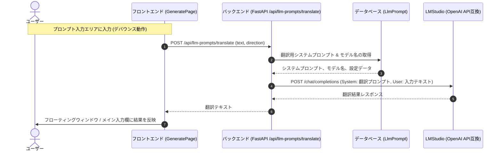

# REQ-116: 生成画面へのAnima特化モード（リアルタイム双方向翻訳付き）の追加

本設計書は、生成画面への「Anima特化モード」の追加、およびローカルLLM（LMStudio）を活用したリアルタイム双方向翻訳機能の実装について定義する。

---

## 1. システムアーキテクチャ & データフロー

モバイル端末や別端末からのフロントエンドアクセスに対応するため、フロントエンドから直接LMStudioに通信するのではなく、バックエンドのFastAPIに設置するプロキシエンドポイントを経由してLMStudio API（OpenAI互換）を呼び出す。



---

## 2. データベース & 初期データ設計 (SSoT)

`LlmPrompt` テーブルに、翻訳用のシステムプロンプト、モデル名、デバウンス間隔を保存するレコードを追加する。

### 2-1. 追加するキーとデフォルト値
1. **`translation_ja_to_en`**: 日本語から英語への翻訳用システムプロンプト
   - **デフォルト値**:
     ```text
     You are a professional prompt translator for AI image generation.
     Translate the following Japanese text into natural, descriptive English prompt.
     Output ONLY the translated English prompt. Do not output any chat dialog or explanations.
     ```
2. **`translation_en_to_ja`**: 英語から日本語への翻訳用システムプロンプト
   - **デフォルト値**:
     ```text
     あなたはAI画像生成プロンプトの専門翻訳者です。
     与えられた英語のプロンプトを、自然な日本語に翻訳してください。
     翻訳結果のみを出力し、挨拶や余計な解説は一切含めないでください。
     ```
3. **`translation_model`**: 翻訳専用のモデル名 (空の場合はメインの `llm_model` を使用)
   - **デフォルト値**: `""` (空文字)
4. **`translation_debounce`**: 翻訳処理のデバウンス間隔 (ミリ秒)
   - **デフォルト値**: `"500"`

---

## 3. バックエンド設計

### 3-1. エンドポイントの追加
`backend/app/routers/llm_prompts.py` に新規POSTエンドポイントを追加する。

```python
class TranslateRequest(BaseModel):
    text: str
    direction: str  # "ja_to_en" または "en_to_ja"

@router.post("/translate", response_model=str)
async def translate_text(payload: TranslateRequest, db: Session = Depends(get_db)):
    # 1. 翻訳方向に応じたシステムプロンプトの取得
    prompt_key = f"translation_{payload.direction}"
    prompt_record = db.query(models.LlmPrompt).filter(models.LlmPrompt.key == prompt_key).first()
    system_prompt = prompt_record.content if prompt_record else "Translate text."

    # 2. 翻訳用モデル名の取得
    model_record = db.query(models.LlmPrompt).filter(models.LlmPrompt.key == "translation_model").first()
    model = model_record.content if model_record and model_record.content else None

    # 3. LLM呼び出し
    try:
        from app.services.llm_request import call_llm
        result = await call_llm(
            system_prompt=system_prompt,
            user_prompt=payload.text,
            model=model,
            timeout=30.0  # 翻訳はインタラクティブ性を重視してタイムアウトを短めに設定
        )
        return result.strip()
    except Exception as e:
        raise HTTPException(status_code=500, detail=f"Translation failed: {str(e)}")
```

---

## 4. フロントエンド設計

### 4-1. 設定画面 (`SettingsPage.tsx`) の変更
- **LLM Model Settings** セクションに以下を追加:
  - 「翻訳用LLMモデル」セレクトボックス (LMStudioからロードしたモデル一覧を表示、空の時は「メインLLMモデルを使用」を表示)
  - 「翻訳デバウンス間隔 (ms)」スライダー/数値入力 (300ms ~ 2000ms)
- **LLM System Prompts** セクション:
  - `PROMPT_LABELS` に `translation_ja_to_en` と `translation_en_to_ja` を追加し、DB上のプロンプトを他の診断用プロンプトと同様にアコーディオン形式で編集・保存可能にする。

### 4-2. 生成画面 (`GeneratePage.tsx`) の変更
- **Anima特化モードトグル**:
  - ワークフロー選択エリアの横にトグルスイッチ「Anima特化モード」を配置。
  - ページの初回ロード時、およびワークフロー切り替え時に、そのワークフローのベースモデルが `Anima` であるかを判別し、一致する場合は自動でON、それ以外はOFFにする。
- **入力モードデフォルト制御**:
  - Anima特化モードがONの場合、プロンプト入力エリアの初期状態を「テキスト入力モード」とする。ONの状態でも、右上のトグルなどから手動で「タグチップモード」に切り替え可能。
- **フローティング翻訳ウィンドウ (UI/UX)**:
  - プロンプトエリア周辺に「翻訳」アイコンボタンを配置。
  - クリックすると、`react-draggable` または独自のマウスイベント等でドラッグ移動可能なフローティングウィンドウを表示。
  - ウィンドウ内には以下の要素を配置:
    - 日本語入力欄 (日→英翻訳時の入力元、または英→日逆翻訳時の出力先)
    - 英語出力/編集欄 (日→英翻訳時の出力先、または英→日逆翻訳時の入力元)
    - 翻訳方向表示、閉じるボタン
    - 処理中インジケータ (LLM呼び出し中スピナー)
  - 双方向リアルタイムデバウンス翻訳:
    - メインの入力欄で文字が変更されたら、デバウンス時間の経過後に自動的に `POST /api/llm-prompts/translate` を呼び出し、結果を翻訳ウィンドウの英語欄に反映。
    - 翻訳ウィンドウの英語欄でユーザーが直接テキストを編集した場合、同様にデバウンス時間経過後に逆翻訳を行い、メインの入力欄に結果を即時反映する。

---

## 5. SSoT仕様書への影響と同期

本PBIの実装完了後、以下の仕様書に仕様を追記する。
- [SPEC_SETTINGS.md](../specs/SPEC_SETTINGS.md)
  - 翻訳LLMモデル、システムプロンプト、デバウンス間隔の設定項目について追記。
- [SPEC_GENERATE.md](../specs/SPEC_GENERATE.md)
  - Anima特化モードトグル、デフォルト入力モード制御、およびフローティング翻訳ウィンドウの機能概要と操作仕様を追記。
