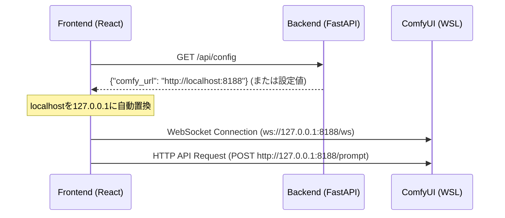

# REQ-008 WSL環境におけるComfyUI WebSocket接続および画像取得エラーの修正 設計書

## 1. 概要
WSL上のComfyUIに対して、Windows上のブラウザから本ツールを実行した際、WebSocketおよび画像取得APIの接続先ホストが `localhost:8188` に固定されているため接続に失敗する。
WSL2のlocalhostポートフォワーディングでは、Windowsブラウザから `localhost`（IPv6の `::1` 等に解決される場合がある）を指定した接続がブロックされ、明示的に `127.0.0.1`（IPv4ループバック）を指定すると正しく通信できる特性がある。
本計画では、バックエンドが環境変数から `COMFY_URL` を取得し、それをフロントエンドに提供する `/api/config` エンドポイントを実装し、フロントエンド側で動的にそのURLを取得した上で、`localhost` を `127.0.0.1` に自動置換して接続を行うようにする。

## 2. アーキテクチャ設計



## 3. 変更内容

### 3.1 Backend: `app/main.py` (実装済)
`/api/config` エンドポイントを定義し、設定値 `settings.comfy_url` を含む設定情報を返却する。
```python
@app.get("/api/config")
def get_config():
    return {
        "comfy_url": settings.comfy_url
    }
```

### 3.2 Frontend: `src/api/client.ts` (実装済)
バックエンドから設定を取得するための `configApi` クライアントを追加する。
```typescript
export const configApi = {
  get: () => request<{ comfy_url: string }>('/config'),
}
```

### 3.3 Frontend: `src/hooks/useComfyWebSocket.ts` (要修正)
- 初回マウント時に `configApi.get()` を呼び出して `comfy_url` を非同期で取得する。
- 取得した `comfy_url` 内に `localhost` が含まれている場合、自動的に `127.0.0.1` に置換する解決関数 `resolveComfyUrl` を通す。
  ```typescript
  const resolveComfyUrl = (url: string | null) => {
    if (!url) return 'http://127.0.0.1:8188'
    return url.replace('localhost', '127.0.0.1')
  }
  ```
- WebSocket接続およびHTTPリクエスト（`queuePrompt` / `cancelGeneration`）の宛先URLには、置換済みのURLを使用する。

### 3.4 Frontend: `src/pages/SettingsPage.tsx` (要修正)
- Connections status 欄で表示される ComfyUI の Ping 確認先 URL および表示用 URL についても、取得した `comfyUrl` を `127.0.0.1` に置換した状態で使用する。

## 4. 懸念点とトレードオフ (Trade-off Disclosure)
- **IPv4への強制解決**: `localhost` から `127.0.0.1` への単純な文字列置換を行うため、IPv6環境（`::1`）が強制されている極めて特殊な開発環境では接続できない可能性がある。しかし、WSL2ポートフォワーディングのバグを回避するためにはこの置換が実用上最適である。
