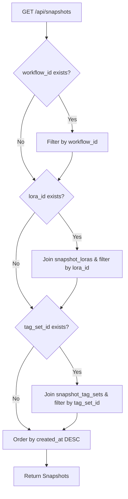

# REQ-043: LoRA・タグセット紐付け編集およびフィルタ機能 - 設計書

## 1. 概要
保存済みのスナップショットに対して、関連付けられている LoRA およびタグセットを後から追加・削除（編集）できるようにするとともに、スナップショット一覧画面において紐付いている LoRA やタグセットによるフィルタリングを可能にするための詳細設計です。

### 1-1. 現状の課題
- 現在、履歴 (History) 画面の `HistoryModalPreview` ではスナップショットに紐付いたアセット情報が表示されるが、これは読み取り専用であり、後から変更できない。
- スナップショット一覧 (History 画面) において、特定の LoRA やタグセットが適用されたスナップショットのみを絞り込む機能が存在しない。

### 1-2. 解決アプローチ
- **Backend APIの追加と拡張**:
  - `PATCH /api/snapshots/{snapshot_id}` を追加し、`lora_ids` (ID配列) と `tag_set_ids` (ID配列) を受け取り、スナップショットのリレーションを上書き更新可能にする。
  - `GET /api/snapshots` を拡張し、クエリパラメータ `lora_id` と `tag_set_id` によるフィルタリングに対応する。
- **Frontend リレーション編集UIの追加**:
  - `HistoryModalPreview` のメタデータパネルに「紐付け編集」ボタンおよび編集用インラインUIを追加する。
  - 編集画面では、チェックボックスやドロップダウンを用いて登録済みの LoRA・タグセットを選択可能にする。
  - 保存時に `PATCH /api/snapshots/{snapshot_id}` を実行して状態を更新する。
- **Frontend フィルタリングUIの追加**:
  - `HistoryPage.tsx` のワークフローフィルタセレクトボックスの隣に、LoRA用フィルタセレクトボックスおよびタグセット用フィルタセレクトボックスを設置する。
  - 選択時、API クエリパラメータを追加してスナップショット一覧を再フェッチする。

---

## 2. 影響コンポーネント・ファイル一覧

### Backend
- [`backend/app/schemas/snapshot.py`](../../backend/app/schemas/snapshot.py)
  - `SnapshotUpdate` スキーマを定義。
- [`backend/app/schemas/__init__.py`](../../backend/app/schemas/__init__.py)
  - `SnapshotUpdate` を re-export。
- [`backend/app/routers/snapshots.py`](../../backend/app/routers/snapshots.py)
  - `PATCH /api/snapshots/{snapshot_id}` エンドポイントを追加。
  - `GET /api/snapshots` エンドポイントに `lora_id`, `tag_set_id` パラメータを追加し、SQLAlchemy クエリでテーブル結合・絞り込みを行う。

### Frontend
- [`frontend/src/api/client.ts`](../../frontend/src/api/client.ts)
  - `snapshotsApi.patch(id, data)` を追加。
  - `snapshotsApi.list(workflow_id, lora_id, tag_set_id)` に引数を拡張。
- [`frontend/src/pages/HistoryPage.tsx`](../../frontend/src/pages/HistoryPage.tsx)
  - `selectedLoraId`, `selectedTagSetId` のフィルタ状態を追加。
  - フィルタUI (LoRA / タグセットのセレクトボックス) を配置。
  - クエリキーに `selectedLoraId`, `selectedTagSetId` を追加してリアクティブにフェッチ。
- [`frontend/src/components/HistoryModalPreview.tsx`](../../frontend/src/components/HistoryModalPreview.tsx)
  - 編集モードの状態トグルを追加。
  - 編集用UI（セレクトボックス / マルチセレクトなど）を実装し、保存時に更新 API を呼び出す。

---

## 3. 詳細データ構造とシーケンス

### 3-1. フィルタ処理フロー (GET /api/snapshots)

### 3-2. リレーション更新処理 (PATCH /api/snapshots/{id})
- 受信した `lora_ids` 配列に基づいて、既存の `SnapshotLora` リレーションを安全に更新（不要なリレーションを削除、新規リレーションを追加。強度は 1.0 デフォルト）。
- 受信した `tag_set_ids` 配列に基づいて、既存 `SnapshotTagSet` リレーションを更新。

---

## 4. 設計上のトレードオフとリスク (Trade-off Disclosure)
- **強度 (strength) の編集**: 今回の要件では強度は 1.0 固定 (または既存値維持) として紐付け編集を行います。個別強度の編集はスコープ外とします。
- **複数リレーション追加時のユニーク制約**: 重複する ID を指定された場合はバリデーションで弾くか、バックエンド側で重複排除を行います。
