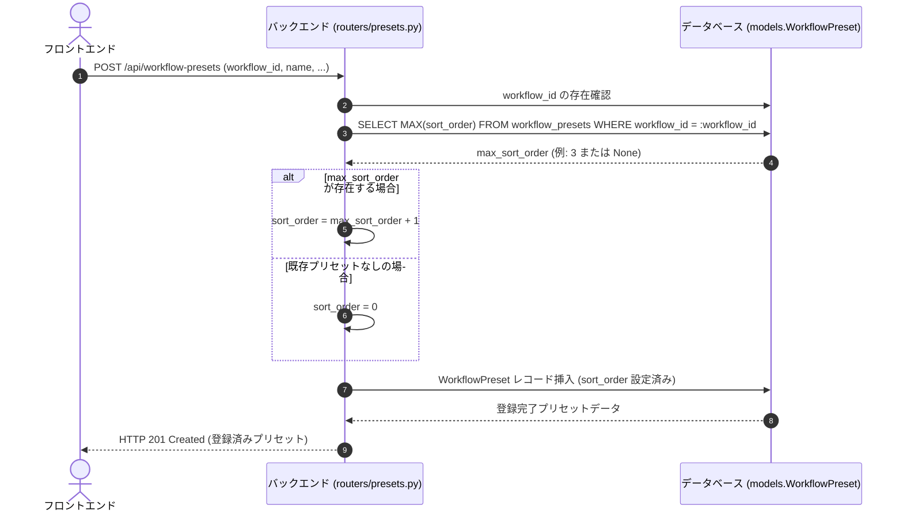

# REQ-147: ワークフロープリセット新規作成時の並び順（sort_order）末尾自動設定

本設計書は、ワークフロープリセット新規作成時において `sort_order` が明示指定されていない場合に、該当 `workflow_id` の既存プリセットにおける最大 `sort_order` + 1 を自動割り当てし、常にリストの末尾に追加されるようにする修正仕様を定義する。

---

## 1. 概要と背景

現行の実装では、新規プリセットを作成する際 (`POST /api/workflow-presets`)、スキーマデフォルト値である `sort_order = 0` が設定される。
ドラッグ＆ドロップ等のリオーダー操作を行った後では、1番目のプリセットが `sort_order = 0`、2番目が `sort_order = 1` ... とDBに登録されているため、新規追加されたプリセットが `sort_order = 0` で保存されると、SQLiteの昇順ソート (`ORDER BY sort_order ASC`) においてタイブレーク (ID昇順) により、必ず先頭から2番目に配置されてしまう課題があった。

本改修により、新規追加時は自動的に既存の最大 `sort_order` + 1（既存なしの場合は `0`）が割り当てられ、常にリストの末尾に新規プリセットが追加されるように改善する。

---

## 2. バックエンド詳細設計

### 2-1. 対象ファイル
- `backend/app/routers/presets.py`

### 2-2. 処理フロー

### 2-3. 実装詳細仕様

1. **`create_preset` エンドポイント (`POST /api/workflow-presets`)**:
   - `payload.sort_order` が `0` (デフォルト値) または未指定の場合、`sqlalchemy.func.max(models.WorkflowPreset.sort_order)` を用いて該当 `workflow_id` 内の既存最大 `sort_order` を取得する。
   - 既存プリセットが存在する場合は `max_sort + 1`、存在しない場合は `0` を設定する。
2. **`list_presets` エンドポイント (`GET /api/workflow-presets`)**:
   - ソート順を `order_by(models.WorkflowPreset.sort_order.asc(), models.WorkflowPreset.id.asc())` とし、同値タイブレークを明示化する。

---

## 3. SSoT仕様書への影響と同期

- 本改修は内部ロジックおよびソート順改善であり、既存APIのインターフェース変更や破壊的変更は発生しない。
- 必要に応じて `docs/backlog/pbi/active/REQ-147.md` に結果を同期する。
