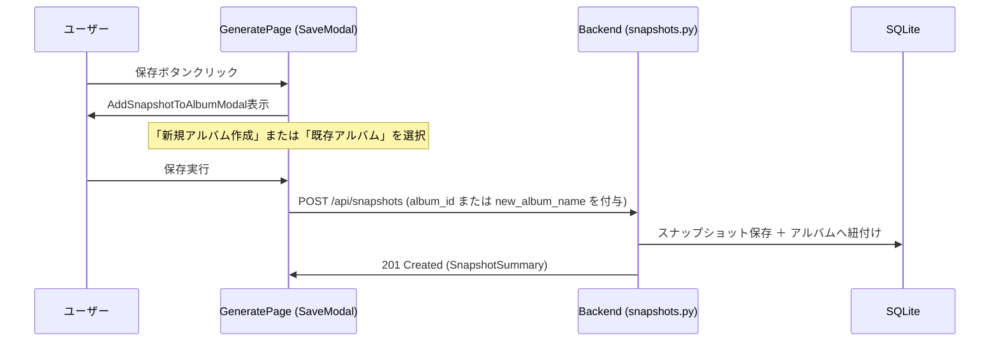
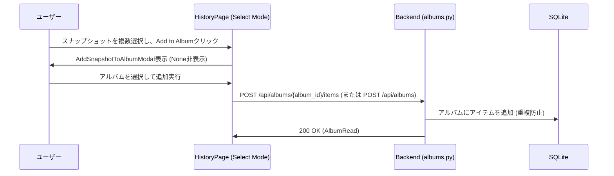

# REQ-044: アルバム追加機能の改善（既存アルバムへの追加・検索）

## 1. 概要
スナップショット一覧や履歴画面において、既存のアルバムを選択して追加する機能が不足していた。
本機能拡張により、新規アルバムの作成と、既存のアルバム（インクリメンタル検索による絞り込みが可能）への追加を同一のシームレスなUI（共通モーダル）で実現する。

## 2. アーキテクチャと設計方針

### 2.1 バックエンドAPIの拡張
既存のアルバムに複数のスナップショットを追加するAPIエンドポイントを `albums` ルーターに追加する。
- **エンドポイント**: `POST /api/albums/{album_id}/items`
- **リクエストボディ**:
  ```json
  {
    "snapshot_ids": [1, 2, 3]
  }
  ```
- **処理内容**:
  1. `album_id` で指定されたアルバムが存在するか確認（存在しない場合は 404 エラー）。
  2. 現在のアルバム内の `sequence_order` の最大値を取得。
  3. リクエストされた `snapshot_ids` のうち、まだアルバムに登録されていないスナップショットを順に末尾に追記。
  4. 追加後のアルバム詳細を返す。

### 2.2 フロントエンドの共通コンポーネント (`AddSnapshotToAlbumModal`)
新規アルバム作成と既存アルバム選択を統合したモーダル。
- **インクリメンタル検索**:
  ドロップダウン内のテキスト入力欄に入力された文字列で、既存アルバムの一覧をリアルタイムにフィルタリングする。
- **選択肢構成**:
  - 最上部: `+ 新規アルバム作成 (Create New Album)`
  - その他: 既存アルバム（名前でソート）
- **表示切替制御**:
  - 「新規アルバム作成」選択時のみ、新規アルバム名のテキスト入力欄を表示・活性化する。
  - 既存アルバム選択時は、新規アルバム名の入力欄を表示しない。

## 3. データフロー

### スナップショット保存時 (GeneratePage)


### 履歴からの追加時 (HistoryPage)

