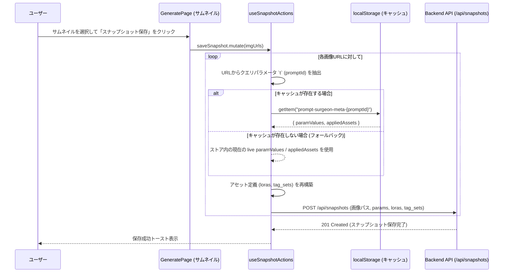

# REQ-073: LoRA・タグセット適用時のスナップショット保存メタデータ不整合問題 - 設計書

## 1. 概要
画像生成時に適用されていたアセット（LoRA・タグセット）およびパラメータが、スナップショットとして保存する際にズレてしまう問題を解決するための詳細設計です。

### 1-1. 現状の課題
- `saveSnapshot` (in `useSnapshotActions.ts`) は、保存対象の画像を選択した時点で、Zustand ストアに存在する現在の最新状態（`appliedAssets`, `paramValues`）を使用して API リクエストを構築している。
- 複数のプロファイルを切り替えた一括生成（Multi-Set 生成）の最中や生成完了後、UI 上の選択プロファイルが変更されると、過去に生成された画像のサムネイルを保存する際に現在のアクティブなプロファイルのアセットが適用されてしまい、スナップショットのアセット情報と実際の生成画像のズレが発生する。

### 1-2. 解決アプローチ
- **メタデータのローカルキャッシュ**:
  画像生成キュー送信時（`queuePrompt`）に、その生成ジョブの `prompt_id` に関連付けて、送信時点の `paramValues` および `appliedAssets` を `localStorage` に保存する。
- **画像URLと `prompt_id` の紐付け**:
  websocket から `executed` イベントを受け取って生成画像を状態に追加する際、画像URLのクエリパラメータ `t` に `Date.now()` ではなく、該当ジョブの `prompt_id` を付与する（履歴読み込み時はすでに `prompt_id` になっている）。
- **スナップショット保存時のメタデータ復元**:
  `saveSnapshot` 処理で、保存対象の画像URLからクエリパラメータ `t` (即ち `prompt_id`) を抽出し、`localStorage` のキャッシュからその `promptId` に対応する `paramValues` と `appliedAssets` を復元して保存用の API リクエストを組み立てる。キャッシュが見つからない場合は、下位互換性維持のため、現在 UI でアクティブな状態をフォールバックとして使用する。

---

## 2. 影響コンポーネント・ファイル一覧

### Frontend
- [`frontend/src/store/useGenerationStore.ts`](../../frontend/src/store/useGenerationStore.ts)
  - `queuePrompt` メソッドの引数拡張：オプションで `{ paramValues, appliedAssets }` を受け取るようにし、`localStorage` に `prompt-surgeon-meta-{promptId}` として保存する。
  - websocket 受信（`executed` ケース）時の画像URL生成部：`t=${Date.now()}` を `t=${promptId}` に変更。
  - キャッシュ自動クリーンアップ：`queuePrompt` 実行時に、キャッシュ数が200件を超えた場合は古い順から削除するプルーニング処理を追加。
- [`frontend/src/pages/GeneratePage/hooks/useGenerateAction.ts`](../../frontend/src/pages/GeneratePage/hooks/useGenerateAction.ts)
  - `handleGenerate` および `handleGenerateSets` において、`queuePrompt` 呼び出し時にその時点の `paramValues` 和 `appliedAssets` を引数として渡すよう修正。
- [`frontend/src/pages/GeneratePage/hooks/useSnapshotActions.ts`](../../frontend/src/pages/GeneratePage/hooks/useSnapshotActions.ts)
  - `saveSnapshot` ミューテーションにおいて、各画像URLから `promptId`（パラメータ `t`）をパースし、対応する `localStorage` キャッシュが存在すればそれを最優先で使用して API リクエストを生成する。

---

## 3. 詳細データ構造とシーケンス

### 3-1. キャッシュデータ構造
- キー: `prompt-surgeon-meta-{promptId}`
- 値 (JSON):
```json
{
  "paramValues": {
    "positive_prompt": "..., <lora:some_lora:1.0>",
    "negative_prompt": "..."
  },
  "appliedAssets": {
    "positive_prompt": [
      {
        "id": "lora-1-123",
        "type": "lora",
        "assetId": 1,
        "name": "some_lora",
        "enabled": true,
        "tags": ["trigger_word"],
        "loraPromptString": "<lora:some_lora:1.0>"
      }
    ]
  },
  "timestamp": 1718223940123
}
```

### 3-2. メタデータ復元シーケンス


---

## 4. 設計上のトレードオフとリスク (Trade-off Disclosure)
- **localStorage 容量制限**: タイムスタンプ管理による自動クリーンアップ（最大200件）を導入するため、容量圧迫のリスクは極めて低いです（1件あたり1KB未満のため、200件でも最大200KB）。
- **プライベートモード/キャッシュクリア**: ブラウザのキャッシュクリアやプライベートウインドウでの操作により `localStorage` がクリアされた場合、画像生成時のメタデータが失われます。この場合は、従来通り「現在の UI 状態」がフォールバックされるため、スナップショット保存自体がエラーになることはなく、堅牢性を担保しています。
