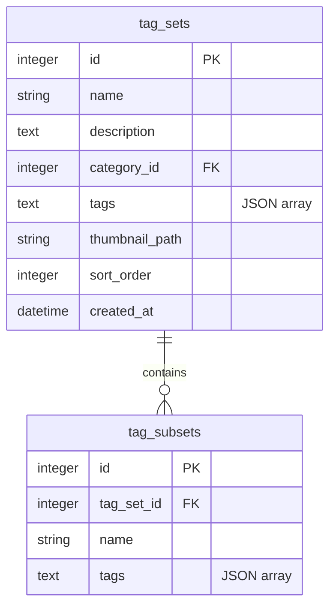

# REQ-087: LoRA・タグセット管理UIの高度化と詳細・編集モーダルの統合 - 設計仕様書

## 1. 変更の背景と目的
現在の Prompt Surgeon では、以下の使い勝手に関する課題が存在します：
- パラメータ設定時の LoRA 選択肢がファイルパス形式のままであり、視認性が低い。
- タグセットにバリエーション（サブセット。例：「教室」の中に「ベース」「夕方」「放課後」など）を持たせることができず、別々のタグセットとして管理する必要がある。
- カバーサムネイルアップロード時に、切り抜き（クロップ）やスケール調整ができず、想定外の範囲が表示されてしまう。
- 詳細確認モーダルと編集モーダルが分離しており、画面遷移の摩擦が生じている。
- 詳細モーダル内に関連スナップショット画像が大量に並んだ際、メインプレビューごとスクロールしてしまい確認が困難になる。

本設計では、これら5つの課題を解決し、より洗練されたユーザー体験（UX）とデータ構造の拡張を提供します。

---

## 2. システム設計・データ構造の拡張

### 2-1. データベース定義の拡張（バックエンド）
タグセットのサブセット（バリエーション）を表現するため、新規テーブル `tag_subsets` を追加し、`tag_sets` テーブルと 1:N の関係を持たせます。



#### SQLAlchemy モデル定義 (`backend/app/models.py`)
```python
class TagSubset(Base):
    __tablename__ = "tag_subsets"

    id: Mapped[int] = mapped_column(Integer, primary_key=True, autoincrement=True)
    tag_set_id: Mapped[int] = mapped_column(ForeignKey("tag_sets.id", ondelete="CASCADE"), nullable=False)
    name: Mapped[str] = mapped_column(String, nullable=False)
    tags: Mapped[str] = mapped_column(Text, nullable=False)  # JSON array of strings

    tag_set: Mapped["TagSet"] = relationship(back_populates="subsets")

# TagSet クラスに以下を追加
class TagSet(Base):
    # ... 既存定義 ...
    subsets: Mapped[list["TagSubset"]] = relationship(
        back_populates="tag_set", cascade="all, delete-orphan"
    )
```

### 2-2. API スキーマの更新（Pydantic & TypeScript）
- **バックエンドスキーマ (`backend/app/schemas/tag_set.py`)**:
  - `TagSubsetCreate`, `TagSubsetRead` スキーマを追加。
  - `TagSetCreate` に `subsets: list[TagSubsetCreate] = []` を追加。
  - `TagSetRead` に `subsets: list[TagSubsetRead] = []` を追加。
- **フロントエンド型定義 (`frontend/src/api/types.ts`)**:
  - `TagSubset`, `TagSet`, `TagSetCreate` インターフェースの更新。

---

## 3. 各機能の詳細実装設計

### 3-1. AC-1: 選択肢/フィルタでの LoRA description 表示とパス表記フォールバック
- **実装箇所**:
  1. `frontend/src/pages/GeneratePage/components/ParamPanel.tsx` (m.input_type === 'select' 時)
  2. `frontend/src/pages/HistoryPage.tsx` (history-lora-filter)
  3. `frontend/src/components/LoraStackEditor.tsx` (すでに実装済みだが、不整合がないか再確認)
- **表示ロジック**:
  - 管理登録済みの LoRA（ID が一致するもの）が存在し、かつ `description` が入力されている場合は `description` を表示。
  - それ以外（未登録、または `description` が空）の場合は、ファイルパス（例：`/path/to/lora.safetensors`）の末尾から拡張子を取り除いた表示にするか、あるいはフルパスのままフォールバック表示する。

### 3-2. AC-2: タグセットのサブセット（バリエーション）管理と適用
- **実装箇所**:
  - タグセット編集UI（`TagsPage.tsx` 内の `TagSetEditor` 相当部分）：サブセット一覧を表示し、追加・編集・削除ができるセクションを新設。
  - Generate ページでの適用UI：
    - タグセットを適用する際、サブセットが登録されている場合は、ドロップダウンやポップオーバー等のUIで「どのサブセットを適用するか」を選択可能にする。
    - 選択されたサブセットのタグを対象のプロンプト領域に展開する。

### 3-3. AC-3: サムネイルクロップ＆スケール調整機能の導入
- クロップ機能の拡張性とモバイル・ピンチズーム対応のため、外部ライブラリ `react-easy-crop` を導入します。
- **UI コンポーネントの挙動 (`ImageCropper.tsx`)**:
  1. `react-easy-crop` の `Cropper` コンポーネントを使用し、アスペクト比 1:1 または自由比率でクロップ領域を提供。
  2. スライダーによる拡大縮小（Zoom）をバインド。
  3. クロップ完了（確定）イベント時、`react-easy-crop` のクロップピクセル（x, y, width, height）パラメータを元に、フロントエンドの Canvas を使って画像を切り抜き、`canvas.toBlob()` を経由して Blob を生成。
  4. 生成した Blob を `File` オブジェクト化して既存のアップロードAPIに送信する。

### 3-4. AC-4: 詳細モーダルと編集モーダルの統合（インプレース編集）およびレイアウト改善
- **対象**:
  - `LoRAsPage.tsx` の詳細/編集モーダル
  - `TagsPage.tsx` の詳細/編集モーダル
- **挙動**:
  - モーダルを開いた初期状態は「詳細表示モード」（閲覧に特化したスッキリしたレイアウト）。
  - 右下または右上に「Edit (編集)」ボタンを配置。ボタンクリックによりモーダル内で「編集モード」へ切り替わる。
- **レイアウト改善 (プレビューの固定化)**:
  - モーダルの全体領域を `h-[75vh]` 等の固定高さにする。
  - 左カラム（プレビュー画像表示側）を `flex flex-col h-full` とし、上部のメインプレビューは固定、下部の「関連スナップショット画像一覧」にのみ `overflow-y-auto flex-1` を設定。
  - これにより、スナップショット画像が大量に並んでもプレビューが隠れず、一覧だけがスクロールする。
  - 右カラム（メタデータ側）も独立して `overflow-y-auto h-full` とし、別個にスクロールするようにする。
