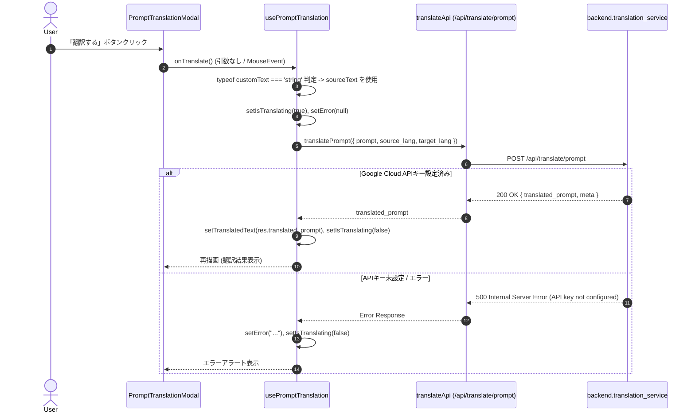

# REQ-179: プロンプト翻訳実行時のTypeError解消および非公式Google無料翻訳の廃止・正規API化 詳細設計書

## 1. 概要 (Overview)
プロンプト翻訳機能において、「翻訳する」ボタンをクリックした際にイベントオブジェクト（MouseEvent）の誤代入による `TypeError: textToTranslate.trim is not a function` が発生し、処理が即時中断する不具合を解消する。
また、Google利用規約に反する非公式Webエンドポイント（`translate_google_free`）を完全廃止・削除し、Google Cloud Translation API（`google_cloud`）をデフォルトのプロバイダに変更する。特定のプロバイダに対する「推奨」表記は排除し、フラットに選択できるようにする。

## 2. 変更対象コンポーネント・ファイル

### Frontend
1. `frontend/src/api/types.ts`
   - `TranslateTestRequest.provider` 型定義から `'google_free'` を削除し `'google_cloud' | 'deepl' | 'llm'` に更新。
2. `frontend/src/pages/GeneratePage/hooks/usePromptTranslation.ts`
   - `executeTranslate` の引数型チェック：`typeof customText === 'string' ? customText : sourceText` に修正。
   - `try-catch` 範囲の最適化とエラー状態（`error` state）の適切な設定。
3. `frontend/src/pages/GeneratePage/components/PromptTranslationModal.tsx`
   - `onClick` コールバックの安全な呼び出し `onClick={() => onTranslate()}`。
   - メタ情報のフォールバックプロバイダ表示を `meta.provider || 'google_cloud'` に変更。
4. `frontend/src/pages/SettingsPage/components/TranslationSettingsSection.tsx`
   - `google_free` オプション（ラジオボタン）を完全削除。
   - デフォルト選択肢を `google_cloud` に変更。
   - 各プロバイダの「推奨」バッジを削除し、フラットなUIに変更。
   - DB値が旧 `google_free` の場合は `google_cloud` にフォールバック。
5. `frontend/src/pages/GeneratePage/hooks/__tests__/usePromptTranslation.test.ts`
   - クリックイベントオブジェクト（`{ preventDefault: fn }` や MouseEvent）が渡された場合のテストケース追加。
   - エラー発生時の `error` state 設定テスト追加。
   - モックプロバイダを `google_cloud` に更新。
6. `frontend/src/pages/__tests__/SettingsPage.test.tsx`
   - モックプロバイダを `google_cloud` に更新。

### Backend
1. `backend/app/services/translation_service.py`
   - `translate_google_free` 関数を完全削除。
   - `get_translation_settings` のデフォルトプロバイダを `"google_cloud"` に変更（DB値が `google_free` の場合も `"google_cloud"` に正規化）。
   - `translate_prompt`:
     - サポートプロバイダを `"google_cloud"`, `"deepl"`, `"llm"` の3種に整理。
     - `"google_cloud"` 選択時に API キーが未設定の場合は `ValueError("Google Cloud Translation API key is not configured. Please set the API key in Settings.")` を送出。
     - `"deepl"` 選択時に API キーが未設定の場合は `ValueError("DeepL API key is not configured. Please set the API key in Settings.")` を送出。
2. `backend/app/routers/translate.py`
   - `TranslateTestRequest.provider` を `Literal["google_cloud", "deepl", "llm"]` に更新。
3. `backend/tests/test_translation_proxy.py`
   - 旧 `google_free` のテストを削除/更新し、`google_cloud`（モック）、`deepl`、`llm` のテストを網羅。

## 3. シーケンス・データフロー

## 4. 影響範囲・非機能要件
- 規約違反リスクのある非公式エンドポイントの完全排除。
- Vitest / Pytest の単体テスト全件パス。
