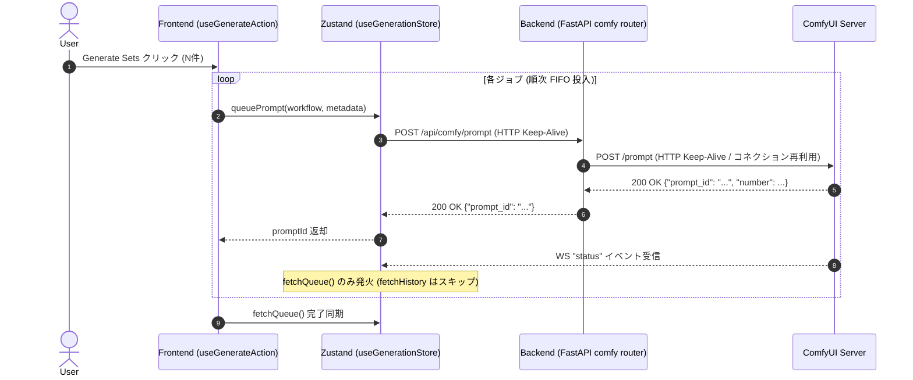

# 設計書: REQ-181 バッチ・複数プリセット生成時のキュー投入高速化と通信オーバーヘッド削減

## 1. 概要 (Overview)
複数プリセットやバッチ数を指定して生成を実行した際、ComfyUIへのキュー投入完了までに時間がかかる問題を解消するため、以下の最適化を実施する。

1. **フロントエンド**: WebSocket `status` メッセージ受信ハンドラにおける無駄な `fetchHistory(100)` 呼び出しを削除し、`fetchQueue()` のみに絞る。画像生成完了時（`executed` / `execution_complete`）の履歴更新は維持する。
2. **バックエンド**: FastAPI アプリケーションにおいて、`httpx.AsyncClient` をシングルトン（Keep-Alive接続プール）として管理し、ComfyUI への HTTP 通信における TCP 接続再利用を実現する。また lifespan ハンドラでクリーンアップを行う。

---

## 2. 変更対象コンポーネントと設計詳細

### 2.1 フロントエンド (`frontend/src/store/useGenerationStore.ts`)
- **変更箇所**: WebSocket `onmessage` ハンドラ内の `case 'status':`
- **設計**:
  ```typescript
  case 'status':
    get().fetchQueue()
    // get().fetchHistory() を削除
    break
  ```
- **理由**:
  - `status` はキュー残数やComfyUI内部ステータス更新の通知であり、新規投入時にも毎ジョブ送信される。
  - ジョブ投入時点では未実行であるため履歴は増えておらず、100件の履歴全件フェッチとJSONパースは完全に不要。
  - 実際の生成完了（`executed` / `execution_complete`）時にはそれぞれ `fetchHistory` が既にバインドされているため、履歴反映が損なわれることはない。

### 2.2 バックエンド (`backend/app/routers/comfy.py`, `backend/app/main.py`)
- **変更箇所**:
  1. `backend/app/routers/comfy.py`:
     - 共有の `httpx.AsyncClient` インスタンスを取得する `get_comfy_client() -> httpx.AsyncClient` 関数を追加。
     - アプリ終了時に接続プールを閉じる `close_comfy_client()` 関数を追加。
     - 各エンドポイント（`get_comfy_object_info`, `get_comfy_object_info_all`, `queue_prompt`, `get_queue`, `manage_queue`, `interrupt_execution`, `get_history`, `get_prompt_history`, `manage_history`）内の `async with httpx.AsyncClient() as client:` を `client = get_comfy_client()` に置換。
  2. `backend/app/main.py`:
     - `lifespan(app: FastAPI)` の終了処理（`yield` の後）で `await comfy.close_comfy_client()` を呼び出し、安全にリソースを解放。

---

## 3. シーケンス図



---

## 4. トレードオフ・リスク開示 (Trade-offs & Constraints)
- **Trade-off**: 外部（ComfyUI WebUI等）で別セッションが画像を生成・完了した際、`status` イベント単体では本クライアントの履歴一覧（`comfyHistoryImages`）が即時フェッチされない。
  - **評価**: 本アプリで生成した画像は `executed` / `execution_complete` で確実に取得される。また、自セッション以外の履歴同期が必要な場合も、定期ポーリングやページ読み込み時、または自セッション生成完了時に最新化されるため実用上の問題はない。
