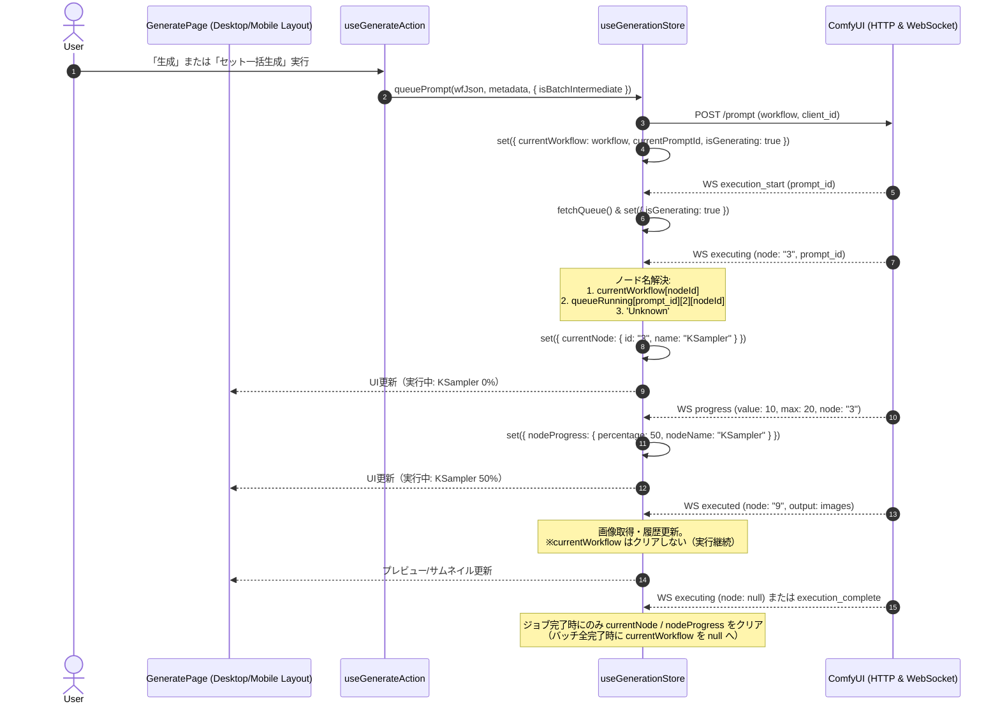

# 設計書: REQ-189 画像生成中プログレスバーの実行中ノード名Unknown表示の解消とキュー情報フォールバック対応

## 1. 概要 (Overview)
画像生成進行中にプログレスバーへ表示されるノード名が `Unknown` と表示される不具合（セット一括生成時、単体/バッチ生成の画像出力後、他セッション実行時・画面リロード後）を解消する。
フロントエンド状態管理（`useGenerationStore`）におけるワークフロー定義の保存ライフサイクルを適正化し、ローカル状態にワークフローが存在しない場合でも ComfyUI キュー情報（`queueRunning` 内の `prompt_json`）からノード名を自動解決するフォールバック機構を導入する。

---

## 2. アーキテクチャとデータフロー (Architecture & Data Flow)



---

## 3. 詳細変更仕様 (Detailed Specifications)

### 3.1 ノード名解決ヘルパー関数の導入 (`resolveNodeTitle`)
ワークフロー JSON（ComfyUI Prompt API形式の `{ [nodeId]: { class_type, _meta: { title } } }`）からノードの表示名を抽出するヘルパー関数を定義する。

```typescript
export function resolveNodeTitle(
  workflow: Record<string, any> | null | undefined,
  nodeId: string | null | undefined
): string | null {
  if (!workflow || !nodeId) return null
  const nodeInfo = workflow[nodeId]
  if (!nodeInfo) return null
  return nodeInfo._meta?.title || nodeInfo.class_type || null
}
```

### 3.2 `queuePrompt` における `currentWorkflow` の保存
- `options?.isBatchIntermediate` が `true` の場合であっても、現在実行対象のワークフロー構造 `workflow` を `currentWorkflow` に保持する。
- これにより、セット一括生成（`handleGenerateSets`）の実行中も `currentWorkflow` が維持され、各ノードの実行時にノード名が取得可能となる。

### 3.3 WebSocket イベント処理の改修 (`useGenerationStore.ts`)
1. **`case 'executing'` / `case 'progress'`**:
   - `nodeId` が指定されている場合、以下の**優先順位**でノード名を解決する:
     1. **主 (Primary)**: `get().queueRunning` から該当 `prompt_id`（または `queueRunning[0]`）の `prompt_json`（インデックス 2）を探索し、`resolveNodeTitle(queueWf, nodeId)` を試行。
     2. **副 (Fallback)**: キュー情報から取得できない場合（API取得前のミリ秒ラグ等）、ローカルの `get().currentWorkflow` から `resolveNodeTitle(currentWorkflow, nodeId)` を試行。
     3. **同期 (Cache Sync)**: キューからワークフローが取得できた場合は `currentWorkflow` にも同期格納し、同一プロンプト内の高速な進捗更新（`progress`）で再利用。
     4. 解決された名称（両方で見つからない場合のみ `'Unknown'`）を `currentNode.name` および `nodeProgress.nodeName` に設定。
   - `nodeId === null` の場合:
     - 1ジョブのノード実行完了として `currentNode: null, nodeProgress: null` のみを設定（`currentWorkflow` はバッチ完了まで保持）。
3. **`case 'executed'`**:
   - 画像出力ノード完了イベントでは `currentWorkflow` を `null` にクリアしない（`currentWorkflow: state.currentWorkflow` を維持）。
4. **`case 'execution_complete'` / `case 'execution_error'`**:
   - バッチ内に未完了ジョブが残っていない場合（`!isStillGenerating`）にのみ `currentWorkflow: null` を設定。
5. **`fetchQueue`**:
   - `queueRunning` が更新された際、もし `currentWorkflow` が `null` であれば `running[0][2]` を `currentWorkflow` として補完。
   - また、現在 `currentNode` が存在しその名称が `'Unknown'` である場合は、取得した `queueRunning` を用いて即座にノード名を再解決・更新する。

---

## 4. 影響範囲 (Scope & Impact)

| 対象 | ファイル | 変更内容 |
|---|---|---|
| Frontend Store | `frontend/src/store/useGenerationStore.ts` | `resolveNodeTitle` 追加、`queuePrompt` での `currentWorkflow` 保存、WSハンドラ（`executing`, `progress`, `executed`, `execution_complete`）の修正、`fetchQueue` でのノード名再解決 |
| Frontend Test | `frontend/src/store/__tests/useGenerationStore.test.ts` | セット生成・他セッションフォールバック・`executed` 後のノード名維持を検証するテスト追加/更新 |

---

## 5. リスクとトレードオフ (Trade-offs & Risks)

- **Trade-off: `queueRunning` の取得タイミングと表示の即時性**:
  他セッション生成時、WebSocketの `executing` が最初の `fetchQueue` レスポンスより数ミリ秒早く到達する場合がある。この場合、一瞬 `Unknown` または初期状態となるが、直後の `fetchQueue` 完了フックにより即座に正式なノード名へと補正されるため、実用上の問題はない。
- **Memory: `currentWorkflow` の保持**:
  ワークフローJSONは通常数十KB程度であり、バッチ完了時に適正にクリアされるためメモリリーク等の懸念はない。
