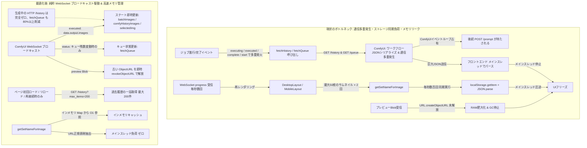

# REQ-195: 生成キュー投入および生成進行時のUI応答性・パフォーマンス改善 詳細設計書

## 1. 概要 (Overview)

ComfyUIへの生成キュー投入時および生成進行中において、生成回数の増加に伴って発生する「キュー投入遅延（`/prompt` 待機）」および「UIフリーズ（メインスレッド停止による操作不能）」を解消する。

ComfyUIのWebSocketブロードキャスト機能を最大限に活用し、**「生成中・完了時のHTTP `/history` 取得の完全撤廃（ゼロHTTPオーバーヘッド化）」**、**「重複 `fetchQueue` の削除と `status` イベントへの集約」**、**「プレビュー画像Blobのメモリリーク解消」**、**「単発バッチ生成時の `skipQueueFetch` 適用」**、**「初期化・リロード時のみ過去200件の履歴取得」**、および**「描画ループ内の同期ストレージアクセスの完全インメモリキャッシュ化」**を行う。

---

## 2. アーキテクチャと改善方針 (Architecture & Optimization Strategy)

### 2.1 現状のボトルネック vs 最適化後アーキテクチャ



---

## 3. 詳細実装仕様 (Implementation Details)

### 3.1 `frontend/src/store/useGenerationStore.ts`

#### 1) WebSocket ブロードキャスト駆動への完全移行（`fetchHistory` 撤廃）
- ComfyUI は生成完了時に `executed` イベントで `data.output.images`（ファイル名・サブフォルダ・タイプ）を接続中の全クライアントへブロードキャストする。
- 既存の `case 'executed'` で `newUrls` を生成して `batchImages` および `comfyHistoryImages` に直接 prepend しているため、**追加の `fetchHistory()` HTTPリクエストは完全に不要**。
- 以下のイベントハンドラから `fetchHistory()` の呼び出しを完全に削除する：
  - `case 'executing'` (nodeId === null) の `get().fetchHistory()` を削除。
  - `case 'executed'` の `setTimeout(() => get().fetchHistory(), 500)` を削除。
  - `case 'execution_complete'` の `setTimeout(() => get().fetchHistory(), 500)` を削除。

#### 2) 重複 `fetchQueue` の削除と `status` イベントへの集約
- ComfyUI はキュー残数や状態が変化した際に WebSocket で `status` メッセージ（`exec_info.queue_remaining`）を自動送信する。
- `execution_start`, `executing` (nodeId === null), `executed`, `execution_complete`, `execution_error` で個別に乱発されていた `get().fetchQueue()` を削除。
- `case 'status'`（およびキュー操作・キャンセル時・再接続時）のみで `fetchQueue` を実行し、不要な HTTP `GET /queue` を 80% 以上削減する。

#### 3) プレビュー画像の Blob ObjectURL メモリ解放 (`URL.revokeObjectURL`)
- 新しいプレビュー画像（Blob）を受信した際、既存の `state.previewImage` が `blob:` URL であれば `URL.revokeObjectURL(state.previewImage)` を呼び出してメモリを即時解放する。
- `clearPreview` や画像選択時にも古いプレビューURLを適切に解放する。

#### 4) `fetchHistory` の実行契機を初期化・再接続時のみに限定（上限200件）
- `fetchHistory` の呼び出し箇所を以下のみに限定：
  - アプリ起動時（`reconcileState`）
  - WebSocket 再接続時（`initConnection`）
- 取得件数はリロード時の過去履歴網羅性を担保するため `comfyApi.getHistory(200)` とし、`comfyHistoryImages` / `batchImages` の上限も最大 200 件に保持。

### 3.2 `frontend/src/pages/GeneratePage/hooks/useGenerateAction.ts`

- **単発生成（`handleGenerate`）のキュー同期適正化**:
  - ループ内の `queuePrompt` 呼び出しに `{ skipQueueFetch: true }` を渡し、ループ完了後に末尾で1度だけ `await fetchQueue?.()` を実行するように変更（`handleGenerateSets` と同一の最適化）。
- **`mappings` のインメモリキャッシュ化**:
  - `promptToSetMapCache.setMapping` および `promptToSetMapCache.saveToStorage` を使用。

### 3.3 `frontend/src/utils/promptToSetMapCache.ts` (NEW) & `useGeneratePageState.ts`

#### 1) `prompt-to-set-map` のインメモリキャッシュ化
- メモリ上に `promptToSetMapCache: Map<string, string>`（またはオブジェクト）を保持。
- 初回アクセス時に `localStorage.getItem('prompt-surgeon-prompt-to-set-map')` から一括ロード。
- 新規マッピング登録時:
  - インメモリキャッシュに `set(promptId, setName)`。
  - `localStorage` 保存時は最大 200 件にトリムして保存。
- 参照時（`getSetNameForImage`）:
  - `localStorage` を一切読まず、インメモリキャッシュから `get(promptId)` で $O(1)$ 引き当て。

#### 2) `getSetNameForImage` の URL 解析高速化
```typescript
export function getSetNameForImage(imgUrl: string): string | null {
  if (!imgUrl) return null;
  const match = imgUrl.match(/[?&]t=([^&#]+)/);
  if (match && match[1]) {
    return promptToSetMapCache.getSetName(decodeURIComponent(match[1]));
  }
  return null;
}
```

### 3.4 `backend/app/routers/comfy.py`

- `get_history` のデフォルト `max_items` を `200`（クエリパラメータで指定された場合はそれに従う）に設定。

---

## 4. 影響ファイル一覧 (Affected Files)

| # | 操作 | ファイルパス | 変更内容 |
|---|---|---|---|
| 1 | [MODIFY] | `frontend/src/store/useGenerationStore.ts` | WebSocket イベント（`executing`, `executed`, `execution_complete`）内の不要な `fetchHistory()` を全撤廃、重複 `fetchQueue()` を削除、プレビュー Blob の `revokeObjectURL` 解放、`fetchHistory(200)` の保持上限を 200 件に対応 |
| 2 | [NEW] | `frontend/src/utils/promptToSetMapCache.ts` | `prompt-to-set-map` のインメモリキャッシュ管理および高速検索・自動トリムユーティリティ |
| 3 | [MODIFY] | `frontend/src/pages/GeneratePage/hooks/useGeneratePageState.ts` | `getSetNameForImage` をインメモリキャッシュ参照に変更 |
| 4 | [MODIFY] | `frontend/src/pages/GeneratePage/hooks/useGenerateAction.ts` | `handleGenerate` に `skipQueueFetch: true` を追加、`mappings` 保存処理をインメモリキャッシュ・トリムユーティリティ経由に変更 |
| 5 | [MODIFY] | `backend/app/routers/comfy.py` | `get_history` のデフォルト `max_items` を 200 に設定 |
| 6 | [MODIFY] | `frontend/src/store/__tests/useGenerationStore.test.ts` | WebSocket ブロードキャスト受信時のステート即時更新テストの更新・検証 |
| 7 | [NEW] | `frontend/src/utils/__tests__/promptToSetMapCache.test.ts` | インメモリキャッシュおよび高速検索・トリム機能のユニットテスト |

---

## 5. 受け入れ基準 (Acceptance Criteria)

- [ ] **AC-1**: 生成進行中および完了時において、`fetchHistory` の呼び出しが完全撤廃され、WebSocket ブロードキャスト経由（`executed: data.output.images`）で画像情報が即座にステート反映されること。
- [ ] **AC-2**: 各イベントごとの重複した `fetchQueue` 呼び出しが整理され、`status` イベント等必要な契機のみに集約されること。
- [ ] **AC-3**: プレビュー画像（Blob）の受信・クリア時に古い ObjectURL が適切に `revokeObjectURL` で破棄され、メモリリークが発生しないこと。
- [ ] **AC-4**: 単発バッチ生成（`handleGenerate`）およびセット生成（`handleGenerateSets`）の投入ループ中に不要な同期 `fetchQueue` が走らないこと。
- [ ] **AC-5**: 初期起動時・リロード時および再接続時のみ ComfyUI 履歴取得（最大200件）が行われ、過去生成画像のギャラリー復元が正常に行われること。
- [ ] **AC-6**: ギャラリーサムネイル表示時のセット名解決（`getSetNameForImage`）において、毎レンダリング時の同期 `localStorage.getItem` および `JSON.parse` が排除され、インメモリキャッシュ等によりメインスレッド負荷が最小化されること。
- [ ] **AC-7**: 生成回数が増加（数十回以上連続生成）した場合でも、生成キュー投入（`POST /prompt`）時の待ち時間増大およびUIフリーズ（クリック・入力不応）が発生しないこと。
- [ ] **AC-8**: 既存の生成機能、バッチ生成、プロファイル/セット別バッチ管理、リアルタイム進捗表示、生成画像プレビューおよび履歴表示にデグレーションが発生しないこと。
