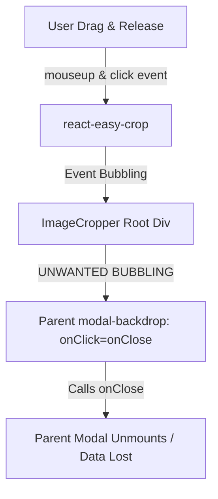
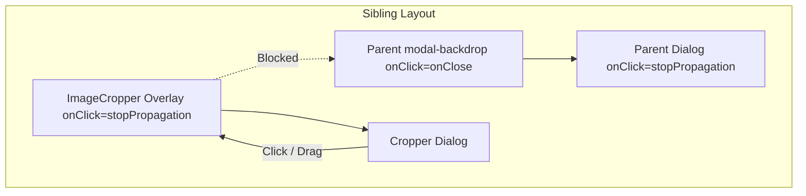

# 設計ドキュメント: REQ-199 ImageCropper操作時におけるイベント伝播制御とモーダル誤クローズ防止

## 1. 概要 (Overview)
`ImageCropper` コンポーネントおよびモーダル階層（`LoraModals.tsx`, `TagSetModals.tsx` 等）において、画像クロップ枠のドラッグ＆ドロップ（D&D）操作終了時に発生する `click` イベントが親の `.modal-backdrop` までバブリングし、親モーダルごと誤ってアンマウントされてしまう不具合を解決する。

---

## 2. アーキテクチャと設計方針 (Architecture & Design Principles)

### 2.1 課題と発生メカニズム
- DOM 仕様において、同一要素または共通の親要素上で `mousedown` → `mousemove` (ドラッグ) → `mouseup` が行われた場合、`mouseup` の直後に `click` イベントが生成・送出される。
- `ImageCropper` が親モーダルの `<div className="modal-backdrop" onClick={onClose}>` の直下に配置されているため、この `click` イベントが最外層の `modal-backdrop` まで伝播し、`onClose()` が誤発火する。



### 2.2 解決設計方針 (Multi-Layer Protection)

#### (1) `ImageCropper.tsx` 自体でのイベント伝播完全遮断 (Self-Containment)
- `ImageCropper` のルートオーバーレイ要素（`<div className="fixed inset-0 z-50 ...">`）および内部ダイアログ（`<div className="relative flex flex-col ...">`）において、クリックイベント伝播を確実に遮断（`onClick={(e) => e.stopPropagation()}`）する。
- ルートオーバーレイをクリックした際のキャンセル動作は、`e.target === e.currentTarget` の判定を用いて明示的に `onCancel()` を呼び出す（かつ親への伝播は遮断）。

#### (2) 親モーダルコンポーネントにおける DOM 階層の分離 (Structural Decoupling)
- `LoraModals.tsx`（`LoraDetailModal`）および `TagSetModals.tsx`（`TagSetDetailModal`, `TagSetCreateModal`, `TagSetEditModal` 等）において、`ImageCropper` を親の `<div className="modal-backdrop" onClick={onClose}>` の内側ではなく、React Fragment `<> ... </>` を用いて同列の兄弟要素（Sibling）としてレンダリングする。
- これにより、万一のイベント伝播時にも構造的に親の `modal-backdrop` に到達しないクリーンな階層を形成する。



---

## 3. 詳細変更仕様 (Detailed Specifications)

### 3.1 `frontend/src/components/ImageCropper.tsx`
- ルートコンテナの `<div>` に `onClick` ハンドラを追加:
  ```tsx
  <div
    className="fixed inset-0 z-50 flex flex-col items-center justify-center p-4 bg-black/80 backdrop-blur-sm"
    onClick={(e) => {
      e.stopPropagation();
      if (e.target === e.currentTarget) {
        onCancel();
      }
    }}
  >
    <div
      className="relative flex flex-col w-full max-w-lg h-[500px] bg-slate-900 border border-slate-800 rounded-xl overflow-hidden shadow-2xl"
      onClick={(e) => e.stopPropagation()}
    >
      ...
    </div>
  </div>
  ```

### 3.2 `frontend/src/components/LoraModals.tsx` & `TagSetModals.tsx`
- モーダルの JSX 構造を Fragment `<>` でラップし、`ImageCropper` を `.modal-backdrop` の外側に配置:
  ```tsx
  return (
    <>
      <div className="modal-backdrop" onClick={onClose}>
        <div ... onClick={(e) => e.stopPropagation()}>
          ...
        </div>
      </div>
      {cropImageSrc && (
        <ImageCropper
          imageSrc={cropImageSrc}
          aspectRatio={numericRatio}
          onCropComplete={handleCropComplete}
          onCancel={() => setCropImageSrc(null)}
        />
      )}
    </>
  )
  ```

---

## 4. トレードオフとリスクの開示 (Trade-offs & Constraints)

| 項目 | トレードオフ / 考慮事項 | 対策・理由 |
|---|---|---|
| **Portal 使用 vs Fragment 兄弟配置** | React `createPortal` を使用するか、Fragment による兄弟配置にするか | `ImageCropper` は既に `fixed inset-0 z-50` による絶対配置スタイルを有しており、Fragment による兄弟配置で十分かつ DOM 構造が直感的でテストが容易であるため Fragment 兄弟配置を採用 |
| **背景クリック時の挙動** | クロップモーダルの暗背景をクリックした際に親モーダルも一緒に閉じるべきか | ユーザーがクロップ作業中の誤操作で親モーダルの編集内容まで破棄されるのを防ぐため、クロップ背景クリックはクロップのキャンセル（または無効）に留め、親モーダルは維持する |
