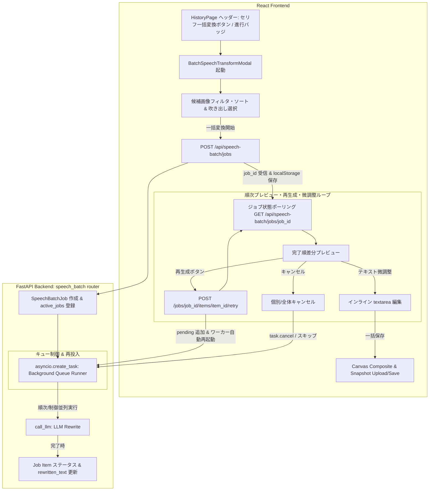

# REQ-203: 複数画像・複数吹き出しに対するLLMセリフ一括変換（BEジョブキュー管理・バックグラウンド実行復帰・個別/全体キャンセル・順次確認・完了後再生成・微調整）機能 詳細設計書

## 1. 概要 (Overview)

本設計は、セリフ（吹き出し）が付与された複数画像および各画像内の任意の吹き出しに対して、同一の口調プロンプトプリセットを用いてバッチ的にセリフ変換（LLM Rewrite）を実行し、変換完了したものから順次確認・個別再生成・インライン微調整を行い、最終的な反映・保存を一元的に完結させる専用ワークフローを提供する。

特に、**変換中および全件完了後を問わず、結果に満足いかない吹き出しを何度でもワンクリックでサーバー側キューへ再投入（再生成）できる仕組み**、およびモバイル端末での画面ロック・スリープやアプリ切り替え、ページ離脱時でも処理が中断・破棄されずに安定して完了する**バックエンド（FastAPI / asyncio）主導の非同期バッチジョブキュー**を統合する。

### 主な実現機能
1. **バックエンド非同期バッチジョブキュー管理 (AC-1, AC-10)**:
   - `POST /api/speech-batch/jobs` によりサーバー側で非同期タスク（`asyncio`）を起動。
   - クライアントが画面ロックやページ離脱してもサーバー側で確実にLLM呼び出しが進行・完了。
   - `activeJobId` の永続化により、アプリ再訪時にジョブ進行状態および完了結果を100%復元。
2. **専用起動エントリーポイントとセリフ付き画像の自動抽出 (AC-2)**:
   - 履歴ページ（Snapshots / Albums）のヘッダーに専用の「セリフ一括変換」ボタンを配置。
   - 実行中ジョブがある場合はボタン上に進行状態バッジ（例: `● 変換中 2/5`）を表示。
   - モーダル起動時に、全スナップショットの中からセリフ（`params.speech_bubbles`）が付与されている画像のみを自動フィルタリングして候補一覧を構成。
3. **候補画像群のフィルタリング・ソート機能 (AC-3)**:
   - 候補一覧において、通常の履歴ページと同様の絞り込み・並び替え（ワークフロー絞り込み、アルバム絞り込み、作成日時ソート、セリフ内テキスト検索）を提供。
   - 候補画像カード単位での選択、およびカード展開による吹き出し単位での個別選択（全選択/全解除対応）。
4. **同一口調プリセットによる一括セリフ変換キュー実行 (AC-4)**:
   - 登録済みの口調プリセット（`SpeechTonePreset`）またはカスタム口調プロンプトを指定して一括変換を開始。
   - ジョブ進捗状況（件数/%）および各吹き出しのステータス（待機中・変換中・完了・エラー）をリアルタイム表示。
5. **ジョブ個別キャンセルおよび全体キャンセル機能 (AC-5, AC-6)**:
   - **単一ジョブキャンセル**: 待機中（pending）または実行中（processing）の特定の吹き出しジョブを個別にキャンセル可能。
   - **全体キャンセル**: 実行中のキュー全体をワンクリックで停止（サーバー側タスクの安全なキャンセル、未実行ジョブの除外）。すでに完了したセリフ変換結果は保持。
6. **完了順の順次プレビュー・差分確認 (AC-7)**:
   - 変換が完了した項目から即座に元テキストと変換後テキストを並列/差分表示し、全体完了を待たずに確認可能。
7. **変換完了後の個別再生成（キュー再投入） (AC-8)**:
   - 変換途中はもちろん、全件完了後であっても、任意の吹き出しの「再生成」ボタンを押すことで、該当アイテムをサーバー側キュー（`pending`）へ再投入。
   - バックエンドのキューワーカーが自動で再起動／継続し、新しいLLM変換結果を取得してUIへ反映。何度でも再試行可能。
8. **インライン微調整・シームレス編集 (AC-9)**:
   - 変換後のセリフをプレビュー画面上で直接テキスト編集可能。
9. **一括反映・保存（上書きまたは新規作成） (AC-11)**:
   - 編集後の全吹き出し情報をキャンバス描画合成し、スナップショットへの上書きまたは新規スナップショット（アルバム登録対応）として一括保存。

---

## 2. アーキテクチャと処理フロー (Architecture & Flow)

---

## 3. 詳細仕様 (Detailed Specifications)

### 3.1 バックエンド 再生成・リトライ機構 (`backend/app/routers/speech_batch.py`)
- **単一アイテム再生成 (`POST /api/speech-batch/jobs/{job_id}/items/{item_id}/retry`)**:
  - 対象アイテムのステータスを `completed` / `failed` / `cancelled` から `pending` に変更し、`error = None` にリセット。
  - ジョブステータスが `completed` / `cancelled` の場合、`processing` に戻す。
  - バックグラウンドタスクが既に終了している場合は、`asyncio.create_task(run_batch_job(job_id))` を起動してキューワーカーを再開。
  - 新しいLLM変換結果が取得されると `rewritten_text` が上書き更新され、`completed` に遷移。

### 3.2 フロントエンド 再生成UI & 操作フロー (`BatchSpeechTransformModal.tsx`)
- 各吹き出しカードに「再生成（RotateCcw アイコン）」ボタンを常時配置。
- 変換完了後（またはエラー時）にクリックすると、即座に対象行がローディング（`processing`）状態に切り替わり、サーバー側で再変換が実行される。
- 新しい結果が返却されると、変換後テキスト欄が最新のLLM出力で更新される。
- ユーザーが手動編集（微調整）していた場合でも、再生成を実行すると最新のLLM結果が反映され、再度微調整が可能。

### 3.3 一括保存処理 (Batch Save & Canvas Composite)
1. 編集対象となったスナップショットごとにグループ化。
2. 各スナップショットについて：
   - 元画像（`base_image_path` または `image_path`）を `HTMLImageElement` にロード。
   - オフスクリーン `<canvas>` を生成し、`drawSpeechBubble`（`speechBubbleRenderer.ts`）を用いてテキストを反映した吹き出しを描画。
   - `canvas.toBlob('image/png')` で Blob を生成し、`snapshotsApi.upload` でアップロード。
   - **上書きモード**: `snapshotsApi.patch(snapshotId, { image_path, thumbnail_path, params: { ...params, speech_bubbles: updatedBubbles } })`
   - **新規作成モード**: `snapshotsApi.create({ workflow_id, image_path, params: { ...params, speech_bubbles: updatedBubbles }, source_snapshot_id })`
     - アルバム指定がある場合は `albumsApi.addItems` または `albumsApi.create` を実行。
3. 保存進行状況モーダル/バーを表示し、全件完了後に `qc.invalidateQueries({ queryKey: ['snapshots'] })` および `qc.invalidateQueries({ queryKey: ['albums'] })` を実行し、`activeJobId` をクリアしてモーダルを閉じる。

---

## 4. 影響範囲・ファイル一覧 (Impacted Files)

| ファイルパス | 変更区分 | 変更内容 |
|---|---|---|
| `backend/app/schemas/speech_batch.py` | 新規作成 | セリフ一括変換ジョブ・アイテム・リトライ等の Pydantic スキーマ |
| `backend/app/schemas/__init__.py` | 変更 | `speech_batch` スキーマの再エクスポート |
| `backend/app/routers/speech_batch.py` | 新規作成 | セリフ変換バッチジョブ管理ルーター（非同期タスク、進捗、キャンセル、完了後再生成・リトライ） |
| `backend/app/main.py` | 変更 | `speech_batch` ルーターの登録（`app.include_router(speech_batch.router)`） |
| `backend/tests/test_speech_batch.py` | 新規作成 | バッチジョブ作成、非同期実行、個別キャンセル、全体キャンセル、完了後再生成のバックエンド単体テスト |
| `frontend/src/api/types.ts` | 変更 | `SpeechBatchJob` 関連の型定義追加 |
| `frontend/src/api/client.ts` | 変更 | `speechBatchApi`（ジョブ作成・取得・キャンセル・再生成リトライ）の追加 |
| `frontend/src/utils/localStorageKeys.ts` | 変更 | `ACTIVE_SPEECH_BATCH_JOB_ID` キー定数の追加 |
| `frontend/src/components/BatchSpeechTransformModal.tsx` | 新規作成 | 候補画像フィルタ・ソート、吹き出し選択、BEジョブ連携、進捗ポーリング、キャンセルUI、差分プレビュー、完了後再生成、インライン微調整、一括保存UI |
| `frontend/src/pages/HistoryPage.tsx` | 変更 | ヘッダーへの専用「セリフ一括変換」ボタン（進行中バッジ付き）追加およびモーダル連携 |
| `frontend/src/components/__tests__/BatchSpeechTransformModal.test.tsx` | 新規作成 | 候補抽出・フィルタ、選択、BEジョブ連携、キャンセル操作、完了後再生成、差分表示、インライン編集、保存フローの単体テスト |
| `frontend/src/pages/__tests__/HistoryPage.test.tsx` | 変更 | ヘッダーボタン表示、進行中バッジ表示、モーダル起動の統合テスト |
