# REQ-204: セリフLLM変換における画像コンテキストおよび画像別場面ヒント付与・反映機能（マルチモーダル対応・単体/一括での画像別シーン説明入力） 詳細設計書

## 1. 概要 (Overview)

本設計は、セリフ（吹き出し）のLLM口調変換において、対象画像データ（ビジョン情報）およびユーザーが任意で入力する「場面ヒント・状況説明テキスト（シーンコンテキスト）」をLLMへ渡し、キャラクターの表情・視線・シチュエーション・場面の雰囲気を正確に解釈させた上で、最適なニュアンス・口調のセリフを生成するマルチモーダル連携機能を提供する。

本機能は、**単体吹き出し編集（`SpeechBubbleControls`）** および **一括セリフ変換（`BatchSpeechTransformModal`）** の両方に対応し、画像単位で個別の場面ヒントテキストを柔軟に入力・保持できる。

特に一括セリフ変換においては、初期の画像・吹き出し選択画面をシンプルに保ちつつ、画面遷移の煩雑さを防ぐため、**「候補選択画面」と「変換対象リスト・実行・レビュー統合画面」の2画面構成**を採用する。統合画面上で、変換開始前の画像別場面ヒント入力、変換の実行、進捗確認、結果レビュー、個別再生成、微調整、一括保存をシームレスに行うことができる。

### 主な実現機能
1. **マルチモーダル画像ビジョン連携 (AC-1, AC-3)**:
   - 対象画像（スナップショット）の画像データをBase64エンコードし、OpenAI互換のマルチモーダルAPI（`image_url`形式）としてLLMへ連携。
   - LLMプロンプトに画像内の表情・シチュエーション・雰囲気を読み取って反映させる指示を追加。
2. **単体編集での場面ヒント入力・画像参照トグル (AC-1)**:
   - 単体セリフ編集画面（`SpeechBubbleControls`）において、画像参照（ON/OFF）と任意テキスト（場面ヒント・説明）の入力欄を提供。
3. **一括変換 統合リスト画面における画像別場面ヒント入力 & 実行・レビュー (AC-2, AC-5)**:
   - 候補選択画面から「次へ：変換リストへ進む」で遷移する統合画面において、選択された対象が画像ごとにグループ化されたリスト形式で一覧表示される。
   - 各画像カード上で「画像参照 (Vision)」のON/OFFおよび「場面ヒント・状況説明」を入力・調整可能。
   - 同一画面上で「一括変換を開始」を実行し、そのまま進捗状況の確認、完了したセリフの差分プレビュー、場面ヒントを反映した個別再生成、インライン編集、合成保存までを一元的に操作可能。
4. **柔軟なフォールバック・非マルチモーダル対応 (AC-4)**:
   - 画像参照OFF時、場面ヒント未入力時、または利用しているLLMモデルがマルチモーダル非対応（エラー返却）の場合でも、自動的にテキストのみの口調変換へフォールバックし、処理を中断させない。
5. **バッチジョブ・再生成時のコンテキスト保持 (AC-5)**:
   - 一括変換ジョブキューの各アイテムに `scene_hint` および `include_image` を保持。
   - レビューフェーズでの個別再生成（リトライ）時にも、設定された場面ヒントと画像コンテキストを用いて正確に再生成を実行。

---

## 2. アーキテクチャと処理フロー (Architecture & Flow)

```mermaid
flowchart TD
    subgraph Frontend [React Frontend]
        subgraph SingleEdit [単体セリフ編集: SpeechBubbleControls]
            A1[画像参照ON/OFF & 場面ヒントテキスト入力] --> B1[口調変換ボタン押下]
            B1 --> C1[POST /api/speech-tone-presets/rewrite]
        end

        subgraph BatchEdit [一括セリフ変換: BatchSpeechTransformModal 統合画面構成]
            A2[Screen 1: select 候補画像・吹き出し選択 & 口調プリセット選択] -->|次へ：変換リストへ進む| B2[Screen 2: review 統合リスト・実行・レビュー画面]
            
            subgraph Screen2_Operations [Screen 2 統合画面内の操作フロー]
                B2 -->|各画像カード| C2[画像参照 ON/OFF & 場面ヒント入力]
                C2 -->|一括変換を開始| D2[POST /api/speech-batch/jobs & 進捗ストリーミング]
                D2 -->|完了順差分プレビュー & インライン編集| E2[編集・微調整]
                D2 -->|場面ヒント変更・再生成| F2[POST /jobs/job_id/items/item_id/retry]
                E2 -->|一括保存| G2[Canvas Composite & Snapshot Upload/Save]
            end
        end
    end

    subgraph Backend [FastAPI Backend]
        C1 --> H1[画像パス解決 & Base64エンコード]
        D2 --> H2[ジョブ登録 & バックグラウンドワーカー起動]
        F2 --> H2
        H2 --> H1

        subgraph LLM_Pipeline [LLMリクエスト構築 & フォールバック]
            H1 --> I[プロンプト合成: 口調 + セリフ + 場面ヒント + 画像指示]
            I --> J{画像参照有効 & 画像あり?}
            J -->|Yes| K[OpenAI互換 マルチモーダルメッセージ構築]
            J -->|No| L[テキストのみメッセージ構築]
            K --> M[call_llm 呼び出し]
            L --> M
            M -->|Vision非対応/400エラー| N[テキストのみへ自動フォールバック再試行]
            M -->|成功| O[変換セリフ返却]
            N --> O
        end
    end
```



---

## 3. 詳細仕様 (Detailed Specifications)

### 3.1 LLMサービスクライアント拡張 (`backend/app/services/llm_request.py`)
- `call_llm` 関数に `image_data: Optional[str] = None`（Base64文字列またはData URL）引数を追加。
- `image_data` が指定されている場合、OpenAI互換の `messages` 構造を構築：
  ```python
  if image_data:
      user_content = [
          {"type": "text", "text": user_prompt},
          {
              "type": "image_url",
              "image_url": {
                  "url": image_data if image_data.startswith("data:") else f"data:image/jpeg;base64,{image_data}"
              }
          }
      ]
  else:
      user_content = user_prompt
  ```
- マルチモーダルリクエストが失敗（400 Bad Request 等でビジョン非対応）した場合、自動的にテキストのみでフォールバック呼び出しを行う安全機構を内蔵。

### 3.2 単体口調変換エンドポイント拡張 (`backend/app/routers/speech_tone_presets.py`)
- **リクエストスキーマ (`SpeechToneRewriteRequest`)**:
  - `snapshot_id: Optional[int] = None`
  - `image_path: Optional[str] = None`
  - `include_image: Optional[bool] = False`
  - `scene_hint: Optional[str] = None`
- **プロンプト構築**:
  - 場面ヒントがある場合：`\n\n【場面の状況・ヒント】\n{scene_hint}`
  - 画像参照が有効な場合：`\n\n※画像が添付されています。画像内のキャラクターの表情、視線、シチュエーション、場面の雰囲気を読み取って、その状況に最も適した感情・トーン・ニュアンスをセリフに反映してください。`

### 3.3 一括セリフ変換エンドポイント拡張 (`backend/app/routers/speech_batch.py`)
- **アイテムリクエストスキーマ (`SpeechBatchJobItemCreate` / `SpeechBatchJobItemRead`)**:
  - `scene_hint: Optional[str] = None`
  - `include_image: Optional[bool] = True`
  - `image_path: Optional[str] = None`
- **ワーカー処理 (`_process_single_item`)**:
  - アイテムの `snapshot_id` / `image_path` および `include_image` に基づき画像Base64をロード。
  - アイテム固有の `scene_hint` をプロンプトに注入して `call_llm` を実行。
  - 再生成（リトライ）時もアイテム内の `scene_hint` / `include_image` がそのまま保持され、同一コンテキストで再生成される。

### 3.4 フロントエンド 単体編集UI (`SpeechBubbleControls.tsx`)
- 口調変換（LLM）アコーディオン内に以下を追加：
  1. 「画像を場面解釈のヒントにする（マルチモーダル）」トグル/チェックボックス（デフォルトON）。
  2. 「場面のヒント・状況説明（任意）」入力欄（textarea / text input）。
  3. 変換実行時に `include_image`, `scene_hint`, `snapshot_id` / `image_path` をリクエストに含めて送信。

### 3.5 フロントエンド 一括変換モーダル (`BatchSpeechTransformModal.tsx`)
- **2画面構成 (`phase: 'select' | 'review'`)**:
  1. **Screen 1: `select`（候補選択画面）**:
     - 候補画像のフィルタ・検索・ソートおよび吹き出しチェック選択。
     - 口調プリセットまたはカスタムプロンプトの指定。
     - フッターボタン：「次へ：変換リストへ進む ({selectedCount}件)」をクリックして Screen 2（`review`）へ遷移。
  2. **Screen 2: `review`（変換対象リスト・実行・レビュー統合画面）**:
     - 選択された画像ごとのカードがリスト表示される。
     - 各画像カードヘッダー/設定部に：
       - サムネイルおよびスナップショット情報
       - **「画像を参照する (Vision)」** チェックボックス（デフォルトON）
       - **「場面ヒント・状況説明 (任意)」** テキストエリア（`sceneHints[snap.id]`）
     - ジョブ未開始時：上部またはフッターに「✨ 一括変換を開始 ({selectedCount}件)」ボタンを表示。
     - ジョブ実行中・完了時：
       - 全体進捗バー、各吹き出しのステータスバッジ（待機中/変換中/完了/エラー）
       - 完了順の差分プレビュー（Before / After）
       - 各吹き出しの個別「再生成」ボタン（画像設定・場面ヒントを保持して再投入）
       - テキストのインライン微調整
       - 保存モード（上書き / 新規）および「変更を一括保存」ボタン
     - 左下に「← 候補選択に戻る」ボタンを配置。

---

## 4. 影響範囲・ファイル一覧 (Impacted Files)

| ファイルパス | 変更区分 | 変更内容 |
|---|---|---|
| `backend/app/services/llm_request.py` | 変更 | `call_llm` への `image_data` マルチモーダル対応およびビジョン非対応時のフォールバック処理 |
| `backend/app/schemas/speech_tone_preset.py` | 変更 | `SpeechToneRewriteRequest` への `snapshot_id`, `image_path`, `include_image`, `scene_hint` 追加 |
| `backend/app/routers/speech_tone_presets.py` | 変更 | 単体セリフ変換での画像読み込み・場面ヒントプロンプト合成処理の実装 |
| `backend/app/schemas/speech_batch.py` | 変更 | `SpeechBatchJobItemCreate` / `SpeechBatchJobItemRead` への `scene_hint`, `include_image`, `image_path` 追加 |
| `backend/app/routers/speech_batch.py` | 変更 | バッチ変換ワーカーでの画像ロード、アイテム別場面ヒント注入、再生成連携 |
| `backend/tests/test_speech_tone_presets.py` | 変更 | 単体セリフ変換の画像コンテキストおよび場面ヒント連携の単体テスト |
| `backend/tests/test_speech_batch.py` | 変更 | バッチジョブでのアイテム別場面ヒントおよび画像連携の単体テスト |
| `frontend/src/api/types.ts` | 変更 | `SpeechToneRewriteRequest` および `SpeechBatchJobItem` 型へのフィールド追加 |
| `frontend/src/components/SpeechBubbleControls.tsx` | 変更 | 単体編集での画像参照トグル・場面ヒント入力UIおよびAPI連携 |
| `frontend/src/components/BatchSpeechTransformModal.tsx` | 変更 | 候補選択画面から変換対象リスト・実行・レビュー統合画面への2画面構成と画像別場面ヒント入力・実行・再生成 |
| `frontend/src/components/__tests__/SpeechBubbleControls.test.tsx` | 変更 | 単体口調変換での画像参照および場面ヒント送信のテスト |
| `frontend/src/components/__tests__/BatchSpeechTransformModal.test.tsx` | 変更 | 統合リスト画面での画像別場面ヒント入力、一括変換開始、再生成のテスト |
