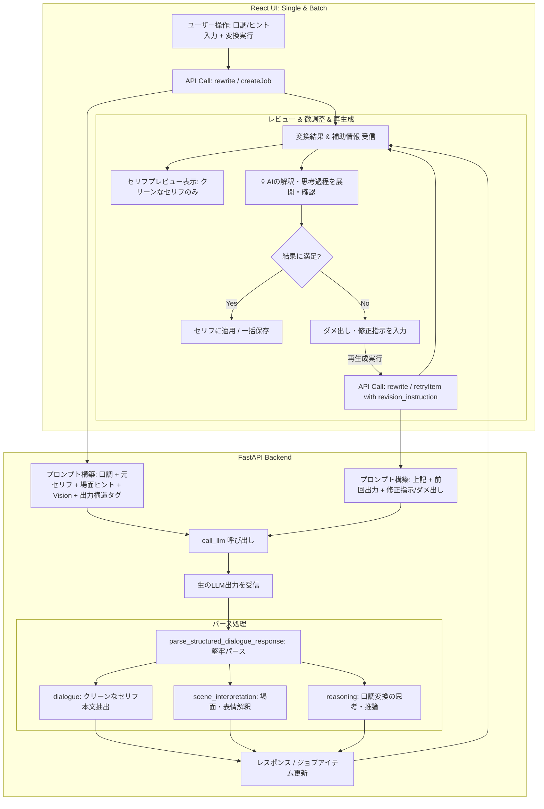

# REQ-205: セリフLLM変換の構造化出力・思考可視化および前回結果フィードバック付き再生成機能 詳細設計書

## 1. 概要 (Overview)

本設計は、セリフ（吹き出し）のLLM口調変換において、以下の3つの課題を解決し、対話的かつ高品質なセリフ編集体験を実現する。

1. **思考漏れ防止・構造化出力パース (AC-1)**:
   - LLMからの応答をタグ付きフォーマット（`<interpretation>`, `<reasoning>`, `<dialogue>`）として出力させ、パースして吹き出しテキストには最終セリフ本文のみを抽出・設定する。
   - 推論モデル（`<think>` タグを出力するモデル等）や思考文が吹き出しに混入する問題（思考漏れ）を根本防止する。
2. **場面解釈・変換思考の補助情報可視化 (AC-2, AC-5)**:
   - LLMが画像・場面ヒントテキストから読み取った「場面・表情の解釈」および口調選定・言い回し決定に至る「思考・推論過程」を補助情報（診断情報）として保存・返却する。
   - フロントエンド（単体編集UIおよび一括変換モーダル）において、AIの解釈・思考を展開表示・確認できるようにし、ユーザーがヒントの微調整方針を的確に判断できるようにする。
3. **ダメ出し・修正指示付き再生成 (AC-3, AC-4, AC-5)**:
   - 変換結果が意にそわない場合、前回の変換結果に対する不満点・追加修正指示（ダメ出し）を入力して再生成できる対話的リトライ機能を提供する。
   - プロンプトに前回の出力結果と修正指示を明示的に注入し、同一の不満点を持つセリフが再出力されるのを防止する。

---

## 2. アーキテクチャと処理フロー (Architecture & Flow)



---

## 3. 詳細仕様 (Detailed Specifications)

### 3.1 構造化プロンプトおよびパース処理仕様

#### プロンプト指示フォーマット
LLMへのシステムプロンプトまたはユーザープロンプト末尾に、以下の出力フォーマット指示を組み込む：

```text
【出力フォーマット】
必ず以下のタグ形式で出力してください。他の挨拶や前置き、解説はタグ外に出力しないでください。

<interpretation>
（添付画像や場面ヒントから読み取った状況、表情、キャラクターの心理や雰囲気の解釈）
</interpretation>
<reasoning>
（指定の口調・設定に合わせてどのように言葉を選び、変換したかの思考過程・推論）
</reasoning>
<dialogue>
（変換後の最終的なセリフ本文のみ。引用符やカッコは不要）
</dialogue>
```

#### パース処理 & 構造妥当性判定 (`backend/app/services/speech_parser.py`)
- `is_valid_structured_response(raw_output: str) -> bool`:
  - `<dialogue>(.*?)</dialogue>` タグ（中身が空でない）または有効なJSON構造が含まれているかを検査。
- `parse_structured_dialogue_response(raw_output: str) -> tuple[str, Optional[str], Optional[str]]`:
  - **タグ抽出**:
    - `<dialogue>(.*?)</dialogue>` (DOTALL) を最優先で抽出。前後の引用符（`「」`, `""`, `''`）を除去。
    - `<interpretation>(.*?)</interpretation>` (DOTALL) を抽出（空の場合は `None`）。
    - `<reasoning>(.*?)</reasoning>` (DOTALL) を抽出。
  - **推論モデル対応 (`<think>` タグ等)**:
    - `<think>(.*?)</think>` が含まれている場合、自動的に除去し、`reasoning` が空であればその内容を `reasoning` として補完。
  - **JSONフォーマット対応**:
    - 万が一LLMがJSON形式（`{"dialogue": "...", "interpretation": "...", "reasoning": "..."}`）で返答した場合、JSONパースを試行。
  - **タグなしフォールバック**:
    - 最大リトライ後もタグが存在しない場合、全体テキストから `<think>` などのタグを除去し、前後の引用符を取り除いたテキストを `dialogue` として扱い、処理を中断させない。

---

### 3.2 フォーマット違反時の指摘付き自動リトライ機構 (AC-7)

LLM出力が構造化ルール（`<dialogue>` 等のタグ）を満たさない場合、直ちに諦めてフォールバックするのではなく、モデルに対して違反理由を指摘して規定回数（デフォルト最大2回）まで自動再送（リトライ）を行う。

#### 自動リトライ制御フロー (`call_llm_with_structured_dialogue`)
```python
async def call_llm_with_structured_dialogue(
    system_prompt: str,
    user_prompt: str,
    model: Optional[str] = None,
    llm_params: Optional[dict] = None,
    image_data: Optional[str] = None,
    max_format_retries: int = 2,
) -> tuple[str, Optional[str], Optional[str]]:
    current_user_prompt = user_prompt
    for attempt in range(max_format_retries + 1):
        raw_output = await call_llm(
            system_prompt=system_prompt,
            user_prompt=current_user_prompt,
            model=model,
            llm_params=llm_params,
            image_data=image_data,
        )
        if is_valid_structured_response(raw_output):
            return parse_structured_dialogue_response(raw_output)
        
        # フォーマット違反時：残りリトライ回数があれば指摘プロンプトを付与して再試行
        if attempt < max_format_retries:
            logger.warning(f"LLM output violated structured format (attempt {attempt + 1}). Retrying with correction prompt.")
            current_user_prompt = (
                f"{user_prompt}\n\n"
                "【重要：出力形式の再要求】\n"
                "直前の出力は指定されたタグ形式（<interpretation>...</interpretation><reasoning>...</reasoning><dialogue>...</dialogue>）に違反していました。\n"
                "挨拶やタグ外の解説は一切含めず、必ず指定された3つのタグで囲んで出力してください。"
            )
    
    # 全リトライ失敗時のみフォールバックパースを実行
    logger.warning("LLM structured output failed after max retries. Using fallback plain text parser.")
    return parse_structured_dialogue_response(raw_output)
```

---

#### 設定項目 (`backend/app/models.py` / `models.LlmPrompt`)
- **Key**: `speech_rewrite_system_prompt`
- **Description**: `セリフ口調変換用システムプロンプト（基本方針・役割。※構造化出力タグ等はシステム側で自動付与されます）`
- **Default Content (`seed_data.py`)**:
  ```text
  あなたはセリフの言い回しや口調を変換する専門家です。
  元のセリフの意味、状況、感情、意図は一切変えずに、指定された口調・話し方・キャラクター特徴に合わせて自然なセリフに書き換えてください。

  【基本方針】
  1. セリフの意味内容・文脈・伝達したい情報は忠実に維持すること。
  2. 指定された口調、語尾、一人称・二人称、キャラクターの性格ニュアンスを的確に反映すること。
  ```

#### システム側でのコア構造化指示の自動結合
ユーザーが設定画面で調整した内容が何であれ、バックエンドは必ず末尾に以下の非破壊的な構造化出力必須指示を付与してLLMへ渡す：
```python
def get_effective_speech_rewrite_system_prompt(db: Session) -> str:
    record = db.query(models.LlmPrompt).filter(models.LlmPrompt.key == "speech_rewrite_system_prompt").first()
    base_prompt = (record.content.strip() if record and record.content and record.content.strip() 
                   else DEFAULT_SPEECH_REWRITE_ROLE_PROMPT)
    return f"{base_prompt}\n\n{STRUCTURED_OUTPUT_SYSTEM_INSTRUCTION}"
```
これにより、ユーザーはキャラクター性や口調変換の基本指針を自由にカスタマイズ可能にしつつ、パースに必要な構造化タグ出力契約（`<interpretation>`, `<reasoning>`, `<dialogue>`）が破壊されるリスクを完全に排除する。

---

### 3.3 ダメ出し・修正指示付き再生成仕様 (AC-3, AC-4)

#### プロンプトへの注入
`revision_instruction`（および任意で `previous_rewritten_text`）が指定されている場合、ユーザープロンプトに以下のブロックを付与：

```text
【前回の変換結果に対する修正指示・ダメ出し】
直前の変換結果: {previous_rewritten_text}
ユーザーからの修正指示: {revision_instruction}
※直前の変換結果で指摘された不満点・修正指示を忠実に反映し、同じ不満点が生じないよう改善したセリフに書き換えてください。
```

---

### 3.3 バックエンド スキーマ定義

#### `backend/app/schemas/speech_tone_preset.py`
```python
class SpeechToneRewriteRequest(BaseModel):
    text: str
    tone_prompt: Optional[str] = None
    preset_id: Optional[int] = None
    model: Optional[str] = None
    llm_params: Optional[dict[str, Any]] = None
    snapshot_id: Optional[int] = None
    image_path: Optional[str] = None
    include_image: Optional[bool] = False
    scene_hint: Optional[str] = None
    previous_rewritten_text: Optional[str] = None
    revision_instruction: Optional[str] = None

class SpeechToneRewriteResponse(BaseModel):
    rewritten_text: str
    scene_interpretation: Optional[str] = None
    reasoning: Optional[str] = None
```

#### `backend/app/schemas/speech_batch.py`
```python
class SpeechBatchItemRetryRequest(BaseModel):
    revision_instruction: Optional[str] = None
    scene_hint: Optional[str] = None
    include_image: Optional[bool] = None

class SpeechBatchJobItemRead(BaseModel):
    id: str
    snapshot_id: int
    bubble_id: str
    bubble_index: int
    original_text: str
    rewritten_text: Optional[str] = None
    scene_interpretation: Optional[str] = None
    reasoning: Optional[str] = None
    previous_rewritten_text: Optional[str] = None
    revision_instruction: Optional[str] = None
    status: str = "pending"
    error: Optional[str] = None
    scene_hint: Optional[str] = None
    include_image: Optional[bool] = True
    image_path: Optional[str] = None
```

---

### 3.4 フロントエンド UI仕様

#### 単体セリフ編集 (`SpeechBubbleControls.tsx`)
- 変換実行後、`rewriteResult` に `rewritten`, `scene_interpretation`, `reasoning` を保持。
- プレビュー領域に：
  - 変換前 / 変換後テキスト（思考は一切混入しない）。
  - 「💡 AIの解釈・思考過程」開閉トグル（クリックで展開、場面解釈と変換思考をタグ付きで表示）。
  - 「再生成・修正指示 (ダメ出し)」入力欄（テキスト入力）＋「✨ 修正指示を反映して再生成」ボタン。
  - 通常の「再試行」ボタン（修正指示なしでの再実行）および「セリフに適用」「破棄」ボタン。

#### 一括変換モーダル (`BatchSpeechTransformModal.tsx`)
- 各セリフアイテムカードに：
  - AIの解釈・思考が存在する場合、小型の「💡 解釈・思考」バッジ/トグルを表示し、クリックでポップオーバーまたはインライン展開。
  - 各アイテムの再生成ボタン押下時、または展開時に「修正指示（ダメ出し）」を入力して再生成（`retryItem` APIに `revision_instruction` を渡す）可能。

---

## 4. 影響範囲・ファイル一覧 (Impacted Files)

| ファイルパス | 変更区分 | 変更内容 |
|---|---|---|
| `backend/app/seed_data.py` | 変更 | `speech_rewrite_system_prompt` のシードデータ定義追加 |
| `backend/app/services/speech_parser.py` | 新規 | `<dialogue>`, `<interpretation>`, `<reasoning>`, `<think>` などを堅牢にパースする関数の実装 |
| `backend/app/schemas/speech_tone_preset.py` | 変更 | `SpeechToneRewriteRequest` / `Response` への補助情報・修正指示フィールド追加 |
| `backend/app/schemas/speech_batch.py` | 変更 | `SpeechBatchJobItemRead`, `SpeechBatchItemRetryRequest` への補助情報・修正指示フィールド追加 |
| `backend/app/routers/speech_tone_presets.py` | 変更 | DBからのシステムプロンプト取得＋必須構造化指示の自動結合、ダメ出し指示注入、パース呼び出し、補助情報返却 |
| `backend/app/routers/speech_batch.py` | 変更 | バッチアイテムの構造化パース、補助情報保持、個別リトライ時の修正指示受け付け |
| `backend/tests/test_speech_parser.py` | 新規 | 構造化パースの各種パターン（正常系、推論タグ、JSON、フォールバック）の単体テスト |
| `backend/tests/test_speech_tone_presets.py` | 変更 | システムプロンプトDB反映・構造化返却・思考補助情報・ダメ出し再生成のテスト |
| `backend/tests/test_speech_batch.py` | 変更 | バッチ変換での思考情報保持・アイテムリトライ修正指示のテスト |
| `frontend/src/pages/SettingsPage.tsx` | 変更 | `PROMPT_LABELS` に `speech_rewrite_system_prompt` を追加 |
| `frontend/src/api/types.ts` | 変更 | 単体・バッチの型定義（補助情報、修正指示）の更新 |
| `frontend/src/api/client.ts` | 変更 | `speechBatchApi.retryItem` に `data?: SpeechBatchItemRetryRequest` を追加 |
| `frontend/src/components/SpeechBubbleControls.tsx` | 変更 | 思考過程展開UI、修正指示（ダメ出し）入力欄、修正指示付き再生成ボタンの実装 |
| `frontend/src/components/BatchSpeechTransformModal.tsx` | 変更 | 各アイテムの解釈・思考展開表示、個別修正指示入力付き再生成の実装 |
| `frontend/src/components/__tests__/SpeechBubbleControls.test.tsx` | 変更 | 単体編集での思考表示・ダメ出し再生成のUIテスト |
| `frontend/src/components/__tests__/BatchSpeechTransformModal.test.tsx` | 変更 | 一括変換での思考表示・個別リトライのUIテスト |


