# REQ-208: 生成ページ状態フック（useGeneratePageState）のドメイン別分割およびStale Closure・再レンダリング防止

## 1. 背景と課題

現在、`frontend/src/pages/GeneratePage/hooks/useGeneratePageState.ts` は **1,450行を超えるモノリシックなフック** となっており、以下の重大な設計上の問題とリスクを抱えています：

1. **単一責任の原則（SRP）の破綻と過剰集約**:
   - ワークフロー管理、プリセットCRUD/一括編集、オートセーブ/Undo-Redo、アセット/LoRA選択、画像履歴ギャラリー、キュー状態、モーダル開閉状態など、40以上のローカルStateと多数のAPI Mutationが1つのフックに混在。
2. **不要な再レンダリングとパフォーマンス劣化**:
   - スライダーの微小な値変更やモーダルの開閉だけで `GeneratePage` 全体および下位の全UIコンポーネントが再評価・再レンダリングされ、入力遅延やチラつきの原因となる。
3. **Stale Closure（古いクロージャ参照）のリスク**:
   - 非同期Mutationやタイマー（オートセーブ等）のコールバック内で最新のStateを参照できず、状態の巻き戻りや競合を招きやすい。
4. **グローバル `CustomEvent` による暗黙的結合**:
   - `tag-chip-editor:text-mode-toggle` 等の `window` レベル DOM カスタムイベントでコンポーネント間連携が行われており、データフローの追跡とテスタビリティを損ねている。

---

## 2. 影響範囲

| ファイル | 変更種別 | 内容 |
|---|---|---|
| `frontend/src/pages/GeneratePage/hooks/useWorkflowManagement.ts` | NEW | ワークフロー取得・更新、マッピング解析、プロンプトタブ、ロール折り畳み状態、Animaモード判定を担当する独立サブフック（~180行） |
| `frontend/src/pages/GeneratePage/hooks/usePresetState.ts` | NEW | プリセットCRUD、一括削除・編集、オートセーブデバウンス、Undo/Redo履歴スタック、Zustand sets同期を担当する独立サブフック（~280行） |
| `frontend/src/pages/GeneratePage/hooks/useAssetSelectionState.ts` | NEW | LoRA/TagSet取得、LoRA設定モーダル状態、アセット適用ハンドラ、スナップショットからのアセット復元を担当する独立サブフック（~140行） |
| `frontend/src/pages/GeneratePage/hooks/useGenerateDisplayState.ts` | NEW | 履歴画像ソート、スナップショット連動、画像プレビューモーダル、複数選択（useMultiSelect）、キュー件数カウント、可視性同期を担当する独立サブフック（~180行） |
| `frontend/src/pages/GeneratePage/hooks/useGeneratePageModals.ts` | NEW | リスキャン、設定、ジョブ管理、シーンジェネレータ等のモーダル開閉状態およびモバイル判定を担当する独立サブフック（~80行） |
| `frontend/src/pages/GeneratePage/hooks/useGeneratePageState.ts` | MODIFY | サブフック群を束ねて既存インターフェースと100%の下位互換性を保つ軽量オーケストレーターフック（~150行） |
| `frontend/src/components/TagChipEditor/index.tsx` | MODIFY | `onTextModeToggle` コールバックプロパティを追加し、`window` カスタムイベントへの依存を排除 |
| `frontend/src/pages/GeneratePage/components/DesktopLayout.tsx` | MODIFY | `TagChipEditor` への `onTextModeToggle` 明示的コールバック受け渡し |
| `frontend/src/pages/GeneratePage/components/MobileLayout.tsx` | MODIFY | `TagChipEditor` への `onTextModeToggle` 明示的コールバック受け渡し |
| テストコード群 | MODIFY/NEW | サブフック単体テストおよび既存 `useGeneratePageState.test.tsx` のグリーン維持 |

---

## 3. アーキテクチャと詳細設計

### 3-1. ドメイン分割構成（サブフック一覧）

```mermaid
graph TD
    GeneratePage["GeneratePage (UI Component)"]
    DesktopLayout["DesktopLayout"]
    MobileLayout["MobileLayout"]
    
    useGeneratePageState["useGeneratePageState (Facade / Orchestrator) <br/> ~150 lines"]
    
    subgraph SubHooks ["Domain-Specific Sub-Hooks (200-300 lines each)"]
        useWorkflowManagement["useWorkflowManagement<br/>(WF Query, Mappings, Role Collapse, Anima)"]
        usePresetState["usePresetState<br/>(Presets CRUD, Bulk Edit, Autosave, Undo/Redo)"]
        useAssetSelectionState["useAssetSelectionState<br/>(LoRA / TagSet Selection, Snapshot Rebuild)"]
        useGenerateDisplayState["useGenerateDisplayState<br/>(History Images, Sort, Preview Modal, Queue Counts)"]
        useGeneratePageModals["useGeneratePageModals<br/>(Modals & Responsive State)"]
        useWorkflowParams["useWorkflowParams<br/>(Existing)"]
        useGenerateAction["useGenerateAction<br/>(Existing)"]
        useSnapshotActions["useSnapshotActions<br/>(Existing)"]
        useAuditAction["useAuditAction<br/>(Existing)"]
        useWorkflowUpload["useWorkflowUpload<br/>(Existing)"]
        usePromptTranslation["usePromptTranslation<br/>(Existing)"]
    end
    
    GeneratePage --> useGeneratePageState
    DesktopLayout --> useGeneratePageState
    MobileLayout --> useGeneratePageState
    
    useGeneratePageState --> useWorkflowManagement
    useGeneratePageState --> usePresetState
    useGeneratePageState --> useAssetSelectionState
    useGeneratePageState --> useGenerateDisplayState
    useGeneratePageState --> useGeneratePageModals
    useGeneratePageState --> useWorkflowParams
    useGeneratePageState --> useGenerateAction
    useGeneratePageState --> useSnapshotActions
    useGeneratePageState --> useAuditAction
    useGeneratePageState --> useWorkflowUpload
    useGeneratePageState --> usePromptTranslation
```

### 3-2. サブフック別責務詳細

#### 1. `useWorkflowManagement`
- **引数**: `{ selectedWorkflowId: number | null, setSelectedWorkflowId: (id: number | null) => void }`
- **提供する状態・関数**:
  - `workflows`, `workflow`, `mappingMasters`, `baseModels`, `paramTypeMasters`, `comfyObjectInfo` (React Query)
  - `renameWorkflowMutation`, `copyWorkflowMutation`, `updateWorkflowMutation`, `updateWorkflowBaseModelMutation`
  - `selectedMasters`, `setSelectedMasters`, `handleUpdateMapping`
  - `workflowManageMode`, `setWorkflowManageMode`, `isWorkflowMenuOpen`, `setIsWorkflowMenuOpen`
  - `activePromptTab`, `setActivePromptTab` (localStorage連動)
  - `collapsedRoles`, `getIsRoleCollapsed`, `setRoleCollapsed` (localStorage連動)
  - `isAnimaMode`, `setIsAnimaMode`
  - `validMappings`, `invalidMappings`, `textMappings`, `paramMappings`

#### 2. `usePresetState`
- **引数**: `{ selectedWorkflowId: number | null, workflow: Workflow | undefined }`
- **提供する状態・関数**:
  - `presets` (React Query)
  - `createPresetMutation`, `updatePresetMutation`, `deletePresetMutation`, `bulkDeletePresetsMutation`, `renamePresetMutation`, `reorderPresetsMutation`
  - `handleCreatePreset`, `handleUpdatePreset`, `handleDeletePreset`, `handleLoadPreset`
  - 一括操作状態: `isBulkDeleteConfirmOpen`, `setIsBulkDeleteConfirmOpen`, `isBulkEditOpen`, `setIsBulkEditOpen`, `bulkTargetIds`, `isBulkApplying`, `handleBulkDeleteRequest`, `handleBulkDeleteConfirm`, `handleBulkEditRequest`, `handleBulkEditApply`
  - プリセットダイアログ: `isPresetOpen`, `setIsPresetOpen`, `newPresetName`, `setNewPresetName`, `isPresetManagerOpen`, `setIsPresetManagerOpen`
  - オートセーブ機構: 1秒デバウンス、`presetUpdatedAtRef` 楽観排他ロック整合性保持
  - Undo/Redo: `undo`, `redo`, `canUndo`, `canRedo`, Ctrl+Z / Ctrl+Y キーボードリスナー
  - sets同期: Zustandストアの `sets`, `activeSetId`, `openPresetIds` との同期制御

#### 3. `useAssetSelectionState`
- **引数**: `{ loras: Lora[] | undefined, tagSets: TagSet[] | undefined, setRoleCollapsed: (role: string, isCollapsed: boolean) => void }`
- **提供する状態・関数**:
  - `loras`, `tagSets` (React Query)
  - `selectedLoraForModal`, `setSelectedLoraForModal`, `selectedTriggerSetId`, `setSelectedTriggerSetId`, `loraStrength`, `setLoraStrength`
  - `openAddAssetRole`, `setOpenAddAssetRole`
  - `handleAddLoraAsset`, `handleAddTagSetAsset`, `handleAddTagSetAssetInternal`
  - `handleLoadSnapshot` (スナップショットのLoRA・TagSetパラメータをパースしてAppliedAssetに復元)

#### 4. `useGenerateDisplayState`
- **引数**: `{ selectedWorkflowId: number | null }`
- **提供する状態・関数**:
  - `displayImages`, `sortedDisplayImages`, `sortedSnapshots`, `snapshotIdsForDisplay`, `showStrip`, `hasHistory`, `getSetNameForImage`
  - `sortOrder`, `setSortOrder`
  - `isModalPreviewOpen`, `setIsModalPreviewOpen`, `modalPreviewIndex`, `setModalPreviewIndex`, `handleOpenModalPreview`
  - 複数選択: `isMultiSelectMode`, `selectedIds`, `handleItemClick`, `getLongPressHandlers`, `isSelected`, `exitMultiSelectMode`, `selectAll`, `clearSelection`
  - キュー・セッション状態: `isGeneratingHere`, `isOtherSessionGenerating`, `allQueueCount`, `totalQueueCount`
  - 画像送り: `handlePrevImg`, `handleNextImg`

#### 5. `useGeneratePageModals`
- **提供する状態・関数**:
  - `isMobile` (768px未満または `/mobile` パス検出、リサイズ監視)
  - `rescanOpen`, `setRescanOpen`
  - `isSettingsOpen`, `setIsSettingsOpen`, `localComfyUrl`, `setLocalComfyUrl`
  - `thumbnailTab`, `setThumbnailTab`
  - `isJobModalOpen`, `setIsJobModalOpen`
  - `isSceneGeneratorOpen`, `setIsSceneGeneratorOpen`

### 3-3. CustomEvent の撤廃と明示的データフロー化

- **対象**: `tag-chip-editor:text-mode-toggle`
- **変更前**:
  - `TagChipEditor` がモード切替時に `window.dispatchEvent(new CustomEvent('tag-chip-editor:text-mode-toggle', { detail: { id } }))` を発行。
  - `useGeneratePageState` が `window.addEventListener` で受信し、`setRoleCollapsed(role, false)` を呼んでいた。
- **変更後**:
  - `TagChipEditor` の Props に `onTextModeToggle?: (isTextMode: boolean) => void` を追加。
  - `DesktopLayout` および `MobileLayout` において、`TagChipEditor` に `onTextModeToggle={() => setRoleCollapsed(role, false)}` を直接バインド。
  - `window` イベントリスナーおよび暗黙的グローバルイベントを完全撤廃。

---

## 4. 検証計画

### 4-1. 自動テスト
1. **サブフックおよびオーケストレーター単体テスト**:
   - `npm test -- --run src/pages/GeneratePage/hooks/__tests__/useGeneratePageState.test.tsx`
   - `npm test -- --run src/pages/GeneratePage/hooks/__tests__/usePresetState.test.ts`
2. **コンポーネント結合テスト**:
   - `npm test -- --run src/components/TagChipEditor/__tests__/TagChipEditor.test.tsx`
   - `npm test -- --run src/pages/__tests__/GeneratePage.test.tsx`
   - `npm test -- --run src/pages/GeneratePage/components/__tests__/DesktopLayout.test.tsx`
   - `npm test -- --run src/pages/GeneratePage/components/__tests__/MobileLayout.test.tsx`
3. **全テストスイートの通過**:
   - `npm test -- --run`

### 4-2. AC準拠検証
- [ ] AC-1: `useGeneratePageState` がドメイン別サブフックに分割され、各ファイルが 200〜300 行以内であること。
- [ ] AC-2: `tag-chip-editor:text-mode-toggle` 等の window レベル CustomEvent が撤廃されていること。
- [ ] AC-3: 状態更新時の再レンダリング範囲が適切に局所化されていること。
- [ ] AC-4: 既存テストが全てグリーン（Pass）であること。
