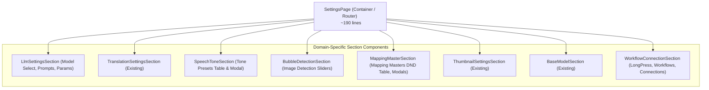

# REQ-211: 設定ページ・履歴ページのモノリス構造解体と非同期エラーリカバリ・プログレス管理の堅牢化

## 1. 背景と課題

`frontend/src/pages/SettingsPage.tsx`（1,690行）および `frontend/src/pages/HistoryPage.tsx`（1,565行）は、プロジェクト肥大化に伴い極めて巨大なモノリスコンポーネントとなっており、以下の構造的・信頼性上の問題を抱えています：

1. **SettingsPage の単一責任原則違反と高結合度**:
   - 音声トーンプリセット、マッピングマスタCRUD・DND並び替え、カスタム型マスタ、LLMモデル・プロンプト・推論パラメータ、吹き出し検出パラメータ、長押し感度、ワークフロー管理、接続ステータス等の独立した多系統ドメインのステート・Mutation・モーダルが1ファイルに混在。
   - 個別の設定セクション修正時に他ドメインへの予期せぬ破壊や再レンダリング汚染が発生しやすい。

2. **HistoryPage の非同期処理におけるエラーリカバリと状態解除の不備**:
   - 一括ダウンロード（JSZipによる複数画像のFetch & ZIPアーカイブ化）やアルバム操作等の長時間非同期処理において、例外やネットワーク切断時の `finally` クリーンアップが不完全な箇所が存在。
   - エラー発生時に `isDownloading` などのローディング状態が解除されずUIがロックされるリスク、および再試行（Retry）導線が欠落。

3. **コンポーネントツリーの肥大化による保守性・テスタビリティの低下**:
   - ページ全体をマウントしないと単体セクションやフックのテストが困難であり、テストファイルも巨大化。

---

## 2. 影響範囲

| ファイル | 変更種別 | 内容 |
|---|---|---|
| `frontend/src/pages/SettingsPage/components/LlmSettingsSection.tsx` | NEW | LLMモデル選択、システムプロンプト編集、LLMハイパーパラメータ設定をカプセル化（~280行） |
| `frontend/src/pages/SettingsPage/components/SpeechToneSection.tsx` | NEW | 口調プリセット一覧、新規/編集モーダル（`SpeechTonePresetModal`）、削除処理をカプセル化（~180行） |
| `frontend/src/pages/SettingsPage/components/BubbleDetectionSection.tsx` | NEW | 吹き出し画像処理パラメータ（min_area, min_brightness）設定をカプセル化（~90行） |
| `frontend/src/pages/SettingsPage/components/MappingMasterSection.tsx` | NEW | マッピングマスタCRUD、DND並び替え、一括編集モーダル、カスタム型マスタモーダルをカプセル化（~280行） |
| `frontend/src/pages/SettingsPage/components/WorkflowConnectionSection.tsx` | NEW | 長押し感度、ワークフロー管理（名前変更/コピー/プリセット/削除ダイアログ）、接続ステータスをカプセル化（~240行） |
| `frontend/src/pages/SettingsPage.tsx` | MODIFY | 各セクションを束ねるアコーディオンコンテナ兼オーケストレーターへスリム化（~190行、300行未満） |
| `frontend/src/pages/HistoryPage/hooks/useBulkDownload.ts` | NEW | JSZip一括ダウンロード、進捗追跡、AbortController、確実なfinally状態解除、リトライ機構を提供する堅牢カスタムフック（~160行） |
| `frontend/src/pages/HistoryPage/hooks/useAlbumOperations.ts` | NEW | アルバムCRUD、2軸ソート、楽観DND並び替え、スコープ付きアイテム削除を管理するカスタムフック（~220行） |
| `frontend/src/pages/HistoryPage/components/AlbumListView.tsx` | NEW | アルバム一覧表示、DND並び替え、インライン名前変更、削除をカプセル化（~180行） |
| `frontend/src/pages/HistoryPage/components/AlbumDetailView.tsx` | NEW | アルバム詳細、2軸ソートツールバー、アイテムDND並び替え、アクションバッジグリッドをカプセル化（~250行） |
| `frontend/src/pages/HistoryPage/components/DeleteScopeModal.tsx` | NEW | アルバムアイテム削除時の「アルバムから削除」「元画像ごと完全削除」選択モーダル（~80行） |
| `frontend/src/pages/HistoryPage/components/BulkDeleteSnapshotsModal.tsx` | NEW | スナップショット一括削除確認モーダル（~70行） |
| `frontend/src/pages/HistoryPage.tsx` | MODIFY | 状態フックとサブコンポーネントを統合する軽量ページレイアウトへスリム化（~250行） |
| テストコード群 | MODIFY/NEW | 単体フックテスト追加および既存 `SettingsPage.test.tsx`, `HistoryPage.test.tsx` の100%グリーン維持 |

---

## 3. アーキテクチャと詳細設計

### 3-1. SettingsPage コンポーネント構造



### 3-2. HistoryPage アーキテクチャと堅牢非同期フロー

```mermaid
graph TD
    HistoryPage["HistoryPage (Main Layout)"]
    
    subgraph CustomHooks ["Resilient Custom Hooks"]
        useBulkDownload["useBulkDownload (JSZip, Progress, Guaranteed finally, Retry)"]
        useAlbumOperations["useAlbumOperations (Album CRUD, Optimistic DnD, Scoped Delete)"]
        useMultiSelect["useMultiSelect (Existing)"]
        useThumbnailAspectRatio["useThumbnailAspectRatio (Existing)"]
    end
    
    subgraph HistoryViews ["Sub-Views & Modals"]
        AlbumListView["AlbumListView (Albums Grid & DnD)"]
        AlbumDetailView["AlbumDetailView (Album Items & 2-Axis Sort)"]
        SnapshotsView["Snapshots Grid & MultiSelect Toolbar"]
        DeleteScopeModal["DeleteScopeModal"]
        BulkDeleteSnapshotsModal["BulkDeleteSnapshotsModal"]
        HistoryModalPreview["HistoryModalPreview (Lightbox)"]
        SpeechBubbleEditorModal["SpeechBubbleEditorModal"]
        BatchSpeechTransformModal["BatchSpeechTransformModal"]
    end
    
    HistoryPage --> useBulkDownload
    HistoryPage --> useAlbumOperations
    HistoryPage --> AlbumListView
    HistoryPage --> AlbumDetailView
    HistoryPage --> SnapshotsView
    HistoryPage --> DeleteScopeModal
    HistoryPage --> BulkDeleteSnapshotsModal
```



### 3-3. 非同期エラーリカバリと状態管理（useBulkDownload）

```typescript
export interface BulkDownloadProgress {
  current: number
  total: number
  percent: number
  currentFilename?: string
}

export interface UseBulkDownloadReturn {
  isDownloading: boolean
  progress: BulkDownloadProgress | null
  error: string | null
  handleBulkDownload: (snapshotIds: number[], zipFilename: string, isAlbum?: boolean) => Promise<boolean>
  retryLastDownload: () => Promise<boolean>
  cancelDownload: () => void
}
```

- **堅牢化ポイント**:
  1. `try ... finally`: 正常終了・ネットワークエラー・ユーザー中断（AbortController）のいかなる場合でも、`isDownloading` を `false` に確実に復元しUIロックを防止。
  2. `error` 状態と `retryLastDownload`: 失敗時に最後のリクエストパラメータを保持し、ワンクリックで再試行可能。
  3. 個別画像のフェッチ失敗（HTTP 404/500等）時も全体を中断せず、エラーログを記録して後続画像のダウンロードを継続するフォールトトレラント設計。

---

## 4. 検証計画

### 4-1. 自動テスト (CLI Verification)
- `npm test -- src/pages/__tests__/SettingsPage.test.tsx`
- `npm test -- src/pages/__tests__/HistoryPage.test.tsx`
- `npm test -- src/pages/HistoryPage/hooks/__tests__/useBulkDownload.test.ts`
- `npm test` (全テストスイートの通過確認)

### 4-2. AC準拠検証
- [ ] **AC-1**: `SettingsPage.tsx` の行数が300行未満（約190行）に削減され、各設定セクションが自己完結型コンポーネントとして分割されていること。
- [ ] **AC-2**: `HistoryPage.tsx` の一括ダウンロード等の非同期処理で例外が発生した場合でもローディング状態が確実に解除され、リトライ機構・エラー通知が機能すること。
- [ ] **AC-3**: `SettingsPage.test.tsx` および `HistoryPage.test.tsx` の全テストが正常にパスすること。
