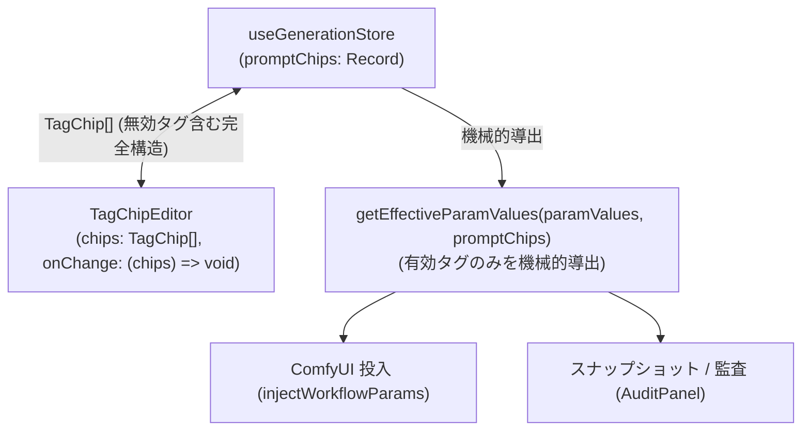

# REQ-220: 生成プロンプト（TagChipEditor）の無効化タグ状態永続化およびライフサイクル保持

## 1. 背景と課題

`comfy-create-helper2` の生成画面（`GeneratePage`）では、プロンプト入力欄（`input_type === "textarea"`）にタグチップエディタ（`TagChipEditor`）が導入されています。
ユーザーはタグをクリックして「有効 / 無効（グレーアウト・取り消し線）」をトグルでき、試行錯誤中にタグを一時的に除外して生成結果を検証できます。

しかしながら、以下の操作が発生すると、**無効化していたタグがチップ列から完全に消失してしまう**事象が発生していました：

1. **画面遷移（Page Navigation）**:
   サイドメニューから「History」「Tags」「LoRAs」「Settings」などの別ページへ遷移した後に「Generate」ページへ復帰すると、`GeneratePage` が再マウントされ、無効タグが消える。
2. **アコーディオン開閉（Section Collapse）**:
   プロンプトセクションのアコーディオンを閉じるとアンマウントされ、再度開いた際に無効タグが消える。
3. **モバイルでのタブ切替（Mobile Tab Switch）**:
   モバイル画面で「Positive」「Negative」などのプロンプトタブを切り替えて戻ると、無効タグが消える。
4. **Multi-Set切替（Set 1 / Set 2 Switch）**:
   セットを切り替えて戻ると、無効タグが消える。

### 根本原因
- SSoT（`SPEC_COMMON.md`）において、`TagChipEditorProps` が `value: string` および `onChange: (val: string) => void`（**有効チップのみ**をカンマ連結した文字列を返す）と定義されていた。
- 無効化タグの存在は `TagChipEditor` 内部のローカルステート（`useChipHistory`）にしか存在せず、`onChange` は有効タグのみの平文文字列を親（`paramValues`）へ送信していた。
- 再マウント時に親から無効タグが削ぎ落とされた平文文字列が渡され、`parseToChips(value)`（全件 `enabled: true`）で初期化されるため、無効タグが永久に喪失していた。

---

## 2. 影響範囲

| ファイル | 変更種別 | 内容 |
|---|---|---|
| `frontend/src/store/types.ts` | MODIFY | `GenerationSet` および `MultiSetState` に `promptChips: Record<string, TagChip[]>` を追加。`MultiSetActions` に `setPromptChips` を追加 |
| `frontend/src/store/slices/multiSetSlice.ts` | MODIFY | `promptChips` をプロンプト項目の SSoT として管理。`getEffectiveParamValues` ヘルパーの実装。セット切替・複製・初期化・アセット適用時のチップ同期を実装 |
| `frontend/src/components/TagChipEditor/index.tsx` | MODIFY | `TagChipEditorProps` を拡張し、`chips: TagChip[]` および `onChange: (chips: TagChip[]) => void`（完全構造を直接授受）に対応。平文への再パースループを完全排除 |
| `frontend/src/pages/GeneratePage/components/DesktopLayout.tsx` | MODIFY | `TagChipEditor` に `key={m.role!}`, `chips={promptChips[m.role!] || []}`, `onChange={(chips) => setPromptChips(m.role!, chips)}` を接続 |
| `frontend/src/pages/GeneratePage/components/MobileLayout.tsx` | MODIFY | `TagChipEditor` に `key={activePromptTabMapping.role!}`, `chips={promptChips[activePromptTabMapping.role!] || []}`, `onChange={(chips) => setPromptChips(activePromptTabMapping.role!, chips)}` を接続 |
| `frontend/src/pages/GeneratePage/hooks/useGenerateAction.ts` | MODIFY | ComfyUI API投入時に `getEffectiveParamValues(paramValues, promptChips)` を使用し、有効タグのみの平文を機械的導出 |
| `frontend/src/components/TagChipEditor/__tests__/TagChipEditor.test.tsx` | MODIFY | 構造体ベースの入出力（`chips` / `onChange`）による無効タグ保持のテストを追加 |
| `docs/specs/SPEC_COMMON.md` | MODIFY | SSoT仕様書に `TagChipEditor` の構造体インターフェースおよびライフサイクル保持規則を反映 |
| `docs/specs/SPEC_GENERATE.md` | MODIFY | SSoT仕様書に `promptChips` のSSoT管理と `getEffectiveParamValues` による平文導出規則を反映 |

---

## 3. アーキテクチャと詳細設計（SSoT ＋ 機械的平文導出）

平文プロンプトと構造化チップの「二重保持（同期更新）」を行わず、**「無効タグを含む完全構造（`promptChips`）を唯一の真実（SSoT）とし、平文が必要な箇所でのみ機械的に有効タグを連結導出する」** アーキテクチャを採用します。



### 3.1 ストア層 (Store Layer)
- プロンプト入力項目（`input_type === "textarea"`）の状態は、**`promptChips: Record<string, TagChip[]>` を SSoT** とします。
- `paramValues` は、int / float / select などの非プロンプトパラメータを保持します。

```typescript
// frontend/src/store/types.ts
export interface GenerationSet {
  id: string | number;
  name: string;
  paramValues: Record<string, string>;
  promptChips?: Record<string, TagChip[]>; // ロール別の完全なチップ配列（無効状態を含む）
  appliedAssets: Record<string, AppliedAsset[]>;
  batchSize: number;
  seedMode: 'random' | 'fixed';
  seed: number;
  checked: boolean;
}

export interface MultiSetState {
  paramValues: Record<string, string>;
  promptChips: Record<string, TagChip[]>;
  // ...
}

export interface MultiSetActions {
  setParamValues: (values: Record<string, string>) => void;
  setPromptChips: (role: string, chips: TagChip[]) => void;
  getEffectiveParamValues: () => Record<string, string>;
  // ...
}
```

### 3.2 機械的平文導出 (`getEffectiveParamValues`)
ComfyUIへの投入時（`injectWorkflowParams`）やスナップショット保存時、監査（Audit）など、平文プロンプトが必要な箇所で呼び出します。

```typescript
export function getEffectiveParamValues(
  paramValues: Record<string, string>,
  promptChips: Record<string, TagChip[]>
): Record<string, string> {
  const effective = { ...paramValues };
  for (const [role, chips] of Object.entries(promptChips || {})) {
    if (chips && chips.length > 0) {
      effective[role] = chipsToString(chips); // 有効タグ (c.enabled === true) のみカンマ連結
    }
  }
  return effective;
}
```

### 3.3 コンポーネント層 (`TagChipEditor`)
- `TagChipEditor` のPropsを構造体ネイティブに刷新します：
  ```typescript
  interface TagChipEditorProps {
    id?: string;
    chips?: TagChip[];
    onChange?: (chips: TagChip[]) => void;
    // 後方互換性用（chips未指定時のみ機能）
    value?: string;
    onStringChange?: (val: string) => void;
    placeholder?: string;
    variant?: string;
    defaultTextMode?: boolean;
    isAnimaMode?: boolean;
    onTextModeToggle?: (isTextMode: boolean) => void;
  }
  ```
- `chips` が渡されている場合：
  - チップの有効/無効トグル、追加、削除、並び替えが発生した際、更新された `TagChip[]` 配列をそのまま `onChange(updatedChips)` で親に返します。
  - 親へ平文を返す必要がなく、文字列からの再パース（情報喪失）が原理的に発生しません。

### 3.4 ライフサイクルと画面切替の保証
1. **画面切替・アコーディオン開閉・モバイルタブ切替**:
   - `promptChips` は Zustand ストア（メモリ）に保持され続ける。
   - コンポーネントが再マウントされた際、ストアの `promptChips[role]` から無効タグを含めて正確に復元される。
2. **Multi-Set切替**:
   - セット切替時、対象セットの `promptChips` が `useGenerationStore` の `promptChips` に復元される。
3. **ComfyUI 投入 (AC-5)**:
   - `useGenerateAction` で `getEffectiveParamValues()` を実行し、ComfyUIには有効タグのみの平文が送信される。

---

## 4. SSoT（仕様書）更新方針

1. **`docs/specs/SPEC_COMMON.md`**:
   - 第3項「TagChipEditor コンポーネント」のインターフェース契約を、`chips: TagChip[]` / `onChange: (chips: TagChip[]) => void` を主軸とする構造体ネイティブ契約に更新。
   - 平文への変換は消費側（`chipsToString` / `getEffectiveParamValues`）の責務とすることを明記。
2. **`docs/specs/SPEC_GENERATE.md`**:
   - 第3項に、プロンプト項目の状態は `promptChips` を SSoT として管理し、ComfyUI投入時に `getEffectiveParamValues` によって機械的に有効タグのみの平文を生成するアーキテクチャを明記。

---

## 5. トレードオフと技術的判断 (Trade-off Disclosure)

1. **単一の真実（SSoT）の確立による整合性保証**:
   - 平文と構造体を二重保持して同期させる方式（旧案）を廃止し、`promptChips` を唯一の真実（SSoT）とすることで、同期不整合や再描画時のパースループを原理的に根絶。
2. **平文導出のオーバーヘッド**:
   - 生成ボタン押下時やスナップショット保存時に `chipsToString` を介して平文を生成するが、タグ数は数十件程度であり、計算コストはナノ秒オーダー（完全に無視できる水準）。
3. **テキスト入力モード切替時の動作**:
   - ユーザーが「テキスト入力モードに切替」を押して生文字列編集を行った場合、テキスト上には無効タグが存在しないため、初版仕様（`spec_tag_chip_editor.md` Section 3-6）通り、チップモード復帰時に有効タグのみが再チップ化される（意図されたエスケープハッチ動作）。
