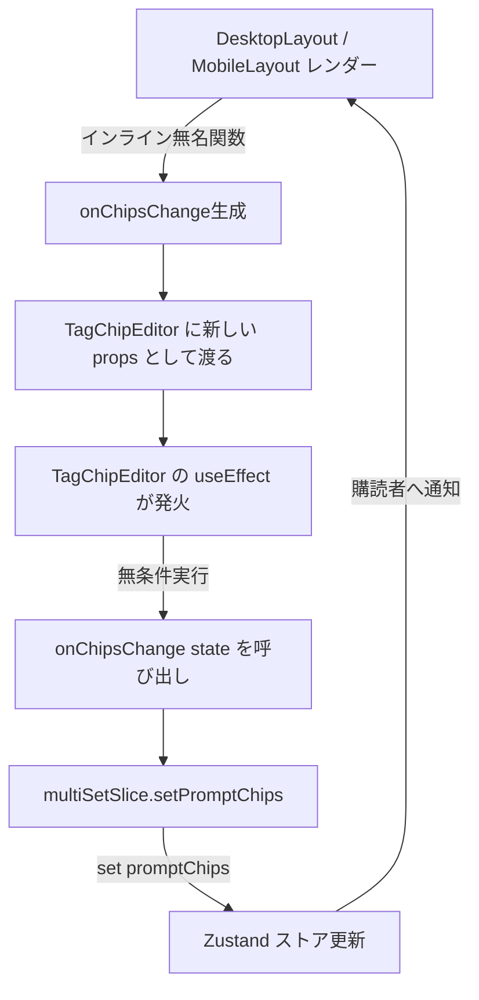

# REQ-221: REQ-220適用後の生成ページ無限再描画エラー（真っ黒画面）の解消

## 1. 概要 (Overview)
REQ-220（無効化タグ状態永続化）の導入後、ブラウザで生成ページ（`/`）を開くと、React が `Maximum update depth exceeded` をスローしてクラッシュし、画面が完全に真っ黒になる障害が発生した。
本設計書では、無限ループの根本原因である「コールバック参照の不安定性」および「TagChipEditor内部Effectと親ストア間の循環同期」を断ち切り、さらにアプリ全体のフォールバック耐久性を向上させるアーキテクチャを定義する。

---

## 2. 根本原因の構造的分析 (Root Cause Analysis)

### 2.1 循環参照・無限再描画のフロー


### 2.2 直接要因
1. **コールバックの参照不安定性**:
   `DesktopLayout.tsx` (L609) および `MobileLayout.tsx` (L707) で、レンダー毎に新規作成される無名関数 `(chips) => setPromptChips(m.role!, chips)` を渡している。
2. **Effectの過剰な依存と無条件発火**:
   `TagChipEditor/index.tsx` (L113-L125) の通知 Effect に `onChipsChange` が依存配列に含まれており、親の再描画毎に Effect がトリガーされる。さらにその中で「値が本当に変わったか」の検査なしにコールバックが発火される。
3. **ストア側の重複更新無防備性**:
   `multiSetSlice.ts` の `setPromptChips` が渡された配列と現在の状態を比較せず、常に新しいオブジェクト `{ ...get().promptChips, [role]: chips }` を生成して `set()` している。
4. **ErrorBoundaryの欠落**:
   `App.tsx` および `GeneratePage` に React ErrorBoundary が存在しないため、子コンポーネントの例外が捕捉されずルート全体がアンマウントされ、ダーク背景のみの真っ黒画面となる。

---

## 3. 詳細アーキテクチャ設計 (Detailed Design)

### 3.1 TagChipEditor 内部の安定化設計 (`TagChipEditor/index.tsx`)
- **コールバック参照のRef化**:
  `onChipsChange` および `onChange` を `useRef` に保持し、Effect 依存配列から排除する。
  ```typescript
  const onChipsChangeRef = useRef(onChipsChange);
  onChipsChangeRef.current = onChipsChange;
  const onChangeRef = useRef(onChange);
  onChangeRef.current = onChange;
  ```
- **送信履歴のトラッキング (`prevEmittedChipsRef`)**:
  外部通知済みのチップ状態を記録し、内容が同一（全件の id, text, enabled が一致）の場合は `onChipsChange` を発火しない。
- **外部Props反映時の送信スキップ**:
  外部から `chipsProp` が渡された場合は `isExternalUpdateRef.current = true` とし、自身が受け取った値を親へオウム返しに送出しないようガードする。

### 3.2 multiSetSlice の更新ガード設計 (`multiSetSlice.ts`)
- `setPromptChips(role, chips)` において、現在のチップ状態と完全一致する場合（参照一致、または要素数・各要素のプロパティ一致）は `set()` および `updateActiveSet()` をスキップする。
  ```typescript
  setPromptChips: (role, chips) => {
    const currentChips = get().promptChips?.[role]
    if (currentChips === chips) return
    if (areChipsEqual(currentChips, chips)) return

    const updated = { ...(get().promptChips || {}), [role]: chips }
    set({ promptChips: updated })
    get().updateActiveSet({ promptChips: updated })
  }
  ```

### 3.3 レイアウト層のコールバック安定化 (`DesktopLayout.tsx` / `MobileLayout.tsx`)
- `handleChipsChange` を `useCallback` で安定化し、不要な関数インスタンス生成を抑制する。
  ```typescript
  const handleChipsChange = useCallback((role: string, chips: TagChip[]) => {
    setPromptChips(role, chips)
  }, [setPromptChips])
  ```

### 3.4 エラーバウンダリの導入 (`ErrorBoundary.tsx`)
- React クラスコンポーネントによる `ErrorBoundary` を `frontend/src/components/common/ErrorBoundary.tsx` として作成。
- レンダリング時例外を捕捉し、ユーザーフレンドリーなエラーカードおよび「ページ再読み込み」ボタンを表示することで、画面全体が真っ黒になる致命的 UX を防止する。

---

## 4. SSoT 整合性確認 (SSoT Alignment)
- `SPEC_COMMON.md`: TagChipEditor コンポーネントの仕様（`chips?: TagChip[]`, `onChipsChange?: (chips: TagChip[]) => void`）と完全に一致。インターフェース変更なし。
- `SPEC_GENERATE.md`: 有効タグ平文の機械的導出（`getEffectiveParamValues`）の仕様と一致。変更なし。

---

## 5. 検証方針 (Verification Strategy)
- `npx vitest run src/pages/GeneratePage/components/__tests__/MobileLayout.test.tsx` が 5 テストすべて PASS すること。
- `npx vitest run src/components/TagChipEditor/__tests__/TagChipEditor.test.tsx` が PASS すること。
- `npx vitest run src/pages/__tests__/GeneratePage.test.tsx` が PASS すること。

