# REQ-222 詳細設計書: TagChipEditorの外部プロンプト文字列同期不全およびプリセット切替時の消失バグ解消

## 1. 背景と課題

REQ-220およびREQ-221において、生成画面のタグチップ（`TagChipEditor`）の状態保持および無限再レンダリング防止策を導入しました。
しかし、以下の2つの重大な機能不全が新たに発生していました：

1. **アクティブなプリセットのプロンプトが消える（空になる）**:
   - プリセット切り替え時、または初期ロード時に、`TagChipEditor` の `key` が `role` のみ（例: `key={m.role!}`）となっていたため、`activeSetId`（プリセット・セットID）の変化に伴う再マウントが行われない。
   - `promptChips?.[role]` が `{}`（空オブジェクト）や未定義の場合、新プリセットのプロンプト文字列 `paramValues[role]` がチップに反映されず、逆に空のチップ状態がストアへ上書き通知されてプロンプトが消滅する。
2. **セクションのコピペ機能（`PromptSectionClipboardMenu`）でペーストできない**:
   - セクションコピペ機能は `onChangeValue(cleanToPaste)` を実行し、親の `paramValues`（文字列）を更新する。
   - しかし `TagChipEditor/index.tsx` の外部同期 Effect において、`if (chipsProp !== undefined)` の分岐に入ると `value`（文字列プロンプト）の変更監視を完全に無視するロジックになっていた。
   - その結果、親の文字列が更新されても `TagChipEditor` 内のチップ配列は更新されず、直後の内部通知 Effect で古いチップ文字列が親の `onChange` に送り返され、ペースト内容が古いプロンプトで上書きされてキャンセルされていた。

---

## 2. 根本原因と解決アーキテクチャ

### 2.1 原因分析と修正方針

```mermaid
flowchart TD
    subgraph Current[現状の欠陥フロー]
        A1[セクションコピペ実行] --> B1[paramValues 更新: 新文字列]
        B1 --> C1["TagChipEditor (chipsProp !== undefined)"]
        C1 -->|chipsPropに変更なし| D1[value の変更を完全無視]
        D1 --> E1[TagChipEditor 内部通知 Effect 発火]
        E1 -->|古いチップ文字列を送り返す| F1[paramValues を古い値で上書きキャンセル]
    end

    subgraph Solution[解決アーキテクチャ]
        A2[セクションコピペ or プリセット変更] --> B2[paramValues 更新: 新文字列]
        B2 --> C2["TagChipEditor: chipsProp と value の両方を検知"]
        C2 -->|文字列 value がチップ配列と不一致| D2[value を parseToChips して同期]
        D2 --> E2[onChipsChange 経由で新チップ配列を promptChips に反映]
        E2 --> F2[安定した単一の真実として画面表示を維持]
    end
```

### 2.2 詳細設計要件

1. **`TagChipEditor/index.tsx` の外部同期 Effect 改修**:
   - `chipsProp` と `value` の両方を整合的に同期する。
   - `chipsProp !== undefined` の場合：
     - `chipsProp !== prevChipsProp.current` であれば、`chipsProp` を優先してチップ状態を更新（`prevChipsProp.current = chipsProp`, `prevEmittedChipsRef.current = chipsProp`, `setChips(chipsProp, false)`）。
     - 加えて、`value !== prevChipsString.current` であり、かつ現在のチップ状態を文字列化した結果と `value` が異なる場合（＝セクションコピペや翻訳適用など外部から文字列が直接書き換えられた場合）、`value` を `parseToChips(value)` してチップ状態を更新し、`prevChipsString.current = value` とする。
   - `chipsProp === undefined` の場合：
     - 従来通り `value !== prevChipsString.current` で `parseToChips(value)` して更新する。

2. **`DesktopLayout.tsx` および `MobileLayout.tsx` のコンポーネント Key 修正**:
   - `TagChipEditor` の `key` プロパティを `${activeSetId}-${m.role!}`（MobileLayout では `${activeSetId}-${activePromptTabMapping.role!}`）に変更する。
   - これにより、プリセットや Multi-Set を切り替えた際に `TagChipEditor` が確実にリフレッシュされ、切り替え前のチップ状態が新プリセットに残留・干渉してプロンプトが消滅する不具合を根本から防止する。

3. **`multiSetSlice.ts` の `loadPresetData` におけるチップ初期化**:
   - プリセットロード時（`loadPresetData`）、各 role の `paramValues` 文字列に対応する `promptChips` が存在しない場合は、`paramValues` から `parseToChips` して `promptChips` を自動生成してセットに保持する。これにより、ロード直後のプリセットでも `promptChips` と `paramValues` の完全な整合性を保証する。

---

## 3. 影響ファイル一覧

| ファイルパス | 変更種別 | 内容 |
|---|---|---|
| `frontend/src/components/TagChipEditor/index.tsx` | MODIFY | `chipsProp` 存在時でも外部 `value` 文字列の更新を検知・パースしてチップへ同期するロジックを実装 |
| `frontend/src/pages/GeneratePage/components/DesktopLayout.tsx` | MODIFY | `TagChipEditor` の `key` を `${activeSetId}-${m.role!}` に更新 |
| `frontend/src/pages/GeneratePage/components/MobileLayout.tsx` | MODIFY | `TagChipEditor` の `key` を `${activeSetId}-${activePromptTabMapping.role!}` に更新 |
| `frontend/src/store/slices/multiSetSlice.ts` | MODIFY | `loadPresetData` 時、プリセットの `param_values` から初期 `promptChips` を安全に構築 |
| `frontend/src/components/TagChipEditor/__tests__/TagChipEditor.test.tsx` | MODIFY | `chips` 指定時でも外部から `value` が変更された場合に正しく同期されることを検証するテストを追加 |
| `frontend/src/pages/__tests__/GeneratePage.test.tsx` | MODIFY | プリセット切り替え時にプロンプトが消えず、セクションコピペが正常に動作する回帰テストを追加 |

---

## 4. トレードオフ・リスク開示 (Trade-off Disclosure)

- **再マウントに伴うローカル Undo/Redo 履歴のスコープ**:
  - `key` に `activeSetId` を含めることでプリセット切り替え時に `TagChipEditor` が再マウントされます。これにより、TagChipEditor 内部のローカル Undo 履歴（`useChipHistory`）はそのプリセットごとに新しく開始されます（プリセット A で行ったチップ編集をプリセット B に切り替えてからチップ単体で Undo することはできなくなります）。
  - ただし、これはプリセットごとに独立した編集コンテキストを持つべきという UI 原則に完全に合致しており、プロンプトの混濁・消失バグを排除するための望ましい設計です。