# REQ-223 詳細設計書: サーバ再起動・初期ロード時のTagChipEditorプロンプト消失バグ解消

## 1. 背景と課題

REQ-222において、プリセット切り替え時のプロンプト消失およびセクションコピペ機能の不具合を解消しました。
しかし、**サーバ再起動（FastAPI/ComfyUI再起動、または画面リロード・再接続）時**において、アクティブプリセットの入力欄（`TagChipEditor`）からプロンプトが再び消失する不具合が再発することが確認されました。
なお、セクションコピペ機能は正常に動作し続けています。

### 観測された現象と再現条件:
1. プリセットにプロンプトを入力・保存した状態で、該当プリセットをアクティブにする。
2. サーバを再起動（またはブラウザを再読み込み）する。
3. 画面描画直後、アクティブな入力欄（`TagChipEditor`）のプロンプトが空（`""`）に消失し、直後の自動保存によりバックエンドDBまで空文字で上書き保存される。

---

## 2. 根本原因と本質的構造欠陥

### 2.1 課題の本質: 「BEからの読み込み」を「変更」と誤認する自己破壊ループ

本不具合の根本的な原因は、**「サーバ/BEからの初期読み込み（Read / Hydration）」を「コンポーネント自身の変更（Write / Mutation）」と誤認して扱ってしまっていること**、および**「未同期フェーズにおける空状態のストア流入と自動保存」に対するガードが存在しないこと**にあります。

```mermaid
flowchart TD
    subgraph Bug[現状の自己破壊メカニズム]
        A1["ページリロード / サーバ再起動"] --> B1["BEデータ到着前: TagChipEditor が value='', chips=undefined でマウント"]
        B1 --> C1["【欠陥1: マウント時通知】TagChipEditor が onChipsChange([]) を親へ発火"]
        C1 --> D1["Zustand ストアに { role: [] } が注入される (未同期の空状態流入)"]
        D1 --> E1["BEからプリセットデータ到着 (loadPresetData)"]
        E1 --> F1["【欠陥2: 誤認マージ】{ role: [] } の存在により BEの正規プロンプトチップを破棄"]
        F1 --> G1["親から value='BEプロンプト' が TagChipEditor に下りてくる"]
        G1 --> H1["【欠陥3: 読み込みを変更と誤認】TagChipEditor が '' !== 'BEプロンプト' を検知し onChange('') を親へ打ち返す"]
        H1 --> I1["親ストアの paramValues が空文字 '' に上書き破壊される"]
        I1 --> J1["【欠陥4: 未同期 autosave】初期同期完了前に autosave が走り DBを空文字で上書き永続化"]
    end

    subgraph Fix[根本的流入遮断 & デバイス跨ぎ同期保証]
        A2["ページリロード / サーバ再起動"] --> B2["【根本遮断1】TagChipEditor マウント時の親通知を完全ゼロ化 (マウントは変更ではない)"]
        B2 --> C2["【根本遮断2】下り方向同期(BEデータ適用)に対する上り onChange('') 打ち返しを完全遮断"]
        C2 --> D2["【根本遮断3】親への通知は『ユーザー直接操作(UIイベント)』のみに厳格限定"]
        D2 --> E2["【保存ロック】usePresetState: isInitialSync 完了まで autosave を完全ロック"]
        E2 --> F2["【多層防護】multiSetSlice: loadPresetData で BEデータを正本として確実にチップ復元"]
        F2 --> G2["【デバイス跨ぎ同期】Desktop/Mobileレイアウト切替 & ID型正規化による同期漏れの完全防止"]
    end
```



### 2.2 根本原因の詳細

1. **下り方向のデータ読み込みに対する上り方向の自己破壊通知**:
   - `TagChipEditor` の内部通知 Effect:
     ```typescript
     const newStr = chipsToString(state);
     if (newStr !== value) {
       prevChipsString.current = newStr;
       onChange?.(newStr);
     }
     ```
   - 親から BE データ（`value`）が下りてきた際、コンポーネント内部ステート（`state`）がまだ追いついていない状態で上記 Effect が走り、「`newStr`（空）と `value`（BEデータ）が異なる」という理由で、コンポーネント自身の空文字を `onChange("")` として親へ打ち返していました。
   - **BEからの読み込みは単なる Read であり「変更」ではない**にもかかわらず、コンポーネント発の変更とみなして親を空文字で破壊していました。
2. **マウント時の未初期化空チップ逆流によるストア汚染**:
   - 初期描画時、`TagChipEditor` はプロップスが空の状態でマウントされます。
   - その初回マウント時に `onChipsChange?.([])` を実行してしまい、Zustand ストアに `{ [role]: [] }` という空配列チップを注入していました。
3. **`multiSetSlice.loadPresetData` の空チップ誤認**:
   - `s.promptChips && Object.keys(s.promptChips).length > 0` の判定により、上記で注入された `{ [role]: [] }` を「有効な既存チップ」と誤認し、BEから届いた正規プロンプトのパース結果（`initialPromptChips`）を破棄していました。
4. **未同期フェーズにおける自動保存（Autosave）の無防備な発火**:
   - `usePresetState` において、`isInitialSyncRef.current` が false（初期同期未完了）の間でも autosave Effect がリッスンしており、破壊された空文字をそのままバックエンドへ上書き送信していました。
5. **デバイス・ストレージ復元時の型揺らぎによる同期脱落**:
   - `localStorage` から復元される `activeSetId` が文字列型（`"1412"`）であるのに対し、DBから届くプリセットIDは数値型（`1412`）であるため、`typeof activeSetId === 'number'` や `s.id === currentActiveSetId` などの厳密比較によって、特定デバイスや画面起動直後に Autosave が無効化されたりセット同期から脱落する不整合が発生していました。

---

## 3. 詳細設計要件

### 3.1 【根本遮断】TagChipEditor の通信方向性の厳格化 (`TagChipEditor/index.tsx`)

1. **マウント時通知の完全抑止**:
   - コンポーネントのマウント（初期レンダリング）はプロップスの受取（Read）に過ぎないため、マウント時に `onChipsChange` や `onChange` を親へ呼び出すことを一切禁止する。
2. **上り通知（子 → 親）を「ユーザー直接操作」のみに限定**:
   - `userEditedRef`（ユーザー直接操作フラグ）を設け、ユーザーが実際にタグ追加・削除・編集・トグル・ドラッグ並べ替え・テキスト入力を行った場合のみ `onChange` / `onChipsChange` の親通知を許可する。
   - 外部から渡された `value` が非空である過渡状態において、内部ステートが空であることを理由にした `onChange("")` の親破壊通知を完全遮断する。
3. **下り方向同期（親/BE → 子）での上り打ち返し防止**:
   - 親から `value` や `chipsProp` が更新された際は、内部ステート（`state`）とテキスト表示を追従させるのみとし、親への `onChange` 打ち返しを発生させない。
   - 万が一 `chipsProp` が空配列 `[]` で渡されても `value` が非空であれば、`parseToChips(value)` によりチップを自律復元する。

### 3.2 【保存遮断 & デバイス跨ぎ同期】usePresetState の同期保証 (`usePresetState.ts`)

1. **初期同期未完了時の autosave 完全ロック**:
   - `if (!isInitialSyncRef.current) return` を autosave Effect の先頭ガードに追加。
   - サーバからのデータ読み込みおよび初回セット同期が完全に完了するまで、いかなる自動保存も実行させない。
2. **初回読み込みデータの baseline 確立**:
   - BEから読み込んだデータ（`loadPresetData`）を `lastSavedStateRef` の基準値として確定させ、読み込み直後は「差分なし（Clean）」として扱う。
3. **ID型正規化によるデバイス跨ぎ同期漏れ防止**:
   - `activeSetId` の比較および autosave ガード：
     `typeof currentActiveSetId === 'number'` や `typeof activeSetId !== 'number'` を撤廃し、`currentActiveSetId !== null && currentActiveSetId !== undefined`、`String(s.id) === String(currentActiveSetId)` に正規化。
   - PC / スマホ / タブレット等のデバイス環境や `localStorage` からの復元経路に左右されず、常に同一のプリセットとして認識・同期・保存されることを保証する。
4. **`mappedSets` 再構築時の既存 `promptChips` 保持**:
   - サーバからの最新データ再取得（TanStack Query リフェッチ等）時にも既存セットの `promptChips` を欠落させず引き継ぐ。

### 3.3 【デバイスレイアウト切替保証】Desktop ↔ Mobile 間の状態連続性

1. **レイアウト切り替え時の状態維持**:
   - ウィンドウリサイズや画面回転によって `DesktopLayout` ↔ `MobileLayout` が動的に切り替わった場合でも、エディタのマウント時通知がゼロ化されているため、マウント/アンマウントに伴う状態の消去や空逆流が一切発生しない。
2. **MobileLayout タブ切り替え時の状態保護**:
   - `MobileLayout` において `activePromptTabMapping`（ロールタブ）を切り替えた際、直前まで入力していたロールのプロンプトおよびチップは Zustand ストアに安全に保存されており、再度タブを戻した際にも完全に復元される。

### 3.4 【多層防護】multiSetSlice の loadPresetData 改修 (`multiSetSlice.ts`)

1. **role 別有効チップ判定（BEプロンプトの正本化）**:
   - `Object.keys().length > 0` による一括判定を廃止。
   - 各 role ごとに有効なチップ（`chips && chips.length > 0`）が存在するかを個別にマージ判定し、空配列 `{ [role]: [] }` で BEプロンプトチップが破棄されないよう完全防御する。

---

## 4. 影響ファイル一覧

| ファイルパス | 変更種別 | 内容 |
|---|---|---|
| `frontend/src/components/TagChipEditor/index.tsx` | MODIFY | マウント時親通知抑止、下り更新に対する上り打ち返し完全遮断、ユーザー直接操作限定通知 |
| `frontend/src/pages/GeneratePage/hooks/usePresetState.ts` | MODIFY | 初期同期未完了時の autosave 完全ロック、baseline 確定、mappedSets チップ保持、ID型正規化（デバイス跨ぎ同期保証） |
| `frontend/src/store/slices/multiSetSlice.ts` | MODIFY | `loadPresetData` での role 別有効チップ判定（BEプロンプトの正本保護） |
| `frontend/src/components/TagChipEditor/__tests__/TagChipEditor.test.tsx` | MODIFY | マウント時非通知・下り更新時非破壊・外部値自己復元・手動全削除テストを追加 |
| `frontend/src/store/__tests/useGenerationStore.test.ts` | MODIFY | 空チップ注入時でも BEプロンプトが優先復元される単体テストを追加 |
| `frontend/src/pages/GeneratePage/components/__tests__/MobileLayout.test.tsx` | MODIFY | MobileLayout タブ切り替え時・マウント時のプロンプトチップ保持テストを追加 |
| `frontend/src/pages/__tests__/GeneratePage.test.tsx` | MODIFY | サーバ再起動・初期同期時の autosave ロックとプロンプト非破壊回帰テストを追加 |

---

## 5. トレードオフ・リスク開示 (Trade-off Disclosure)

- **ユーザーが意図してプロンプトを「全削除」した場合の検知**:
  - ユーザーが手動でタグチップをすべて削除した（またはテキストモードで全選択削除した）場合は、ユーザー直接操作（`userEditedRef.current = true`）であるため、正常に親へ `onChange("")` が発火して空としてDB保存されます。
  - 「未同期・初期ロード・レイアウト切り替え時の空状態」と「ユーザー操作による意図的な空化」が厳密に識別されるため、機能的な欠落や副作用はありません。\n