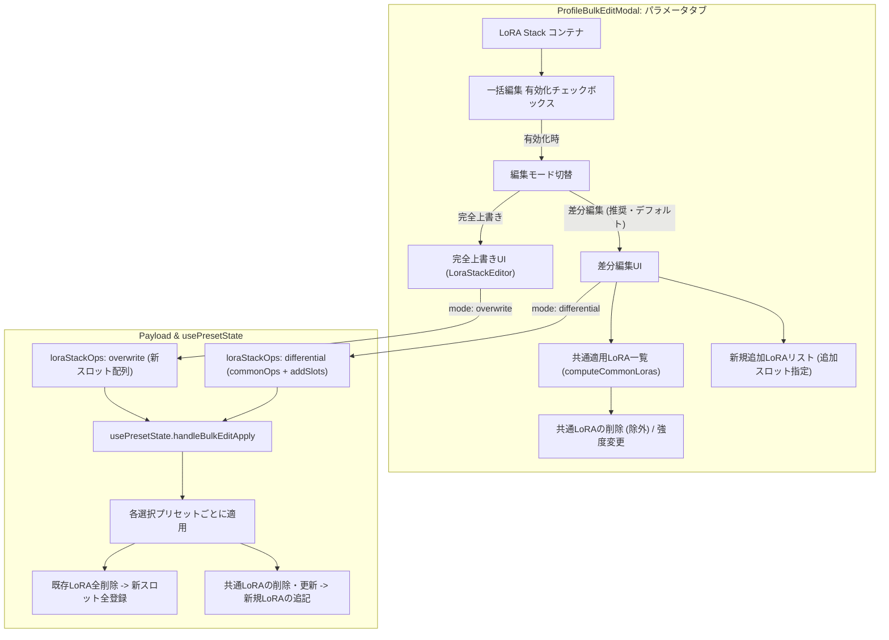

# REQ-224 詳細設計書: プリセット一括編集におけるパラメータタブLoRA適用不具合解消およびLoRA適用機能の重複整理

## 1. 背景と課題

生成画面（`GeneratePage`）の「プリセット一括編集モーダル（`ProfileBulkEditModal`）」において、以下の課題が存在する。

1. **LoRAの特性に応じた一括編集機能の不足と適用不具合**:
   - LoRA（`lora_stack`）は単一のスカラー値（数値や文字列）とは異なり、複数スロットのリスト構造を持つ。
   - 複数プリセットを選択して一括編集を行う際、「各プリセットで共通して適用されているLoRAを確認し、特定の共通LoRAを削除したり、新たなLoRAを追加（追記）したりする差分編集」を行いたいユースケースと、「全プリセットのLoRAを新設定で一括全置換する完全上書き」の双方が状況に応じて必要とされる。
   - しかし現状は、パラメータタブ内の `LoraStackEditor` に個別有効化チェックボックスがなく、さらに `buildPayload` がスロットキーを除外してしまうため、LoRA設定が一切プリセットに反映されない不具合がある。
2. **LoRA専用タブとパラメータタブの機能重複**:
   - モーダル内に独立した「LoRA」タブが存在するが、プロンプトへのタグ反映を担うアセット機能は既に「プロンプト」タブ（`AddAssetModal`）に備わっている。
   - LoRAタブ内の「単一 LoRA 指定（従来機能）」はパラメータタブのLoRA設定と目的が重複し、かつ保存先が `applied_assets` に誤配向されているため、独立したLoRAタブ自体が冗長でありユーザーの混乱要因となっている。

---

## 2. 構造分析とアーキテクチャ設計

### 2.1 改善後のタブ構成と責務
- **タブ構成の簡素化（2タブ化）**:
  - モーダル内のタブを**「プロンプト」**と**「パラメータ」**の2つのみに整理（旧「LoRA」タブは完全撤廃）。
  - **プロンプトタブ**: プロンプト文字列の検索・置換・追加・削除、およびプロンプトへのアセット追加（トリガータグ反映）。
  - **パラメータタブ**: サンプラー、スケジューラー等の一般パラメータ、および **LoRA Stack（共通LoRA差分編集／完全上書き）**。

### 2.2 LoRA Stack 一括編集のアーキテクチャ



---

## 3. 詳細設計要件

### 3.1 共通LoRAの抽出ロジック (`computeCommonLoras`)
選択された全プリセット（`selectedPresets`）において、指定ロール（`role`）に共通して適用されているLoRA（モデル名で一致判定）を抽出する純粋関数:

```typescript
export interface CommonLoraItem {
  name: string;
  weight: string;
  modelStrength: string;
  clipStrength: string;
  enabled: boolean; // false で削除対象
}

export function computeCommonLoras(
  presets: WorkflowPreset[],
  role: string
): CommonLoraItem[] {
  if (presets.length === 0) return [];

  // 各プリセットのLoRA一覧を取得
  const presetLoras: Array<Map<string, { weight: string; modelStrength: string; clipStrength: string }>> = presets.map(p => {
    const map = new Map();
    const count = parseInt(p.param_values?.[`${role}_lora_count`] || '0', 10);
    for (let i = 1; i <= count; i++) {
      const name = p.param_values?.[`${role}_lora_name_${i}`];
      if (name && name !== 'None') {
        map.set(name, {
          weight: p.param_values?.[`${role}_lora_wt_${i}`] ?? '0.0',
          modelStrength: p.param_values?.[`${role}_model_str_${i}`] ?? '1.0',
          clipStrength: p.param_values?.[`${role}_clip_str_${i}`] ?? '1.0',
        });
      }
    }
    return map;
  });

  const firstPreset = presetLoras[0];
  if (!firstPreset) return [];

  const common: CommonLoraItem[] = [];
  firstPreset.forEach((data, name) => {
    const isCommonInAll = presetLoras.every(map => map.has(name));
    if (isCommonInAll) {
      common.push({
        name,
        weight: data.weight,
        modelStrength: data.modelStrength,
        clipStrength: data.clipStrength,
        enabled: true,
      });
    }
  });

  return common;
}
```

### 3.2 パラメータタブ内の LoRA Stack UI (`ProfileBulkEditModal.tsx`)

1. **個別有効化チェックボックス**:
   - `m.input_type === 'lora_stack'` のコンテナ先頭にチェックボックス `<input type="checkbox" checked={isEnabled} onChange={() => toggleParamEnabled(m.role)} />` を提供。
   - OFF時は全体を非活性（`opacity-40 pointer-events-none`）表示。
2. **編集モード切替ボタン**:
   - 「差分編集（共通確認・追加・削除）」／「完全上書き」の切り替えボタングループを設置。
3. **差分編集モードUI**:
   - **共通適用LoRAセクション**:
     - `computeCommonLoras` の結果を一覧表示。
     - 各共通LoRAに「削除（除外）」ボタン（ゴミ箱アイコン）および強度入力を配置。削除ボタン押下で `enabled: false`（赤字・取消線表示）に切り替え。
     - 共通LoRAが存在しない場合は「選択したプリセット間で共通するLoRAはありません」とメッセージ表示。
   - **新規追加LoRAセクション**:
     - 「+ LoRAを追加」ボタンにより、追記したいLoRA（モデル選択、強度、モデル/クリップ強度）のスロットを追加可能。
4. **完全上書きモードUI**:
   - 既存の `LoraStackEditor` を配置し、最大10スロットの自由な再構築・設定が可能。

### 3.3 ペイロード定義と `buildPayload` (`ProfileBulkEditModal.tsx`)

```typescript
export interface PresetLoraSlot {
  name: string;
  weight: string;
  modelStrength: string;
  clipStrength: string;
}

export interface CommonLoraOp {
  name: string;
  action: 'update' | 'remove';
  weight?: string;
  modelStrength?: string;
  clipStrength?: string;
}

export interface LoraStackOp {
  role: string;
  mode: 'overwrite' | 'differential';
  slots?: PresetLoraSlot[];       // overwrite モード時
  commonOps?: CommonLoraOp[];     // differential モード時
  addSlots?: PresetLoraSlot[];    // differential モード時
}

export interface BulkEditPayload {
  promptOps?: PromptOp[];
  paramPatch?: Record<string, string>;
  batchSize?: number;
  loraOps?: LoraOp[];
  assetOps?: AppliedAssetOp[];
  loraStackOps?: LoraStackOp[];
}
```

- `buildPayload` において、`enabledParams.has(role)` かつ `mapping.input_type === 'lora_stack'` の場合、選択されているモードに応じた `loraStackOps` を生成してペイロードに付与。

### 3.4 プリセット一括適用ハンドラ (`usePresetState.ts`)

`handleBulkEditApply` において、各プリセットに対する `payload.loraStackOps` の処理ロジックを追加:

```typescript
if (payload.loraStackOps) {
  for (const op of payload.loraStackOps) {
    if (op.mode === 'overwrite') {
      // 1. 既存の全スロットを削除
      const oldCount = parseInt(newParamValues[`${op.role}_lora_count`] || '0', 10);
      delete newParamValues[`${op.role}_lora_count`];
      for (let i = 1; i <= oldCount; i++) {
        delete newParamValues[`${op.role}_lora_name_${i}`];
        delete newParamValues[`${op.role}_lora_wt_${i}`];
        delete newParamValues[`${op.role}_model_str_${i}`];
        delete newParamValues[`${op.role}_clip_str_${i}`];
      }
      // 2. 新スロットを登録
      const newSlots = op.slots || [];
      newParamValues[`${op.role}_lora_count`] = String(newSlots.length);
      newSlots.forEach((slot, idx) => {
        const i = idx + 1;
        newParamValues[`${op.role}_lora_name_${i}`] = slot.name;
        newParamValues[`${op.role}_lora_wt_${i}`] = slot.weight;
        newParamValues[`${op.role}_model_str_${i}`] = slot.modelStrength;
        newParamValues[`${op.role}_clip_str_${i}`] = slot.clipStrength;
      });
    } else if (op.mode === 'differential') {
      // 1. 当該プリセットの既存スロットを抽出
      const oldCount = parseInt(newParamValues[`${op.role}_lora_count`] || '0', 10);
      const currentSlots: PresetLoraSlot[] = [];
      for (let i = 1; i <= oldCount; i++) {
        const name = newParamValues[`${op.role}_lora_name_${i}`];
        if (name && name !== 'None') {
          currentSlots.push({
            name,
            weight: newParamValues[`${op.role}_lora_wt_${i}`] ?? '0.0',
            modelStrength: newParamValues[`${op.role}_model_str_${i}`] ?? '1.0',
            clipStrength: newParamValues[`${op.role}_clip_str_${i}`] ?? '1.0',
          });
        }
        delete newParamValues[`${op.role}_lora_name_${i}`];
        delete newParamValues[`${op.role}_lora_wt_${i}`];
        delete newParamValues[`${op.role}_model_str_${i}`];
        delete newParamValues[`${op.role}_clip_str_${i}`];
      }

      // 2. commonOps の反映 (削除 / 更新)
      const removeNames = new Set(
        (op.commonOps || []).filter(c => c.action === 'remove').map(c => c.name)
      );
      const updateMap = new Map(
        (op.commonOps || []).filter(c => c.action === 'update').map(c => [c.name, c])
      );

      let updatedSlots = currentSlots.filter(s => !removeNames.has(s.name));
      updatedSlots = updatedSlots.map(s => {
        const update = updateMap.get(s.name);
        if (update) {
          return {
            ...s,
            weight: update.weight ?? s.weight,
            modelStrength: update.modelStrength ?? s.modelStrength,
            clipStrength: update.clipStrength ?? s.clipStrength,
          };
        }
        return s;
      });

      // 3. addSlots の追記 (重複防止 & 最大10件制限)
      for (const add of (op.addSlots || [])) {
        if (!updatedSlots.some(s => s.name === add.name) && updatedSlots.length < 10) {
          updatedSlots.push(add);
        }
      }

      // 4. newParamValues への再書き込み
      newParamValues[`${op.role}_lora_count`] = String(updatedSlots.length);
      updatedSlots.forEach((slot, idx) => {
        const i = idx + 1;
        newParamValues[`${op.role}_lora_name_${i}`] = slot.name;
        newParamValues[`${op.role}_lora_wt_${i}`] = slot.weight;
        newParamValues[`${op.role}_model_str_${i}`] = slot.modelStrength;
        newParamValues[`${op.role}_clip_str_${i}`] = slot.clipStrength;
      });
    }
  }
}
```

### 3.5 独立LoRAタブの完全撤廃 (`ProfileBulkEditModal.tsx`)
- `Tab` 型を `'prompt' | 'params'` に変更。
- タブバーを「プロンプト」「パラメータ」の2タブに変更。
- 旧LoRAタブのレンダリングブロック、State（`loraFilename`, `loraStrength`, `loraRole`, `loraMode` 等）を完全削除。
- プロンプトタブ内の「アセットを追加」ボタンおよび `assetOps` はプロンプト用アセット注入機能としてそのまま維持。

---

## 4. トレードオフとリスク (Trade-off Disclosure)

- **差分編集時のスロット数上限**:
  - 各プリセットごとに既存LoRA数が異なる場合、追加スロットをマージした結果が上限（10件）を超えるプリセットは10件で打ち止め（クランプ）されます。警告テキスト等で最大10スロットであることを明示します。
- **UIタブの2タブ化**:
  - タブ数が減り、モーダルが大幅にシンプル化されます。LoRA設定はパラメータタブ内で「共通確認・追加・削除」または「完全上書き」として完結するため、ユーザーの迷いが解消されます。

---

## 5. 影響範囲・対象ファイル一覧

| ファイルパス | 変更区分 | 変更概要 |
|---|---|---|
| `frontend/src/components/ProfileBulkEditModal.tsx` | MODIFY | タブの2タブ化（プロンプト／パラメータ）、`computeCommonLoras` 実装、差分編集UI／完全上書きUIの提供、`buildPayload` での `loraStackOps` 生成 |
| `frontend/src/pages/GeneratePage/hooks/usePresetState.ts` | MODIFY | `handleBulkEditApply` での `payload.loraStackOps`（差分編集／完全上書き）の各プリセット反映処理 |
| `frontend/src/components/__tests__/ProfileBulkEditModal.test.tsx` | MODIFY | 2タブ構成の検証、`computeCommonLoras` ユニットテスト、差分編集／完全上書きのペイロード検証テスト |
| `docs/specs/SPEC_GENERATE.md` | MODIFY | プリセット一括編集モーダルの仕様（2タブ構成、LoRA Stack の差分／上書き一括編集）の同期 |
