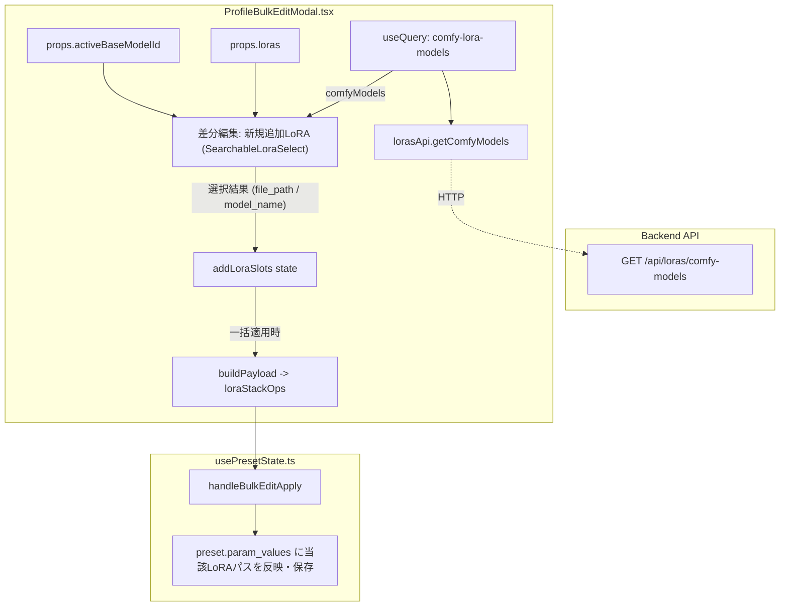

# REQ-225 詳細設計書: プリセット一括編集におけるComfyUI未登録LoRAモデルの選択連携

## 1. 背景と課題

`ProfileBulkEditModal`（プリセット一括編集モーダル）のパラメータタブ内において、`lora_stack` の一括編集機能（差分編集モードおよび完全上書きモード）が提供されている。
しかし、現状の実装では以下の課題がある：

1. **未登録ComfyUI LoRAが候補に現れない**:
   - 通常の生成画面のパラメータパネル（`LoraStackEditor`）では、バックエンドの `/api/loras/comfy-models` から取得した ComfyUI 側認識済みLoRA一覧（`comfyModels`）と DB 登録済み LoRA 一覧（`loras`）を `SearchableLoraSelect` に渡すことで、ComfyUI のディレクトリ内に配置された未登録 LoRA も検索・選択できる。
   - 一方、`ProfileBulkEditModal` 内の差分編集「新規追加LoRA」セクションの `SearchableLoraSelect` には `loras` のみが渡されており、`comfyModels` が未連携であるため、DB 未登録の LoRA が選択候補に表示されない。
2. **表示仕様・優先順位の乖離**:
   - `SearchableLoraSelect` の仕様上、`comfyModels` と `loras` が渡された場合：
     - DB 登録済み LoRA は、登録されている説明文（`description`）またはモデル名（`model_name`）を優先表示する。
     - DB 未登録 LoRA は、ファイルパスを表示し、`Unregistered` バッジを付与する。
   - `ProfileBulkEditModal` に `comfyModels` を渡すことで、個別の `LoraStackEditor` と完全に同一の表示仕様・選択体験に統一する必要がある。

---

## 2. 構造分析とアーキテクチャ設計

### 2.1 データフロー設計



### 2.2 コンポーネントおよびプロパティ設計

1. **`ProfileBulkEditModal.tsx`**:
   - `useQuery` を利用して `['comfy-lora-models']`（`lorasApi.getComfyModels`）を取得。
     - ※ `LoraStackEditor` と同一の `queryKey: ['comfy-lora-models']` を利用することで、TanStack Query のキャッシュが有効に働き、無駄な再フェッチを防止。
   - `activeBaseModelId?: number | null` を `ProfileBulkEditModalProps` に追加。
   - 差分編集の「新規追加LoRA」セクションにある `SearchableLoraSelect` に渡す props を更新：
     ```tsx
     <SearchableLoraSelect
       loras={loras}
       comfyModels={comfyModels}
       activeBaseModelId={activeBaseModelId}
       value={slot.name}
       onChange={val => { ... }}
       placeholder="LoRAを選択..."
     />
     ```
   - 完全上書きモードで描画される `LoraStackEditor` にも `activeBaseModelId` を透過して渡す。

2. **`GeneratePage.tsx`**:
   - `ProfileBulkEditModal` を呼び出す箇所において、`activeBaseModelId={workflow?.target_base_model_id ?? null}` を渡す。

---

## 3. 詳細設計要件

### 3.1 `SearchableLoraSelect` の表示優先順位の確認
`SearchableLoraSelect.tsx` の内部ロジックは以下の通り実装済み：
```typescript
if (comfyModels) {
  return comfyModels.map((model) => {
    const registered = loras?.find((l) => l.id === model.lora_id);
    return {
      value: model.file_path,
      displayName: registered?.description ? registered.description : model.file_path,
      loraId: model.lora_id,
      modelName: registered?.model_name || '',
      filePath: model.file_path,
      description: registered?.description || null,
      isRegistered: model.is_registered,
      lora: registered,
    };
  });
}
```
- `comfyModels` を渡すことにより：
  - 登録済みLoRA（`is_registered: true`）は、`description`（設定されていれば）またはモデル名が `displayName` となり優先表示される。
  - 未登録LoRA（`is_registered: false`）は、ファイルパスが `displayName` となり、かつ右端に `Unregistered` バッジが表示される。
  - 選択時の値（`value`）は `model.file_path` となり、ComfyUI の LoRA ローダーが正しく解釈可能な相対ファイルパス（サブフォルダ含む）が渡される。

### 3.2 プリセットへの適用と永続化 (`usePresetState.ts`)
- 未登録 LoRA の `value`（`model.file_path`）が `slot.name` として `loraStackOps` に格納される。
- `usePresetState.ts` 内の既存のハンドラ：
  ```typescript
  newParamValues[`${op.role}_lora_name_${i}`] = slot.name;
  newParamValues[`${op.role}_lora_wt_${i}`] = slot.weight;
  newParamValues[`${op.role}_model_str_${i}`] = slot.modelStrength;
  newParamValues[`${op.role}_clip_str_${i}`] = slot.clipStrength;
  ```
  により、各プリセットの `param_values` に正常に書き込まれるため、バックエンドおよび一括更新処理への変更は不要。

### 3.3 アセット追加機能 (`AddAssetModal`) の非対象（スコープ外）維持
- プロンプトへのアセット追加（`AddAssetModal`）は、プロンプトにトリガーワード（`trigger_word_sets`）を挿入することが主目的であるため、DB 登録済み LoRA のみを対象とする現行実装を一切変更せず維持する。

---

## 4. トレードオフとリスク (Trade-off Disclosure)

- **オフライン・ComfyUI未起動時のフォールバック**:
  - ComfyUI サーバーが未起動またはオフラインの場合、`/api/loras/comfy-models` は空配列を返すかエラーとなる可能性がある。
  - `SearchableLoraSelect` は `comfyModels` が undefined または空配列の場合、`loras`（DB登録済みLoRA一覧）にフォールバックして動作するため、ComfyUI がオフラインでも登録済み LoRA による編集は継続して機能する。

---

## 5. 影響ファイル一覧

| ファイルパス | 変更区分 | 変更概要 |
|---|---|---|
| `frontend/src/components/ProfileBulkEditModal.tsx` | MODIFY | `useQuery` で `comfy-lora-models` を取得、`activeBaseModelId` prop 追加、`SearchableLoraSelect` に `comfyModels` と `activeBaseModelId` を連携 |
| `frontend/src/pages/GeneratePage.tsx` | MODIFY | `ProfileBulkEditModal` 呼び出し箇所に `activeBaseModelId={workflow?.target_base_model_id ?? null}` を追加 |
| `frontend/src/components/__tests__/ProfileBulkEditModal.test.tsx` | MODIFY | `comfyModels` が渡された状態での未登録LoRA表示・選択、登録名優先表示、差分適用のテストケースを追加 |

