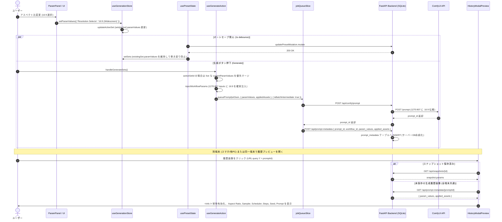

# REQ-227 詳細設計書: 生成パラメータのアスペクト比変更反映の修正および生成時パラメータのサーバー永続化・可視化 (Option A)

## 1. 背景と課題

生成画面（`GeneratePage`）において、以下の2つの重大な課題が存在する。

1. **アスペクト比等パラメータの変更未反映と巻き戻り不具合（Type A）**:
   - パラメータパネル（`ParamPanel`）上でアスペクト比（例: `9:16` から `16:9`）を変更しても、生成実行（`handleGenerateSets`）時にComfyUIノード `1270:807`（`ResolutionSelector`）へデフォルト値（`9:16`）が送信され、生成画像のアスペクト比が変更されない。
   - 根本原因として、UI変更後のオートセーブ（1秒デバウンス）成功に伴う `qc.invalidateQueries` で `presets` が再取得された際、`usePresetState.ts` の再同期処理が `existingSet.paramValues` を破棄して `{ ...defaultParams, ...(p.param_values || {}) }` で再構築するため、未保存・保存途中のパラメータがワークフロー初期値（`9:16`）へ巻き戻る競合が発生していた。
   - また、`handleGenerateSets` 側でもアクティブセットのパラメータについて、最新のUIストア値（`currentParamValues`）を優先マージする保護機構が欠落していた。
2. **生成時パラメータの端末間非同期・不可視化およびスナップショット保存のデータ破損（Type B）**:
   - 従来の仮実装では `localStorage`（`prompt-surgeon-meta-${promptId}`）をパラメータの中継に利用していたが、バッチ生成（`isBatchIntermediate: true`）時に保存が除外されていたため、生成時の実行メタデータが即座に消失していた。
   - さらに、**`localStorage` は端末・ブラウザごとに完全に隔離されているため、PCで生成した後にスマホや他端末から開いた場合にメタデータが一切存在しない**。
   - その結果、別端末から「スナップショット保存」ボタンを押した際、`useSnapshotActions.ts` がメタデータを復元できず、別端末側の開いているUI設定値（`paramValues`）でフォールバック保存してしまい、実際の画像とDBパラメータが完全に乖離するデータ破損リスクが存在した。
   - 加えて、履歴プレビューモーダル（`HistoryModalPreview`）で `<Info />`（パラメータ表示）ボタンが `activeSnapshotId`（スナップショット保存済み）に限定されており、通常の生成画像で適用されたパラメータ（アスペクト比、サンプラー、スケジューラー、シード等）を確認できなかった。

---

## 2. アーキテクチャとデータフロー (サーバー永続化)



---

## 3. 詳細設計要件

### 3.1 バックエンド DB & API 仕様 (`prompt_metadata`)

#### 1) テーブル定義 (`models.py` / `migrations/steps.py` Step 010)
```python
# backend/app/models.py
class PromptMetadata(Base):
    __tablename__ = "prompt_metadata"

    prompt_id: Mapped[str] = mapped_column(String, primary_key=True)
    workflow_id: Mapped[Optional[int]] = mapped_column(Integer, nullable=True)
    param_values: Mapped[str] = mapped_column(Text, nullable=False)  # JSON serialized dict
    applied_assets: Mapped[Optional[str]] = mapped_column(Text, nullable=True)  # JSON serialized dict
    created_at: Mapped[datetime] = mapped_column(DateTime, default=utc_now)
```

#### 2) REST API エンドポイント (`backend/app/routers/prompt_metadata.py`)
- `POST /api/prompt-metadata`:
  - Request: `{ prompt_id: str, workflow_id?: int, param_values: dict, applied_assets?: dict }`
  - 既存レコードがあれば更新、なければ挿入（UPSERT）。
  - 最大1000件を超過した場合、古いレコードを自動クリーンアップ。
- `GET /api/prompt-metadata/{prompt_id}`:
  - Response: `{ prompt_id: str, workflow_id: int | null, param_values: dict, applied_assets: dict | null, created_at: str }`
  - 見つからない場合は 404 Not Found を返却。

### 3.2 フロントエンド クライアント & スライス仕様

#### 1) `frontend/src/api/client.ts`
`promptMetadataApi` を新設：
```typescript
export const promptMetadataApi = {
  create: (data: {
    prompt_id: string;
    workflow_id?: number | null;
    param_values: Record<string, any>;
    applied_assets?: Record<string, any>;
  }) => request('/prompt-metadata', { method: 'POST', body: JSON.stringify(data) }),
  get: (promptId: string) =>
    request<PromptMetadataRead>(`/prompt-metadata/${encodeURIComponent(promptId)}`),
}
```

#### 2) `frontend/src/store/slices/jobQueueSlice.ts`
`queuePrompt` 内で `promptId` 発行時、`promptMetadataApi.create` を非同期実行してサーバーDBへ登録。同時にクライアント内高速アクセス用として `localStorage` にも書き込む。

#### 3) `frontend/src/pages/GeneratePage/hooks/useSnapshotActions.ts`
スナップショット保存時、画像URLの `t` パラメータからまず `localStorage` キャッシュを調べ、存在しない場合は `promptMetadataApi.get(t)` を呼び出してサーバーDBからメタデータを復元。
これにより、**別端末からスナップショット保存を実行しても、UIの生値にフォールバックすることなく正確な生成パラメータが保存される**。

### 3.3 パラメータ同期と巻き戻り防止

#### 1) `frontend/src/pages/GeneratePage/hooks/usePresetState.ts`
`rawMappedSets` 内で `existingSet?.paramValues` を優先マージし、オートセーブ成功後の再同期で編集中のパラメータが初期値へ巻き戻る競合を遮断。
```typescript
paramValues: {
  ...defaultParams,
  ...(p.param_values || {}),
  ...(existingSet?.paramValues || {}),
}
```

#### 2) `frontend/src/pages/GeneratePage/hooks/useGenerateAction.ts`
`handleGenerateSets` 内でアクティブセット処理時、最新のUIストア値（`currentParamValues`）を優先マージ。

### 3.4 プレビューモーダル UI 拡充 (`HistoryModalPreview.tsx`)

1. **サーバーメタデータ照会**:
   `promptId`（URLの `t`）が存在し、`activeSnapshotId` が無い場合、TanStack Query を用いて `promptMetadataApi.get(promptId)` をフェッチ（またはローカルキャッシュから即時復元）。
2. **`<Info />` ボタンの表示条件**:
   `showControls && !isFullscreen && (activeSnapshotId || effectiveParams)`
3. **パラメータ表示カード拡充**:
   - `Aspect Ratio`（解像度・アスペクト比）
   - `Sampler`（サンプラー名）
   - `Scheduler`（スケジューラー名）
   - `CFG Scale`
   - `Steps`
   - `Seed`
   - `Prompt` / `Negative Prompt`

---

## 4. 受け入れ基準（AC）との対応関係

| AC番号 | 内容 | 実現アプローチ |
|---|---|---|
| **AC-1** | パラメータパネル上でアスペクト比を変更して生成を実行した際、ComfyUIノード入力に指定したアスペクト比が正しく伝搬し、該当アスペクト比の画像が生成されること | `useGenerateAction` でのアクティブセット値の優先マージと、`injectWorkflowParams` への確実な伝搬により実現 |
| **AC-2** | オートセーブやプリセットの再取得が発生しても、編集中のパラメータがデフォルト値（9:16）に巻き戻されないこと | `usePresetState` の再同期処理において `existingSet.paramValues` を保持するマージ順序の是正により実現 |
| **AC-3** | バッチ生成時を含むすべての生成プロンプトの実行メタデータがサーバー側DB（`prompt_metadata`）に永続化されること | バックエンド `prompt_metadata` テーブルの新設と、`jobQueueSlice.ts` からの自動登録により実現 |
| **AC-4** | 生成履歴プレビューモーダルにおいて、端末やブラウザを問わず、スナップショット未保存の画像であっても実際に生成に使用されたパラメータ（アスペクト比、サンプラー、シード等）を確認できること | `HistoryModalPreview` で画像URLの `t` パラメータからサーバーDBの `prompt_metadata` をフェッチし、各種カードを表示することで実現 |
| **AC-5** | 別端末から未保存画像のスナップショット保存を実行した場合でも、開いているUI設定値で汚染されず、実際の生成パラメータが正確に保存されること | `useSnapshotActions.ts` がサーバーDBの `prompt_metadata` からメタデータを復元して保存するため完全整合 |

---

## 5. リスクとトレードオフ (Trade-off Disclosure)

| 項目 | トレードオフ・制約事項 | 対策と評価 |
|---|---|---|
| **DBストレージ増加** | 大量生成時に `prompt_metadata` テーブルのレコードが増加する。 | 直近1000件を超えるレコードは自動削除（LRUクリーンアップ）を行うため、DBサイズ増加は数MB未満に完全に抑制される。 |
| **APIリクエストのオーバーヘッド** | 生成完了時およびプレビュー表示時にAPIリクエストが発生する。 | `jobQueueSlice` では非同期（fire-and-forget）で送信し、フロントエンドではTanStack Queryおよび `localStorage` キャッシュを併用することでUIレスポンスに一切影響を与えない。 |
| **ComfyUI履歴の手動削除時の整合** | ComfyUIの履歴のみを外部から直接全削除した場合、DB側のメタデータが残存する。 | `prompt_id` が主キーであるため、画像が存在しない場合はプレビューも開かれないため不整合の害はない。またComfy履歴削除APIと連動してカスケード削除可能。 |
