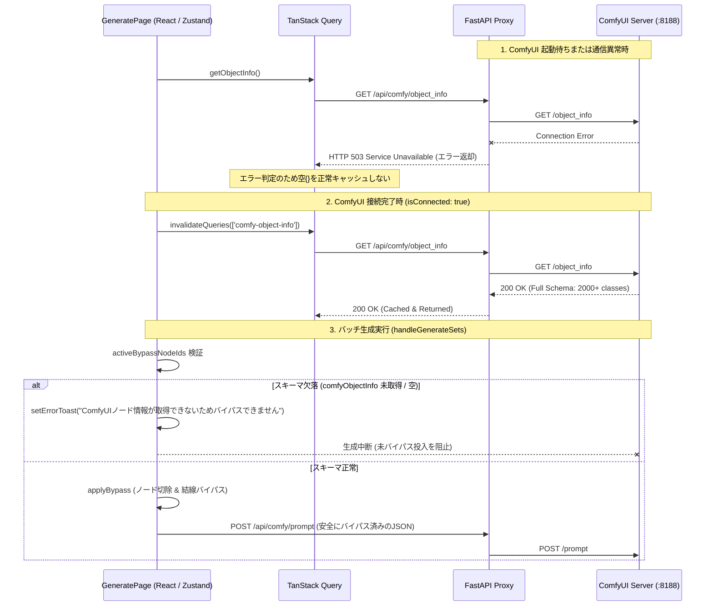

# Design Doc: REQ-230 ComfyUI Node Bypass Reliability & Schema Cache Restoration

ComfyUIノードバイパス機能において、ComfyUI起動待ちや一時切断に起因してスキーマ情報（`object_info`）が空キャッシュされ、バイパス処理がサイレントにスキップされて未バイパスのまま生成が実行される不具合の根本解決と信頼性向上設計。

---

## 1. 問題の構造と背景

### 1-1. 発生メカニズムの要約
1. **バックエンドのエラー握りつぶし (`backend/app/routers/comfy.py`)**:
   - `/api/comfy/object_info` エンドポイントが、ComfyUI不達時に例外をキャッチして `{}` をステータス 200 OK で返却していた。
2. **フロントエンドの誤キャッシュ固着 (`useWorkflowManagement.ts`)**:
   - React Query の `staleTime: 1000 * 60 * 60`（1時間）により、空の `{}` が成功データとしてキャッシュされ、ComfyUIが起動・接続完了した後も1時間再取得されなかった。
   - ComfyUIの接続ステータス（`isConnected`）が `true` に変化しても、`comfy-object-info` クエリが無効化（`invalidateQueries`）されなかった。
3. **`applyBypass` のサイレントスキップ (`bypassUtils.ts`)**:
   - `comfyObjectInfo[classType]` が存在しない場合、結線破壊を防ぐためにバイパス対象から除外される。
   - 全ノードが除外されて `validBypassSet.size === 0` になった場合、エラーを投げずUI通知も出さずに元のワークフローをそのまま返却していた。
4. **バイパスプロファイル取得の分散 (`DesktopLayout.tsx` vs `useGeneratePageState.ts`)**:
   - `fetchParamSyncGroups` はページ初期化時（`useGeneratePageState.ts`）に集中実行されているのに対し、`fetchBypassProfiles` はレイアウト層（`DesktopLayout.tsx`, `MobileLayout.tsx`）に委ねられていた。

---

## 2. アーキテクチャ設計と解決アプローチ

### 2-1. バックエンド是正 (`backend/app/routers/comfy.py`)
- `/api/comfy/object_info` において、ComfyUI通信失敗時に例外をキャッチした場合、空辞書の200返却を廃止し、`HTTPException(status_code=503, detail="ComfyUI server is unavailable or starting up")` を送出する。
- 過去に取得済みの正常インメモリキャッシュ（`_object_info_cache`）が存在する場合はそれを返却し、未取得かつ通信不可の場合のみ503を返す。
- これにより、フロントエンドのReact Queryはエラーとしてハンドリングし、空オブジェクトを正常データとして長期キャッシュすることを防ぐ。

### 2-2. フロントエンド接続同期 & ページ集中化 (`useWorkflowManagement.ts`, `useGeneratePageState.ts`)
1. **ComfyUI接続復帰時のクエリ無効化**:
   - `useWorkflowManagement` または `useGeneratePageState` において、`useGenerationStore` の `isConnected` を監視。
   - `isConnected` が `false` から `true` に変化した際、およびマウント時に `comfyObjectInfo` が空（`!comfyObjectInfo || Object.keys(comfyObjectInfo).length === 0`）である場合、`qc.invalidateQueries({ queryKey: ['comfy-object-info'] })` を実行して最新スキーマを取得する。
2. **バイパスプロファイル取得のページレベル統一**:
   - `useGeneratePageState.ts` の `useEffect` 内で、`fetchParamSyncGroups(selectedWorkflowId)` と同様に `fetchBypassProfiles(selectedWorkflowId)` を中央実行する。

### 2-3. 生成アクションのフェイルセーフ & トースト通知 (`useGenerateAction.ts`)
- `handleGenerate` および `handleGenerateSets` において、`activeBypassNodeIds.length > 0` の場合:
  - `comfyObjectInfo` の存在およびエントリ件数（`Object.keys(comfyObjectInfo).length > 0`）を検証する。
  - スキーマが未ロードまたは空の場合、未バイパスのままComfyUIへプロンプトを投入することを即座に中止（abort）する。
  - `setErrorToast({ message: 'ComfyUIのノードスキーマ情報を取得できていないため、バイパス処理を実行できません。ComfyUIの接続を確認してください。', type: 'error' })` を発行し、ユーザーに明示的に通知する。
  - バイパス対象の各ノードについて、クラス定義が見つからずスキップされたノードが存在する場合も、警告トーストまたはログを残して不整合を防止する。

---

## 3. SSoT 影響分析 (SSoT Impact)

- **`docs/specs/SPEC_GENERATE.md`**:
  - 「バイパスプロファイルおよび生成前バイパス処理仕様」セクションを更新。
  - 「スキーマ情報が未取得の場合はサイレント投入を行わず、生成を中断してエラートーストを表示する」旨の安全仕様を追記。
  - 「ComfyUI接続ステータス（`isConnected: true`）確立時に `comfy-object-info` を再検証・再取得する」ライフサイクル仕様を追記。

---

## 4. トレードオフとリスクの開示 (Trade-off Disclosure)

1. **503エラー返却時のフロントエンド挙動**:
   - 変更前: 200で `{}` が返っていたため、画面側はエラー表示にならず正常系として扱われていた。
   - 変更後: ComfyUI未起動時に `/api/comfy/object_info` は503エラーとなる。React Queryはエラー状態となり、コンソールにHTTP 503が表示される。
   - トレードオフ評価: エラー状態が正しく顕在化することは健全であり、`isConnected` の復帰によって自動リカバリされるため、システムの整合性において圧倒的に優れる。
2. **スキーマ欠落時の生成ブロック**:
   - 変更前: スキーマがなくても警告なしで生成が走り、全ノード（バイパス指定含む）が実行されていた。
   - 変更後: バイパス指定がある場合にスキーマがなければ生成がブロックされる。
   - トレードオフ評価: 「意図せず不要な重い処理や検閲回避ノードが実行されてしまう事故」を完全に防ぐための仕様であり、必須の安全性向上である。
