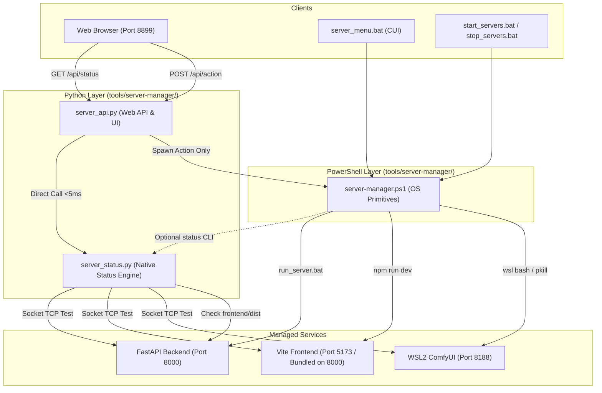

# REQ-246 システム詳細設計書

## 1. 概要
本設計書は、Prompt Surgeon におけるサーバーマネージャー群（`tools/server-manager/`）の保守性向上・責務分離を目的とした **【案B：Python監視集約型アーキテクチャ】** の詳細設計を定義する。

---

## 2. 背景と設計目標

### 2.1 現状の課題
1. **スクリプトの肥大化**: `server-manager.ps1` が 740 行、`server_api.py` が 698 行に達し、プロセス制御・ポート待機・WSL 通信・ステータス判定・HTML テンプレートが混載している。
2. **二重管理と判定の乖離**: REQ-257（タイムアウト3層防御）および REQ-262（内包配信 BUNDLED 判定）のロジックが PowerShell と Python の双方に対症療法的に実装され、コードが重複している。
3. **ポーリング遅延とタイムアウト**: Web Manager の `/api/status`（5秒間隔ポーリング）のたびに `powershell.exe` プロセスが起動され、0.5〜2秒のオーバーヘッドと WSL 応答待ちによる 6秒タイムアウト（フォールバック頻発）が発生している。

### 2.2 設計目標
- **Python ネイティブ監視への一本化**: 状態判定・ポート確認・内包配信判定を Python（`server_status.py`）に集約し、ステータス取得の応答速度を 5ms 以内に短縮。
- **PowerShell の OS プリミティブ純化**: `server-manager.ps1` を OS 外部プロセスの起動・停止・強制キル（`taskkill /T /F`）を行う薄いディスパッチャ（200〜250行目安）にスリム化。
- **防衛機構の 100% 継承**:
  - REQ-257: `Invoke-ProcessWithTimeout` / `Invoke-WslWithTimeout` による 3秒強制タイムアウト（`taskkill.exe /PID $pid /T /F`）の維持。
  - REQ-262: `frontend/dist/index.html` 存在時の `BUNDLED` ステータス付与および 2 プロセス（ComfyUI + Backend 8000）起動の維持。
  - WSL2 Mirrored モードにおける Windows 側 8188 ポートの誤キル防止。
  - Vite 起動前の `.vite/deps` ReadOnly 解除と空洞化依存の自動削除（EPERM 防止）。
  - CLI 対話メニュー（`server_menu.bat`）の完全互換性維持。

---

## 3. コンポーネント構成



---

## 4. 詳細設計

### 4.1 `tools/server-manager/server_status.py` (新規)
ステータス判定専用の Python モジュール。外部依存なし（標準ライブラリ `socket`, `pathlib`, `json`, `sys` のみ）。

```python
# 主要インターフェース
def check_port_listening(port: int, timeout: float = 0.5) -> bool:
    """ローカルポートへのTCP接続試行によりリッスン中かを判定する。"""

def is_frontend_bundled(dist_dir: Path | None = None) -> bool:
    """frontend/dist/index.html が存在するかを判定する。"""

def get_server_status(config_path: Path | None = None) -> dict[str, Any]:
    """
    fe, be, comfy の稼働ステータス辞書を生成して返却する。
    スキーマ:
    {
        "fe": {"name": str, "port": int, "running": bool, "status": str, "pids": list[int]},
        "be": {"name": str, "port": int, "running": bool, "status": str, "pids": list[int]},
        "comfy": {"name": str, "port": int, "running": bool, "status": str, "pids": list[int], "error"?: str}
    }
    """
```

### 4.2 `tools/server-manager/server_api.py` (改修)
- `/api/status`: `server_status.get_server_status()` を直接呼び出し、インメモリキャッシュ（2秒）と `_status_lock` で返却。PowerShell プロセスの spawn を廃止。
- フォールバックコードの重複を削除（`server_status.py` 内に一本化）。
- `/api/action`: 従来どおり `powershell.exe -File server-manager.ps1 -Action <action>` を実行（タイムアウト15秒）。

### 4.3 `tools/server-manager/server-manager.ps1` (改修)
- 重複するステータス判定・HTMLログフォーマット関数を削除。
- 責務を以下の 4 つに集約:
  1. **プロセス起動**: `Start-ComfyUIProcess`, `Start-BackendProcess`, `Start-FrontendProcess`
  2. **プロセス停止**: `Stop-ComfyUIProcess`, `Stop-BackendProcess`, `Stop-FrontendProcess`, `Stop-AllServices`
  3. **タイムアウト保護**: `Invoke-ProcessWithTimeout`, `Invoke-WslWithTimeout`（REQ-257 準拠、`taskkill /T /F`）
  4. **CUIメニュー**: `Show-InteractiveMenu`（`server_menu.bat` 用）
- `-Action status -Json`: `python server_status.py --json` を呼び出すか、軽量ポート確認結果を出力。

---

## 5. 受け入れ基準（AC）との対応関係

| AC ID | 要件項目 | 設計上の担保方針 |
| :--- | :--- | :--- |
| **AC-1** | REQ-257 タイムアウト防衛の死守 | `server-manager.ps1` 内の `Invoke-ProcessWithTimeout`（3s/taskkill /T /F）および `Invoke-WslWithTimeout` を完全保持。 |
| **AC-2** | REQ-262 BUNDLED 内包配信の完全遵守 | `server_status.py` の `is_frontend_bundled()` および `server-manager.ps1` の `Test-FrontendBundled` で整合。 |
| **AC-3** | 状態判定ロジックの Python 集約 | `server_api.py` の `/api/status` が `server_status.py` を直接呼び出し、PowerShell spawn を排除。 |
| **AC-4** | PowerShell のスリム化と純化 | `server-manager.ps1` を OS プロセス起動・停止・強制キルに純化し、740行から250行程度にスリム化。 |
| **AC-5** | Web GUI / CUI メニューの互換性 | Web Manager（Port 8899）および `server_menu.bat`（1〜8, R, Q）の動作を維持。 |
| **AC-6** | 防衛機構の完全継承 | Windows側 8188 のキル抑止、`.vite/deps` EPERM 対策を維持。 |

