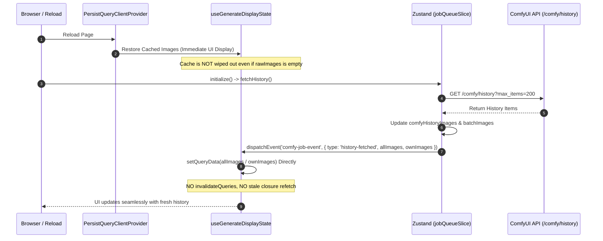

# REQ-253: 生成画面リロード後の履歴表示消失とジョブ完了時の一括同期バグの修正 詳細設計書

## 1. 背景と課題

生成画面（GeneratePage）において、ブラウザをリロードした直後に過去の ComfyUI 生成履歴が履歴ストリップ/ギャラリーに一切表示されず空白になる。
その後、新規の画像生成ジョブを実行して画像が完成（`executed` イベント到達）した瞬間に、過去分も含めて画像が一気に表示されるという挙動が発生している（[docs/incident_report.md](../incident_report.md) 参照）。

### 特定された構造的ボトルネック
1. **マウント時 useEffect による永続化キャッシュの初期化消去**:
   `useGenerateDisplayState.ts` の `useEffect` 内で、リロード直後（Zustand 初期値 `rawImages.length === 0`）に `return []` が実行され、`PersistQueryClientProvider` によって復元された TanStack Query キャッシュを即座に空配列 `[]` で破壊している。
2. **`history-fetched` イベントと React 非同期再レンダリングの競合（Race Condition）**:
   `jobQueueSlice.ts` の `fetchHistory()` 完了時に `history-fetched` イベントが発火され、`useGenerateDisplayState.ts` が `queryClient.invalidateQueries` を実行する。しかし、React 18 の状態バッチ処理によりコンポーネントが再レンダリングされる前に古いクロージャ（`rawImages = []`）をキャプチャした `queryFn` が非同期実行され、キャッシュを再び `[]` で上書きしてしまう。
3. **`addHistoryImage` による一括遅延出現**:
   新規ジョブ完了時に走る `addHistoryImage` は直接 `setQueryData` を実行する。このとき、バックグラウンドの `fetchHistory()` で既に Zustand に格納されていた全履歴が `(old = comfyHistoryImages)` のデフォルトパラメータ経由で一気に同期されるため、ユーザーには「ジョブ完了時に過去履歴が一気に出現した」と認識される。

---

## 2. アーキテクチャ設計方針

Zustand と TanStack Query の二重管理における競合を解消し、以下の原則に基づいてイベント駆動型の単一データフローを確立する。



### 設計原則
1. **キャッシュ破壊の根絶**:
   `rawImages.length === 0` の際に既存キャッシュを消去してはならない。ストア未取得時は永続化キャッシュを優先維持する。
2. **`invalidateQueries` の廃止と直接更新（Deterministic Cache Update）への統一**:
   非同期 `invalidateQueries` によるクロージャ巻き込みリフェッチを廃止し、`history-fetched` イベントに `allImages` / `ownImages` を積載して `setQueryData` で直接確定値をセットする。
3. **`queryFn` の動的ストア参照（Fresh Store State Extraction）**:
   `queryFn: () => rawImages` のような静的クロージャキャプチャをやめ、クエリ評価時に `useGenerationStore.getState()` から最新のストア状態を直接取り出す構造にする。

---

## 3. 詳細仕様

### 3-1. `frontend/src/store/slices/jobQueueSlice.ts` の改善

`fetchHistory()` 完了時に発行する CustomEvent `comfy-job-event` (`history-fetched`) に、取得・構築した最新画像配列をペイロードとして含める。

```typescript
// jobQueueSlice.ts - fetchHistory()
set((state) => {
  const nextBatch = Array.from(new Set([...state.batchImages, ...ownImages])).slice(0, 8)
  localStorage.setItem(LS_KEYS.BATCH_IMAGES, JSON.stringify(nextBatch))

  const nextSelected =
    state.selectedImg || (state.filterOwnSession ? nextBatch[0] : allImages[0]) || null
  if (nextSelected && !state.selectedImg) {
    localStorage.setItem(LS_KEYS.SELECTED_IMG, nextSelected)
  }

  return {
    comfyHistoryImages: allImages.slice(0, 200),
    batchImages: nextBatch,
    selectedImg: nextSelected,
  }
})

// イベントペイロードに allImages と ownImages を付与
window.dispatchEvent(
  new CustomEvent('comfy-job-event', {
    detail: {
      type: 'history-fetched',
      allImages: allImages.slice(0, 200),
      ownImages: Array.from(new Set([...get().batchImages, ...ownImages])).slice(0, 8),
    },
  })
)
```

---

### 3-2. `frontend/src/pages/GeneratePage/hooks/useGenerateDisplayState.ts` の改善

#### (1) `useQuery` の初期化と `queryFn` のストア直読化
- `initialData: rawImages` は `rawImages` が空配列のときにキャッシュを空で固定してしまうため、空配列の場合は渡さない（キャッシュ復元を阻害しない）。
- `queryFn` はクロージャ依存を排除し、`useGenerationStore.getState()` から最新状態を取得する。

```typescript
const { data: displayImages = rawImages } = useQuery<string[]>({
  queryKey: ['generateDisplayImages', { filterOwnSession: !!filterOwnSession }],
  queryFn: () => {
    const storeState = useGenerationStore.getState()
    return filterOwnSession ? storeState.batchImages : storeState.comfyHistoryImages
  },
  initialData: rawImages.length > 0 ? rawImages : undefined,
  staleTime: Infinity,
})
```

#### (2) `useEffect` による同期処理の安全化（キャッシュ保護）
- `rawImages.length === 0` であれば何もせず既存キャッシュを保持する（リロード直後のキャッシュ消去を防止）。
- `rawImages.length > 0` の場合のみマージを行う。

```typescript
useEffect(() => {
  if (rawImages.length === 0) return

  queryClient.setQueryData<string[]>(
    ['generateDisplayImages', { filterOwnSession: !!filterOwnSession }],
    (old) => {
      if (!old || old.length === 0) return rawImages
      const oldSet = new Set(old)
      const appended = rawImages.filter((x) => !oldSet.has(x))
      if (appended.length > 0) {
        return [...old, ...appended]
      }
      return old
    }
  )
}, [rawImages, filterOwnSession, queryClient])
```

#### (3) `history-fetched` イベントリスナーの直接キャッシュ反映
- `invalidateQueries` による古いクロージャのリフェッチを廃止。
- イベントペイロードに含まれる `allImages` と `ownImages` を直接 `setQueryData` に書き込む。

```typescript
} else if (customEvent.detail?.type === 'history-fetched') {
  const allImages = customEvent.detail.allImages
  const ownImages = customEvent.detail.ownImages
  if (allImages) {
    queryClient.setQueryData<string[]>(
      ['generateDisplayImages', { filterOwnSession: false }],
      allImages
    )
  }
  if (ownImages) {
    queryClient.setQueryData<string[]>(
      ['generateDisplayImages', { filterOwnSession: true }],
      ownImages
    )
  }
}
```

---

## 4. 影響ファイル一覧 (SSoT Impact)

| ファイルパス | 変更種別 | 責務と主な変更内容 |
|---|---|---|
| `frontend/src/store/slices/jobQueueSlice.ts` | [MODIFY] | `fetchHistory()` の `history-fetched` イベントに最新画像配列（`allImages`, `ownImages`）を含めて dispatch |
| `frontend/src/pages/GeneratePage/hooks/useGenerateDisplayState.ts` | [MODIFY] | マウント時のキャッシュ破壊防止、`queryFn` の動的ストア参照化、`history-fetched` 時の直接 `setQueryData` 更新 |
| `frontend/src/pages/GeneratePage/hooks/__tests__/useGenerateDisplayState.test.tsx` | [MODIFY] | リロード時空ストアでのキャッシュ保護検証、`history-fetched` 直接反映テストの追加 |

---

## 5. リスクとトレードオフ (Trade-off Disclosure)

1. **イベントペイロードのメモリ一時使用**:
   - `history-fetched` イベントで最大200件の URL 文字列配列を CustomEvent 経由で配送する。
   - 200件の文字列配列は数十KB程度であり、ガベージコレクション対象となるためメモリへの実質的悪影響は皆無である。
2. **ComfyUI 側で画像が全件手動削除されたケース**:
   - ComfyUI の全履歴がクリアされた場合、`fetchHistory()` は空配列を返し、`history-fetched` が `allImages: []` を配信して正常にキャッシュが `[]` に更新される。初回マウント時のみ消去を抑制し、サーバー取得完了後は実態に同期するため問題ない。

---

## 6. 検証計画

### 6-1. 自動テスト
1. **単体テスト**:
   `npm --prefix frontend test -- src/pages/GeneratePage/hooks/__tests__/useGenerateDisplayState.test.tsx --run`
2. **ストアスライステスト**:
   `npm --prefix frontend test -- src/store/__tests__/slices/jobQueueSlice.test.ts --run`
3. **E2E回帰テスト**:
   `npm --prefix frontend test -- src/test/e2e_req240_multidevice.test.ts --run`

### 6-2. AC 準拠表

| AC 項目 | 判定条件 | 検証タスク / 手段 |
|---|---|---|
| **AC-1** | 生成画面（GeneratePage）をリロードした直後、永続化キャッシュまたは取得済みの履歴画像一覧が正常に表示されること（空白にならない）。 | 単体テスト（ストア初期空・キャッシュ存在ケース） |
| **AC-2** | `fetchHistory()` 完了時において、キャッシュが空配列で破壊・上書きされることなく、正しく全件の履歴画像が反映されること。 | 単体テスト（`history-fetched` イベント受信ケース） |
| **AC-3** | 新規ジョブ生成完了時（`executed`）に新規画像が先頭に追加され、既存履歴が正常に維持されること。 | 既存単体テスト（AC-3 / AC-4）およびスライステスト |
