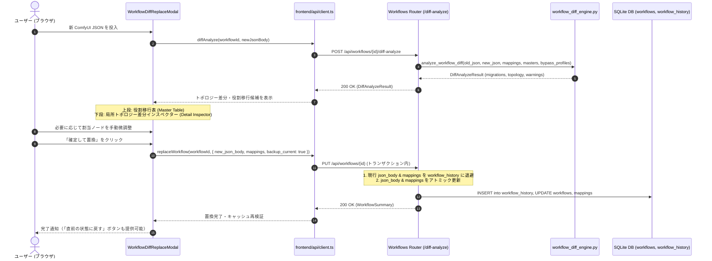

# REQ-254: 生成ワークフロー差分推測・スマート置換（トポロジー解析とプリセット維持）詳細設計書

## 1. 背景と課題

Prompt Surgeon は ComfyUI をバックエンドとして動作し、ワークフロー内の各ノード（プロンプト入力、サンプラー、シード、LoRA 等）を論理ロール（`MappingMaster`）として抽象化しています。これにより、プロファイル（プリセット群）、バイパス設定（`BypassProfile`）、パラメータ同期（`ParamSyncGroup`）といった付加価値機能を提供しています。

しかし現在、ComfyUI 側でワークフローの改善・編集（ノード再生成、配線変更、Detailer 追加等）を行った際、Prompt Surgeon 側の既存ワークフローの JSON（`json_body`）のみを安全に差し替える UI/API が存在しません。

### 現状の問題点
1. **ノード誤同定と独自アセットの切断・消失**:
   ComfyUI の仕様上、ノード再生成に伴う ID 変更、ノード削除後の ID 再利用（False Reuse）、リネーム等が発生します。単純なノード ID 一致やタイトル一致比較ではこれらを正しく識別できず、既存のプロファイル（プリセット値）やバイパス設定が切断・消失します。
2. **差分可視化および対話的移行 UI の欠如**:
   新旧ワークフローのどのノードがどの役割を引き継ぐべきか、前後配線がどう変わったかをユーザーが視覚的に確認・微調整できる対話型 UI がありません。
3. **安全な置換トランザクションおよびロールバック機構の未整備**:
   ワークフロー更新時に既存アセットを保護するアトミックトランザクションや、操作ミス時に直前の状態へ戻す退避・復元機構が存在しません。

---

## 2. アーキテクチャ設計方針



---

## 3. ネットワークトポロジー解析・フィンガープリント照合アルゴリズム

### 3-1. 評価項目と配点（合計 100点）

ComfyUI のワークフロー JSON は `inputs: { slot_name: [upstream_id, slot_index] }` で配線された有向非巡回グラフ（DAG）です。各ノードについて単体属性と周辺環境（接続先）から構造フィンガープリントを抽出し、新旧ノードペアの類似度スコア $S \in [0, 100]$ を算出します。

| 評価項目 | 配点 | 計算ロジック | 判定基準・狙い |
|---|---|---|---|
| **クラス種別一致 (Class Type)** | 35点 | 完全一致で35点、不一致で0点 | ノードの本質的機能（KSampler, CLIPTextEncode等）を保証 |
| **入力元一致度 (In-Degree)** | 30点 | 上流ノードのクラス型＋入力スロット名の Jaccard 係数 $\times 30$ | 「どこから何のデータを受け取っているか（CLIP, MODEL等）」の同一性 |
| **出力先一致度 (Out-Degree)** | 20点 | 下流ノードのクラス型＋接続先スロット名の Jaccard 係数 $\times 20$ | 「後続のどの端子へ送っているか（positive, latent等）」の役割同一性 |
| **タイトル類似度 (Node Title)** | 10点 | 完全一致で10点、レーベンシュタイン距離比率で部分点 | ユーザー命名の類似性（リネーム時は部分点） |
| **ノードID一致 (Node ID Identity)** | 5点 | 旧ID == 新ID で5点加点 | 同一IDでトポロジーも一致する場合のボーナス |

### 3-2. 状態判定マトリクス

| 判定区分 (status) | スコア条件 | 発生事象 | Prompt Surgeon での処理 |
|---|---|---|---|
| **Renamed** | ID一致, $S \ge 85$ | 同じノードのタイトルのみを編集 | マッピング維持。UI表示名を新タイトルに自動更新 |
| **Re-indexed** | ID相違, Title一致 または $S \ge 80$ | ノードを再生成または再配置 | 旧ID → 新IDへ自動追従。マッピングを引き継ぎ |
| **Substituted** | ID相違, Title相違, $S \ge 75$ | ノードを別名で作り直したが位置・役割は同等 | トポロジーから後継と同定。候補として自動提案（要確認バッジ） |
| **False Reuse** | ID一致, $S < 40$ | 旧ノード削除後、別ノードに同IDが偶然割当 | ID一致を無視。旧マッピングは解除し、新ノードは別扱い |
| **Not Found (Removed)** | 全候補 $S < 50$ または候補なし | 必須ノードが撤去された | 赤色警告表示。必須ロール未割当時は置換確定をバリデーション抑止 |
| **Added** | 新ワークフローでマッピング対象外の新規ノード | Detailer等の機能ブロック新設 | 新規追加ノード一覧に表示（マッピング未割当） |

### 3-3. 対称並列ノード（LoRA Loader等）の識別
入力・出力トポロジーが対称な並列ノード（例: 2段積みLoRA）の場合、ノード内部パラメータ（`inputs` 内の文字列値やファイル名、強度設定等）の類似度をサブスコアとして評価し、候補順位を決定します。

---

## 4. バックエンド API 仕様

### 4-1. `POST /api/workflows/{workflow_id}/diff-analyze`
新旧ワークフローのトポロジー差分を解析し、役割移行提案と配線比較データを返却します。

#### Request Body
```json
{
  "new_json_body": { ...ComfyUI Workflow JSON... }
}
```

#### Response (200 OK)
```json
{
  "summary": {
    "added": 2,
    "removed": 0,
    "renamed": 1,
    "reindexed": 3,
    "false_reuse": 0
  },
  "role_migrations": [
    {
      "master_id": 1,
      "role": "Positive_Prompt",
      "display_name": "ポジティブプロンプト",
      "old_node_id": "6",
      "new_node_id": "12",
      "confidence": 0.96,
      "reason": "Identical upstream (CheckpointLoaderSimple.clip) and downstream (KSampler.positive)",
      "status": "reindexed",
      "candidates": [
        { "node_id": "12", "title": "Positive", "class_type": "CLIPTextEncode", "score": 96 },
        { "node_id": "15", "title": "Prompt", "class_type": "CLIPTextEncode", "score": 45 }
      ],
      "old_topology": {
        "node_id": "6",
        "title": "Positive Prompt",
        "class_type": "CLIPTextEncode",
        "inputs": [
          { "slot": "clip", "source_node_id": "4", "source_class": "CheckpointLoaderSimple", "source_title": "Base Model" }
        ],
        "outputs": [
          { "slot": "positive", "target_node_id": "3", "target_class": "KSampler", "target_title": "Sampler" }
        ]
      },
      "new_topology": {
        "node_id": "12",
        "title": "Positive",
        "class_type": "CLIPTextEncode",
        "inputs": [
          { "slot": "clip", "source_node_id": "4", "source_class": "CheckpointLoaderSimple", "source_title": "Base Model" }
        ],
        "outputs": [
          { "slot": "positive", "target_node_id": "3", "target_class": "KSampler", "target_title": "Sampler" }
        ]
      }
    }
  ],
  "bypass_warnings": [
    { "profile_name": "Draft", "missing_node_id": "10", "suggested_node_id": "14" }
  ],
  "unmapped_new_nodes": [
    { "node_id": "25", "title": "Face Detailer", "class_type": "FaceDetailer" }
  ]
}
```

### 4-2. `POST /api/workflows/{workflow_id}/rollback`
直前に自動退避されたスナップショットからワークフローの `json_body` および `mappings` を復元します。

#### Response (200 OK)
```json
{
  "message": "Workflow successfully restored from snapshot",
  "workflow": {
    "id": 1,
    "name": "SDXL_Base",
    "created_at": "2026-09-12T10:00:00Z"
  }
}
```

### 4-3. `GET /api/workflows/{workflow_id}/history-status`
復元可能な履歴が存在するかを確認する軽量エンドポイント。

#### Response (200 OK)
```json
{
  "has_rollback": true,
  "history_count": 2,
  "latest_backup_at": "2026-09-12T16:45:00Z"
}
```

---

## 5. データベース設計（マイグレーション）

### 5-1. `workflow_history` テーブル
置換直前の状態を退避し、即座のロールバックを担保します。

```python
class WorkflowHistory(Base):
    __tablename__ = "workflow_history"

    id: Mapped[int] = mapped_column(Integer, primary_key=True, autoincrement=True)
    workflow_id: Mapped[int] = mapped_column(ForeignKey("workflows.id", ondelete="CASCADE"), nullable=False)
    json_body: Mapped[str] = mapped_column(Text, nullable=False)
    mappings: Mapped[str] = mapped_column(Text, nullable=False)  # JSON array of {master_id, node_id}
    created_at: Mapped[datetime] = mapped_column(DateTime, default=utc_now)

    workflow: Mapped["Workflow"] = relationship(back_populates="history_entries")
```

`steps.py` に `step_011_create_workflow_history` を追加。

---

## 6. フロントエンド UI/UX 仕様

### 6-1. `WorkflowDiffReplaceModal.tsx`（上下配置型マスター・ディテール設計）
横幅 900〜1000px の広々としたモーダルで、上段に役割一覧、下段に選択中ノードの前後配線対比インスペクターを配置します。

```
+---------------------------------------------------------------------------------------------------+
| ⇄ ワークフロー差分レビュー & スマート置換 (Workflow Smart Migration)                              [X] |
| ターゲット: SDXL_Base (ID: 1)                                                                      |
| [トポロジー解析サマリー: +2ノード追加 / -0ノード削除 / 1名変更 / 3ID自動追従]                       |
+---------------------------------------------------------------------------------------------------+
| 【上段: Prompt Surgeon 役割(Role) 引き継ぎマッピング】(Master Table)                              |
| 役割(Role)              旧ノード         新ワークフロー割当ノード(選択可)   状態       判定根拠・スコア   |
| ------------------------------------------------------------------------------------------------- |
| Positive_Prompt         6 (Positive)     12 (Positive) [CLIPTextEncode]   ID自動追従  Up/Down一致(96点) |
| Negative_Prompt         7 (Negative)     13 (Negative) [CLIPTextEncode]   ID自動追従  Up/Down一致(96点) |
| Sampler_Steps/CFG       3 (KSampler)     14 (KSampler) [KSampler]         ID自動追従  Up/Down一致(98点) |
| Face_Detailer           (未設定)         25 (FaceDetailer) [FaceDetailer] 新設ノード  新規追加として検出|
+---------------------------------------------------------------------------------------------------+
| 【下段: 局所トポロジー前後比較インスペクター】(選択中: Positive_Prompt, 旧ID: 6 -> 新ID: 12)        |
|  [旧ワークフロー接続]                                                                              |
|  [Base Model (CheckpointLoader)] ---CLIP---> [Positive Prompt (CLIPText)] ---CONDITIONING---> [Sampler]|
|  [新ワークフロー接続]                                                                              |
|  [Base Model (CheckpointLoader)] ---CLIP---> [Positive Prompt (CLIPText)] ---CONDITIONING---> [Sampler]|
|  ※ 判定理由サマリー: 上流(CheckpointLoader)および下流(KSampler)の端子名・型が100%合致したため同定。 |
+---------------------------------------------------------------------------------------------------+
| [✓] 既存プロファイル(プリセット値)を維持する   [✓] パラメータ同期設定(ParamSync)を引き継ぐ          |
|                                                                    [キャンセル]  [確定して置換]    |
+---------------------------------------------------------------------------------------------------+
```

### 6-2. バリデーション & 安全制御
1. **必須ロール未割当の確定抑止**:
   `Positive_Prompt` や `Sampler` などの必須ロールが未割り当て（`not_found` または未選択）の場合、「確定して置換」ボタンを非活性化し、ツールチップで理由を明示。
2. **直前状態へのロールバックボタン**:
   `WorkflowConnectionSection` および `SettingsPopover` に、直近バックアップが存在する場合「直前の状態に戻す (Rollback)」ボタンを活性表示。

---

## 7. 影響ファイル一覧 (SSoT Impact)

| ファイルパス | 変更種別 | 責務と主な変更内容 |
|---|---|---|
| `backend/app/services/workflow_diff_engine.py` | [LOCAL NEW] | トポロジー抽出・フィンガープリント照合・スコアリングエンジンの実装 |
| `backend/app/models.py` | [LOCAL MODIFY] | `WorkflowHistory` モデル追加、`Workflow` にリレーション追加 |
| `backend/app/migrations/steps.py` | [LOCAL MODIFY] | `step_011_create_workflow_history` マイグレーション追加 |
| `backend/app/schemas/workflow.py` | [LOCAL MODIFY] | `DiffAnalyzeRequest`, `DiffAnalyzeResponse`, `WorkflowRollbackResponse` スキーマ追加 |
| `backend/app/routers/workflows.py` | [LOCAL MODIFY] | `POST /diff-analyze`, `POST /rollback`, `GET /history-status` エンドポイント追加、PUT置換時の自動バックアップ |
| `backend/openapi.json` | [LOCAL MODIFY] | 新規エンドポイントおよびスキーマの定義同期 |
| `docs/specs/SPEC_SETTINGS.md` | [LOCAL MODIFY] | ワークフロー差分レビュー・スマート置換仕様の追記 |
| `docs/specs/SPEC_GENERATE.md` | [LOCAL MODIFY] | SettingsPopover からの差分置換・ロールバック導線の追記 |
| `frontend/src/api/types.ts` | [LOCAL MODIFY] | 差分解析・ロールバック関連 TypeScript 型定義 |
| `frontend/src/api/client.ts` | [LOCAL MODIFY] | `diffAnalyze`, `rollback`, `getHistoryStatus` API クライアント関数追加 |
| `frontend/src/components/WorkflowDiffReplaceModal.tsx` | [LOCAL NEW] | 上下配置型マスター・ディテール差分レビューモーダルの実装 |
| `frontend/src/pages/SettingsPage/components/WorkflowConnectionSection.tsx` | [LOCAL MODIFY] | 「スマート差分置換」ボタンおよび「ロールバック」ボタンの追加 |
| `frontend/src/pages/GeneratePage/components/SettingsPopover.tsx` | [LOCAL MODIFY] | 「スマート差分置換」ボタンおよび「ロールバック」ボタンの追加 |

---

## 8. リスクとトレードオフ (Trade-off Disclosure)

1. **大規模グラフでのトポロジー解析計算量**:
   - ノード数が 100 を超える大規模 ComfyUI ワークフローでは、全ノード対の総当たり比較 ($O(N \times M)$) でミリ秒単位のオーバーヘッドが生じる可能性があります。
   - **対策**: クラス型一致による一次フィルタリングを最初に行い、同一または互換クラス型の候補間でのみ入出力トポロジーの Jaccard 係数計算を実行することで、$O(K)$（$K \ll N \times M$）に抑え、100ms 未満の応答を保証します。
2. **履歴テーブル（`workflow_history`）の肥大化**:
   - ワークフロー置換ごとに JSON 文字列を退避するため、頻繁に置換を繰り返すと DB サイズが増加する懸念があります。
   - **対策**: ワークフローごとに最新 5 件までの直近履歴を保持し、古い履歴を自動クリーンアップするローテーションポリシーを適用します。
3. **未割当新ノードの自動登録スコープ**:
   - 新規追加されたノード（例: `FaceDetailer`）は MappingMaster に未登録の場合、自動でマッピングを作成することはできません。
   - **対策**: 未割当ノードとして一覧化し、ユーザーに情報提供するに留め、既存プリセットを壊さないことを最優先とします。

---

## 9. 検証計画

### 9-1. 自動テスト
1. **トポロジー解析エンジン単体テスト**:
   `pytest backend/tests/test_workflow_diff_engine.py -v`
   - ノードリネーム、ID再採番、新旧ノード置換、False Reuse 検知、バイパス警告の網羅検証。
2. **DBマイグレーション & モデルテスト**:
   `pytest backend/tests/test_workflow_history_migration.py -v`
   - `workflow_history` テーブル作成、外部キー、カスケード削除の検証。
3. **ワークフロー差分 API テスト**:
   `pytest backend/tests/test_workflows_diff_api.py -v`
   - `/diff-analyze`, `/rollback`, `/history-status` の正常系・異常系テスト。
4. **フロントエンドモーダル単体テスト**:
   `npm --prefix frontend test -- src/components/__tests__/WorkflowDiffReplaceModal.test.tsx --run`
   - モーダル描画、上段クリック時の下段トポロジー連動、手動ノード変更、必須ロールバリデーションの検証。
5. **フロントエンド統合テスト**:
   `npm --prefix frontend test -- src/pages/SettingsPage/components/__tests__/WorkflowConnectionSection.test.tsx --run`
   - 置換モーダル起動およびロールバック操作のトリガー検証。

### 9-2. AC 準拠表

| AC 項目 | 判定基準 | 検証タスク / 手段 |
|---|---|---|
| **AC-1** | 新規 JSON 投入時に、ID変更やリネームがあってもトポロジーから高精度に新旧ノードが自動推測・提示されること。 | `test_workflow_diff_engine.py` (Re-indexed / Renamed) |
| **AC-2** | 偶発的なノード ID 再利用（False Reuse）がトポロジー不一致として検知され、誤マッピングが防止されること。 | `test_workflow_diff_engine.py` (False Reuse 検知) |
| **AC-3** | 差分レビューモーダルで上段役割一覧と下段配線対比インスペクターが連動し、手動修正できること。 | `WorkflowDiffReplaceModal.test.tsx` (連動・手動選択) |
| **AC-4** | 確定置換を実行した際、既存プロファイル（プリセット値）および ParamSync 設定が維持されること。 | `test_workflows_diff_api.py` (プリセット・マッピング維持確認) |
| **AC-5** | 必須ロールが未割当のままでは置換を確定できないバリデーションが機能すること。 | `WorkflowDiffReplaceModal.test.tsx` (バリデーション抑止) |
| **AC-6** | 置換直前に旧状態が自動退避され、操作ミス時に直前の状態へ復元（ロールバック）できること。 | `test_workflows_diff_api.py` (ロールバック復元テスト) |
