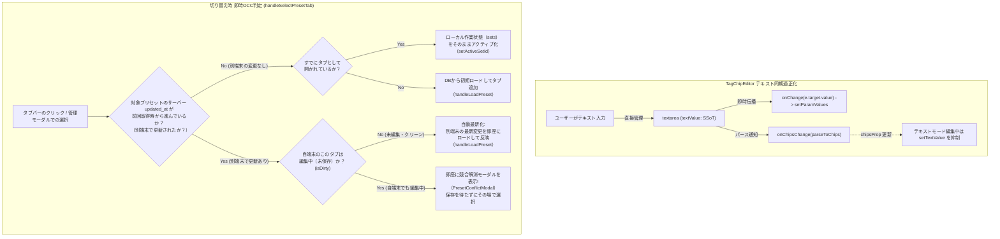

# REQ-255: プリセットのプロンプト編集反映保証とタブ切り替えキャッシュ保護 設計書

## 1. 概要と目的

ユーザーがプリセット選択状態でプロンプトを編集した際、テキスト入力の巻き戻しやタブ切り替え時のサーバーキャッシュ上書きにより、編集内容が ComfyUI 生成に反映されない不具合を根本解決する。

具体的には：
1. `TagChipEditor` のテキスト入力モード時における自己同期ループ（`chipsProp` 変化による `setTextValue` 巻き戻し）を遮断し、入力テキストの完全な保全と `onChange` 伝播を実現する。
2. Multi-Set タブバーおよび管理モーダルでのプリセット選択時に、**「即時OCC判定（サーバー更新有無 & Dirty判定）」** を備えた統一ハンドラ `handleSelectPresetTab` を適用する。
   - **サーバー変更なし**: メモリ内の最新作業状態（`sets`）を維持して切り替え（`setActiveSetId`）。
   - **サーバー更新あり＋自端末未編集（クリーン）**: サーバーの最新版を自動再ロード（`handleLoadPreset`）。
   - **サーバー更新あり＋自端末編集中（Dirty）**: 即座に競合解消モーダル（`PresetConflictModal`）を表示し、保存を待たずにその場で解決。
3. `useGenerateAction` におけるパラメータ解決と `activeSetId` の整合性を担保し、編集したプロンプトが確実に ComfyUI に送信されるようにする。

---

## 2. アーキテクチャ設計

### 2.1 データフローと即時OCC判定



---

## 3. コンポーネント別変更詳細

### 3.1 `TagChipEditor` (`frontend/src/components/TagChipEditor/index.tsx`)
- **テキストモード時の SSoT 確立**:
  - `isTextMode` が `true` の間は、`textValue` をエディタの絶対的な Single Source of Truth（SSoT）として扱う。
  - ユーザーがテキスト入力中（`userEditedRef.current === true` または `isTextMode` 有効時）、外部から渡される `chipsProp` の参照変化を理由にした `setTextValue(chipsToString(chipsProp))` の呼び出しを抑制する。
  - テキスト入力時（`textarea.onChange`）に、`setTextValue(e.target.value)` だけでなく `onChange?.(e.target.value)` を即座に発火させ、生の文字列（末尾スペースやカンマを含む）を親の `paramValues` へ即座に反映する。
- **チップモード ⇔ テキストモードの双方向切り替え整合性**:
  - チップモードからテキストモードへ切り替え時: 現在のチップ配列から `chipsToString(state)`（または `value`）を生成して `setTextValue` に設定。
  - テキストモードからチップモードへ切り替え時: `parseToChips(textValue)` でチップを確定し、`setChips(newChips, true)`、`onChipsChange(newChips)`、`onChange(chipsToString(newChips))` を同期。

### 3.2 即時OCC付き切り替えハンドラ (`usePresetState.ts`, `DesktopLayout.tsx`, `MobileLayout.tsx`)
- **`handleSelectPresetTab` の新設 (`usePresetState.ts`)**:
  ```typescript
  const handleSelectPresetTab = (presetId: string | number) => {
    const targetId = Number(presetId)
    const serverPreset = presets?.find((p) => p.id === targetId)
    const prevUpdatedAt = presetUpdatedAtRef.current[targetId]
    const serverChanged = !!(
      serverPreset?.updated_at &&
      prevUpdatedAt &&
      serverPreset.updated_at !== prevUpdatedAt
    )

    const targetSet = storeRef.current.sets?.find((s) => String(s.id) === String(presetId))
    const lastSaved = lastSavedStateRef.current[targetId]
    const isDirty = targetSet && lastSaved ? !isStateEqual(lastSaved, targetSet) : false

    if (serverChanged && isDirty && serverPreset && targetSet) {
      // 競合検知: 即座に競合解消モーダルを表示
      presetUpdatedAtRef.current[targetId] = serverPreset.updated_at
      setConflictData({
        serverPreset,
        localDraft: {
          name: targetSet.name,
          paramValues: targetSet.paramValues,
          appliedAssets: targetSet.appliedAssets,
          batchSize: targetSet.batchSize,
          seedMode: targetSet.seedMode,
          seed: targetSet.seed,
        },
      })
      return
    }

    if (serverChanged && !isDirty && serverPreset) {
      // クリーン自動同期: サーバーの最新版をロード
      presetUpdatedAtRef.current[targetId] = serverPreset.updated_at
      handleLoadPreset(serverPreset)
      return
    }

    // サーバー変更なし
    const isOpen = (storeRef.current.openPresetIds || []).map(String).includes(String(presetId))
    if (isOpen) {
      setActiveSetId(presetId)
    } else if (serverPreset) {
      handleLoadPreset(serverPreset)
    } else {
      setActiveSetId(presetId)
    }
  }
  ```
- **UIコンポーネントでの適用**:
  - `DesktopLayout.tsx` (L487-L490) および `MobileLayout.tsx` (L641-L642):
    `handleSelectPresetTab(s.id)` を呼び出す。
  - `GeneratePage.tsx` の `PresetManagerPanel` `onOpenAsTab`:
    `handleSelectPresetTab(id)` を呼び出す。

---

## 4. トレードオフ・リスクの開示 (Trade-off Disclosure)

1. **テキストモード時の生文字列優先とチップ未確定許容**:
   - `TagChipEditor` のテキストモード編集中は、タイピングのスムーズさを最優先し、末尾カンマやスペースを含む生の文字列をそのまま親の `paramValues` に伝播します。内部チップへの分解（`parseToChips`）は同期通知されますが、テキストエリアの入力値（`textValue`）を外部から強制書き換えしません。
2. **切り替え時OCCによる競合モーダル表示の即時化**:
   - 切り替え時に別端末での変更を検知した場合、保存時ではなく切り替え直後に `PresetConflictModal` が表示されます。
   - これにより、ユーザーは「別端末で変更されたプリセットの上で無駄な編集作業を続けてしまう」リスクを未然に回避できます。
