# REQ-256: タグチップサブメニューでの強度直接入力時Backspaceキー誤削除の防止 設計書

## 1. 概要と目的

タグチップ（`TagChip`）のサブメニュー（ポップオーバー）において、「強度 (Weight)」の数値入力欄（`<input type="number">`）で `Backspace` または `Delete` を入力した際、入力値の編集ではなく親要素のショートカットが誤発火してタグチップ自体が削除されてしまう不具合を根本解決する。

同時に、サブメニュー内の各入力コンポーネント（タグ名入力欄、強度入力欄、ステップボタン、トグルボタン等）におけるキーイベントが外側のタグチップ本体のショートカットハンドラに漏洩しないよう、**サブメニュー全体のキーボードイベント伝播境界（Event Propagation Boundary）** を確立する。

---

## 2. アーキテクチャ設計とイベントフロー

### 2.1 現状のイベントバブリングと問題点

```mermaid
flowchart TD
    subgraph Current ["現状のバブリング（不具合）"]
        Input["<input type='number'> (強度入力欄)"] -->|Backspace / Delete / Space / Ctrl+D| SubmenuDiv["サブメニュー <div> (onClick のみ遮断)"]
        SubmenuDiv -->|イベントがバブリング| ChipDiv["最外周チップ <div onKeyDown={handleKeyDown}>"]
        ChipDiv -->|handleKeyDown 発火| Action["onDelete(id) 実行 -> チップ消滅！"]
    end
```

### 2.2 改善後のイベント境界設計（多重防護）

```mermaid
flowchart TD
    subgraph Improved ["修正後の伝播境界（多重防護）"]
        SubInput["<input type='number'> (強度入力欄)"] -->|handleWeightKeyDown| Stop1["e.stopPropagation() (直接防護)"]
        SubInput -->|Enter| Submit["handleWeightSubmit()"]
        SubInput -->|Escape| Close1["setIsMenuOpen(false)"]
        
        SubButtons["ステップボタン / トグルボタン等"] -->|Space / Enter等| SubmenuContainer["サブメニューコンテナ <div onKeyDown>"]
        SubmenuContainer -->|onKeyDown| Stop2["e.stopPropagation() (境界防護)"]
        SubmenuContainer -->|Escape| Close2["setIsMenuOpen(false)"]

        SubmenuContainer x-.-x ChipShortcut["最外周チップ <div onKeyDown={handleKeyDown}>\n※サブメニュー内の操作は一切届かない"]
    end
```

---

## 3. 詳細実装設計

### 3.1 `handleWeightKeyDown` の修正 (`frontend/src/components/TagChipEditor/TagChip.tsx`)
- 強度入力欄の `onKeyDown` ハンドラ `handleWeightKeyDown` の先頭で `e.stopPropagation()` を実行する。
- これにより、入力欄内で入力される `Backspace`、`Delete`、`Space`、`Arrow` キー、`Ctrl+` 組み合わせ等のキーイベントが親要素にバブリングすることを直接遮断する。
- 既存の `Enter`（確定）および `Escape`（メニュー閉じる）の処理はそのまま維持する。

### 3.2 サブメニューコンテナの伝播境界の追加 (`frontend/src/components/TagChipEditor/TagChip.tsx`)
- サブメニューのルート `div`（`ref={menuRef}`）に対して、既存の `onClick={(e) => e.stopPropagation()}` に加え、`onKeyDown` ハンドラを追加する。
- サブメニュー内で発生するすべてのキーボードイベントに対して `e.stopPropagation()` を呼び出し、親チップのショートカット（`handleKeyDown`）にキーが漏洩することをコンテナレベルで完全に遮断する。
- サブメニュー内のボタン等にフォーカスがある状態で `Escape` が押された場合は、メニューを閉じる処理（`setIsMenuOpen(false)`）を行う。

### 3.3 既存のショートカットへの影響なし
- チップが非編集状態かつサブメニューが閉じている場合、最外周 `div` の `handleKeyDown`（`Space` でトグル、`Delete` / `Backspace` で削除、`Ctrl+D` で複製）は引き続きそのまま動作する。
- チップ本体のテキストをインライン編集している場合（`isEditing === true`）は、既存の `if (isEditing) return;` により保護されているため影響を受けない。

---

## 4. 影響範囲・ドキュメント（SSoT）同期

- **影響コンポーネント**: `frontend/src/components/TagChipEditor/TagChip.tsx`
- **SSoT 仕様書**: `docs/specs/SPEC_COMMON.md`
  - 3-5 節「タグチップ操作」のキーボードショートカット仕様に「サブメニュー展開中およびサブメニュー内各コントロールにフォーカスがある際は、チップ本体のキーボードショートカットは発火せず、サブメニュー内の入力・操作が優先される」旨を明記。
