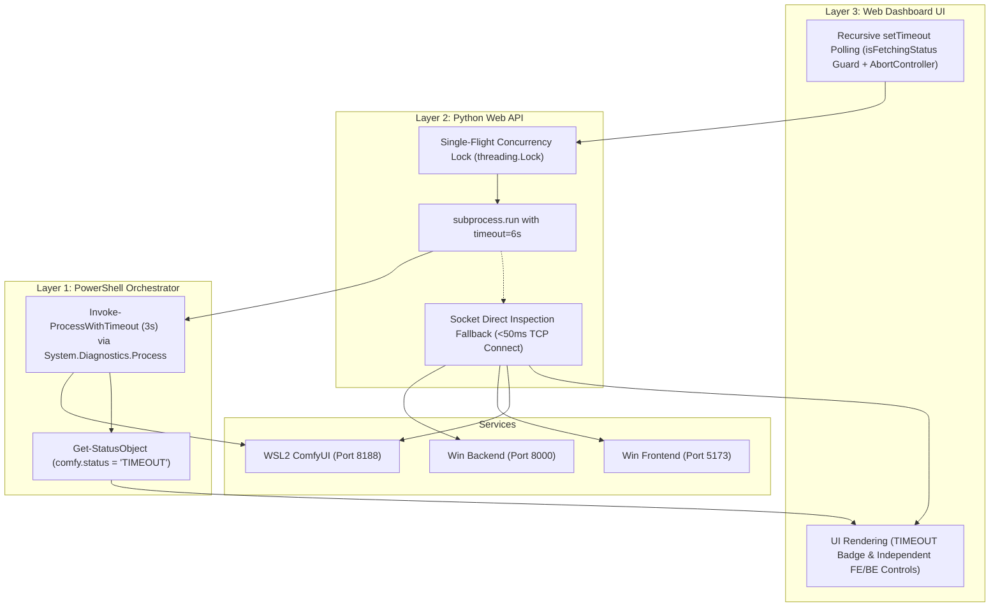

# REQ-257: Server Manager の WSL / サブプロセス呼び出しタイムアウト保護と耐障害性の向上 詳細設計書

## 1. 背景と課題

Prompt Surgeon の統合サービス管理ツール（`tools/server-manager/`）において、WSL2 上で動作する ComfyUI や WSL ディストリビューション自体が高負荷または異常によりハング（無応答）になった際、以下の深刻な障害連鎖が発生する。

### 特定された障害連鎖（Failure Cascade）
1. **WSL コマンドの永久ブロック**:
   `server-manager.ps1` 内の `Get-WslComfyPids`（`pgrep`）、`Test-WslAvailability`（`echo OK`）、`Stop-ComfyUIProcess`（`pkill`）、`Show-Logs`（`tail`）が `Invoke-Expression` によりタイムアウトなしで同期実行されているため、WSL が無応答になるとスクリプト全体が永久ブロックする。
2. **Web API サーバーの同期ブロック**:
   `server_api.py` の `subprocess.run` による PowerShell 呼び出しに `timeout` が設定されておらず、Worker スレッドが応答待ちで永久に固まる。
3. **クライアントポーリングによるプロセス多重蓄積（Process Accumulation）**:
   Web UI（HTML/JS）が 5 秒ごとに `setInterval` で `/api/status` をポーリングしているため、リクエストが詰まっている間に新たな `powershell.exe` プロセスが 5 秒ごとに生成され続け、20 個以上のプロセスが蓄積・リソース枯渇を引き起こす。
4. **全サービス操作の道連れフリーズ**:
   ComfyUI（WSL）の不応答によって Web UI 全体が操作不能になり、正常に稼働している Windows 側の Backend（FastAPI）や Frontend（Vite）の状態確認や停止・再起動すら行えなくなる。

---

## 2. アーキテクチャ設計方針（3層防御モデル）

本改修では、障害を ComfyUI / WSL 境界で完全に封じ込め、上位レイヤーおよび他サービスへの影響をゼロにする **3層防御アーキテクチャ** を導入する。



---

## 3. 詳細モジュール設計

### 3-1. Layer 1: PowerShell スクリプトのタイムアウト保護 (`server-manager.ps1`)

#### (1) `Invoke-ProcessWithTimeout` ヘルパー関数の新設
外部コマンド（特に `wsl.exe`）を規定時間（デフォルト 3 秒）で安全に実行し、超過時はプロセスツリーを強制終了して制御を戻す。

```powershell
function Invoke-ProcessWithTimeout (
    [string]$filePath,
    [string]$arguments,
    [int]$timeoutSec = 3
) {
    $psi = New-Object System.Diagnostics.ProcessStartInfo
    $psi.FileName = $filePath
    $psi.Arguments = $arguments
    $psi.RedirectStandardOutput = $true
    $psi.RedirectStandardError = $true
    $psi.UseShellExecute = $false
    $psi.CreateNoWindow = $true

    $proc = New-Object System.Diagnostics.Process
    $proc.StartInfo = $psi
    try {
        if (-not $proc.Start()) {
            return [PSCustomObject]@{ ExitCode = -1; StdOut = ""; StdErr = "Failed to start process"; TimedOut = $false }
        }
        $stdoutTask = $proc.StandardOutput.ReadToEndAsync()
        $stderrTask = $proc.StandardError.ReadToEndAsync()

        if ($proc.WaitForExit($timeoutSec * 1000)) {
            $stdoutTask.Wait()
            $stderrTask.Wait()
            return [PSCustomObject]@{
                ExitCode = $proc.ExitCode
                StdOut = $stdoutTask.Result
                StdErr = $stderrTask.Result
                TimedOut = $false
            }
        } else {
            # タイムアウト発生: プロセス強制終了
            try {
                & taskkill.exe /PID $proc.Id /T /F 2>$null
                $proc.Kill()
            } catch {}
            return [PSCustomObject]@{
                ExitCode = -1
                StdOut = ""
                StdErr = "Command timed out after ${timeoutSec}s"
                TimedOut = $true
            }
        }
    } catch {
        return [PSCustomObject]@{
            ExitCode = -1
            StdOut = ""
            StdErr = $_.Exception.Message
            TimedOut = $false
        }
    } finally {
        $proc.Dispose()
    }
}
```

#### (2) `Invoke-WslWithTimeout` による WSL コールの一元化
```powershell
function Invoke-WslWithTimeout ([string]$bashCommand, [int]$timeoutSec = 3) {
    $wslPrefix = Get-WslDistroPrefix
    $args = "$($wslPrefix)bash -c `"$bashCommand`""
    return Invoke-ProcessWithTimeout "wsl.exe" $args $timeoutSec
}
```

#### (3) 各 WSL 呼び出し箇所の改修
- `Get-WslComfyPids`: `Invoke-WslWithTimeout "pgrep -f 'python.*main.py'" 3` を使用。タイムアウト時は空配列を返し、呼び出し元にタイムアウトフラグを伝達。
- `Test-WslAvailability`: `Invoke-WslWithTimeout "echo OK" 3` を使用。
- `Stop-ComfyUIProcess`: `Invoke-WslWithTimeout "pkill -f 'python.*main.py'" 3` を使用。
- `Show-Logs`: `Invoke-WslWithTimeout "tail -n 50 ~/comfyui.log" 3` を使用。
- `Get-StatusObject`: ComfyUI が応答なし・タイムアウトした場合は以下のように構成：
  ```powershell
  comfy = [PSCustomObject]@{
      name = "WSL ComfyUI"
      port = $cfg.wsl.port
      running = $comfyRunning
      status = if ($comfyTimedOut) { "TIMEOUT" } elseif ($comfyRunning) { "LISTEN" } else { "STOPPED" }
      pids = $comfyPids
      error = if ($comfyTimedOut) { "WSL応答タイムアウト" } else { $null }
  }
  ```

---

### 3-2. Layer 2: Python Web API の耐障害化 (`server_api.py`)

#### (1) `do_GET` `/api/status` のタイムアウト保護とソケットフォールバック
`subprocess.run` に `timeout=6` を設定。万一 PowerShell がハングした場合、例外をキャッチして即座にポート直接ソケット検査（<50ms）に切り替え、正常な HTTP 200 JSON を返す。

```python
def check_port_listening(port: int, timeout: float = 0.5) -> bool:
    try:
        with socket.create_connection(("127.0.0.1", port), timeout=timeout):
            return True
    except (socket.timeout, ConnectionRefusedError, OSError):
        return False

# /api/status 内
try:
    res = subprocess.run(
        ["powershell.exe", "-ExecutionPolicy", "Bypass", "-File", str(PS_SCRIPT), "-Action", "status", "-Json"],
        capture_output=True, text=True, creationflags=CREATE_NO_WINDOW, timeout=6
    )
    self._send_json(json.loads(res.stdout.strip() or "{}"))
except subprocess.TimeoutExpired:
    # フォールバック: Pythonソケット直接検査で即座に応答を復元
    fe_open = check_port_listening(5173)
    be_open = check_port_listening(8000)
    comfy_open = check_port_listening(8188)
    fallback_data = {
        "fe": {"name": "React FE", "port": 5173, "running": fe_open, "status": "LISTEN" if fe_open else "STOPPED", "pids": []},
        "be": {"name": "Win BE", "port": 8000, "running": be_open, "status": "LISTEN" if be_open else "STOPPED", "pids": []},
        "comfy": {"name": "WSL ComfyUI", "port": 8188, "running": comfy_open, "status": "TIMEOUT", "pids": [], "error": "PowerShell / WSL 応答タイムアウト"},
        "_warning": "PowerShell status timed out. Socket fallback returned."
    }
    self._send_json(fallback_data, status=200)
```

#### (2) `do_POST` `/api/action` のタイムアウト保護
`subprocess.run(cmd, timeout=15)` を適用し、アクション実行が永久停止するのを防止。タイムアウト時は HTTP 504 とエラーメッセージを返却。

#### (3) プロセス多重起動防止（Single-Flight Concurrency Guard）
ステータス取得が重なった場合の多重 `powershell.exe` 起動を抑止するため、スレッド排他制御（`threading.Lock`）を導入。先行リクエスト実行中に後続リクエストが到達した場合は待機または直近キャッシュ（TTL: 2秒）を返却する。

---

### 3-3. Layer 3: Web Dashboard UI の防護 (`server_api.py` 内 HTML/JS)

#### (1) ポーリングの多重蓄積防止
従来の固定 `setInterval(fetchStatus, 5000)` を廃止し、先行リクエストの完了を待ってから次のタイマーを起動する再帰的 `setTimeout` パターンに変更。さらに `isFetchingStatus` フラグと `AbortController` (7秒) により、重複リクエストの発行を物理的に遮断する。

#### (2) `TIMEOUT` ステータスおよびエラーの視認性向上
- スタイル追加: `.badge-timeout` （警告アンバー色: `#f59e0b`、背景色: `rgba(245, 158, 11, 0.2)`）。
- ComfyUI が `TIMEOUT` の場合でも、React FE および Win BE のカードは正常表示され、各サービスの起動・停止・再起動ボタンが完全に操作可能であることを維持する。

---

## 4. 受け入れ基準 (AC) トレーサビリティ

| AC | 要件 | 実現メカニズム |
|---|---|---|
| **AC-1** | WSL 無応答時も `/api/status` がハングせず規定時間内に応答 | PS レイヤーの 3 秒タイムアウト + Python レイヤーの 6 秒タイムアウト + ソケットフォールバック |
| **AC-2** | Web UI 定期ポーリングによる `powershell.exe`/`wsl.exe` 多重スタック防止 | 再帰的 `setTimeout` + `isFetchingStatus` + `AbortController` + Python 側 Single-Flight Lock |
| **AC-3** | `server-manager.ps1` の WSL 問い合わせが 3 秒以内で安全に中断 | `Invoke-ProcessWithTimeout` (.NET `Process.WaitForExit` + `taskkill` + `Kill()`) |
| **AC-4** | Web Manager 画面上に「応答なし (TIMEOUT)」が表示され、BE/FE の操作が阻害されない | `status: "TIMEOUT"` バッジ表示 + FE/BE カードの完全独立レンダリングと操作性確保 |

---

## 5. リスクとトレードオフ

1. **WSL 初期起動時の遅延判定**:
   - 初回 `wsl.exe` 起動時に 2〜3 秒を要する場合がある。
   - **対策**: タイムアウトは過度に短い値（例: 1秒）ではなく 3 秒に設定し、誤判定を防止する。また万一タイムアウトしても次回ポーリングで自動復帰する。
2. **ソケットフォールバック時の PID 欠落**:
   - ソケットフォールバック時は Windows ポート接続確認のみとなるため、PID リストが一時的に空配列 `[]` となる。
   - **対策**: UI 上は「PID: なし (フォールバック)」と表示され、サービスの死活判定自体（LISTEN / STOPPED）は正確に維持される。

