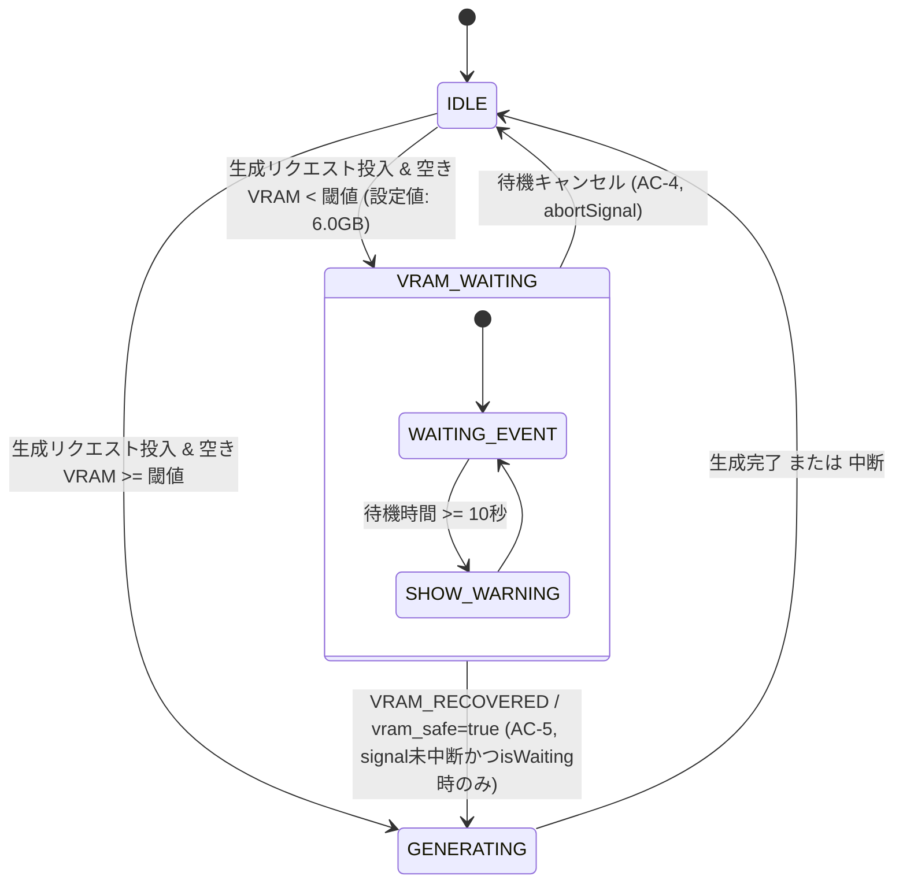

# REQ-260: ComfyUI生成開始前の他プロセスVRAM競合防止と待機通知 詳細設計書 (WebSocketイベント駆動 & 設定永続化)

## 1. 概要と背景
Prompt Surgeonと同一のホストPC（Windows / RTX 4080 16GB等）上では、ローカルLLM（LM Studio / Ollama）、3Dモデリングツール、別画像生成プロセス等の他アプリケーションが並行稼働することがある。
ComfyUIの生成開始前に他プロセスがVRAMを大量に消費している状態で画像生成リクエストを投入すると、VRAM枯渇（CUDA Out of Memory）によりComfyUIやグラフィックドライバ、ホストOS全体のフリーズやクラッシュを誘発するリスクがある。
本機能（REQ-260）は、ComfyUIへの生成プロンプト投入前にGPU空きVRAM量を自動検証し、安全基準値を下回っている場合は生成リクエストを一時待機させ、他プロセスの終了やモデルアンロードによって安全な空き容量が回復した段階で自動的に生成を開始するプリフライトガード機構を提供する。

### ユーザーレビューに基づく主要設計方針
1. **安全基準値のバックエンドDB永続化とSettings UI**:
   - 初期デフォルト値をより安全な **6.0GB** に引き上げ。
   - SQLite DB（汎用キーバリュー `app_settings` テーブル: key, value, updated_at）で閾値を永続化し、`GET/PUT /api/settings/vram` APIを提供。
   - `SettingsPage` に専用の「ComfyUI VRAM安全ガード設定」セクション（スライダー/数値入力、リアルタイム空き容量ゲージ）を追加し、ユーザーが環境やモデルに合わせて動的に基準値を調整可能にする。
2. **WebSocketイベント駆動型プッシュ（HTTPポーリング完全撤廃）**:
   - バックエンドのFastAPI WebSocket（`/api/ws`）を活用し、2.5秒周期の `SYSTEM_STATS` プッシュおよびVRAM回復契機の `VRAM_RECOVERED` 即時通知により、クライアント側のポーリング負荷をゼロ化して即時再開を実現。

---

## 2. アーキテクチャと設計方針

### 2-1. レイヤー分離と責務分担
1. **バックエンド（設定永続化・WebSocketイベントバス & メトリクス提供）**:
   - `AppSetting` ORMモデル (`backend/app/models.py`):
     - 汎用 `app_settings` テーブル（key: str primary_key, value: str, updated_at）を採用し、将来の設定拡張にもマイグレーション不要で安全に対応。
   - `Settings API` (`backend/app/routers/settings.py`):
     - `GET /api/settings/vram`: 現在の閾値、有効状態、およびリアルタイムVRAM情報を返却。
     - `PUT /api/settings/vram`: 閾値を更新・DBトランザクションで永続化し、即座に `ResourceMonitorService` へ反映。
   - `ResourceMonitorService` (`backend/app/services/resource_monitor.py`):
     - Windows PDH API経由でシステム全体VRAM使用量を常時サンプリング。
     - 動的に空きVRAM量（`vram_free_gb = vram_total_gb - vram_used_gb`）および安全判定（`safe = vram_free_gb >= min_free_gb`）を機械的算出。
     - 2.5秒周期の `SYSTEM_STATS` に `vram_free_gb`, `vram_safe`, `vram_min_free_gb` を包含して `/api/ws` から全クライアントへブロードキャスト。
     - 危険（unsafe）から安全（safe）へ回復した瞬間に、専用イベント `VRAM_RECOVERED` を即時ブロードキャスト。
2. **フロントエンド 設定UI (`frontend/src/pages/SettingsPage/components/VramGuardSection.tsx`)**:
   - 閾値（`vram_min_free_gb`）の数値入力/スライダー（2.0GB〜14.0GB、0.5GB刻み）。
   - 現在の空きVRAM量（`systemStats.vram_free_gb`）と設定閾値の比較ゲージ表示。
   - React Queryによる更新（`settingsApi.updateVram`）と保存成功トースト通知。
3. **フロントエンド状態管理 (`jobQueueSlice.ts`, `useSystemStats.ts`)**:
   - `SystemStats` に `vram_free_gb`, `vram_safe`, `vram_min_free_gb` を統合。
   - `useGenerationStore` の `vramWaitStatus: { isWaiting: boolean; freeGb: number | null; requiredGb: number; waitDurationSec: number } | null` で待機状態を一元管理。
   - `cancelVramWait()` により待機キャンセルとアイドル復帰を安全に行う。
4. **生成アクションオーケストレーション (`useGenerateAction.ts`)**:
   - `handleGenerate` / `handleGenerateSets` において、`queuePrompt` 実行直前にVRAM検証を実施。
   - VRAM不足時は待機状態（`isWaiting: true`）へ遷移。
   - **HTTPポーリングは行わず**、Zustandストア購読（`useGenerationStore.subscribe`）によりWebSocketからの `vram_safe: true` または `VRAM_RECOVERED` 受信をイベント駆動で待機。
   - **キャンセル排他性（Cancel Idempotency）の徹底**:
     - ユーザーがキャンセル（AC-4）を実行した際、`abortController.abort()` により即座に待機プロミスを破棄し、`vramWaitStatus: null` を確定。
     - 待機解除後に遅れて `VRAM_RECOVERED` イベントを受信しても、`vramWaitStatus === null` および `signal.aborted === true` により後続の自動再開（AC-5）は完全に不発化（ガード）される。
   - 待機時間が10秒を超過した場合、警告トーストを発行（AC-3）。回復時は自動的に `queuePrompt` を実行（AC-5）。
5. **UIレイアウト (`DesktopLayout.tsx`, `MobileLayout.tsx`, `useGenerateDisplayState.ts`)**:
   - ステータスバー上に `「VRAM解放待ち（他プロセスの終了待機中）」` バッジ、リアルタイム空き/必要容量（WebSocket更新）、経過秒数、および `[待機キャンセル]` ボタンを表示。

---

## 3. 詳細API・型仕様

### 3-1. バックエンド 設定API & WebSocketイベント
```python
# GET /api/settings/vram
# Response:
{
    "vram_min_free_gb": 6.0,
    "vram_guard_enabled": True,
    "vram_free_gb": 11.8,
    "vram_total_gb": 16.0
}

# PUT /api/settings/vram
# Request:
{
    "vram_min_free_gb": 6.0,
    "vram_guard_enabled": True
}
```

```python
# SYSTEM_STATS 拡張ペイロード (/api/ws)
{
    "type": "SYSTEM_STATS",
    "data": {
        "vram_used_gb": 12.5,
        "vram_total_gb": 16.0,
        "vram_free_gb": 3.5,
        "vram_safe": False,
        "vram_min_free_gb": 6.0,
        "ts": 1727395200000
    }
}

# VRAM回復通知イベント (/api/ws)
{
    "type": "VRAM_RECOVERED",
    "data": {
        "vram_free_gb": 11.8,
        "vram_min_free_gb": 6.0,
        "ts": 1727395205000
    }
}
```

### 3-2. フロントエンド 型定義 (`frontend/src/store/types.ts`)
```typescript
export interface SystemStats {
  cpu_pct: number
  ram_used_gb: number
  ram_total_gb: number
  ram_pct: number
  gpu_pct: number | null
  vram_used_gb: number | null
  vram_total_gb: number | null
  vram_pct: number | null
  vram_free_gb?: number | null
  vram_safe?: boolean
  vram_min_free_gb?: number
  ts: number
}

export interface VramWaitStatus {
  isWaiting: boolean
  freeGb: number | null
  requiredGb: number
  waitDurationSec: number
}

export interface VramSettings {
  vram_min_free_gb: number
  vram_guard_enabled: boolean
  vram_free_gb?: number | null
  vram_total_gb?: number | null
}
```

---

## 4. 厳格な状態マシンと遷移フロー



---

## 5. BA論理監査フィードバックへの適合

| 指摘論点 | 本設計における解決策・防護策 |
|---|---|
| **基準値の心もとなさ & 動的設定 (ユーザー指摘)** | デフォルトを4.0GBから **6.0GB** へ引き上げ。バックエンドDB（汎用KV `app_settings`）で永続化し、`SettingsPage` からスライダーで即時調整可能に刷新。スキーマ変更に左右されない汎用設計。 |
| **ポーリング負荷の排除 (ユーザー指摘)** | 定期HTTPポーリングを完全廃止。FastAPI WebSocket（`/api/ws`）によるプッシュ配信（2.5秒メトリクス + 回復時即時通知）へ全面刷新。 |
| **キャンセルと回復の競合 (AC-4 vs AC-5)** | `abortSignal` + `vramWaitStatus === null` の二重ガードによるキャンセル排他性を徹底。キャンセルされた場合は後続の回復イベントを一切無視してアイドルを維持。 |
| **WS切断時のフォールバック** | 指数バックオフ自動再接続（1s-10s）に加え、15秒切断継続時はHTTPフェイルセーフ照会でハングを抑止。 |
| **非ブロッキングアーキテクチャ** | バックエンドのFastAPIワーカースレッドを待機ブロックせず、クライアントサイドの非同期オーケストレーション（`useGenerateAction`）で待機ループを実行。他セッションやUIの動作を一切阻害しない。 |

---

## 6. SSoT 同期対象ドキュメント
- `docs/specs/SPEC_GENERATE.md`: 2-10項 リソース監視HUDおよび5-4項に「WebSocketプッシュ駆動型VRAM安全ガード機構（REQ-260）」の記述を反映。
- `docs/specs/SPEC_SUMMARY.md`: Settings画面の機能一覧に「VRAM安全ガード設定（永続化）」を追加。
- `docs/backlog/pbi/active/REQ-260.md`: 設計ドキュメントリンクおよびステータス反映。
