# REQ-261: 生成プリセット一括編集モーダルでのサンプラ・スケジューラ選択肢の正常表示 詳細設計書

## 1. 背景と課題

Prompt Surgeon の生成画面において、プリセット一覧（PresetManagerPanel）から複数プリセットを選択し、「一括編集」モーダル（`ProfileBulkEditModal`）の「パラメータ」タブを開いた際、`select_sampler`（サンプラ）および `select_scheduler`（スケジューラ）のドロップダウンに選択肢が1件も表示されず空になる不具合が発生している（チェックポイント等のカスタム型は正常に表示）。

### 調査結果と根本原因
1. **親コンポーネントにおける Props 伝達漏れ**:
   [`frontend/src/pages/GeneratePage.tsx`](frontend/src/pages/GeneratePage.tsx) の `ProfileBulkEditModal` 呼び出し部で、`paramTypeMasters` や `loras`、`tagSets` は渡されているが、`comfyObjectInfo`（`state.comfyObjectInfo`）の引き渡しが漏れており、モーダル内部で `undefined` となっていた。
2. **コンポーネント内定数フォールバックの欠如**:
   [`frontend/src/components/ProfileBulkEditModal.tsx`](frontend/src/components/ProfileBulkEditModal.tsx) の `getSamplerOptions` / `getSchedulerOptions` は、`comfyObjectInfo` が `undefined` の場合に空配列 `[]` を返していた。仕様書 [`docs/specs/SPEC_SETTINGS.md`](docs/specs/SPEC_SETTINGS.md) 第4-1節の規定（「オフライン時は定数フォールバック」）に反し、通常のパラメータパネル（`ParamPanel.tsx`）にあるような `DEFAULT_SAMPLERS` / `DEFAULT_SCHEDULERS` のフォールバックが存在しなかった。

---

## 2. 設計方針とデータフロー

### 2-1. 2重防御モデル（Props 伝達 ＋ 定数フォールバック）
本改修では、ComfyUI との接続状態や親コンポーネントからのデータ供給タイミングに依存せず、常にサンプラ・スケジューラの選択肢を確実にユーザーへ提示するため、以下の2重防御構成とする。

```mermaid
flowchart TD
    subgraph Parent["GeneratePage.tsx"]
        StateHook["useGeneratePageState()"]
        ComfyInfo["state.comfyObjectInfo"]
        StateHook --> ComfyInfo
    end

    subgraph ModalProps["ProfileBulkEditModal Props"]
        PropComfy["comfyObjectInfo={state.comfyObjectInfo}"]
        ComfyInfo --> PropComfy
    end

    subgraph ModalLogic["ProfileBulkEditModal.tsx"]
        SamplerFn["getSamplerOptions()"]
        SchedulerFn["getSchedulerOptions()"]
        PropComfy --> SamplerFn
        PropComfy --> SchedulerFn
        
        FallbackSamplers["DEFAULT_SAMPLERS (ParamPanel.tsx から export)"]
        FallbackSchedulers["DEFAULT_SCHEDULERS (ParamPanel.tsx から export)"]
        
        FallbackSamplers -.->|comfyObjectInfo 不在・空配列時| SamplerFn
        FallbackSchedulers -.->|comfyObjectInfo 不在・空配列時| SchedulerFn
        
        UISelectSampler["<select> サンプラー選択"]
        UISelectScheduler["<select> スケジューラー選択"]
        
        SamplerFn --> UISelectSampler
        SchedulerFn --> UISelectScheduler
    end
```



---

## 3. 詳細モジュール設計

### 3-1. `frontend/src/pages/GeneratePage/components/ParamPanel.tsx`
- **変更内容**: 既存の `DEFAULT_SAMPLERS` および `DEFAULT_SCHEDULERS` を `export` する。
- **コード変更イメージ**:
  ```tsx
  export const DEFAULT_SAMPLERS = [
    'euler', 'euler_ancestral', 'heun', 'heunpp2', 'dpm_2', 'dpm_2_ancestral',
    'lms', 'dpm_fast', 'dpm_adaptive', 'dpmpp_2s_ancestral', 'dpmpp_sde',
    'dpmpp_sde_gpu', 'dpmpp_2m', 'dpmpp_2m_sde', 'dpmpp_2m_sde_gpu',
    'dpmpp_3m_sde', 'dpmpp_3m_sde_gpu', 'ddim', 'uni_pc', 'uni_pc_bh2'
  ];

  export const DEFAULT_SCHEDULERS = [
    'normal', 'karras', 'exponential', 'sgm_uniform', 'simple', 'ddim_uniform', 'beta'
  ];
  ```

### 3-2. `frontend/src/components/ProfileBulkEditModal.tsx`
- **変更内容**:
  1. `DEFAULT_SAMPLERS`, `DEFAULT_SCHEDULERS` をインポート。
  2. `getSamplerOptions` / `getSchedulerOptions` において、`comfyObjectInfo` からの取得結果が空配列または未定義の場合に定数配列へフォールバックする。
- **コード変更イメージ**:
  ```tsx
  import { DEFAULT_SAMPLERS, DEFAULT_SCHEDULERS } from '../pages/GeneratePage/components/ParamPanel';

  const getSamplerOptions = (): string[] => {
    const fromInfo = comfyObjectInfo?.KSampler?.input?.required?.sampler_name?.[0] ?? 
                     comfyObjectInfo?.KSamplerAdvanced?.input?.required?.sampler_name?.[0];
    return (fromInfo && fromInfo.length > 0) ? fromInfo : DEFAULT_SAMPLERS;
  };

  const getSchedulerOptions = (): string[] => {
    const fromInfo = comfyObjectInfo?.KSampler?.input?.required?.scheduler?.[0] ?? 
                     comfyObjectInfo?.KSamplerAdvanced?.input?.required?.scheduler?.[0];
    return (fromInfo && fromInfo.length > 0) ? fromInfo : DEFAULT_SCHEDULERS;
  };
  ```

### 3-3. `frontend/src/pages/GeneratePage.tsx`
- **変更内容**: `ProfileBulkEditModal` 呼び出し部に `comfyObjectInfo={state.comfyObjectInfo}` を追加する。
- **コード変更イメージ**:
  ```tsx
  <ProfileBulkEditModal
    isOpen={isBulkEditOpen}
    onClose={() => setIsBulkEditOpen(false)}
    selectedPresets={(presets ?? []).filter(p => bulkTargetIds.includes(p.id))}
    mappingMasters={...}
    paramTypeMasters={state.paramTypeMasters}
    comfyObjectInfo={state.comfyObjectInfo}
    loras={loras ?? []}
    tagSets={tagSets ?? []}
    onApply={handleBulkEditApply}
    isApplying={isBulkApplying}
    activeBaseModelId={workflow?.target_base_model_id ?? null}
  />
  ```

---

## 4. テスト戦略

1. **単体テスト (`ProfileBulkEditModal.test.tsx`)**:
   - `comfyObjectInfo` が渡されない（`undefined`）場合でも、フォールバック定数（`DEFAULT_SAMPLERS` / `DEFAULT_SCHEDULERS`）によってドロップダウン選択肢が描画されることを検証。
   - `comfyObjectInfo` が正常に渡された場合、ComfyUI 由来の動的リスト（例: `euler`, `dpmpp_2m` 等）が優先して選択肢に展開されることを検証。
2. **結合・回帰テスト**:
   - モーダルでサンプラおよびスケジューラを選択して適用ボタンを押下した際、`onApply` コールバックに正しく選択値（`paramPatch`）が引き渡されることを検証。
   - 既存のプロンプトタブ操作（共通タグ編集・検索置換）、LoRA Stack操作に一切の副作用がないことを既存単体テストスイートで検証。

---

## 5. トレードオフとリスク開示 (Trade-off Disclosure)

- **トレードオフ**: `DEFAULT_SAMPLERS` / `DEFAULT_SCHEDULERS` を `ParamPanel.tsx` から直接エクスポートして共有する方式を採用する。これにより新たな共通定数ファイルを作成・肥大化させることなく変更ファイル数を最小限（3ファイル以内）に抑えられる。一方で、将来パラメータ定義共通ファイル（例: `constants/comfyDefaults.ts`）に一元化するリファクタリングが推奨される。
- **リスク**: ComfyUI のカスタムノード等で特殊なサンプラ名が追加された場合、ComfyUI オフライン時は定数に含まれる標準サンプラのみが表示される。ただしこれは仕様（`SPEC_SETTINGS.md`）通りの許容されたフォールバック挙動であり、オンライン時は動的に取得されるため問題ない。
