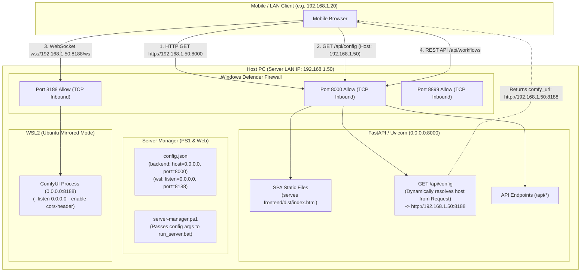
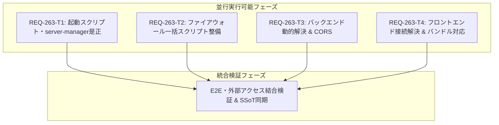

# REQ-263: モバイル・LAN外部アクセス対応と各種起動・管理スクリプトのハードコード網羅是正 詳細設計書

## 1. 背景と課題

REQ-262 においてフロントエンドの Uvicorn 内包配信（単一プロセス配布）および Port 8000 ファイアウォール許可スクリプト（`allow_firewall_8000.bat`）が整備された。
しかし、その後の実機検証において以下の深刻な課題・潜在障害が判明した：

1. **起動スクリプトのローカルループバック（127.0.0.1）ハードコード**:
   - `backend/run_server.bat` 内に `python -m uvicorn app.main:app --host 127.0.0.1 --port 8000 %*` がハードコードされており、`tools/server-manager/config.json` で `"start_args": "-m uvicorn app.main:app --host 0.0.0.0 --port 8000"` と指定していても一切反映されない。
   - `server-manager.ps1` の `Start-BackendProcess` も `run_server.bat` を引数なしで実行していたため、外部 LAN やモバイル端末からの接続要求が OS カーネル層で即座に拒絶（Connection Refused）されていた。
2. **ComfyUI 接続先 URL の外部アクセス不整合とバンドルモード不整合**:
   - バックエンドの `/api/config` が `{"comfy_url": "http://localhost:8188"}` を固定で返却していた。
   - フロントエンドの `resolveComfyUrl` は `localhost` を検知すると `${window.location.origin}/comfy`（Vite 開発サーバーのプロキシ前提パス）へ変換していた。
   - 単一プロセス（バンドル配信モード: Port 8000）では Vite は起動しておらず、Uvicorn 側にも `/comfy` のリバースプロキシが存在しないため、モバイル端末上では ComfyUI への WebSocket 接続および画像プレビューが 404 / 接続エラーとなり機能不全に陥っていた。
3. **ファイアウォール許可設定の断片化と ComfyUI (8188) の許可漏れ**:
   - `allow_firewall_8000.bat` と `allow_firewall_8899.bat` は個別に存在していたが、外部端末から ComfyUI へ直接接続するために必須となる **Port 8188** のファイアウォール許可スクリプトが存在していなかった。
   - 必要なポート群（8000, 8188, 8899）の状態を一括で設定・検証できるツールが未整備であった。

---

## 2. アーキテクチャとデータフロー



---

## 3. 各コンポーネントの詳細設計

### 3.1 起動スクリプトのハードコード是正（`backend/run_server.bat`）
- `127.0.0.1` のハードコードを撤廃し、デフォルト待機アドレスを `0.0.0.0` とする。
- 外部引数（`%*`）が渡された場合は引数を優先展開し、`server-manager.ps1` や CLI からの引数指定（`--host`, `--port`）を完全に透過する。
- 環境変数 `UVICORN_HOST`, `UVICORN_PORT` も尊重するフォールバック設計。

```cmd
@echo off
cd /d "%~dp0"
if exist ".venv\Scripts\activate.bat" (
    call .venv\Scripts\activate.bat
)
if "%~1"=="" (
    python -m uvicorn app.main:app --host 0.0.0.0 --port 8000
) else (
    python -m uvicorn app.main:app %*
)
```

### 3.2 サーバーマネージャーの設定伝達（`tools/server-manager/server-manager.ps1`）
- `Start-BackendProcess` において、`$cfg.backend.start_args`（存在する場合）またはホスト・ポート設定を `run_server.bat` の起動引数として確実に渡す。
- これにより、`tools/server-manager/config.json` を編集してホストやポートを変更した場合に、即座に起動コマンドへ反映される。

### 3.3 Windows ファイアウォール一括設定・検証スクリプト
- `tools/server-manager/allow_firewall_all.bat` を新設：
  - **Port 8000**: Prompt Surgeon Backend & UI
  - **Port 8188**: WSL2 ComfyUI (画像生成・WebSocket・ノード情報)
  - **Port 8899**: Prompt Surgeon Web Manager
  - 管理者権限（UAC昇格）の自動ハンドリング。
  - 各ルールの登録成否および既存ルール状態のコンソール表示。
- 既存の `allow_firewall_8000.bat`, `allow_firewall_8899.bat` は互換性のため維持しつつ、一括スクリプトへの案内または委譲を行う。

### 3.4 バックエンド `/api/config` の動的ホスト解決と CORS 整備
- `backend/app/main.py`:
  - `get_config(request: Request)`:
    `request.url.hostname` を参照し、アクセス元が `localhost` / `127.0.0.1` 以外のホスト（LAN IP や特定ホスト名）である場合、`settings.comfy_url` 中の `localhost` / `127.0.0.1` をクライアントがアクセスしてきたホスト名（例: `192.168.1.50`）に動的置換して返却する。
  - CORS 設定:
    `allow_origins` にワイルドカード `*` を許容（またはプライベート IP 正規表現パターン）し、LAN 内他端末からの dev / bundled 双方のアクセスで CORS エラーを発生させない。

### 3.5 フロントエンドの ComfyUI 接続先解決ロジック（`resolveComfyUrl`）
- `frontend/src/hooks/useComfyWebSocket.ts`:
  - `resolveComfyUrl(url: string | null)`:
    - `window.location.hostname` が `localhost` / `127.0.0.1` でない場合（モバイルや外部端末環境）：
      - `url` に含まれる `localhost` / `127.0.0.1` を `window.location.hostname` に置換し、ComfyUI のポート（通常 8188）へ直接接続する URL（例: `http://192.168.1.50:8188`）を返す。
      - 単一プロセス配信（Port 8000）環境下で存在しない `/comfy` へのプロキシ転送を防ぐ。
    - `window.location.hostname` が `localhost` かつ Vite 開発サーバー稼働時（Port 5173）:
      - 従来どおり `/comfy` プロキシを利用可能として後方互換性を担保。

---

## 4. タスク分解と並行性設計

各タスクは独立して実装・単体検証可能な粒度に分解されており、並行作業が可能です。

| Task ID | タイトル | 変更対象ファイル（最大3ファイル） | 並行実行性 |
|---|---|---|---|
| **REQ-263-T1** | 起動・管理スクリプトのハードコード是正と設定透過 | `backend/run_server.bat`<br>`tools/server-manager/server-manager.ps1` | 並行可能 (Infra) |
| **REQ-263-T2** | Windows ファイアウォール一括許可・状態確認スクリプトの配備 | `tools/server-manager/allow_firewall_all.bat`<br>`tools/server-manager/allow_firewall_8000.bat` | 並行可能 (Infra) |
| **REQ-263-T3** | バックエンド `/api/config` の動的ホスト解決と CORS / 外部アクセス適応 | `backend/app/main.py`<br>`backend/tests/test_api_config_network.py` | 並行可能 (Backend) |
| **REQ-263-T4** | フロントエンドの ComfyUI 接続先動的解決とバンドルモード対応 | `frontend/src/hooks/useComfyWebSocket.ts`<br>`frontend/src/store/slices/connectionSlice.ts` | 並行可能 (Frontend) |



---

## 5. 検証・テスト方針

### 5.1 単体・自動テスト
1. **バックエンド単体テスト**:
   - `pytest backend/tests/test_api_config_network.py`:
     - Localhost からのリクエスト時: デフォルトの `comfy_url` が返却されること。
     - LAN IP（`192.168.1.50`）を Host ヘッダーに持つリクエスト時: `http://192.168.1.50:8188` に動的解決されること。
2. **フロントエンド単体テスト**:
   - `npm run test` (または Vitest):
     - `resolveComfyUrl` がホスト名に応じて適切に URL を解決すること。
3. **スクリプト構文・起動テスト**:
   - PowerShell スクリプトの構文チェックおよび引数伝達の検証。

### 5.2 結合・実機検証
1. `allow_firewall_all.bat` を管理者権限で実行し、Port 8000, 8188, 8899 のルールが追加・有効化されることを確認。
2. `Start-BackendProcess` 経由および `backend/run_server.bat` 直接起動で、`netstat` / `Get-NetTCPConnection` にて `0.0.0.0:8000` で LISTEN されることを確認。
3. 同一 LAN 内のモバイル端末ブラウザから `http://<ホストPC-IP>:8000` を開き、画面表示・WebSocket 接続インジケータ（Green）・画像生成・進捗表示が正常に動作することを確認。

---

## 6. トレードオフ・リスクの開示

1. **セキュリティトレードオフ（0.0.0.0 バインドとファイアウォール開放）**:
   - `0.0.0.0` バインドにより、同一 LAN 内の全端末から Web UI および ComfyUI がアクセス可能となる。
   - **対策**: スクリプト内の注記および `server_manager_guide.md` にて「信頼できる家庭内 LAN やプライベートネットワーク環境下でのみ利用すること」を明記し、パブリック Wi-Fi 等での利用リスクを警告する。
2. **WSL2 ネットワークモードの依存性**:
   - ComfyUI が WSL2 内で動作する場合、Windows 側ポート 8188 でリッスンするためには WSL2 の `mirrored` ネットワークモード設定（`.wslconfig`）が必要となる。
   - **対策**: `server_manager_guide.md` に mirrored ネットワークモードの必要性・設定手順を明記し、ドキュメントの整合性を保つ。
