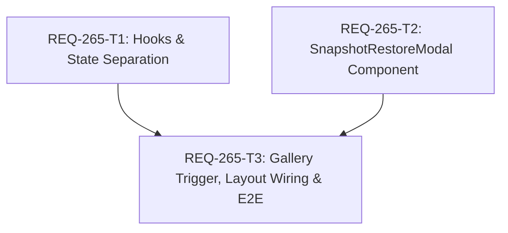

# REQ-265 設計書: スナップショットからのプリセット復元導線の分離とプレビューモーダル化による誤反映防止

## 1. 概要と実現可能性判定

- **実現可能性判定**: **実現可能（Feasible）**
- **背景と課題**:
  - 現行実装では `GenerationGallerySection.tsx` のスナップショット一覧カードをクリックすると `gallery.handleSnapshotClick(snap.id)` が呼ばれ、`DesktopLayout.tsx` / `MobileLayout.tsx` 経由で `useAssetSelectionState.ts` の `handleLoadSnapshot(id)` が即座に実行される。
  - `handleLoadSnapshot` は `snapshotsApi.get(id)` 後に `loadSnapshotParams(snapshot.params)`（`setParamValues`, `setSeed`, `setSeedMode`）および `setAppliedAssets(rebuiltAssets)` を呼び出すため、単なる閲覧・確認目的のクリックで現在編集中のアクティブプリセット・プロンプト・LoRA/TagSet構成が即座に上書きされる。
- **解決方針**:
  1. **閲覧・プレビュー導線と復元・反映導線の完全分離**: `useGalleryInteraction` のカードクリックを `onLoadSnapshot`（即時上書き）から `onPreviewSnapshot`（読み取り専用プレビューモーダル起動）へ置き換える。
  2. **専用復元トリガーと2段階プレビューモーダルの新設**: スナップショットタブヘッダーに専用導線ボタン（「プリセットに復元...」）を配置し、新規 `SnapshotRestoreModal`（共通 `Modal` ベース）で大きめサムネイル一覧・選択・簡易プレビュー（プロンプト/パラメータ/LoRA/TagSet概要）を提供し、明示的な「アクティブプリセットに復元」ボタン押下時のみ `handleLoadSnapshot` を実行する。
  3. **保護とキャンセル安全性**: モーダル内でのサムネイル選択・詳細取得はローカル state と React Query キャッシュのみに留め、キャンセル・閉じる・Esc・バックドロップクリック・モバイルスワイプダウン時はアクティブプリセットおよび編集中のプロンプトを一切変更しない。

---

## 2. SSoT 影響分析

| 仕様書 / ファイル | 影響種別 | 内容 |
|---|---|---|
| `docs/specs/SPEC_GENERATE.md` | **更新対象（Closure時同期）** | `GenerationGallerySection` のスナップショット操作契約（クリック即時復元廃止 → プレビューモーダル起動）、`SnapshotRestoreModal` の `LazyModalHost` (`while-open`) 登録の追記 |
| `docs/specs/SPEC_COMMON.md` | **準拠対象（変更なし）** | §1-4 共通Modal（モバイルボトムシート、`data-testid="modal-sheet-handle"`、Esc/backdrop/スワイプダウン）、§1-5 UI 6大不変条件・4大コンポーネントプリセットに完全準拠 |

---

## 3. アーキテクチャとUI分類

### 3-1. インタラクションフロー（Before / After）

- **Before**:
  `Snapshot Card Click` → `gallery.handleSnapshotClick(id)` → `onLoadSnapshot(id)` (`handleLoadSnapshot`) → `setParamValues` / `setSeed` / `setAppliedAssets`（即時上書き）
- **After**:
  1. `Snapshot Tab Header「プリセットに復元」ボタン` または `Snapshot Card Click` → `openSnapshotRestoreModal(id?)`（読み取り専用モーダル起動、ストア無変更）
  2. `SnapshotRestoreModal` 内でサムネイル選択（ローカル `selectedSnapshotId` 更新 + `snapshotsApi.get(selectedSnapshotId)` による詳細プレビュー取得、ストア無変更）
  3. **明示的復元**: 「アクティブプリセットに復元」押下 → `await onRestore(selectedSnapshotId)` (`handleLoadSnapshot`) → 成功時に `onClose()`
  4. **中止・保護**: 「キャンセル」/「×」/ Esc / Backdrop / スワイプダウン → `onClose()` のみ実行（`onRestore` 未呼出、ストア無変更）

### 3-2. UI 4大アーキテクチャ分類と制約（UI 6大不変条件準拠）

| 対象要素 | アーキテクチャ分類 | 適用制約 |
|---|---|---|
| `SnapshotRestoreModal` 外枠 | **Archetype 1: Modals & Overlays** | 共通 `Modal` (`src/components/common/Modal.tsx`) を使用。`size="full"` + `dialogClassName="md:max-w-4xl lg:max-w-5xl md:max-h-[85dvh] overflow-hidden"`、`sheetMaxHeightClass="max-h-[88dvh]"`、`overscroll-contain`、モバイル幅 < 768px で下部ボトムシート化。 |
| サムネイル一覧グリッド | **Archetype 2: Tabs / Chips / Grids** | `grid grid-cols-2 sm:grid-cols-3 gap-3`、カード内テキストは `min-w-0 flex-1 truncate`、長い文字列は `whitespace-pre-wrap break-words`、選択状態は枠線色だけでなく `aria-pressed` とバッジ/チェック表示を併用。 |
| 復元トリガー・モーダル操作ボタン | **Archetype 3: Forms & Controls** | ボタンは最小 44×44px タッチ領域（`min-h-11` または `relative before:absolute before:-inset-2` Hit-Slop）と `touch-manipulation` を適用。生の `100vh` 禁止、グローバルフォント底上げ禁止（`text-[11px]`/`text-xs` を個別指定）。 |

---

## 4. Test Seam Map (`[W-DD-SEAM]`)

1. **Integrated (real code)**:
   - `GenerationGallerySection`、`SnapshotRestoreModal`、`Modal`、`useGalleryInteraction`、`useGeneratePageModals`、`useAssetSelectionState`、`useWorkflowParams`、Zustand ストア（`useGenerationStore`）。
2. **Severed (external I/O only)**:
   - バックエンド HTTP 通信（`snapshotsApi.list` / `snapshotsApi.get` / `lorasApi.list` / `tagSetsApi.list`）を Vitest モック（単体・統合）または Playwright `page.route`（E2E）でネットワーク境界にて切断。
3. **Mock Level**:
   - 内部ビジネスロジック（`loadSnapshotParams` や `rebuiltAssets` 構築ロジック、モーダル内選択ロジック）のモンキーパッチは禁止。HTTP クライアント境界またはコンポーネント props 境界（単体テスト時）のみをモック化する。
4. **PBT Decision**:
   - 本 PBI は UI 状態遷移・モーダル操作・明示的トリガー分離が中心であり、パーサー・DSL・数式等の広大な入力空間を持たないため、PBT（Property-Based Testing）は **不要**。
5. **Fault Injection**:
   - `snapshotsApi.get(id)` 失敗時（500/ネットワークエラー）に、モーダル内にエラー表示（`role="alert"`）を出しつつアクティブプリセットが破壊されないこと、および復元失敗時にモーダルが誤って閉じず状態が保護されることをテストする。

---

## 5. 設計契約 D1–D7 (`[W-DD-BOUNDARY]`)

### D1: タスクごとの責務・スコープ・完了条件

| Task ID | 責務とスコープ | 完了条件 |
|---|---|---|
| `REQ-265-T1` | モーダル開閉状態（`useGeneratePageModals`）、キーボードショートカット抑止（`useGeneratePageState`）、ギャラリークリックのプレビュー分離（`useGalleryInteraction`）、復元結果返却化（`useAssetSelectionState`）およびフック単体テスト | `useGalleryInteraction.handleSnapshotClick` が `onPreviewSnapshot` のみを呼び出し、`handleLoadSnapshot` が `Promise<boolean>` を返し、対象 Vitest 単体テストが全件 PASS し `npm run typecheck` が通ること |
| `REQ-265-T2` | `SnapshotRestoreModal.tsx` の新規実装（大きめサムネイル一覧、選択・簡易プレビュー、明示的復元アクション、キャンセル/閉じる保護、UI 6大不変条件準拠）およびコンポーネント単体テスト | `SnapshotRestoreModal` が AC-1, AC-3, AC-4, AC-5 を満たし、UI 不変条件チェックおよび `SnapshotRestoreModal.test.tsx` が全件 PASS すること |
| `REQ-265-T3` | `GenerationGallerySection.tsx` への専用復元導線ボタン追加、および `DesktopLayout.tsx` / `MobileLayout.tsx` / `GeneratePage.tsx` への配線・統合テスト・Playwright E2E テスト追加 | 専用ボタン・カードクリック双方から安全にプレビューモーダルが開き、明示復元でのみ適用され、全 Vitest / `verify_ui_invariants.py` / `verify_test_naming.py` / E2E が PASS すること |

### D2: タスク間依存関係と理由

- `REQ-265-T1`: 依存なし（フック・状態契約の定義）
- `REQ-265-T2`: 依存なし（`SnapshotSummary` / `Snapshot` / `Modal` にのみ依存するため `T1` と並列実行可能）
- `REQ-265-T3`: `depends_on: ["REQ-265-T1", "REQ-265-T2"]`
  - **理由**: `DesktopLayout` / `MobileLayout` / `GeneratePage` は `T1` が提供する `openSnapshotRestoreModal` / `isSnapshotRestoreOpen` / `onPreviewSnapshot` 契約と、`T2` が提供する `SnapshotRestoreModal` コンポーネントの両方を結合するため。

### D3: ファイル所有権マップ（排他）

| Task ID | 所有ファイル（作成・編集） |
|---|---|
| `REQ-265-T1` | `frontend/src/pages/GeneratePage/hooks/useGeneratePageModals.ts`, `frontend/src/pages/GeneratePage/hooks/useGalleryInteraction.ts`, `frontend/src/pages/GeneratePage/hooks/useAssetSelectionState.ts`, `frontend/src/pages/GeneratePage/hooks/useGeneratePageState.ts`, `frontend/src/pages/GeneratePage/hooks/__tests__/useGalleryInteraction.test.ts`, `frontend/src/pages/GeneratePage/hooks/__tests__/useAssetSelectionState.test.ts` |
| `REQ-265-T2` | `frontend/src/pages/GeneratePage/components/SnapshotRestoreModal.tsx`, `frontend/src/pages/GeneratePage/components/__tests__/SnapshotRestoreModal.test.tsx` |
| `REQ-265-T3` | `frontend/src/pages/GeneratePage/sections/GenerationGallerySection.tsx`, `frontend/src/pages/GeneratePage/components/DesktopLayout.tsx`, `frontend/src/pages/GeneratePage/components/MobileLayout.tsx`, `frontend/src/pages/GeneratePage.tsx`, `frontend/src/pages/GeneratePage/sections/__tests__/GenerationGallerySection.cache.test.tsx`, `frontend/e2e/generateSnapshotRestore.spec.ts` |

### D4: 共有契約（型・インターフェース・Props）

1. **`useGeneratePageModals` 追加返却値**:
   ```ts
   isSnapshotRestoreOpen: boolean
   snapshotRestoreInitialId: number | null
   openSnapshotRestoreModal: (initialSnapshotId?: number) => void
   closeSnapshotRestoreModal: () => void
   ```
2. **`UseGalleryInteractionOptions` (`useGalleryInteraction.ts`)**:
   ```ts
   onPreviewSnapshot?: (snapshotId: number) => void
   // 旧 onLoadSnapshot は廃止（DesktopLayout/MobileLayout から即時上書き経路を排除するため）
   ```
3. **`useAssetSelectionState.handleLoadSnapshot`**:
   ```ts
   handleLoadSnapshot: (id: number) => Promise<boolean>
   ```
4. **`SnapshotRestoreModalProps` (`SnapshotRestoreModal.tsx`)**:
   ```ts
   export interface SnapshotRestoreModalProps {
     isOpen: boolean
     onClose: () => void
     snapshots: SnapshotSummaryWithParams[]
     initialSnapshotId?: number | null
     onRestore: (snapshotId: number) => Promise<boolean>
   }
   ```

### D5: AC とタスク・検証方法の対応

| AC | 対象タスク | 検証方法（詳細は `REQ-265-test-plan.md`） |
|---|---|---|
| AC-1 | T1, T2, T3 | Unit (`useGalleryInteraction.test.ts`, `SnapshotRestoreModal.test.tsx`), Integration (`GenerationGallerySection.cache.test.tsx`), E2E (`generateSnapshotRestore.spec.ts`) |
| AC-2 | T3 | Integration (`GenerationGallerySection.cache.test.tsx`), E2E (`generateSnapshotRestore.spec.ts`) |
| AC-3 | T2, T3 | Unit (`SnapshotRestoreModal.test.tsx`), E2E (`generateSnapshotRestore.spec.ts`) |
| AC-4 | T1, T2, T3 | Unit (`useAssetSelectionState.test.ts`, `SnapshotRestoreModal.test.tsx`), E2E (`generateSnapshotRestore.spec.ts`) |
| AC-5 | T2, T3 | Unit (`SnapshotRestoreModal.test.tsx`), E2E (`generateSnapshotRestore.spec.ts`) |
| AC-6 | T2, T3 | Integration (`GenerationGallerySection.cache.test.tsx`), E2E (`generateSnapshotRestore.spec.ts` Desktop + Mobile) |

### D6: Engineer への委譲判断範囲

- `SnapshotRestoreModal` 内のプレビュー表示項目レイアウト（プロンプト・シード・パラメータ抜粋の表示順や余白・Tailwind 装飾クラス、ただし UI 6大不変条件と `Modal` 共通契約の範囲内）。
- `GenerationGallerySection` ヘッダー内の専用復元ボタンのアイコン選定（例: `RotateCcw` / `History`）と既存ボタンスタイルとの調和。
- 日時フォーマット関数やパラメータ抜粋表示のローカルヘルパー分割。

### D7: 変更禁止スコープ

- バックエンド API（`backend/` 配下）および OpenAPI スキーマ（`docs/system/openapi.yaml`）は一切変更しない。
- 保存済みスナップショットのメタデータ編集機能（`HistoryModalPreview.tsx`, `SnapshotMetadataTab.tsx`, `SnapshotTagAssociationsPanel.tsx`）およびプリセット自動保存（`usePresetState.ts` / `multiSetSlice.ts`）の仕様は変更しない。
- `useAssetSelectionState.handleLoadSnapshot` 内部のパラメータ/LoRA/TagSet 復元ロジック自体は維持する（戻り値 `Promise<boolean>` 化と `try/catch` 整備のみ）。
- テストファイル名にチケット番号（`req\d+` / `REQ-\d+`）を含めることは禁止。

---

## 6. トレードオフとリスク

1. **スナップショットカードの直接クリック挙動の変更**:
   - **トレードオフ**: 従来のようにスナップショットタブのカードを1クリックで即座に復元できなくなり、モーダルでの確認＋「アクティブプリセットに復元」の2ステップが必要になる。ただし PBI の主目的（低頻度な復元操作に対する誤上書き防止）に合致し、カードクリックでも同モーダルが該当スナップショット選択状態で開くため手数は最小限（2クリック）に抑えられる。
2. **既存レイアウトテストのモック互換性**:
   - **リスク**: `DesktopLayout.test.tsx` / `MobileLayout.test.tsx` 等は `useGeneratePageState` のモックオブジェクトを渡しているため、新しいプロパティ（`openSnapshotRestoreModal` 等）が未定義でもクラッシュしない設計が必要。
   - **対策**: `useGalleryInteraction` の `onPreviewSnapshot` をオプショナルとし、`GenerationGallerySection` でも `state.openSnapshotRestoreModal?.()` のオプショナル呼び出しとする。
3. **詳細取得中の復元・非同期競合**:
   - **リスク**: `snapshotsApi.get` が失敗した場合や復元処理中に連打された場合、モーダルが閉じてしまったり二重実行される可能性がある。
   - **対策**: 復元ボタンに `isRestoring` ローディング/無効化ガードを設け、`onRestore` が `true` を返したときのみ `onClose()` する。

---

## 7. タスク依存関係 (Mermaid DAG)

