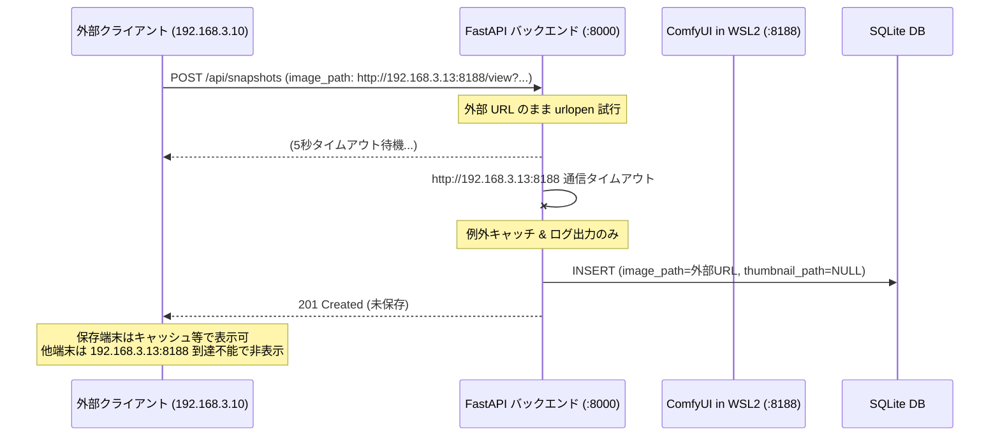
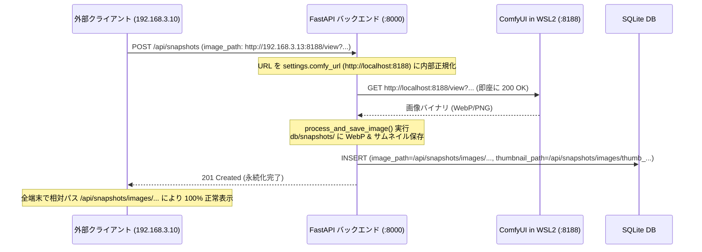
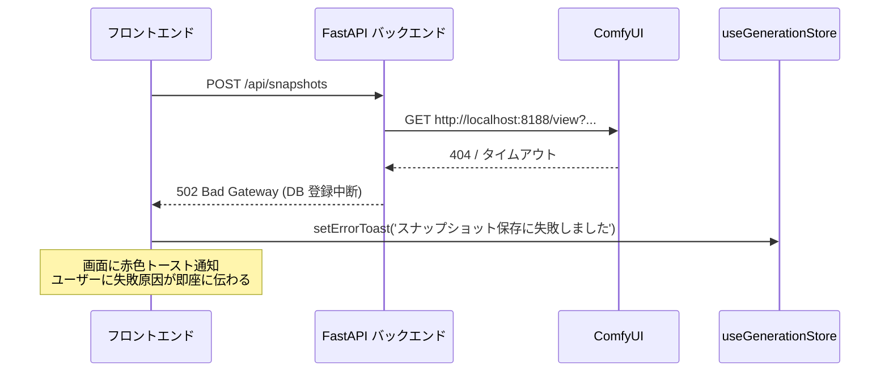

# 設計書 - REQ-267: 外部クライアント端末からのスナップショット保存時における画像永続化不全および端末間画像表示不具合の是正

## 1. 目的と概要
Prompt Surgeon を LAN 内の複数端末（PC、ノートPC、タブレット等）から利用するマルチデバイス環境において、外部クライアント端末（例: `192.168.3.10`）から生成画像をスナップショット保存した場合、保存を行った端末自身では閲覧できるものの、別の端末（サーバーホスト `127.0.0.1` や他クライアント）で `/history` ページを閲覧するとサムネイル・モーダルプレビュー共に実画像が表示されない障害が発生していました。

本設計では以下の根本原因を解消し、マルチデバイス環境において常に安定して画像が永続化され、全端末間でシームレスに履歴閲覧・プレビューが行えるアーキテクチャを確立します：

1. **バックエンド ComfyUI 画像取得 URL の内部正規化**:
   - `SnapshotService.create_snapshot` において、クライアントから送信された `payload.image_path` が ComfyUI の `/view` URL である場合、クライアント都合のホスト名・IP（`192.168.3.13:8188` 等）を破棄し、サーバー内部の直接通信先である `settings.comfy_url`（`http://localhost:8188`）に正規化して画像データを取得する。
   - これにより、Windows / WSL2 間のヘアピン NAT ルーティングによるタイムアウト（5秒遅延およびダウンロード失敗）を根本防止する。
2. **サイレントフォールバックの排除とデータ整合性の保護**:
   - ComfyUI からの実画像ダウンロードが失敗した場合、外部 URL をそのまま DB に登録するサイレントフォールバック（`thumbnail_path = None`）を廃止し、適切な HTTP 502 / 500 エラーを返却して不正な未保存レコードの混入を防止する。
3. **フロントエンド側のエラー通知ハンドリング（UX 保護）**:
   - バックエンドから万一画像取得失敗（HTTP 502等）が返却された場合、`useSnapshotActions.ts` の `useMutation` が `onError` でエラーを捕捉し、グローバルストアの `setErrorToast` により「スナップショットの保存に失敗しました」と画面上に明確にトースト通知を表示する。
4. **既存不全データ（68件）の安全な修復マイグレーション**:
   - 2026-09-16 に発生した 68 件（Snapshot ID: 4108 〜 4177）の不全レコードに対し、ComfyUI の一時フォルダ（`type=temp`）に残存する元画像から WebP 永続化ファイルおよびサムネイルを生成し、DB の `image_path` および `thumbnail_path` を正規の相対パス（`/api/snapshots/images/...`）へと一括修復する。
5. **フロントエンド側の二重防御（防御的プロキシフォールバック）**:
   - `HistoryPage` および `HistoryModalPreview` において、万一 DB に外部 ComfyUI URL（`/view?`）が残存していた場合でも、直接ポート 8188 を叩くのではなく `/api/comfy/thumbnail` および `/api/comfy/view` プロキシを経由するようフォールバック処理を導入し、端末間の表示互換性を担保する。

---

## 2. アーキテクチャ設計

### 2.1 処理フロー比較（Before / After）

#### [Before: 障害発生時のフロー]

#### [After: 是正後の正常フロー]

#### [After: 万一の異常系（ComfyUI 停止・一時ファイル消失）フロー]

---

## 3. コンポーネント別詳細仕様

### 3.1 バックエンド (`backend/app/services/snapshot_service.py`)
- **URL 正規化ヘルパー `resolve_internal_comfy_url(url: str, base_url: str) -> str`**:
  - `url` が `http://` または `https://` で始まり、かつ `/view?` または `/view/` を含む場合：
    - クエリパラメータ（`filename`, `subfolder`, `type`）を抽出。
    - 内部設定 `settings.comfy_url`（`http://localhost:8188`）をベースとする URL を構築：
      `f"{settings.comfy_url.rstrip('/')}/view?filename={filename}&subfolder={subfolder}&type={type}"`
  - 通常の外部画像 URL（ComfyUI 以外）はそのまま返却。
- **ダウンロードおよびエラーハンドリング**:
  - `urllib.request.urlopen` でダウンロードを試行。
  - ダウンロードに失敗した場合はサイレントフォールバックせず、`HTTPException(status_code=502, detail=f"Failed to fetch image from ComfyUI: {e}")` を送出する。

### 3.2 フロントエンド保存処理・エラーハンドリング (`frontend/src/pages/GeneratePage/hooks/useSnapshotActions.ts`)
- `useGenerationStore` の `setErrorToast` を利用。
- `saveSnapshot` の `useMutation` において、`onError: (error) => void` を追加。
- 失敗時にトースト通知を発火し、保存モーダルのローディングを解除してユーザーが再試行またはキャンセルできるようにする。

### 3.3 データ修復スクリプト (`backend/scripts/repair_snapshots_req267.py`)
- **対象レコード**:
  `SELECT id, image_path FROM snapshots WHERE thumbnail_path IS NULL AND image_path LIKE 'http%'`
- **修復ロジック**:
  1. `image_path` からパラメータを抽出し、`http://localhost:8188/view?...` から実画像バイト列を取得。
  2. `process_and_save_image` を呼び出して `db/snapshots/` に WebP 実体およびサムネイルを生成。
  3. `UPDATE snapshots SET image_path = ?, thumbnail_path = ? WHERE id = ?` をコミット。
  4. 完了件数・スキップ件数・エラー件数を構造化ログで出力。

### 3.4 フロントエンド表示フォールバック (`frontend/src/pages/HistoryPage.tsx`, `HistoryModalPreview.tsx`)
- サムネイル描画時：
  - `snap.thumbnail_path` が存在すればそのまま使用。
  - `snap.thumbnail_path` がなく `snap.image_path` が ComfyUI の `/view?` 形式である場合、`toThumbnailUrl(snap.image_path)` を介して `/api/comfy/thumbnail?...` プロキシ URL を利用する。
- プレビューモーダル時：
  - 同様に `/view?` 形式の URL については、FastAPI のプロキシエンドポイント `/api/comfy/view?...` を優先利用し、端末に依存せず実画像が表示されるよう防御的フォールバックを施す。
