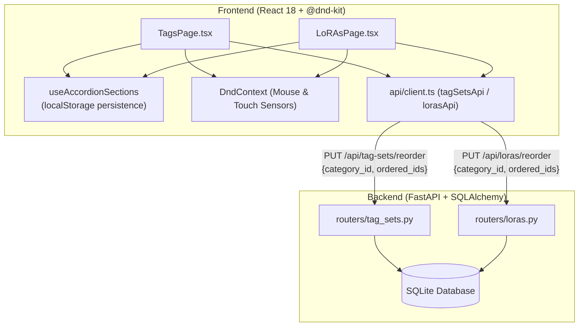

---
id: REQ-269
title: "タグセット・LoRAのカテゴリセクション化とセクション内スコープ並び替え（Phase 1）詳細設計書"
status: design
tags: [frontend, backend, tags, loras, categories, dnd, sort_order, accordion, filter]
related_paths:
  - frontend/src/pages/TagsPage.tsx
  - frontend/src/pages/LoRAsPage.tsx
  - frontend/src/api/client.ts
  - frontend/src/api/types.ts
  - frontend/src/hooks/useAccordionSections.ts
  - backend/app/routers/tag_sets.py
  - backend/app/routers/loras.py
  - backend/app/schemas/tag_set.py
  - backend/app/schemas/lora.py
  - docs/specs/SPEC_TAGS.md
  - docs/specs/SPEC_LORAS.md
---

# REQ-269: タグセット・LoRAのカテゴリセクション化とセクション内スコープ並び替え（Phase 1）詳細設計書

## 1. 背景と課題

現在、Prompt Surgeonの `TagsPage` および `LoRAsPage` は、登録されている全カードを単一のフラットな配列として保持し、全カード共通の `sort_order`（0, 1, 2...）で並び順を管理している。
この構造には以下の深刻な制約とUX上の破綻が存在する：

1. **フィルタ適用時の並び替え不可制約**:
   - 検索クエリやカテゴリフィルタ、BaseModelフィルタ適用時にカード順序を変更すると、フィルタ外のカードとインデックス衝突を起こすため、`isDndActive = false` としてD&Dを一律無効化せざるを得ない。
2. **単一フラットリストによるソート順衝突と順序崩壊**:
   - カテゴリごとにまとまった順序境界（スコープ）が存在しないため、仮に特定カテゴリのみを並び替えて保存すると、他カテゴリのカード順序番号が破壊されるか、フィルタ解除時に意図しない位置へカードがワープする。
3. **固定的な単一選択フィルタ**:
   - カテゴリフィルタが単一選択（OR条件不可）に閉じており、必要な複数カテゴリ（例: キャラクターと衣装）のみを並べて俯瞰・整理することができない。
   - 「未分類（カテゴリ未設定）」のカードを集中的にトリアージする導線が不足している。

本設計（Phase 1）では、既存のDBスキーマを変更することなく、フロントエンドの一覧表示を「カテゴリ別アコーディオンセクション」に刷新し、バックエンドの `/reorder` API を「カテゴリ内スコープ更新」に対応させることで、安全なセクション内並び替えおよびセクション間D&D移動を実現する。

---

## 2. アーキテクチャ概要

### 2-1. システム境界とコンポーネント構成



---

## 3. UI/UX 詳細仕様

### 3-1. カテゴリ別アコーディオンセクション

- **一覧の構造化**:
  - カード一覧を「登録済みカテゴリ」および「未分類（その他）」ごとの独立したアコーディオンセクションとして縦スクロール配置する。
  - カテゴリ一覧はマスタ（`tagsetCategoriesApi` / `loraCategoriesApi`）で定義された並び順に従って表示する。
  - `category_id` が null または未割当のカードは、常に最下部の「未分類（その他）」セクションに集約して表示する。
- **セクションヘッダー**:
  - カテゴリ名、登録件数バッジ（例: `(24件)`）、開閉トグルアイコン（ChevronDown / ChevronRight）を配置。
  - ヘッダークリックまたはトグルボタン押下でセクションの開閉（展開/折りたたみ）を切り替える。
  - 登録件数が0件のカテゴリは `(0件)` と表示し、セクション内には「カードがありません（ここにドラッグ＆ドロップしてカテゴリ移動）」のドロップ受け入れゾーンを表示する。
- **開閉状態の永続化**:
  - 各セクションの開閉状態は `localStorage` に即時保存（キー: `ps_accordion_tagsets`, `ps_accordion_loras`）。
  - ページ再訪時やリロード時に直前の開閉状態が正確に復元される。新規カテゴリはデフォルト展開（Open）。

### 3-2. カテゴリフィルタによるセクション表示制御（OR条件）

- **フィルタボタン群の動作**:
  - `All`: 全解除。全カテゴリセクションおよび（カードが存在する場合）未分類セクションを表示。
  - カテゴリボタン: 各カテゴリを選択/解除（トグル操作）。複数選択可能（OR条件）。
  - `未分類`: 「未分類（その他）」を独立した選択肢として配置。単独選択または他カテゴリと同時選択可能。
- **セクション連動**:
  - 選択されたカテゴリに対応するセクションのみが画面上に表示される。
  - フィルタ適用中であっても、表示されているセクション内でのD&D並び替えは100%有効。

### 3-3. D&D 並び替えと移動（@dnd-kit）

1. **同一セクション内D&D（スコープ付き並び替え）**:
   - セクション内のカード順序をドラッグ＆ドロップで入れ替え。
   - バックエンドには `{ category_id: targetCatId, ordered_ids: [id1, id2, ...] }` を送信。
   - 対象カテゴリのカードのみ `sort_order`（0, 1, 2...）を更新し、他カテゴリのカードの `sort_order` には一切影響を与えない。
2. **セクション間D&D（カテゴリ移動）**:
   - カードを別カテゴリのセクション（空セクション含む）へドラッグ＆ドロップ。
   - ドロップ先カテゴリの `category_id` へカードの所属を変更し、挿入位置に応じた `ordered_ids` で並び順を更新。
   - クライアント側で楽観的UI更新（Optimistic Update）を行い、通信失敗時は元のカテゴリ位置へ自動ロールバックしてエラー通知を表示。
3. **検索クエリおよびBaseModelフィルタ適用時の挙動**:
   - 検索語句やBaseModelフィルタ適用時は、各セクション内で該当するカードを絞り込み表示する（セクション構造は維持）。
   - 絞り込み表示中は、カード順序の意図しない崩壊を防止するため、D&D並び替え操作を不活性化（`isDndActive = !search && selectedBaseModelIds.length === 0`）する。

---

## 4. バックエンド API 仕様

### 4-1. Reorder API 拡張

#### `PUT /api/tag-sets/reorder` / `PUT /api/loras/reorder`

- **リクエストペイロード (Pydantic Schema)**:
  ```python
  class TagSetReorder(BaseModel):
      category_id: Optional[int] = None
      ordered_ids: list[int]
  ```
  ※ `category_id` は `Optional[int] = None`。フィールドがリクエストボディに含まれている場合（`"category_id" in payload.model_fields_set`）、スコープ付き並び替えおよびカテゴリ移動として処理する。
  ※ `category_id: null` の場合は未分類（カテゴリ未割当）アイテムのスコープ並び替え。
  ※ `category_id` が省略されたレガシーリクエストの場合は、従来通り `ordered_ids` の `sort_order` のみを更新（完全後方互換性維持）。

- **処理ロジック**:
  ```python
  is_scoped = "category_id" in payload.model_fields_set
  for idx, item_id in enumerate(payload.ordered_ids):
      update_data = {"sort_order": idx}
      if is_scoped:
          update_data["category_id"] = payload.category_id
      db.query(Model).filter(Model.id == item_id).update(update_data)
  db.commit()
  ```

### 4-2. Category 単独更新 API (オプション補助)

#### `PATCH /api/tag-sets/{id}/category` / `PATCH /api/loras/{id}/category`
- リクエスト: `{"category_id": Optional[int]}`
- 単一アイテムのカテゴリのみを即座に変更したい場合のエンドポイント（204 No Content）。

---

## 5. データモデルとマイグレーション

- **DBスキーマ変更**: なし（既存の `tag_sets`, `loras` テーブルの `category_id`, `sort_order` カラムをそのまま利用）。
- **後方互換性**: 既存の登録データや既存のAPIクライアントへの破壊的変更は一切発生しない。

---

## 6. SSoT 同期対象仕様書

- `docs/specs/SPEC_TAGS.md`: セクション化レイアウト、カテゴリ複数選択、未分類セクション、スコープ付き並び替えAPI仕様の追記。
- `docs/specs/SPEC_LORAS.md`: 同上。
