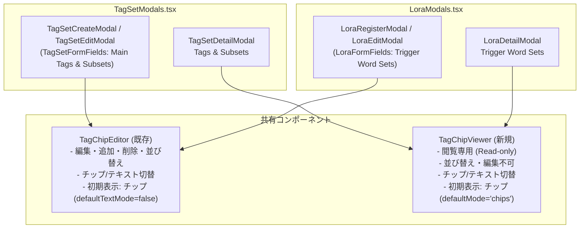

# REQ-273: LoRA・タグセット管理における詳細・編集画面のタグチップ/テキスト切替および操作仕様の統一 詳細設計書

## 1. 背景と課題

Prompt Surgeon では、プロンプト入力画面や各種アセット管理（LoRA、タグセット）においてタグの扱いやすさを向上させるため、タグチップ化（`TagChipEditor`）が進められてきた。
しかし、管理モーダル間の実装経緯の違いにより、以下の操作性・表示性のチグハグ（不整合）が発生している。

### 現状の不整合マトリクス

| 対象モーダル | 詳細画面（Detail Modal） | 登録・編集画面（Create/Edit Modal） |
|---|---|---|
| **LoRA管理** (`LoraModals.tsx`) | **非チップ（通常テキストのみ）**<br>・チップ表示がなく視覚的構造が把握しにくい | **チップエディタ対応済み** (`TagChipEditor`)<br>・デフォルトチップ表示<br>・テキスト切替可能<br>・D&D並び替え・追加・削除・編集対応 |
| **タグセット管理** (`TagSetModals.tsx`) | **チップ表示のみ（バッジ静的表示）**<br>・通常テキストへの切替手段がなく、一括コピーやテキスト一覧の確認に制約 | **非チップ（プレーンなテキスト入力）**<br>・メインタグ: `<textarea>`<br>・サブセットタグ: `<input>`<br>・チップによる直感的な並び替えや追加・削除が不可 |

### 課題の要約
1. **詳細表示の統一感欠如**: LoRA詳細ではチップ表示がなく、タグセット詳細ではテキスト表示への切替ができない。
2. **編集画面の体験断絶**: LoRA編集画面ではプロンプト画面同等のチップエディタが利用できるのに対し、タグセット編集画面では原始的なカンマ区切りテキスト入力のままである。
3. **安全性の担保**: 詳細画面では視覚的なチップ表示とコピー用テキスト表示の切替が求められる一方、誤操作による並び替えやタグ編集は確実に遮断（Read-only保証）する必要がある。

---

## 2. アーキテクチャ設計方針

### 2-1. コンポーネント分離と責務

本改修では、**「編集可能エディタ」** と **「閲覧専用ビューア」** の責務を明確に分離する。



### 2-2. 新規コンポーネント: `TagChipViewer`

詳細画面（`TagSetDetailModal` および `LoraDetailModal`）で共通利用する閲覧専用コンポーネント `TagChipViewer` を `frontend/src/components/TagChipViewer.tsx` に新設する。

#### Props インターフェース
```typescript
export interface TagChipViewerProps {
  tags: string[];
  accentColor?: 'purple' | 'green'; // purple: タグセット用 (#7C6FDD), green: LoRA用 (accent-green)
  defaultMode?: 'chips' | 'text';   // デフォルト: 'chips'
  className?: string;
  emptyPlaceholder?: string;        // タグが空の場合の表示文字列
}
```

#### 主な挙動と特徴
1. **モード切替**:
   - 右上に切替トグルボタンを配置（`LayoutGrid` アイコン / `FileText` アイコン）。
   - 初期表示（デフォルト）は `chips` モード。
   - クリックにより `chips`（チップ一覧） ⇄ `text`（カンマ区切りテキスト）をスムーズに切り替え。
2. **完全な読み取り専用（Read-only）ガード**:
   - チップに対するドラッグ＆ドロップ（並び替え）リスナーは一切持たない。
   - チップの削除ボタン（×）やインライン編集入力欄はレンダリングしない。
   - チップクリックによる状態変更（トグル・無効化等）は行わない（単一タグのコピー等の安全なアクション、またはプレーンバッジ表示）。
3. **デザイン・スタイルの整合**:
   - `TagSetDetailModal` では紫系（`bg-[rgba(124,111,221,0.1)] border-[rgba(124,111,221,0.2)] text-[#a99ef7]`）。
   - `LoraDetailModal` では緑系（`bg-[rgba(74,222,128,0.1)] border-[rgba(74,222,128,0.2)] text-accent-green`）。
   - テキストモード時は、等幅フォント（`font-mono`）で改行・折り返しを適切に行い、テキスト選択（`select-all`）が容易な表示とする。

---

### 2-3. 登録・編集画面の改修 (`TagSetModals.tsx`)

`TagSetFormFields` 内のタグ入力箇所を、`TagChipEditor` に置換する。

#### メインタグ入力部
- 現行の `<textarea id={`${idPrefix}-tags`} ... />` を廃止し、以下に置き換え：
  ```tsx
  <TagChipEditor
    id={`${idPrefix}-tags`}
    value={form.tags}
    onChange={(val) => setForm((f) => ({ ...f, tags: val }))}
    placeholder="swimsuit, bikini, white bikini, ..."
    defaultTextMode={false} // デフォルト: チップモード
  />
  ```

#### サブセット（バリエーション）入力部
- 現行の `<input type="text" placeholder="Tags (comma-separated)" value={sub.tags} ... />` を廃止し、以下に置き換え：
  ```tsx
  <TagChipEditor
    value={sub.tags}
    onChange={(val) => {
      const next = [...(form.subsets || [])];
      next[idx] = { ...next[idx], tags: val };
      setForm((f) => ({ ...f, subsets: next }));
    }}
    placeholder="Tags (comma-separated)..."
    defaultTextMode={false} // デフォルト: チップモード
  />
  ```

---

### 2-4. 詳細表示画面の改修 (`TagSetModals.tsx` & `LoraModals.tsx`)

#### タグセット詳細画面 (`TagSetDetailModal`)
- **メインタグ表示**:
  現行の静的 `tags.map(span...)` を `TagChipViewer` に置き換え。
  ```tsx
  <TagChipViewer
    tags={tagSet.tags}
    accentColor="purple"
    defaultMode="chips"
  />
  ```
- **サブセット表示**:
  各サブセットのタグ表示も `TagChipViewer` に置き換え。
  ```tsx
  <TagChipViewer
    tags={Array.isArray(sub.tags) ? sub.tags : (sub.tags as unknown as string).split(',').map(t => t.trim()).filter(Boolean)}
    accentColor="purple"
    defaultMode="chips"
  />
  ```

#### LoRA詳細画面 (`LoraDetailModal`)
- **トリガーワードセット表示**:
  現行の `<p className="text-xs text-zinc-300...">{wordsStr}</p>` を `TagChipViewer` に置き換え。
  ```tsx
  <TagChipViewer
    tags={tws.words}
    accentColor="green"
    defaultMode="chips"
  />
  ```

---

## 3. データフローと副作用検証

- **データモデル・API 契約**:
  - `TagSet`、`TagSetCreate`、`Lora`、`LoraCreate` のデータ構造や API リクエスト/レスポンスには一切変更なし。
  - `TagChipEditor` は内部で文字列 `value`（カンマ区切り）と相互変換して親の `form` に渡すため、フォーム送信時のバリデーションやバックエンド連携は完全に既存ロジックと互換性を維持する。
- **パフォーマンス・レンダリング負荷**:
  - `TagChipViewer` はドラッグ＆ドロップのコンテキスト（`DndContext`）を持たない軽量な純粋 React コンポーネントであるため、詳細モーダル表示時のレンダリングオーバーヘッドは最小限に抑えられる。
