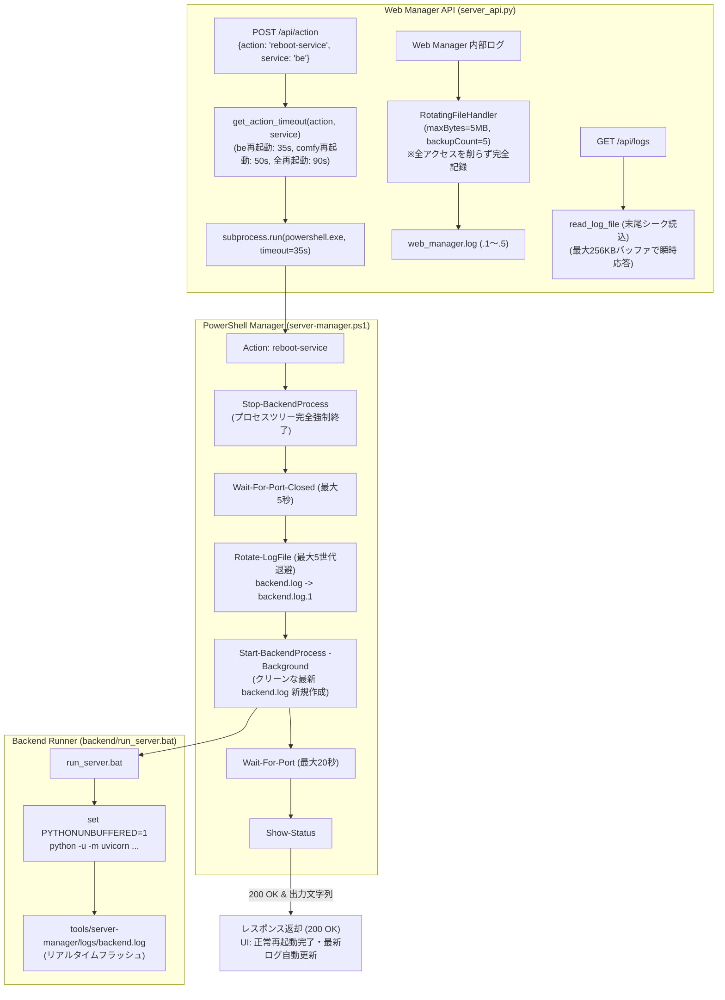
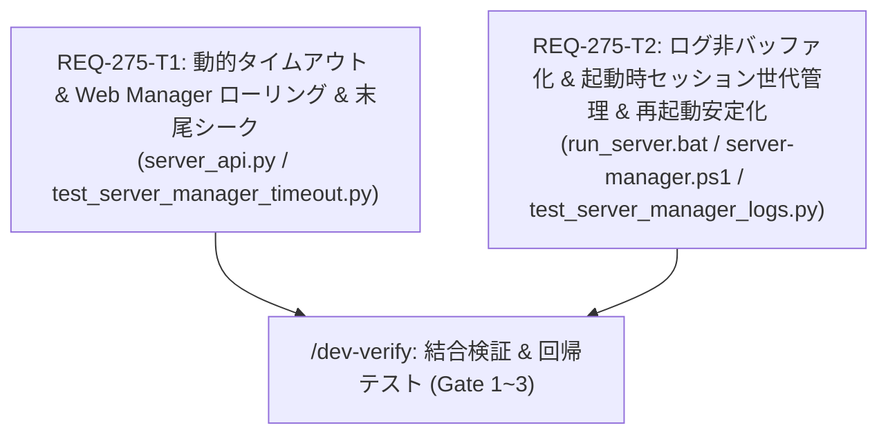

# REQ-275: Web Manager経由のサービス再起動(reboot-service)におけるタイムアウト(504)および起動失敗の解消 詳細設計書

## 1. 背景と根本原因分析 (Root Cause Analysis)

### 1-1. 発生現象
1. Web Manager UI（`http://localhost:8899`）から「再起動」（`reboot-service` / `restart`）を実行した際、15秒経過後に `HTTP 504 Gateway Timeout` が返却され、Web 画面上でエラーとなる。
2. 再起動要求後、バックエンドが立ち上がらず、そのまま `STOPPED`（停止）状態のまま残存する。
3. Web Manager のログ画面（Backend タブ）に表示される内容が過去の時刻（22:35時点等）で停止したまま更新されず、最新の起動ログやアクセスログが `tools/server-manager/logs/backend.log` に反映されない。
4. 常時稼働時または再起動の繰り返しにおいて、プロセスログ（`web_manager.log`, `backend.log`）に対するサイズ上限や世代管理（ローテーション）機構が存在せず、長期間運用における無限肥大化および `read_log_file` でのファイル一括読み込み負荷のリスクが存在する。

### 1-2. メカニズムの解明
1. **固定15秒タイムアウトと同期実行カスケードの不整合 (Timeout Mismatch & Sync Cascade)**:
   - Web Manager API（`tools/server-manager/server_api.py`）の `/api/action` エンドポイントでは、`subprocess.run(cmd, ..., timeout=15)` により PowerShell 呼び出しのタイムアウトが全アクション一律 15 秒にハードコードされている。
   - 一方、`server-manager.ps1` の `reboot-service` は「停止処理（`Stop-BackendProcess`）」＋「停止待機（`Wait-For-Port-Closed` 最大5秒）」＋「バックグラウンド起動（`Start-BackendProcess`）」＋「起動後ポート待機（`Wait-For-Port` 最大15秒）」＋「ステータス取得（`Show-Status` 1~2秒）」を直列同期実行する。
   - バックエンドの起動完了までに合計15秒をわずかでも超過すると、Python 側の `subprocess.TimeoutExpired` が発火して HTTP 504 を返却する。
   - さらに、`subprocess.run` のタイムアウト時動作により子プロセス（`powershell.exe`）が強制 `kill()` されるため、停止されたバックエンドプロセスの再起動処理が中断され、バックエンドが停止状態（STOPPED）で放置される。
2. **Python 出力ブロックバッファリングとログ追記仕様の欠落 (Output Buffering & Log Redirection)**:
   - `backend/run_server.bat` では `python -m uvicorn app.main:app %ARGS%` が実行されているが、標準出力がコンソール（TTY）ではなくファイルにリダイレクトされた場合、Python はデフォルトでブロックバッファリング（約4KB〜8KB）を行う。
   - そのため、起動直後のわずか数百バイトの Uvicorn 起動ログがファイルにフラッシュされず、メモリ内に滞留してリアルタイムに `backend.log` に出力されない。
3. **ログ世代管理（ローテーション）の欠如と全行一括読込負荷**:
   - `web_manager.log` は UI の高頻度ポーリング（`/api/logs`, `/api/status`）により常時稼働下で1日数万行（数MB）蓄積されるが、サイズ上限や世代管理が存在しない。
   - 単純追記（`>>`）のみでは過去セッションと現セッションのログが混在し、障害発生時にクラッシュ直前ログの追跡が困難になる。
   - また `server_api.py` の `read_log_file` は `readlines()` でファイル全行を一括メモリ展開しており、巨大ファイル時に UI 応答速度が著しく低下する。

---

## 2. アーキテクチャ設計方針 (Multi-Layer Solution)

本改修では、タイムアウト設定・プロセスライフサイクル・完全記録型ログローテーションを整合させた多層改修を実施する。

### 2-1. レイヤー1: 動的アクションタイムアウト設計 (`server_api.py`)
- アクション種別（`action`）および対象サービス（`service`）に応じた `get_action_timeout(action: str, service: str, config: Optional[dict] = None) -> int` を導入。
- **タイムアウト設定値一覧**:
  - `restart` / `reboot-service`:
    - `service in ["backend", "be"]`: **35秒**（停止5s + 起動15s + ステータス取得・安全マージン15s）
    - `service in ["comfy", "wsl"]`: **50秒**（WSL停止・起動30s + 安全マージン）
    - `service in ["frontend", "fe"]`: **35秒**
    - `service in ["", "all"]`（全サービス再起動）: **90秒**
  - `start`:
    - `service in ["backend", "be", "frontend", "fe"]`: **25秒**
    - `service in ["comfy", "wsl"]`: **35秒**
    - `service in ["", "all"]`: **60秒**
  - `stop`:
    - 単一サービス: **15秒**
    - 全サービス: **25秒**
  - その他 / デフォルト: **30秒**
- `ManagerHandler.do_POST`:
  - 計算された `timeout` 値を `subprocess.run(..., timeout=timeout)` に適用。
  - タイムアウト発生時の 504 エラーメッセージにも該当タイムアウト秒数を明記。

### 2-2. レイヤー2: Web Manager ロギングの完全記録 ＆ 自動ローリング (`server_api.py`)
- **ログの完全記録方針**:
  - 障害解析（トリアージ）の観点から、ポーリングや通常アクセスを一切間引かず、すべてのリクエストを 100% 記録する。
- **`RotatingFileHandler` の導入**:
  - `tools/server-manager/logs/web_manager.log` に対して Python 標準の `RotatingFileHandler` を設定。
  - `maxBytes = 5 * 1024 * 1024`（5MB）、`backupCount = 5`（最大5世代、合計最大25MB固定）。
  - 常時稼働下でファイルが 5MB に達するたびに、古いログを `.1`〜`.5` へ自動ローテーション。
- **`read_log_file` の末尾シーク（Tail Seek）最適化**:
  - ファイル全体を `readlines()` するのをやめ、ファイル末尾（例: 最終 256KB）のみを seek して末尾 N 行を取得。
  - ログファイルが数MB〜数GBになっても、Web UI 表示が常にミリ秒で軽快に完了。

### 2-3. レイヤー3: リアルタイム標準出力フラッシュと起動ごとのセッション世代管理 (`backend/run_server.bat`, `server-manager.ps1`)
- `backend/run_server.bat`:
  - `set PYTHONUNBUFFERED=1` を追加。
  - `python -u -m uvicorn app.main:app %ARGS%` を実行し、非TTYファイル出力時のブロックバッファリングを完全に防止。
- `tools/server-manager/server-manager.ps1`:
  - 汎用ローテーション関数 `Rotate-LogFile ($logPath, $maxCount = 5)` を導入。
  - `Start-BackendProcess`, `Start-FrontendProcess`, `Start-ComfyUIProcess` の起動直前に呼び出し、既存ログを `*.log.1` 〜 `*.log.5` に世代退避。
  - 最新セッションは常にクリーンな `*.log` で開始され、起動直後にセッション開始タイムスタンプヘッダー（`=== Prompt Surgeon Backend Started: YYYY-MM-DD HH:mm:ss ===`）を刻印。
  - これにより、クラッシュ直前のログが確実に `.1` に保全され、再起動後もトリアージが可能。

### 2-4. レイヤー4: プロセス終了・ポート解放待機の堅牢化 (`server-manager.ps1`)
- `reboot-service` / `restart`:
  - `Stop-BackendProcess` 実行後、`Wait-For-Port-Closed` でポートが閉じるまで待機。
  - ポートが指定秒数内に閉じなかった場合は、残存プロセスに対して再度強制終了を試行し、確実にポート解放された状態で `Start-BackendProcess` を呼び出す。
  - `Wait-For-Port` のタイムアウトを十分な値（20秒）に設定し、コールドスタート時のタイムアウト誤検知を防止。

---

## 3. タスク分割と並列設計 (Atomicity & Parallel Plan)

| Task ID | 対象ファイル (Max 3 files) | 責務 | 依存関係 | 並行実行性 |
|---|---|---|---|---|
| **REQ-275-T1** | `tools/server-manager/server_api.py` `tests/unit/test_server_manager_timeout.py` | 動的タイムアウト関数 `get_action_timeout`、`RotatingFileHandler` (5MB/5世代) 導入、`read_log_file` 末尾シーク最適化、単体テスト実装 | なし | T2と完全並行可能 |
| **REQ-275-T2** | `backend/run_server.bat` `tools/server-manager/server-manager.ps1` `tests/unit/test_server_manager_logs.py` | バッファリング無効化（`PYTHONUNBUFFERED=1` / `python -u`）、PowerShell 側起動時セッションローテーション（`Rotate-LogFile`）、再起動シーケンス安定化、単体テスト実装 | なし | T1と完全並行可能 |

---

## 4. トレードオフとリスク開示 (Trade-off Disclosure)

1. **タイムアウト上限延長に伴う UI 待機時間の増大**:
   - タイムアウト値を最大 35秒〜90秒に緩和することで、万一プロセスが完全にハングアップした場合にユーザーが待機する時間が長くなります。
   - **緩和策**: Web Manager UI ではリクエスト送信時にボタン非活性化（`setControlsDisabled(true)`）と実行中メッセージ表示が行われており、正常時は8〜10秒で完了するため、通常運用の応答性に悪影響はありません。
2. **ディスク使用量の完全固定化**:
   - Web Manager ログは最大 25MB（5MB × 5世代）、各サービスログも最大5世代で自動削除されるため、ディスク使用量は厳格に上限が担保され、ディスク枯渇のリスクを構造的に排除します。
