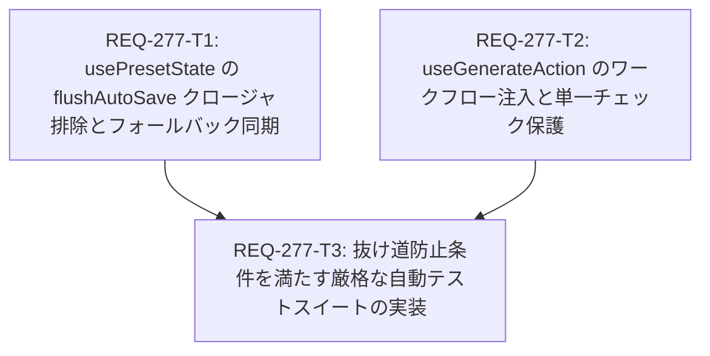

# REQ-277: パラメータ変更後の即時生成における最新値未反映およびセット間不整合の根本解消 設計書 (第2版・抜け道防止強化版)

- **PBI**: REQ-277
- **改訂日**: 2026-09-18
- **作成者**: Architect
- **ステータス**: 設計改訂完了 (Design Overhauled with Anti-Loophole Guard)

---

## 1. 概要 & 目的

生成画面（Generate ページ）において、ステップ数、スケジューラ、CFG、Denoise、アスペクト比などのパラメータを変更しても、ページをリロード（F5）しないと生成結果に反映されず、古い値のままキュー投入される問題を根本解消する。
画面上の表示は最新値のままであり、DBオートセーブも正常に完了しているにもかかわらず、生成実行時のハンドラおよび先行オートセーブ処理が古いクロージャスナップショットを参照してインメモリ状態を上書きしていた欠陥、および単一セット時や非同期同期時のフォールバック漏れを修正し、リロードの有無やオートセーブの完了待ちに関わらず、100% 確実に最新パラメータが ComfyUI 投入ワークフロー（`wfJson` inputs）に反映されるアーキテクチャを確立する。

また、従来のテストが保存用メタデータ（第2引数）のみを検証していた不備、ワークフローのマッピング不足、およびプレーンオブジェクトモックによる状態遷移スキップ（偽陽性の抜け道）を完全に遮断し、真の ComfyUI 投入ペイロードとフック・ストア間連携を検証する自動テスト計画を確立する。

---

## 2. 根本原因の徹底分析 (Test Gap Report & 抜け道監査反映)

1. **`usePresetState.flushAutoSave` のクロージャ参照によるインメモリ上書き**:
   - `handleGenerateSets` は先頭で `options?.onBeforeGenerate?.()`（`presetState.flushAutoSave`）を呼び出している。
   - `flushAutoSave` は `usePresetState` のクロージャ変数 `paramValues` を参照して `currentState` を構築し、`updateActiveSet(currentState)` を実行する。
   - 入力直後の即時生成時、React の再レンダリングやフック再生成が完了する前にボタンが押下されると、**古いクロージャの `paramValues` でインメモリの `sets` が上書きされる**。
2. **単一セット時における `activeSetId` 未確定時のフォールバック欠落**:
   - 初期ロード直後等で `activeSetId` が `null` の場合、従来のガード `if (!activeSetId) return;` により `flushAutoSave` が即時リターンし、単一セットのインメモリ同期やオートセーブがスキップされていた。
3. **プリセット同期 `useEffect`（React Query ポーリング）による上書き競合**:
   - `usePresetState` 内の `useEffect`（lines 808-874）が、サーバーからフェッチした `presets`（まだオートセーブが未反映の旧値）をもとに `setSets` を実行する際、`currentActiveSetId` が null の場合や初回復帰時に `rawMappedSets`（サーバー旧値）でインメモリ状態を上書きするリスクが存在した。
4. **プロンプトとパラメータの反映経路の非対称性**:
   - プロンプト項目は `TagChipEditor` により `promptChips` として管理され、最終キュー投入時に `getEffectiveParamValues` で `promptChips` から平文が再生成されて強制上書きされるため、`paramValues` が古くても最新値が反映されていた。
   - 一方、パラメータ項目（ステップ数、CFG、スケジューラ等）は `promptChips` を持たないため 100% `itemParams`（`paramValues`）に依存し、上記クロージャ上書きや同期ズレの直撃を受けて古い値のまま投入されていた。
5. **テスト検証パイプラインの重大な偽陽性（3つの抜け道）**:
   - ① 投入ワークフロー `wfJson`（第1引数）を検査せず、保存用メタデータ（第2引数）のみをアサートしていた。
   - ② テスト用ワークフローに mapping が存在せず、パラメータ注入パイプラインが形骸化していた。
   - ③ Zustand ストアを空プレーンオブジェクトで完全にモックし、ストアの状態遷移やフック間の協調処理を一切通さずに手動代入していたため、実機のクロージャ競合を検知できなかった。

---

## 3. アーキテクチャ設計方針

### 3.1 `flushAutoSave` のクロージャ排除と完全フォールバック
- `usePresetState.ts` の `flushAutoSave` において、フックのスコープ変数 `paramValues` への依存を排除する。
- 実行時に `useGenerationStore.getState()` より最新の `paramValues`, `appliedAssets`, `batchSize`, `seedMode`, `seed` を直接取得して `currentState` を構築する。
- **フォールバック保証**: `currentStore.activeSetId` が null または undefined の場合でも、`currentStore.sets.length === 1` のときは `currentStore.sets[0].id` をアクティブ対象として扱い、単一セット時の即死リターンを防止する。

### 3.2 `useGenerateAction` のペイロード構築と単一チェック保証
- `handleGenerateSets` および `handleGenerate` の実行時に `useGenerationStore.getState()` を取得。
- `currentParamValues` と `setItem.paramValues` のマージ条件を強化：
  - 明示的に `setItem.id === currentActiveSetId` のセット。
  - または、**チェックされているセットが1つだけ（`checkedSets.length === 1`）の場合** は、無条件に画面最新パラメータ（`currentParamValues`）をマージする。
- これにより、アクティブタブとチェック状態の不一致や型差異（string vs number）があっても、画面上で編集中の最新パラメータが確実にジョブへ適用される。

### 3.3 `injectWorkflowParams` への完全な値注入保証
- `injectWorkflowParams` を呼び出す際、`paramValues: syncedParamValues` が渡され、各 mapping（`Sampler_Steps`, `Sampler_cfg`, `Sampler_Scheduler`, `Sampler_Sampler` 等）に対応するノードの inputs（`steps`, `cfg`, `sampler_name`, `scheduler` 等）に型変換されて注入されることを保証する。

---

## 4. コンポーネント別改修仕様

### 4.1 `frontend/src/pages/GeneratePage/hooks/usePresetState.ts`
- `flushAutoSave` を最新 Zustand ストア参照およびフォールバック付きに改修：
  ```typescript
  const flushAutoSave = useCallback(() => {
    if (autoSaveTimerRef.current) {
      clearTimeout(autoSaveTimerRef.current)
      autoSaveTimerRef.current = null
    }
    if (!isInitialSyncRef.current) return
    
    // クロージャではなく、最新の Zustand ストアから最新入力状態を直接取得
    const currentStore = useGenerationStore.getState()
    let targetActiveId = currentStore.activeSetId
    if ((targetActiveId === null || targetActiveId === undefined) && currentStore.sets?.length === 1) {
      targetActiveId = currentStore.sets[0].id
    }
    if (!selectedWorkflowId || targetActiveId === null || targetActiveId === undefined) return
    
    const activePreset = presets?.find((p) => String(p.id) === String(targetActiveId))
    if (!activePreset) return

    const currentState: HistoryState = {
      paramValues: currentStore.paramValues,
      appliedAssets: currentStore.appliedAssets,
      batchSize: currentStore.batchSize,
      seedMode: currentStore.seedMode,
      seed: currentStore.seed,
    }

    // インメモリ上の activeSet を即時同期
    updateActiveSet?.(currentState)
    ...
  ```

### 4.2 `frontend/src/pages/GeneratePage/hooks/useGenerateAction.ts`
- `handleGenerate` / `handleGenerateSets` の先頭で `useGenerationStore.getState()` を取得。
- `checkedSets.length === 1` 時の単一チェック保証：
  ```typescript
  const isExplicitActive =
    currentActiveSetId !== null &&
    currentActiveSetId !== undefined &&
    String(setItem.id) === String(currentActiveSetId)

  // 単一チェック時、またはアクティブIDがセット一覧に見当たらない場合の安全フォールバック
  const isActive =
    isExplicitActive ||
    (checkedSets.length === 1 &&
      (!currentActiveSetId ||
        !currentSets.some((s) => String(s.id) === String(currentActiveSetId)) ||
        !checkedSets.some((s) => String(s.id) === String(currentActiveSetId))))
  ```

### 4.3 `frontend/src/pages/GeneratePage/hooks/__tests__/useGenerateAction.test.ts` (テスト全面是正・抜け道防止)
- 実機同等の KSampler mapping を持つ `realisticWorkflow` を導入。
- プレーンオブジェクト直代入によるモックを排除し、実ストア状態遷移（`setParamValues`）を経由。
- `onBeforeGenerate`（先行オートセーブ）との協調動作テストを追加。
- ワークフロー初期値（例: steps=20）と明確に異なる値（例: steps=40）を用いて「初期値フォールバックの偽陽性」を遮断。
- 第1引数 `wfJson`（各ノード inputs）の型変換・最新値注入を厳密にアサート。

---

## 5. Trade-off Disclosure & 影響範囲

| 項目 | 内容 |
|---|---|
| **トレードオフ** | `flushAutoSave` および `useGenerateAction` で `useGenerationStore.getState()` を直接呼び出すことで、React コンポーネントツリーの再レンダリング遅延によるクロージャ遅延を完全に回避する。これにより純粋な関数型データフローではなくなるが、リアルタイム UI における即時キュー投入の整合性を担保するための不可欠な設計である。 |
| **影響範囲** | `usePresetState.ts`, `useGenerateAction.ts`, およびテストコード。バックエンド API や DB スキーマ、ComfyUI プロキシへの変更は不要。 |

---

## 6. タスク分割と依存関係



| タスク ID | スコープ | 依存関係 | 並行実行 |
|---|---|---|---|
| **REQ-277-T1** | `usePresetState.ts` の `flushAutoSave` におけるクロージャ排除・最新ストア直接取得・単一セット時フォールバック | なし | T2 と並行可能 |
| **REQ-277-T2** | `useGenerateAction.ts` の最新ストア取得・アクティブ判定（単一チェック保証）・ワークフロー注入 | なし | T1 と並行可能 |
| **REQ-277-T3** | `useGenerateAction.test.ts` の `realisticWorkflow` 整備、抜け道防止条件（実ストア遷移・初期値乖離・wfJson検査）の実装 | T1, T2 | T1, T2 完了後 |

