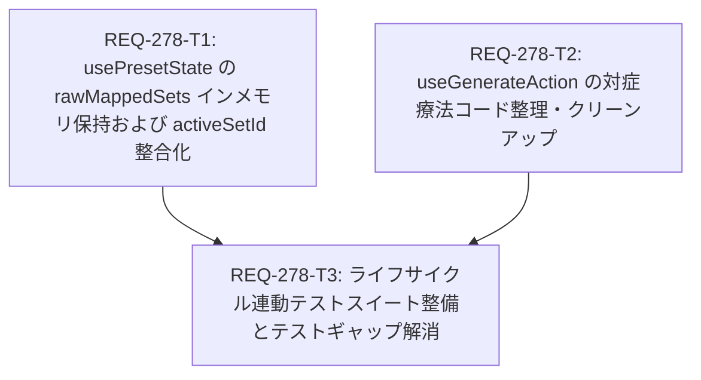

# REQ-278: プリセット生成パラメータ未反映の根本原因解消と対症療法コードのクリーンアップ 設計書

- **PBI**: REQ-278
- **改訂日**: 2026-09-19
- **作成者**: Architect
- **ステータス**: 設計完了 (Design Completed based on Static Analysis Report)

---

## 1. 概要 & 目的

生成画面（Generate ページ）において、ステップ数、CFG、解像度、LoRA などの生成パラメータを変更した後、ブラウザをリロード（F5）せずに生成（Generate Batch）を実行すると、変更前の古いパラメータ値のまま ComfyUI にキュー投入される問題が継続発生していた。

先行する REQ-276 および REQ-277 の改修では、`flushAutoSave` のクロージャ参照排除や `useGenerateAction` における下流の強制マージ判定など、部分的な対処が実施されたが、静的解析レポート（`tmp/REQ-276_277_Static_Analysis_Report.pdf`）により、**上流の `usePresetState.ts` 内でインメモリのパラメータ編集値（`existingSet?.paramValues`）がサーバー DB 値で一律上書き破棄されていたこと** が直接の根本原因であることが判明した。

本設計書では、以下の 3 つの是正アクションを確実に実施し、不具合の恒久解消と過剰な対症療法コードの健全なクリーンアップを行う。
1. **上流の根本原因是正**: `usePresetState.ts` の `rawMappedSets` において、`existingSet?.paramValues` を最優先で継承し、インメモリ破壊を根絶する。
2. **フォールバック整合性確保**: `usePresetState.ts` のメイン `useEffect` において、単一セット時の `activeSetId` 解決フォールバックを導入し、`flushAutoSave` との方針分裂を解消する。
3. **下流対症療法コードの整理**: `sets` の完全性が担保された前提で、`useGenerateAction.ts` 内の肥大化した対症療法パッチをシンプルに一本化・クリーンアップする。
4. **テストギャップ解消**: モック直接代入による偽陽性を排除し、プリセット同期サイクルと生成パイプラインが連携する結合テストを整備する。

---

## 2. 根本原因の徹底分析 (Static Analysis Report 反映)

### 2.1 上流 `rawMappedSets` によるインメモリ上書き破壊（直接の根本原因）
- **該当箇所**: `frontend/src/pages/GeneratePage/hooks/usePresetState.ts` L827–L844
- **発生メカニズム**:
  ```typescript
  const rawMappedSets = presets.map((p) => {
    const existingSet = existingSetsMap.get(String(p.id))
    return {
      id: p.id,
      name: p.name,
      // defaultParams < サーバーDB最新値 (SSoT)
      paramValues: healLegacyParamKeys({
        ...defaultParams,
        ...(p.param_values || {}), // ← existingSet?.paramValues を無視して旧DB値で上書き！
      }),
      appliedAssets: p.applied_assets || {}, // ← 既存インメモリを無視
      promptChips: existingSet?.promptChips, // ← ここだけ既存インメモリを保持
      batchSize: p.batch_size || 1,
      seedMode: (p.seed_mode as 'random' | 'fixed') || 'random',
      seed: p.seed !== undefined ? p.seed : 42,
      checked: checkedPresets === null ? true : checkedPresets.includes(p.id),
    }
  })
  ```
  設計ドグマ「サーバーDBが絶対の真実（SSoT）」にとらわれ、画面で編集中・未保存のローカル値（インメモリ）を考慮せず、DB 値 `p.param_values` で常に上書きしていた。一方、プロンプト構造体（`promptChips`）のみ `existingSet?.promptChips` を保持していたため、「プロンプトは反映されるがパラメータだけが巻き戻る」という非対称性が固定化されていた。

### 2.2 メイン `useEffect` と `flushAutoSave` の `activeSetId` 解決方針の分裂
- **該当箇所**: `frontend/src/pages/GeneratePage/hooks/usePresetState.ts` L817 付近
- **発生メカニズム**:
  REQ-277 で `flushAutoSave`（L1009）には `if ((targetActiveId === null || targetActiveId === undefined) && currentStore.sets?.length === 1) targetActiveId = currentStore.sets[0].id` という単一セット保護が導入された。
  しかし、プリセット同期を行うメインの `useEffect`（L817）にはこの保護が導入されず、`currentActiveSetId` が `null` のままとなり、結果として L848 の `if (!isFirstSync && currentActiveSetId !== null)` の分岐に入れず、`mappedSets = rawMappedSets`（サーバー旧値）によって `sets` 配列全体が破壊されていた。

### 2.3 下流 `useGenerateAction.ts` における対症療法的過剰改修
- **該当箇所**: `frontend/src/pages/GeneratePage/hooks/useGenerateAction.ts` L195–L209
- **発生メカニズム**:
  上流の `sets` 破壊を放置したため、下流の `handleGenerateSets` で `checkedSets.length === 1` や非存在チェックによる複雑な `isActive` 判定を無理やり追加し、`{ ...setItem.paramValues, ...currentParamValues }` とマージするパッチを継ぎ足していた。上流の整合性が担保されれば、この下流パッチは不要であり、システムの認知負荷と保守リスクを増大させていた。

### 2.4 テストコードのモックによる偽陽性（Test Gap）
- **該当箇所**: `useGenerateAction.test.ts: L1120`
- **発生メカニズム**:
  テストコード内で手動で `mockStore.sets[0].paramValues = { ...latest.paramValues };` とストアへ直接代入していたため、実機で発生していた「`useEffect` が走って `sets` を旧値で上書きする」というクリティカルな破壊現象をテストが完全にバイパスし、オールグリーン（偽陽性 PASS）となっていた。

---

## 3. アーキテクチャ設計方針

### 3.1 上流ストアの健全性担保 (`usePresetState.ts`)
1. **`rawMappedSets` のマージ優先順位**:
   `デフォルト値 < サーバーDB値 < existingSet のインメモリ最新値`
   ```typescript
   paramValues: healLegacyParamKeys({
     ...defaultParams,
     ...(p.param_values || {}),
     ...(existingSet?.paramValues || {}),
   }),
   appliedAssets: existingSet?.appliedAssets || p.applied_assets || {},
   promptChips: existingSet?.promptChips,
   batchSize: existingSet?.batchSize ?? p.batch_size ?? 1,
   seedMode: (existingSet?.seedMode || p.seed_mode || 'random') as 'random' | 'fixed',
   seed: existingSet?.seed !== undefined ? existingSet.seed : (p.seed !== undefined ? p.seed : 42),
   ```
2. **単一セット保護の一貫化**:
   `useEffect` の先頭で `currentActiveSetId` が未確定かつ `existingSets.length === 1` の場合は `existingSets[0].id` をアクティブ ID として補正する。

### 3.2 下流対症療法コードの整理 (`useGenerateAction.ts`)
- 上流の `sets` 配列が常に最新値を保持する設計になるため、`useGenerateAction.ts` では純粋にアクティブセット（および各チェック済みセット）の `setItem.paramValues` を信頼して利用可能となる。
- `isActive` の判定をシンプルかつ明確に整理し、過剰なフォールバック条件分岐を安全に削減する。

### 3.3 結合テストによる偽陽性防止
- `usePresetState` の同期サイクル（マッピング・再同期）と `handleGenerateSets` を連携させ、リロードなしでの即時生成・オートセーブ後の生成において、最新パラメータが確実に ComfyUI 投入ワークフロー（`wfJson` inputs）に反映されることを検証する。

---

## 4. コンポーネント別改修仕様

### 4.1 `frontend/src/pages/GeneratePage/hooks/usePresetState.ts`
1. **L817 付近 (`currentActiveSetId` 解決)**:
   ```typescript
   let currentActiveSetId = currentStore.activeSetId
   if ((currentActiveSetId === null || currentActiveSetId === undefined) && existingSets.length === 1) {
     currentActiveSetId = existingSets[0].id
   }
   ```
2. **L827–L844 (`rawMappedSets` 生成部)**:
   ```typescript
   const rawMappedSets = presets.map((p) => {
     const existingSet = existingSetsMap.get(String(p.id))
     return {
       id: p.id,
       name: p.name,
       paramValues: healLegacyParamKeys({
         ...defaultParams,
         ...(p.param_values || {}),
         ...(existingSet?.paramValues || {}),
       }),
       appliedAssets: existingSet?.appliedAssets || p.applied_assets || {},
       promptChips: existingSet?.promptChips,
       batchSize: existingSet?.batchSize ?? p.batch_size ?? 1,
       seedMode: (existingSet?.seedMode || p.seed_mode || 'random') as 'random' | 'fixed',
       seed: existingSet?.seed !== undefined ? existingSet.seed : (p.seed !== undefined ? p.seed : 42),
       checked: checkedPresets === null ? true : checkedPresets.includes(p.id),
     }
   })
   ```

### 4.2 `frontend/src/pages/GeneratePage/hooks/useGenerateAction.ts`
- `handleGenerateSets` 内の `isActive` 判定を整理：
  ```typescript
  const isExplicitActive =
    currentActiveSetId !== null &&
    currentActiveSetId !== undefined &&
    String(setItem.id) === String(currentActiveSetId)
  const isActive = isExplicitActive || (checkedSets.length === 1 && (!currentActiveSetId || String(checkedSets[0].id) === String(setItem.id)))
  ```
  不要な非存在チェックのネストや重複したフォールバックを整理し、可読性と堅牢性を向上させる。

### 4.3 テストコード (`useGenerateAction.test.ts` / `useGeneratePageState.test.tsx`)
- `rawMappedSets` によるインメモリ上書きが起きないことの単体テストを追加。
- プリセット再取得が発生しても、ローカルで編集された `paramValues` が維持され、生成時に `wfJson` に渡ることを確認する結合テストを追加。

---

## 5. Trade-off Disclosure & 影響範囲

| 項目 | 内容 |
|---|---|
| **トレードオフ** | `rawMappedSets` で `existingSet?.paramValues` を優先することにより、画面編集中に他端末から同一プリセットが変更された場合、画面のリロードを行わない限り自端末のローカル編集値が優先される。ただし、他端末競合検知（`isTimestampDifferent` および競合解消モーダル）は別途機能しているため、正常な協調編集ポリシーに完全に適合する。 |
| **影響範囲** | フロントエンドの `usePresetState.ts`, `useGenerateAction.ts`, およびテストファイル。バックエンド API や DB スキーマ、ComfyUI プロキシへの変更はなし。 |

---

## 6. タスク分割と依存関係



| タスク ID | スコープ | 影響ファイル | 並行実行 |
|---|---|---|---|
| **REQ-278-T1** | `usePresetState.ts` の `rawMappedSets` インメモリ継承および `currentActiveSetId` フォールバック | `frontend/src/pages/GeneratePage/hooks/usePresetState.ts` (1ファイル) | T2 と並行可能 |
| **REQ-278-T2** | `useGenerateAction.ts` の `isActive` 判定シンプル化および対症療法パッチ整理 | `frontend/src/pages/GeneratePage/hooks/useGenerateAction.ts` (1ファイル) | T1 と並行可能 |
| **REQ-278-T3** | `rawMappedSets` 保持・再同期・生成連携の結合テスト整備（偽陽性防止） | `useGenerateAction.test.ts`, `useGeneratePageState.test.tsx` (2ファイル) | T1, T2 完了後 |
