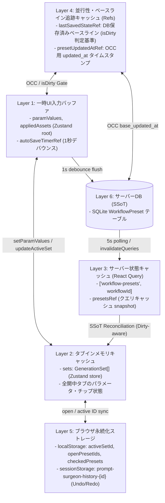

# REQ-281: プリセット同期・状態ライフサイクルの根本是正 詳細設計書

## 1. 背景と課題

Prompt Surgeon では、プロンプトの比較・生成管理のためにプリセット（GenerationSet）機能が提供されている。
しかし、ユーザーより「プリセットのプロンプトが別のプリセットの内容で意図せず上書きされる」「別端末での編集内容が反映されず消失・巻き戻る」という深刻な不具合が報告された。

調査の結果、対症療法では解決できない以下の4つの根本的なライフサイクル上の欠陥が判明した。

### 1-1. 現状の4大欠陥メカニズム

---

## 2. 5層キャッシュ階層（Cache Hierarchy）と同期アーキテクチャ

単に「サーバーDB」と「画面上の直編集」の2者間だけでなく、Prompt Surgeon 内に存在する **全5層の中間キャッシュレイヤ** の整合性を厳密に定義・同期する。

### 2-1. 5層キャッシュ構造の定義

### 2-2. 各キャッシュレイヤ間の同期整合化ルール

| キャッシュ層 | 同期責任 | 従来の不備・不整合 | REQ-281 での恒久是正ルール |
|---|---|---|---|
| **L1 ⇄ L2** (UI ⇄ Store sets) | 単一タブ編集と複数タブ保持の同期 | `createPresetMutation.onSuccess` 時に L2 (`sets`) へ未反映のまま L1 を更新し、直前タブの L2 を汚染 | `loadPresetData` で L1 と L2 を同一の `set()` トランザクションでアトミック更新 |
| **L1 ⇄ L6** (UI ⇄ サーバーDB) | オートセーブによる確定永続化 | タブ切替時に 1秒タイマーが `clearTimeout` され未フラッシュ破棄 | `handleSelectPresetTab` 冒頭で `flushAutoSave()` を同期実行し即時永続化 |
| **L3 ⇄ L2** (React Query ⇄ Store sets) | サーバー最新版のインメモリ展開 | `rawMappedSets` が未編集の L2 を L3 の上に無条件スプレッドし、他端末更新を破棄 | **Dirty 認識型 SSoT 同期**: クリーンなタブは L3（サーバー値）で L2 を完全更新。ダーティなタブのみローカル変更を保持 |
| **L3 キャッシュの即時整合化** | React Query キャッシュの即時更新 | 新規作成時に `invalidateQueries` のみ行い、非同期再フェッチ完了まで L3 キャッシュが古いままだった | `createPresetMutation.onSuccess` で `qc.setQueryData` を即時実行して新プリセットを同期注入 |
| **L4 追跡キャッシュ (Refs)** | `lastSavedStateRef` & `presetUpdatedAtRef` | 1. 非アクティブタブのタイムスタンプが追跡されない 2. Undo/Redo 時に `lastSavedStateRef` が不正上書きされオートセーブが阻害される | 1. ポーリング時に全プリセットの `presetUpdatedAtRef` を追跡 2. `undo` / `redo` は UI/Zustand のみを更新し、`lastSavedStateRef` を勝手に書き換えない（サーバー保存成功時のみ更新） |
| **L5 ブラウザストレージ** | `localStorage` / `sessionStorage` | タブ開閉状態やアクティブIDとストアの整合ズレ | プリセット作成・削除・切替時に `openPresetIds` / `activeSetId` を localStorage と不可分に更新 |

---

## 3. コンポーネントおよびファイル変更仕様

### 3-1. `frontend/src/pages/GeneratePage/hooks/usePresetState.ts`
- **`createPresetMutation.onSuccess`**:
  - `loadPresetData` によるアトミック更新（L1 & L2 同時更新）。
  - `qc.setQueryData` による L3 キャッシュの即時同期。
  - `presetUpdatedAtRef` および `lastSavedStateRef` (L4) の即時初期化。
  - `localStorage` (L5) の同期。
- **`flushAutoSave` 関数の新設 & `handleSelectPresetTab`**:
  - タブ切替時に保留中デバウンスタイマーを即時キャンセルし、`performUpdatePresetRef` を呼び出して L6（サーバーDB）へ同期フラッシュ。
  - 切替先プリセットの L4 タイムスタンプと L6 タイムスタンプを比較し、クリーンなら L3 最新版をロード、ダーティなら競合モーダル表示。
- **ポーリング `useEffect` (`rawMappedSets` & `mappedSets`)**:
  - 無条件スプレッドの撤廃。
  - 各プリセットの Dirty 判定に基づく L3 ⇄ L2 同期。
  - 全プリセットの L4 タイムスタンプ追跡。
- **`undo` / `redo` の整合性是正**:
  - `lastSavedStateRef` の誤上書きを撤廃。UI/Zustand パラメータのみを変更し、オートセーブが正しく発火・保存されるようにする。
- **`updatePresetMutation` & `handleUpdatePreset`**:
  - 非アクティブプリセット更新時のアクティブパラメータ混入ガード。

### 3-2. `frontend/src/store/slices/multiSetSlice.ts`
- `loadPresetData` が存在しないセットに対しても確実に新規追加・アクティブ化を行えることの確認・保証。
- `setActiveSetId` の安全性ガード。

---

## 4. Acceptance Criteria (AC) 充足方針

| AC | 要件 | 充足メカニズム（中間キャッシュレイヤを含む） |
|---|---|---|
| **AC-1** | 新規作成時に直前プリセットが上書きされない | `createPresetMutation.onSuccess` で `loadPresetData` を呼び、L1/L2/L3/L4/L5 を単一トランザクションでアトミック更新。直前プリセットへのタイマー誤発火を遮断。 |
| **AC-2** | タブ切替時の未保存変更が即時フラッシュ保存される | `handleSelectPresetTab` の先頭で `flushAutoSave` を実行。L1 のデバウンスバッファを破棄せず L6 へ同期フラッシュし、L4 を更新。 |
| **AC-3** | 他端末で更新されたプリセットへの切替時に最新値が反映される | 全プリセットの L4 タイムスタンプ追跡と、タブ切替時の `serverChanged` 検知により、クリーンなプリセットは L3/L6 最新値を即時ロード。 |
| **AC-4** | 未編集プリセットが定期ポーリング時に他端末の最新値で同期される | `rawMappedSets` で無条件スプレッドを廃止し、Clean なプリセットは L3/L6 の SSoT 値で L2 を上書き再同期。 |
| **AC-5** | プリセット管理パネルからの操作で別プリセットが誤上書きされない | `updatePresetMutation` のフォールバックロジックを厳密化し、非アクティブプリセットへのアクティブパラメータ誤混入を防止。 |
