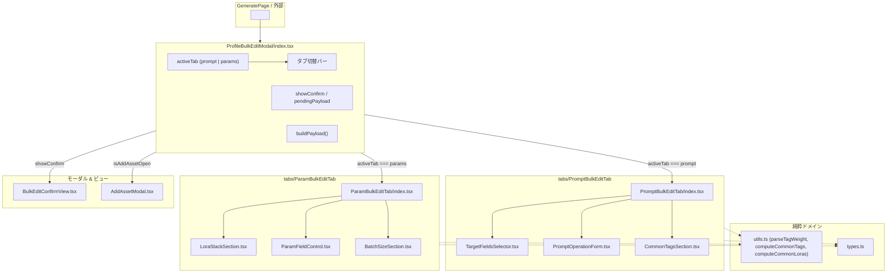

# REQ-283: ProfileBulkEditModal のドメイン計算分離と 2 タブ階層化・セクション化 詳細設計書

## 1. 背景と課題

`ProfileBulkEditModal.tsx` は複数プリセットの一括編集モーダルとして実装されているが、以下の課題を抱え単一ファイルが 1,338 行に達している（リファクタ計画 PBI-REF-02 該当）。

1. **ドメイン純粋計算ロジックの混載**:
   - タグ文字列の重みパース（`parseTagWeight`）、重みフォーマット（`formatTagWithWeight`）、全プリセット横断の共通タグ抽出（`computeCommonTags`）、共通LoRA抽出（`computeCommonLoras`）がモーダルコンポーネントファイル内に同居しており、単体テストの実行・拡張がUIコンポーネント依存になりやすい。
2. **多重責務のコンポーネント肥大化**:
   - モーダル外枠、タブ切り替え、プロンプトタブ（検索置換・追加・共通タグ調整・対象フィールド選択）、パラメータタブ（LoRAスタック差分/上書き・型別パラメータ制御・バッチ数）、確認ダイアログ（`BulkEditConfirmView`）が1つの巨大なJSXおよびStateに詰め込まれている。
3. **可読性とテスト容易性の低下**:
   - 変更時の影響範囲がファイル全体に及び、1ファイルあたりの保守上限行数（250行）を大きく超過（1,338行）している。

---

## 2. 設計方針とアーキテクチャ

### 2-1. コンポーネントツリーの階層化

本設計では、関心の分離（Separation of Concerns）を徹底し、ディレクトリ構成を以下のように階層化する。

```
frontend/src/components/ProfileBulkEditModal/
├─ index.tsx                  # モーダル枠・タブ切替・フッター・状態統括（約150行）
├─ types.ts                   # BulkEditPayload 等の型定義（約80行）
├─ utils.ts                   # タグ重みパース・共通タグ/LoRA計算純粋関数（約120行）
├─ BulkEditConfirmView.tsx    # 反映前の確認プレビュー画面（約45行）
├─ __tests__/
│  └─ utils.test.ts           # utils.ts の純粋ロジック単体テスト
└─ tabs/
   ├─ PromptBulkEditTab/
   │  ├─ index.tsx               # Promptタブ統合（約80行）
   │  ├─ CommonTagsSection.tsx   # 共通タグチップ表示・強度/削除調整（約110行）
   │  ├─ PromptOperationForm.tsx # 検索置換 / 追加 / 上書きフォーム（約90行）
   │  └─ TargetFieldsSelector.tsx# 対象フィールド（positive等）選択（約40行）
   └─ ParamBulkEditTab/
      ├─ index.tsx               # Paramsタブ統合（約80行）
      ├─ LoraStackSection.tsx    # LoRAスタック（差分/上書き）（約170行）
      ├─ ParamFieldControl.tsx   # 型別パラメータ行（約130行）
      └─ BatchSizeSection.tsx    # バッチ数設定（約35行）
```

### 2-2. データフローとコンポーネント間連携



---

## 3. モジュール詳細設計

### 3-1. `types.ts`
- 既存の `PromptOpType`, `CommonTagOp`, `CommonTagItem`, `PromptOp`, `LoraOp`, `AppliedAssetOp`, `PresetLoraSlot`, `CommonLoraOp`, `LoraStackOp`, `BulkEditPayload`, `ProfileBulkEditModalProps`, `Tab`, `PROMPT_OP_LABELS` を完全集約。
- `ProfileBulkEditModal/index.tsx` よりすべて re-export することで、既存の型参照（`usePresetState.ts` の `import('../../../components/ProfileBulkEditModal').BulkEditPayload` やテストファイル）との完全な後方互換性を担保する。

### 3-2. `utils.ts`
- UI 非依存の純粋関数を配置：
  - `parseTagWeight(tag: string)`: `(tag:1.2)`, `(tag)`, `tag` のパース
  - `formatTagWithWeight(base: string, weight: number | null)`: 重みフォーマット
  - `computeCommonTags(presets: WorkflowPreset[], targetRoles: string[])`: 全プリセットの対象ロールから共通タグの積集合を算出
  - `computeCommonLoras(presets: WorkflowPreset[], role: string)`: 全プリセットから共通 LoRA スロットの積集合を算出
  - `getSamplerOptions(comfyObjectInfo: any)` / `getSchedulerOptions(comfyObjectInfo: any)`: 定数フォールバックを含むサンプラ・スケジューラ選択肢解決

### 3-3. `PromptBulkEditTab`
- **`TargetFieldsSelector.tsx`**:
  - `promptTargetAll` チェックボックスおよび各 textarea ロールの pill ボタン選択 UI。
- **`PromptOperationForm.tsx`**:
  - `search_replace`（検索テキスト、置換 TagChipInput、アセット追加導線）
  - `overwrite`, `prefix`, `suffix` のテキスト/TagChipInput 入力
  - 操作タイプ（PROMPT_OP_LABELS）切替ボタン
- **`CommonTagsSection.tsx`**:
  - `remove_tags` 時の共通タグ一覧表示
  - タグクリックによる有効/削除トグル（取り消し線・打消しスタイル）
  - `+` / `-` による 0.1 単位の強度増減
  - 削除予定タグ数の警告バッジ表示
- **`index.tsx`**:
  - 上記3セクションの配置、および `assetOps`（追加予約アセット）の一覧バッジ表示を統括。

### 3-4. `ParamBulkEditTab`
- **`LoraStackSection.tsx`**:
  - `differential`（差分編集）と `overwrite`（完全上書き）のモード切替。
  - `overwrite`: 既存の `LoraStackEditor` を埋め込み。
  - `differential`: 共通 LoRA の強度調整（`step="0.05"`）と削除トグル、新規 LoRA 追加スロット（`SearchableLoraSelect` + 強度入力）。
- **`ParamFieldControl.tsx`**:
  - `select_sampler`, `select_scheduler`: ドロップダウン選択
  - `boolean`: トグルスイッチ
  - `customType`: select / boolean / textarea / number
  - `int`, `float`: 数値入力フィールド
- **`BatchSizeSection.tsx`**:
  - バッチ数の有効化トグルおよび正の整数入力。
- **`index.tsx`**:
  - `mappingMasters` のフィルタ（`paramRoles`）ループを回し、各ロールをレンダリング。

### 3-5. `BulkEditConfirmView.tsx`
- 適用前の確認ダイアログ（`showConfirm` 時）を独立したビューコンポーネントとして切り出し。
- 件数表示（`count 件のプリセットに変更を適用します`）、警告文（`この操作は取り消せません`）、キャンセルボタン、適用ボタン（ローディングインジケータ付き）。

### 3-6. `index.tsx`
- モーダル全体のシェル（開閉アニメーション、オーバーレイ、タイトルバー、タブヘッダー、コンテンツスクロール枠、フッターボタン）。
- `useQuery(['comfy-lora-models'])` の管理。
- プロンプト・パラメータ双方の State と `buildPayload()` ロジックを保持し、各 Tab コンポーネントへ Props 経由で配布。
- `AddAssetModal` の表示制御。

---

## 4. 後方互換性と移行計画

- 既存ファイル `frontend/src/components/ProfileBulkEditModal.tsx` を `frontend/src/components/ProfileBulkEditModal/index.tsx` へリロケートする。
- TypeScript / Vite において、`import { ProfileBulkEditModal } from '../components/ProfileBulkEditModal'` はディレクトリ内の `index.tsx` を自動解決するため、呼び出し側（`GeneratePage.tsx`, `usePresetState.ts`, テストコード等）の変更は最小限に抑えられる。
- `ProfileBulkEditModal.tsx` に `export * from './ProfileBulkEditModal';` のリダイレクトファイルを配置するか、完全に置き換える。
