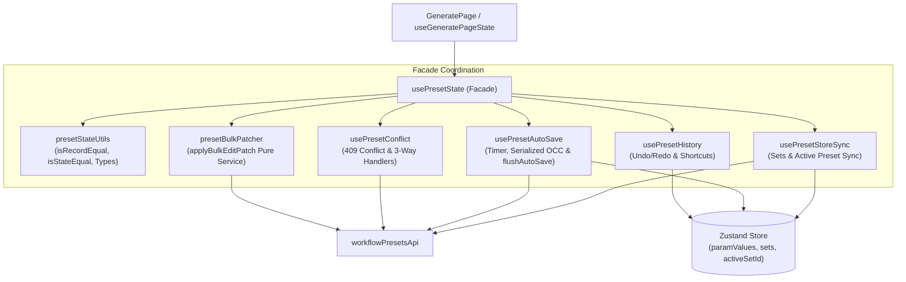

# REQ-284: usePresetState の責務分離と一括パッチサービスの純粋関数化 詳細設計書

## 1. 背景と課題

現在、`frontend/src/pages/GeneratePage/hooks/usePresetState.ts` は **1,380行** に達する巨大な単一カスタムフックとなっている。
このフックの中には、以下の直交する複数の関心事が同居しており、単一責任原則（SRP）が損なわれている（リファクタ計画 PBI-REF-03）。

1. **一括パラメータ更新（handleBulkEditApply）の肥大化（約320行）**:
   - `ProfileBulkEditModal` からのペイロードに応じたプロンプト検索置換、タグ削除・更新、LoRAスタック差分適用、アセットマージ等の複雑なビジネスロジックがフック内部に記述されており、単体テストが困難。
2. **Undo/Redo 履歴管理（約190行）**:
   - `sessionStorage` を用いたスナップショットの読み書き、スタック操作、グローバルキーボードショートカット（Ctrl+Z / Ctrl+Y）リスナーがフック内部で直接処理されている。
3. **OCC（楽観的排他制御）409 競合検知・解決（約80行）**:
   - TanStack Query mutation の 409 Conflict エラーハンドリング、競合モーダル用データ管理、および「サーバー優先」「ローカル上書き」「新規保存」の 3-way 解決ロジックが混在。
4. **オートセーブタイマー＆シリアライゼーション（約120行）**:
   - 1秒デバウンスタイマー管理、先行リクエスト完了待機キュー（`pendingSaveArgsRef`）、および即時確定処理（`flushAutoSave`）が同居。
5. **サーバーPresetとZustand Storeの多段同期（約250行）**:
   - サーバー最新値とインメモリの `sets` 配列、およびアクティブタブの状態同期と汚染防止（REQ-278/REQ-281）の制御ロジック。

これにより、状態遷移の追跡が極めて困難であり、わずかな改修でも予期せぬ副作用を生むリスクが高い。

---

## 2. アーキテクチャと分離設計

### 2-1. モジュール構成方針

本設計では、`usePresetState.ts` を薄い**統合ファサードフック（約150行）**へと集約し、直交する関心事を独立したサブフックおよび純粋サービスへと分離する。

```
frontend/src/pages/GeneratePage/
├─ hooks/
│  ├─ usePresetState.ts       # 統合ファサードフック（約150行に集約）
│  ├─ presetStateUtils.ts     # 共通型定義・等価判定ユーティリティ（約80行）
│  ├─ usePresetHistory.ts     # Undo/Redoスタック & Ctrl+Z/Yリスナー（約120行）
│  ├─ usePresetConflict.ts    # 409競合検知 & 3-way解決ハンドラ（約100行）
│  ├─ usePresetAutoSave.ts    # オートセーブタイマー & 同期的フラッシュ（約140行）
│  └─ usePresetStoreSync.ts   # サーバーPresetとZustand(sets)同期（約180行）
└─ services/
   ├─ presetBulkPatcher.ts    # handleBulkEditApplyの純粋関数サービス（約240行）
   └─ __tests__/
      └─ presetBulkPatcher.test.ts # 包括的単体テスト（約250行）
```

### 2-2. 責務マッピング



### 2-3. 各サブモジュールのインターフェース詳細

#### 1. `presetStateUtils.ts`
- **型定義**: `HistoryState`, `PresetConflictData`, `UpdatePresetArgs`
- **純粋関数**:
  - `isRecordEqual(a?: Record<string, any>, b?: Record<string, any>): boolean`
  - `normalizeTimestamp(ts?: string | null): number`
  - `isTimestampDifferent(a?: string | null, b?: string | null, thresholdMs?: number): boolean`
  - `isStateEqual(a: HistoryState, b: HistoryState): boolean`

#### 2. `services/presetBulkPatcher.ts`
- **純粋計算関数**:
  ```typescript
  export interface BulkEditPatchResult {
    updatedPreset: WorkflowPreset
    newParamValues: Record<string, string>
    newAppliedAssets: Record<string, any[]>
    newBatchSize: number
  }

  export function computePresetPatch(
    preset: WorkflowPreset,
    payload: BulkEditPayload
  ): {
    param_values: Record<string, string>
    applied_assets: Record<string, any[]>
    batch_size: number
  }
  ```
- 副作用（API通信やStore更新）を一切持たず、入力 Preset と `BulkEditPayload` から新しい `param_values`, `applied_assets`, `batch_size` を決定論的に算出する。
- `handleBulkEditApply` は、この関数を用いて差分計算を行い、API更新およびStore反映を実行するオーケストレーションのみを担当する。

#### 3. `hooks/usePresetHistory.ts`
- 引数:
  ```typescript
  interface UsePresetHistoryProps {
    activeSetId: string | number | null
    currentState: HistoryState
    onApplyState: (state: HistoryState) => void
  }
  ```
- 戻り値: `{ undo, redo, canUndo, canRedo, pushHistory }`
- 機能:
  - `sessionStorage` への Undo/Redo 履歴保存（`prompt-surgeon-history-${id}`）
  - Ctrl+Z / Ctrl+Y のキーボードショートカット監視（INPUT/TEXTAREA フォーカス時は除外）

#### 4. `hooks/usePresetConflict.ts`
- 引数:
  ```typescript
  interface UsePresetConflictProps {
    selectedWorkflowId: number | null
    presets: WorkflowPreset[] | undefined
    presetsRef: React.MutableRefObject<WorkflowPreset[] | undefined>
    onLoadPreset: (preset: WorkflowPreset) => void
    onUpdatePreset: (args: UpdatePresetArgs) => void
    onCreatePreset: (name: string, draft: HistoryState) => void
  }
  ```
- 戻り値:
  - `{ conflictData, setConflictData, handleResolveConflictUseServer, handleResolveConflictOverwrite, handleResolveConflictSaveAsNew }`

#### 5. `hooks/usePresetAutoSave.ts`
- 引数:
  ```typescript
  interface UsePresetAutoSaveProps {
    selectedWorkflowId: number | null
    activeSetId: string | number | null
    currentState: HistoryState
    presets: WorkflowPreset[] | undefined
    presetsRef: React.MutableRefObject<WorkflowPreset[] | undefined>
    isInitialSyncRef: React.MutableRefObject<boolean>
    lastSavedStateRef: React.MutableRefObject<Record<string | number, HistoryState>>
    presetUpdatedAtRef: React.MutableRefObject<Record<number, string>>
    updatePresetMutation: UseMutationResult<any, any, UpdatePresetArgs, any>
    onRecordHistory?: (id: string | number, state: HistoryState) => void
  }
  ```
- 戻り値: `{ flushAutoSave, autoSaveTimerRef }`
- 重要制約:
  - 【AC-2 遵守】`flushAutoSave` 内で `currentStore.updateActiveSet?.(currentState)` を即座に同期的実行し、ジョブ投入前のインメモリ反映を保証。
  - 【AC-3 遵守】`isStateEqual` による差分比較（`isRecordEqual`）を保持し、プロパティ順序の相違による誤オートセーブを遮断。

#### 6. `hooks/usePresetStoreSync.ts`
- 引数:
  ```typescript
  interface UsePresetStoreSyncProps {
    selectedWorkflowId: number | null
    workflow: Workflow | undefined
    presets: WorkflowPreset[] | undefined
    presetsRef: React.MutableRefObject<WorkflowPreset[] | undefined>
    isInitialSyncRef: React.MutableRefObject<boolean>
    lastSavedStateRef: React.MutableRefObject<Record<string | number, HistoryState>>
    presetUpdatedAtRef: React.MutableRefObject<Record<number, string>>
    setConflictData: (data: PresetConflictData | null) => void
    handleLoadPreset: (preset: WorkflowPreset) => void
    handleCreatePreset: (name: string) => void
  }
  ```
- 戻り値: `{ handleSelectPresetTab }`
- 機能:
  - 初回ロード時の sets 初期化およびアクティブセット解決（`loadPresetData`）
  - 5秒ポーリング時の SSoT 同期（ローカル dirty 状態のタブは上書きせず保持）
  - `handleSelectPresetTab` によるタブ切替・衝突検知

---

## 3. 下位互換性と外部インターフェースの維持

`usePresetState` の戻り値シグネチャは、既存の `useGeneratePageState.ts` および `usePresetState.test.ts` と 100% 互換を保つ。
また、`isRecordEqual`, `normalizeTimestamp`, `isTimestampDifferent` などの関数も `usePresetState.ts` から再エクスポートすることで、外部テストコードのインポートを一切破壊しない。
