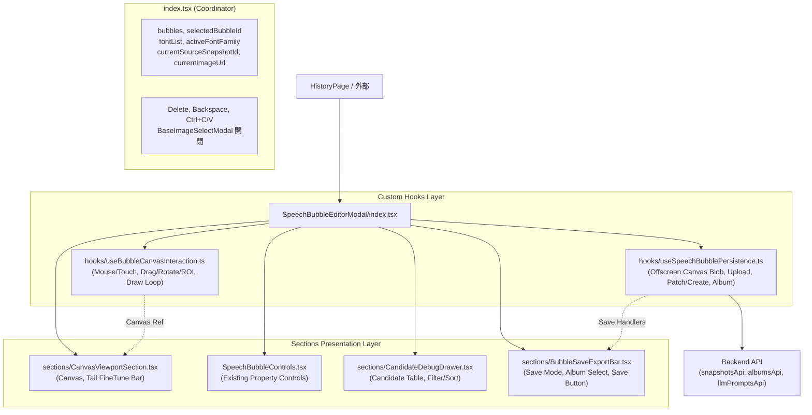

# REQ-285: SpeechBubbleEditorModal の Canvas 操作分離とセクション部品化 詳細設計書

## 1. 背景と課題

現在、`frontend/src/components/SpeechBubbleEditorModal.tsx` は **1,553行** に達し、プロジェクト内で最大規模の単一コンポーネントとなっている（リファクタ計画 PBI-REF-04 該当）。
このファイル内には、以下の直交する複数の責務・状態管理が同一ファイル内に同居しており、単一責任原則（SRP）が損なわれている。

1. **Canvas マウス/タッチ座標計算と対話的インタラクション（約450行）**:
   - 矩形回転角（`getLocalBubblePoint`）、四隅リサイズハンドル判定、しっぽ先端ドラッグと境界クランプ（`clampTailApexOutsideBubble`）、しっぽ接点角度計算（`baseAngle1`, `baseAngle2`）、ROI矩形ドラッグ描画。
   - ダブルクリックによる吹き出し追加、タッチイベント（`onTouchStart`, `onTouchMove`, `onTouchEnd`）のエミュレーション。
   - `requestAnimationFrame` または `useEffect` による Canvas 再描画ループ。
2. **画像合成・スナップショット永続化・API通信（約120行）**:
   - オフスクリーン Canvas（1:1スケール）での吹き出しレイヤー再描画と Blob 変換。
   - `snapshotsApi.upload`、`snapshotsApi.create` / `snapshotsApi.patch` によるスナップショット保存。
   - `albumsApi.create` / `albumsApi.addItems` によるアルバム登録および `localStorage` への前回アルバム記録。
   - `llmPromptsApi.speechDraft` によるセリフドラフト生成。
3. **自動検出候補デバッグ表示・フィルタ・ソートテーブル（約130行）**:
   - `snapshotsApi.detectBubbleDebug` で取得した候補（`candidates`）の判定（`pass`/`all`/`fail`）フィルタ。
   - 面積（`area_desc`/`area_asc`）、輝度（`brightness_desc`）、ROI中心距離（`distance_center`）、IDによるソート。
   - テーブル行ホバー連動ハイライトおよび候補適用ボタン。
4. **Canvas ビューポートおよびしっぽ微調整バー（約180行）**:
   - しっぽ微調整モード（`isFineTuning`）のチェックボックスおよび接点初期化ボタン。
   - Canvas 本体コンテナとレスポンシブなサイズ管理。
5. **下部保存・エクスポートバー（約110行）**:
   - 新規保存 / 上書き保存モード切り替えトグル。
   - アルバム選択ドロップダウンおよび新規アルバム名入力フォーム。
   - キャンセル / 保存実行ボタン。

これにより、可読性が著しく低下し、Canvas 操作の改修や保存処理の機能追加の際に副作用が生じやすく、AI コンテキストウィンドウに対しても過大な負荷を与えている。

---

## 2. 設計方針とアーキテクチャ

### 2-1. コンポーネントおよびディレクトリ構成方針

関心の分離（Separation of Concerns）を徹底し、ディレクトリ構成を以下のように階層化・部品化する。

```
frontend/src/components/SpeechBubbleEditorModal/
├─ index.tsx                         # モーダル枠・全体State統合・ショートカット管理（約150行）
├─ types.ts                          # 型定義（MobileTab, SpeechBubbleEditorProps等）（約60行）
├─ hooks/
│  ├─ useBubbleCanvasInteraction.ts  # Canvasマウス/タッチ操作・ROI描画・ドラッグ状態（約280行）
│  └─ useSpeechBubblePersistence.ts  # 画像合成・下書きAPI呼出・保存・アルバム登録（約140行）
└─ sections/
   ├─ CanvasViewportSection.tsx      # Canvas本体・しっぽ微調整ツールバー（約140行）
   ├─ BubbleSaveExportBar.tsx        # 下部保存バー（保存モード・アルバム選択）（約110行）
   └─ CandidateDebugDrawer.tsx       # 自動検出候補のフィルタ・ソートテーブル（約130行）
```

また、既存のインポート元（`HistoryPage.tsx` および `SpeechBubbleEditorModal.test.tsx`）の後方互換性を完全に維持するため、`frontend/src/components/SpeechBubbleEditorModal.tsx` を thin re-export forwarder として維持する。

```typescript
// frontend/src/components/SpeechBubbleEditorModal.tsx
export * from './SpeechBubbleEditorModal/index'
```

### 2-2. アーキテクチャとデータフロー



---

## 3. 各モジュールのインターフェース詳細

### 3-1. `types.ts`

```typescript
import type { SnapshotSummary, BubbleCandidate } from '../api/types'
import type { SpeechBubble } from '../types/speechBubble'

export type MobileTab = 'preview' | 'controls'

export interface SpeechBubbleEditorModalProps {
  snapshot: SnapshotSummary
  initialAlbumId?: number
  onClose: () => void
  onSaved: () => void
}

export type DraggingType = 'bubble' | 'tail' | 'tail-base-1' | 'tail-base-2' | 'resize' | 'rotate'
export type ResizeHandle = 'nw' | 'ne' | 'se' | 'sw'

export interface DraggingState {
  bubbleId: string
  type: DraggingType
  handle?: ResizeHandle
  startX: number
  startY: number
  initialBubble: SpeechBubble
}

export interface ROI {
  x: number
  y: number
  w: number
  h: number
}

export type FilterStatus = 'all' | 'pass' | 'fail'
export type SortBy = 'area_desc' | 'area_asc' | 'brightness_desc' | 'distance_center' | 'id'
```

### 3-2. `hooks/useBubbleCanvasInteraction.ts`

Canvas に対するすべてのポインタ入力（マウス・タッチ）、幾何座標変換、再描画ループをカプセル化する。

- **引数（Options）**:
  - `canvasRef`: React.RefObject<HTMLCanvasElement | null>
  - `miniCanvasRef`: React.RefObject<HTMLCanvasElement | null>
  - `imageObj`: HTMLImageElement | null
  - `bubbles`: SpeechBubble[]
  - `setBubbles`: React.Dispatch<React.SetStateAction<SpeechBubble[]>>
  - `selectedBubbleId`: string | null
  - `setSelectedBubbleId`: (id: string | null) => void
  - `activeFontFamily`: string
  - `scaleX`: number
  - `scaleY`: number
  - `showDebugPanel`: boolean
  - `candidates`: BubbleCandidate[]
  - `hoveredCandidate`: BubbleCandidate | null
  - `activeMobileTab`: MobileTab
  - `createBubbleFromStyle`: (params: any) => SpeechBubble
  - `setLastUsedStyle`: React.Dispatch<React.SetStateAction<any>>
  - `onROISubmit`: (roi: ROI) => Promise<void>
- **戻り値**:
  - `cursorStyle`: string
  - `currentROI`: ROI | null
  - `isDrawingROI`: boolean
  - `lastUsedROI`: ROI | null
  - `setLastUsedROI`: (roi: ROI | null) => void
  - `miniPreviewHeight`: number
  - `handleResizeStart`: (clientY: number) => void
  - `handleMouseDown`: (e: React.MouseEvent<HTMLCanvasElement>) => void
  - `handleMouseMove`: (e: React.MouseEvent<HTMLCanvasElement>) => void
  - `handleMouseUp`: () => Promise<void>
  - `handleDoubleClick`: (e: React.MouseEvent<HTMLCanvasElement>) => void
  - `handleTouchStart`: (e: React.TouchEvent<HTMLCanvasElement>) => void
  - `handleTouchMove`: (e: React.TouchEvent<HTMLCanvasElement>) => void
  - `handleTouchEnd`: () => void

### 3-3. `hooks/useSpeechBubblePersistence.ts`

画像合成・Blob生成・スナップショットAPI・アルバムAPI・下書きAPIとのやり取りをカプセル化する。

- **引数（Options）**:
  - `snapshot`: SnapshotSummary
  - `currentSourceSnapshotId`: number
  - `currentImageUrl`: string
  - `imageObj`: HTMLImageElement | null
  - `bubbles`: SpeechBubble[]
  - `setBubbles`: React.Dispatch<React.SetStateAction<SpeechBubble[]>>
  - `selectedBubbleId`: string | null
  - `activeFontFamily`: string
  - `initialAlbumId`?: number
  - `albums`: any[]
  - `onClose`: () => void
  - `onSaved`: () => void
- **戻り値**:
  - `isSaving`: boolean
  - `isDrafting`: boolean
  - `setIsDrafting`: React.Dispatch<React.SetStateAction<boolean>>
  - `saveMode`: 'new' | 'overwrite'
  - `setSaveMode`: (mode: 'new' | 'overwrite') => void
  - `targetAlbumId`: number | 'new' | ''
  - `setTargetAlbumId`: (id: number | 'new' | '') => void
  - `newAlbumName`: string
  - `setNewAlbumName`: (name: string) => void
  - `handleGenerateDraft`: () => Promise<void>
  - `handleSave`: () => Promise<void>

### 3-4. `sections/CanvasViewportSection.tsx`

Canvas 本体と、しっぽ微調整ツールバーの描画を担当するプレゼンテーションコンポーネント。

- **Props**:
  - `canvasRef`: React.RefObject<HTMLCanvasElement | null>
  - `imageObj`: HTMLImageElement | null
  - `canvasDimensions`: { width: number; height: number }
  - `cursorStyle`: string
  - `selectedBubble`: SpeechBubble | null
  - `setBubbles`: React.Dispatch<React.SetStateAction<SpeechBubble[]>>
  - `activeMobileTab`: MobileTab
  - `onMouseDown`: (e: React.MouseEvent<HTMLCanvasElement>) => void
  - `onMouseMove`: (e: React.MouseEvent<HTMLCanvasElement>) => void
  - `onMouseUp`: () => void
  - `onTouchStart`: (e: React.TouchEvent<HTMLCanvasElement>) => void
  - `onTouchMove`: (e: React.TouchEvent<HTMLCanvasElement>) => void
  - `onTouchEnd`: () => void
  - `onDoubleClick`: (e: React.MouseEvent<HTMLCanvasElement>) => void

### 3-5. `sections/BubbleSaveExportBar.tsx`

モーダル最下部の保存・アルバム登録バーを担当するプレゼンテーションコンポーネント。

- **Props**:
  - `saveMode`: 'new' | 'overwrite'
  - `setSaveMode`: (mode: 'new' | 'overwrite') => void
  - `targetAlbumId`: number | 'new' | ''
  - `setTargetAlbumId`: (id: number | 'new' | '') => void
  - `newAlbumName`: string
  - `setNewAlbumName`: (name: string) => void
  - `albums`: any[]
  - `isSaving`: boolean
  - `bubblesCount`: number
  - `onClose`: () => void
  - `onSave`: () => Promise<void>

### 3-6. `sections/CandidateDebugDrawer.tsx`

自動検出候補のフィルタリング、ソート、テーブル一覧表示、適用ボタンを担当するコンポーネント。

- **Props**:
  - `showDebugPanel`: boolean
  - `setShowDebugPanel`: (show: boolean) => void
  - `filterStatus`: FilterStatus
  - `setFilterStatus`: (status: FilterStatus) => void
  - `sortBy`: SortBy
  - `setSortBy`: (sortBy: SortBy) => void
  - `candidates`: BubbleCandidate[]
  - `isDebugLoading`: boolean
  - `hoveredCandidate`: BubbleCandidate | null
  - `setHoveredCandidate`: (c: BubbleCandidate | null) => void
  - `hasLastUsedROI`: boolean
  - `onApplyCandidate`: (c: BubbleCandidate) => void
  - `onFetchCandidates`: () => void

### 3-7. `index.tsx`

モーダル全体のオーケストレーション、フォント動的ロード、キーボードショートカット（Delete, Backspace, Ctrl+C / Ctrl+V）、初期スナップショット読み込みおよび自動検出を担当する。行数は約150行に収まる。

---

## 4. 互換性と移行計画

- **インポートパスの後方互換性**:
  `frontend/src/components/SpeechBubbleEditorModal.tsx` を re-export forwarder とすることで、呼び出し側である `HistoryPage.tsx` や既存のテストファイル `SpeechBubbleEditorModal.test.tsx` のパス変更は一切不要。
- **機能等価性**:
  マウス操作（ドラッグ、回転、4隅リサイズ、しっぽ先端、接点微調整）、タッチ操作、ROI検出、セリフ下書き、オフスクリーン合成保存、アルバム追加、ショートカットキー、デバッグ候補表示の振る舞いを 100% 維持する。

---

## 5. テスト・検証方針

- **Gate 1 (Typecheck)**:
  `cd frontend && npm run typecheck`（tsc -b --noEmit）がエラー0件であること。
- **Gate 2 (Unit & Regression Tests)**:
  `cd frontend && npx vitest run src/components/__tests__/SpeechBubbleEditorModal.test.tsx` が全24件以上 PASS すること。
- **Gate 3 (Red Team & Boundary Verification)**:
  `docs/design/REQ-285-test-plan.md` に基づき、ROI 10px 未満の無効操作、画像未ロード時の保存抑止、アルバム新規作成時の空名バリデーション、異常系エラーハンドリングを網羅検証する。

