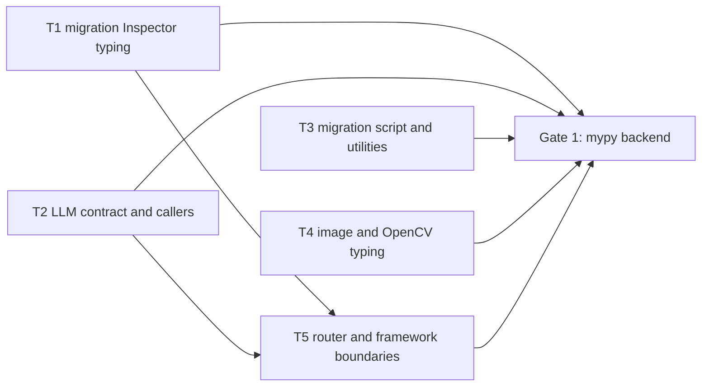

# REQ-295 詳細設計: backend mypy 型不整合の解消

## 1. 問題と設計目標

2026-09-29 の再現で `mypy backend` は131 source filesを確認し、19ファイル101 errorsで終了した。型検査設定や対象を緩めず、既存の実行時契約を型へ正確に表し、バックエンド全体の型検査を通す。今回確認した診断の一覧と根拠は `docs/incident_report.md` および本設計に記録する。

これは純粋な実装不具合の修正であり、外部APIや永続化形式の変更は意図しない。エラー抑制、`Any` の拡大、ファイル除外、型検査設定緩和を解決策にしない。曖昧な外部境界では、実際の値とライブラリ契約を確認してから型を定める。

## 2. 診断群と設計方針

| Task | 所有ファイル | 診断群 | 方針 |
|---|---|---|---|
| T1 | `app/migrations/steps.py` | `any` を型として使ったvalid-type/attr-defined連鎖 | `typing.Any` の一括置換で終えず、SQLAlchemy Inspector等、実際の引数契約が表現できる範囲で具体型を優先。動的な境界だけ `Any` を使う。 |
| T2 | `services/llm_request.py`, `services/llm_service.py`, `services/speech_parser.py`, `services/translation_service.py`, `routers/llm_prompts.py` | call_llm のnullable引数契約、画像引数、ローカル変数型、translation戻り値 | 設定値が未設定/nullableとなる実行経路を確認し、`str | None` 等を宣言するか、送信直前に妥当な既定値/検証を行う。`None` の画像は既存のテキスト専用要求へ整合させる。ローカル変数は用途別に注釈。戻り値の値域を実際の構築内容と合わせる。 |
| T3 | `scripts/migrate_from_v1.py`, `services/llm_parser.py`, `utils/windows_loop_defense.py` | nullable ID代入、空リスト推論、非公開Windows loop属性 | ID欠損時の移行意味を維持してnullableで伝播するか、既存規則に基づき安全に分岐する。空コレクションには要素型を記す。動的loop patch属性は狭い `setattr`/Protocol 等で表現し、既存の実行条件を変えない。 |
| T4 | `services/bubble_detector.py`, `services/snapshot_service.py`, `routers/comfy.py`, `routers/snapshots.py` | OpenCV `inRange`引数型、PIL Image/ImageFile変数再利用、TagSet/Lora変数混用 | OpenCV stubの要求と実行時ndarray契約を合わせる。画像変換前後の値を別名で保持し、同一ローカル変数へ異なる型を代入しない。検索対象の異なるORM値も別変数で扱う。 |
| T5 | `routers/tag_sets.py`, `routers/loras.py`, `routers/presets.py`, `routers/translate.py`, `routers/speech_batch.py`, `app/main.py` | SQLAlchemy update mapping、ORM/入力schema変数混用、nullable日時、kwargs展開、lambda推論、Starlette override | SQLAlchemyの公開入力型または狭い境界型を使う。schemaとORM modelは別変数。DB日時のnull可能性を読み込み時に検査するか応答schemaへ正しく反映。`TranslateMeta`を明示構築し、lambda引数を注釈。StaticFiles overrideは親と同じかより広い引数型・可変mapping型を守る。 |

## 3. Task依存 DAG

T1/T2/T3/T4は所有範囲が独立しているため並行可能。T5はT1/T2の修正を統合した後に開始し、ルーターのエラー再診断を使って残存境界を解消する。全カード後にGate 1と全バックエンドテストを行う。既存REQ-294は同じbackend領域を編集しているため、着手前に作業ツリーの差分を確認し、REQ-294の変更を含むファイルは差分を保持したまま適用する。競合時はファイル所有者間で調整し、他者の変更を戻さない。

## 4. 受入条件と禁止事項

- PBI記載のAC-1〜AC-5をすべて満たす。
- 各Taskは担当エラー群に関係する既存テスト、必要な局所テスト、`mypy backend`を確認する。最終カードでバックエンド全テストを実行する。
- 型エラー解消のためだけの実行時挙動変更をしない。挙動変更が避けられない場合は、根拠と互換性を設計レビューへ差し戻す。
- `# type: ignore`追加、mypy設定の緩和、ソース対象削減を使わない。外部stub不備が実証された場合のみ、根拠を明記した一行レベルignoreをレビュー対象とする。
- 完了時に `mypy backend` の checked file数とゼロエラー出力を記録する。

## 5. レビュー事項

設計確認では、とくに (1) nullableなLLM設定をどの層で保持/検証するか、(2) v1移行中に欠損するIDの既存意味、(3) migrationのInspector境界型、(4) Starlette overrideの正確な署名、(5) OpenCV ndarray型注釈のランタイム非影響を確認する。REQ-295の修正開始はユーザーの依頼により承認済み。
