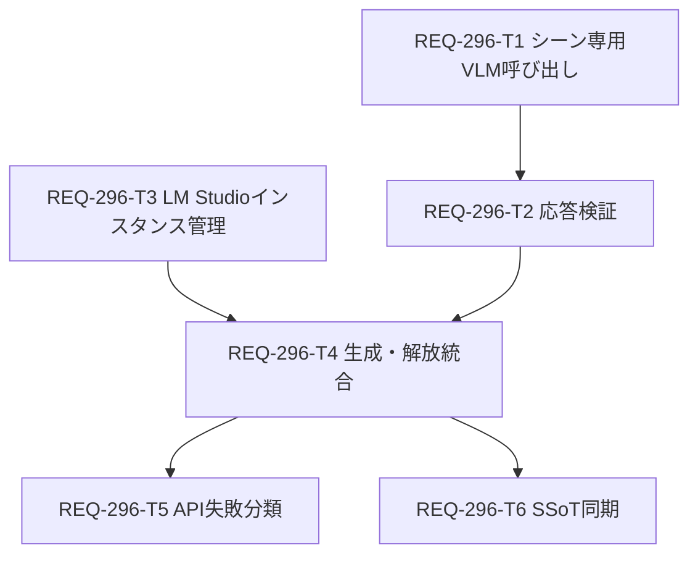

# Implementation Plan: REQ-296

## Goal

セリフ一括生成でVLMからスキーマに合うJSONを受け、安全に検証する。推論後は対象LM Studioインスタンスを識別して解放し、実ロード状態を確認する。REQ-291の2系統参照・UIフローは維持する。

## SSoT and API Audit

`doc_mapper.py docs/specs docs/backlog/pbi/active/REQ-296.md` はマッピングなし。実際の旧契約は `docs/design/REQ-291.md`、`docs/design/REQ-291-test-plan.md`、`docs/specs/SPEC_HISTORY.md` にある。前2文書は設計段階で更新した。SPEC_HISTORYはT6で同期する。指定の `docs/system/openapi.yaml` は存在せず、`backend/openapi.json` はscene-draft系が未収録。T6で生成手順を確認する。

公式LM Studio資料は [Structured Output](https://lmstudio.ai/docs/developer/openai-compat/structured-output)、[Models List](https://lmstudio.ai/docs/developer/rest/list)、[Load](https://lmstudio.ai/docs/developer/rest/load)、[Unload](https://lmstudio.ai/docs/developer/rest/unload)。

## Mermaid DAG

根はT1とT3。最大深度は4層。T5とT6はT4後に並行可能。

## Atomicity Audit

| ID | 対象ファイル | 依存 | 変更目安 | 検証 |
|---|---|---|---:|---|
| T1 | `speech_draft_service.py`, `test_speech_draft.py` | なし | ≤180行 | `pytest tests/test_speech_draft.py` |
| T2 | `speech_scene_service.py`, `test_speech_scene_service.py` | T1 | ≤180行 | `pytest tests/test_speech_scene_service.py` |
| T3 | 新規 `lm_studio_lifecycle.py`, `test_lm_studio_lifecycle.py` | なし | ≤250行 | `pytest tests/test_lm_studio_lifecycle.py` |
| T4 | `speech_scene_service.py`, `test_speech_scene_service.py` | T2,T3 | ≤220行 | `pytest tests/test_speech_scene_service.py` |
| T5 | `speech_scene.py`, `test_speech_scene_router.py` | T4 | ≤140行 | `pytest tests/test_speech_scene_router.py` |
| T6 | `SPEC_HISTORY.md`, 必要なら生成 `backend/openapi.json` | T4 | ≤80行 | 旧契約検索とOpenAPIエンドポイント確認 |

全カードは3ファイル以下、変更300行以下。T2とT4は同一サービス・テストを順序付けし、T1/T3の並行作業は別ファイルに限定する。

## Verification Plan

局所テストは `docs/design/REQ-296-test-plan.md` のAC対応を実行する。Gate 1は `mypy backend`、Gate 2はバックエンド全Pytest、Gate 3はLM Studioの実機でコールドスタートからの正常生成と `GET /api/v1/models` のインスタンス消失、および非JSON/アンロード偽200の異常系を確認する。2026-09-30のGate 3で、旧T3実装のloadが共通4秒タイムアウトによりReadTimeoutとなり、LM Studioでは後からロードが完了することを確認した。T3の修復と再検証が必要。

## Trade-offs and Risks

1. シーン専用VLM関数を追加するため呼び出しコードが一部重複する。既存画像説明APIの契約と回帰範囲を守ることを優先する。
2. 構造化出力を拒否するモデルは制御エラーとし、非構造化の再試行は行わない。対象モデルでの実機適合をGate 3で確認する。
3. 公式資料はOpenAI互換Chat Completionsの別名 `instance_id` 指定を明記していないが、対象LM Studioで `req296-instance-probe` を用いた短いテキスト推論はHTTP 200、`finish_reason=stop`、`OK` で成功し、解放後のロード済みインスタンスは0件だった。取得IDを推論と解放の両方へ渡す契約は局所的に実現可能。本番の画像とJSON Schemaの組合せはGate 3で確認し、拒否時はモデルキーへ戻さず制御失敗にする。
4. 推論前にモデルを明示ロードしてIDを取得するため初回の待ち時間が増える可能性がある。既存ロード済み1件は再利用する。コールドスタートではloadに独立した最大120秒の応答・全体期限を与える。ReadTimeout後にロードが完了する場合があるため、load再送はせずモデル一覧から最大20秒・1秒間隔で単一IDを回収する。IDが回収できなければ解放成功とは報告できず、外部利用者による同時ロードとの識別もできない。
5. 同一プロセス内のモデル単位排他はバックエンド自身の競合を防ぐ。複数ワーカーや外部LM Studio利用者との調整はできず、共有運用では解放が他利用者へ影響しうる。
6. HTTP 200を成功扱いする既存テストは改訂が必要。アンロード応答IDと再照会の両方を要求するため、一時的な照会失敗は保守的に失敗となる。
7. `vram_unloaded=true` は対象VLMインスタンスの消失を意味する。GPU全体の空き容量は別の計測対象であり、このフラグから推定しない。
8. 作業ツリーには他REQの未コミット変更が多数ある。各Engineerはカード記載の所有ファイルだけを編集し、既存変更を保持する。
9. `implementation_plan.md` にはREQ-294の未コミット作業があるため、REQ-296の計画はこの専用文書に置いた。レビュー時も両計画を混同しない。
10. 既存REQ-294計画には `mypy backend` で変更外の既存型エラーが残ると記録されている。Gate 1の差分起因判定には、その既存基準との差分を確認する。現時点でREQ-296実装の型検査は未実行。

## Review Gate

本PBIの設計レビュー承認は維持する。今回の追記はGate 3で判明したT3実装詳細の修復であり、承認済み修正ループ内でT3担当へ渡す。修復後はコールドスタートのGate 3を再実行し、結果をREQ-296専用walkthroughへ記録する。
