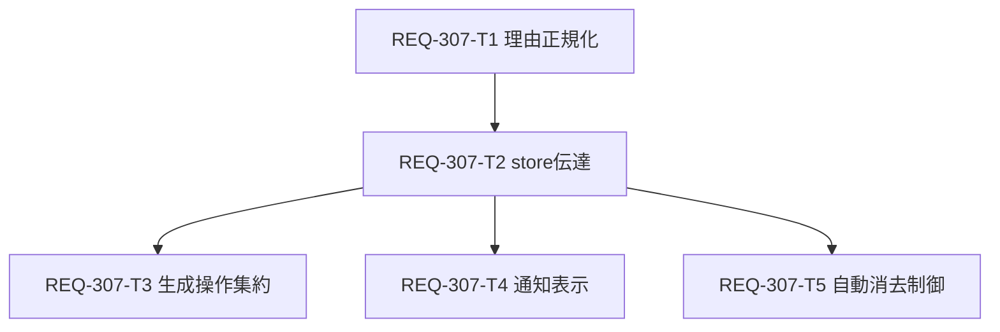

# Implementation Plan - REQ-307: 生成キュー投入失敗理由の表示

生成時のキュー投入失敗について、失敗対象と取得できた理由を同じトーストに表示する。理由がない場合は「理由を特定できませんでした」を表示する。複数件は一つの通知に各件を対応づけ、長文も全文を読めるようにする。

## Proposed Changes

- `frontend/src/utils/queueSubmissionFailure.ts`: ComfyUI のエラー応答、proxy の `detail`、通信タイムアウトを正規化。説明のない番号・空値は理由不明へフォールバック。
- `frontend/src/store/types.ts` と `jobQueueSlice.ts`: `queuePrompt` から失敗理由を呼び出し元へ渡すコールバックと、生成失敗通知の `persistent` 属性を追加。中断は通知しない。
- `frontend/src/pages/GeneratePage/hooks/useGenerateAction.ts`: 単一・複数セットの各投入で対象と理由を固定し、失敗を一つのトーストへ集約。REQ-141 の failed 状態を維持。
- `frontend/src/pages/GeneratePage/sections/GenerateModalsOverlay.tsx`: 折返し・改行・縦スクロールで全文を表示。
- Desktop/Mobile の Layout: 生成失敗通知を自動消去せず、他の通知は 5 秒のまま。
- `docs/specs/SPEC_GENERATE.md`: 実装後に失敗理由・応答未確認時の表現・通知寿命を同期。

## Task Dependency & Parallelization

各 Task Card は `docs/backlog/task/active/REQ-307-T*.md` に作成済み。最大深度は 3 層。T3/T4/T5 は並行可能。各タスクの変更対象は 2〜3 ファイル、見積り 300 行以内。既存の通知型を変更する T2 が下流の共通依存となる。

## Verification Plan

`docs/design/REQ-307-test-plan.md` に AC-1〜5、REQ-141 回帰、単一・複数セット、空理由、部分成功、全件失敗、タイムアウト、中断、長文・多数件の検証を定義した。各カード記載の局所 Vitest と `cd frontend; npm run typecheck` を実装後に実行する。最後に PC/モバイルで長文全文と 5 秒後の残存を確認する。

## Trade-offs and Risks

- 既存の `Promise<string | null>` を維持しコールバックで理由を渡すため、既存呼び出しの破壊を抑える。`null` だけ返る経路には必ず理由不明のフォールバックを使う。
- 多数失敗は一つのスクロール可能な通知に全件を表示する。件数制限は対象と理由の対応を失わせるため設けない。
- 失敗通知は手動で閉じる。5 秒の自動消去では長文の読了を保証できない。
- 通信タイムアウトは投入結果が確認できないため、断定的な失敗表現や自動再投入を避ける。
- 別操作のトーストが通知を上書きした場合の履歴保持は本要件に含めない。

## Review Gate

設計書、テスト計画、Task Card の内容を人間が確認した後に実装へ進める。`dev-design` の root 外参照禁止により `${GLOBAL_SCRIPTS}` の設計補助スクリプトと追加ローカルモデル BA 監査は実行していない。既存の BA 監査記録を参照し、条件付き承認の論点を設計で解決した。
