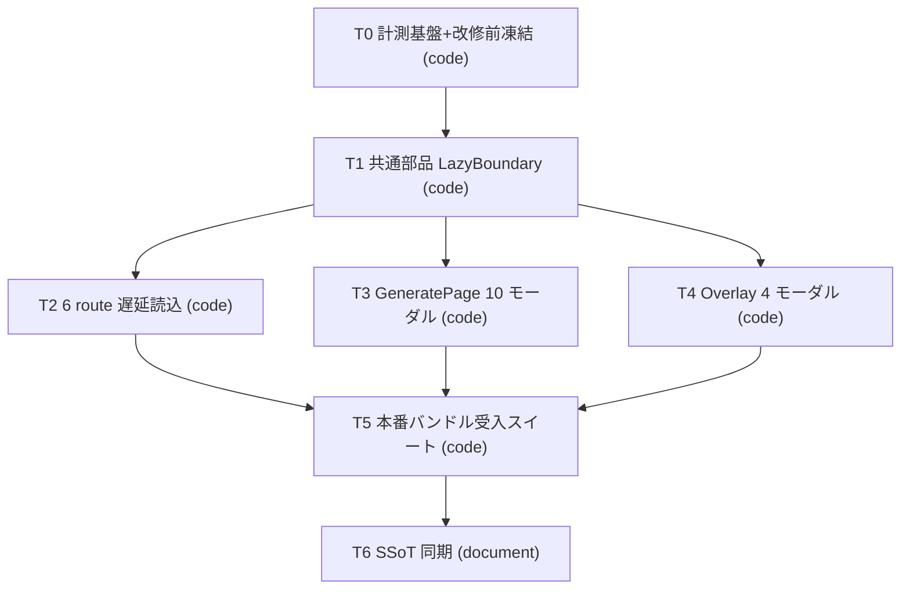

# Implementation Plan: REQ-309

## Summary

6 route（Generate / Studio / LoRAs / Tags / History / Settings）を `React.lazy` + `Suspense` で画面単位に分割し、Generate 本体と overlay の 14 モーダルを「開くまで取得しない」境界へ移す。現行の Data Router（`createAppRoutes()`）、`SettingsDraftBoundary` の離脱保護、IndexedDB persister による query cache 復元、`RethrowRouteError` → `GlobalErrorBoundary` の例外境界はすべて維持する。警告閾値は変更せず、実チャンクの縮小で AC-2 を満たす。AC-1 は凍結した改修前候補との同一条件・空 cache・同一判定点での JS 転送量比較で判定する。

設計の詳細: `docs/design/REQ-309.md`、テスト計画: `docs/design/REQ-309-test-plan.md`。旧 T0〜T5 は全面書き換え、T6 を追加（削除したカードなし）。

## DAG

最大深さ 5（T0→T1→T2→T5→T6）は警告域。真の依存: T0 は「アプリ source 変更前の凍結」、T1 は T2〜T4 が import する部品、T5 は 3 つの実装の結果が必要、T6 は検証済み事実の同期。T2/T3/T4 は所有ファイルが互いに素で並列可。T6 の文面は構造のみに依存するが、実装事実と矛盾させないため T5 後に置く（手戻りの可能性は低いが、T5 が設計改訂を要求した場合は T6 を保留）。

## Task Cards

| ID | change_kind | 所有ファイル | depends_on |
|---|---|---|---|
| T0 | code | `frontend/playwright.config.ts`(1行)、new `playwright.prod.config.ts`、new `frontend/e2e/prod/support/{serveDist.mjs,apiStub.ts,jsTransfer.ts,srcManifest.mjs}`、new `frontend/e2e/prod/initialJsTransfer.spec.ts` | なし |
| T1 | code | new `frontend/src/components/common/LazyBoundary.tsx`、new `.../common/__tests__/LazyBoundary.test.tsx` | T0 |
| T2 | code | `frontend/src/App.tsx`、`src/__tests__/App.routing.test.tsx`、`src/__tests__/App.persistence.test.tsx` | T0, T1 |
| T3 | code | `frontend/src/pages/GeneratePage.tsx`、`src/pages/GeneratePage/__tests__/GeneratePage.test.tsx` | T0, T1 |
| T4 | code | `frontend/src/pages/GeneratePage/sections/GenerateModalsOverlay.tsx`、`.../sections/__tests__/GenerateModalsOverlay.test.tsx` | T0, T1 |
| T5 | code | new `frontend/e2e/prod/{buildGuard,initialJsCompare,routes,generate,failure}.spec.ts`、new `e2e/prod/support/chunkReport.mjs` | T2, T3, T4 |
| T6 | document | `docs/specs/{SPEC_SUMMARY,SPEC_GENERATE,SPEC_SETTINGS,SPEC_COMMON,SPEC_TEST_ARCHITECTURE}.md` | T5 |

## Trade-off Disclosure

- 初期 `/` が「entry → Generate chunk」の 2 段直列取得になる（取得量は減るが往復は増える）。編集可能までの時間も併記する。
- 他 route の初回遷移は chunk 取得待ちが入る。中間表示（既存画面維持か fallback か）は React Router v7 の transition 挙動に依存し、固定仕様にしない。
- モーダルの `latch` 方式は「初回オープン後は mount 維持」で現行の状態寿命を保つ代わりに、初回オープン後のメモリは解放されない。
- Desktop/Mobile レイアウトの遅延分割、他画面の idle prefetch、Data Router の `Route lazy`、`manualChunks` のみの分割、自動 reload は採用しない（理由は設計書の代替案表）。
- 検証基盤（`playwright.prod.config.ts`、`e2e/prod`）を新設するため high リスク。V1 baseline のみ、フルスイート fallback を常時適用。

## 検証プロファイルと承認

V1 Baseline。最終 candidate を凍結後、独立 tester が Gate 1（typecheck, ui invariants, test naming）→ Gate 2（`scripts/run_full_suite.py` フル discovery）→ Gate 3（`scripts/run_e2e.py` ＋ 本番バンドル専用 `playwright.prod.config.ts`）を fresh 実行。AC は証拠が揃うまで PASS としない。V2 opt-in は宣言しない。人間の設計レビューで本計画と全カードが承認されるまで実装は開始しない。

## 設計監査の結果（2026-10-27〜28、ローカル LM Studio `qwen/qwen3.5-9b`、`--context-length 32768`、reasoning none）

- 全対象を 1 つの AuditPackage で監査する実行は、モデルの出力形式不正（`output invalid after retry`）で複数回 `AUDIT_ERROR`（INCONCLUSIVE）となった。代替として、対象ごとの AuditPackage（`pbi` + 3 つの SSoT 抜粋）で個別に監査した。成果物と生ログは `docs/logs/REQ-309-design/audit/`（git 管理外）。
- カード（現行バイト列）: T1・T2・T5・T6 は `PASS_NO_FINDINGS`。T0・T3・T4 は `ISSUES_FOUND`（いずれも「単一カード内で他 AC の記述がない」という MISSING_COVERAGE で、AC 分担は設計書・テスト計画の対応表と各カードの「AC 分担」行で明示済み。disposition 案: not-applicable）。
- 設計書・テスト計画は全体実行では完了せず、節ごとの監査（複製節ファイルを対象、同一バイトを確認済み）を補助証拠とした。未完了（INCONCLUSIVE）: 設計書の「Seam Map」節（6 回再試行しても出力不正）・「Status and Boundary」節（`INSUFFICIENT_CONTEXT`）、テスト計画の「Risk and Profile」節（`INSUFFICIENT_CONTEXT`）。その他の節は `PASS_NO_FINDINGS` または節単位の網羅性指摘のみ（disposition 案: not-applicable）。
- 実質的な設計欠陥の指摘はなかった。ただし監査は SDD 全体の PASS ではなく、設計ゲートを単独で閉じない。各 finding の disposition には人間の設計レビューでの明示回答が必要。
- 各実行の直後にモデルをアンロードし、最終確認でも LM Studio がロード済みモデルなしを報告した（GPU メモリ全体の解放は主張しない）。
