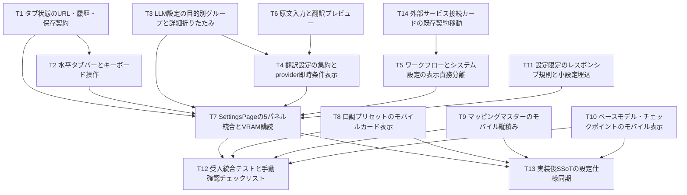

# REQ-314 BA Audit: part 1/8
Audit this fragment of the complete design, test plan and all 14 Task Cards. Other definitions may be in other fragments; do not invent defects solely from missing context. State findings with exact artifact/task references. User browser tests are manual and excluded from autonomous checks; typecheck/Vitest remain. D1: six real prompt keys versus AC-4 seven is an explicit unresolved human decision. D2: Backend/LM Studio URL editing versus unchanged API/schema is an explicit unresolved human decision. Do not require approval bypass or falsely mark those AC passed. Review acceptance coverage, logical contradictions, ownership/dependencies, testability and actual new gaps.

## Artifact: docs\design\REQ-314.md
---
title: REQ-314 設定ページ水平5タブ設計
status: awaiting-human-design-review
tags: [REQ-314, settings, frontend, information-design, interaction, visual]
related_paths:
  - docs/backlog/pbi/active/REQ-314.md
  - docs/design/REQ-314-test-plan.md
  - frontend/src/pages/SettingsPage.tsx
  - frontend/src/pages/SettingsPage/
  - docs/specs/SPEC_SETTINGS.md
  - docs/specs/SPEC_COMMON.md
  - docs/specs/SPEC_SUMMARY.md
---

# REQ-314: 設定ページ水平5タブ設計

## Review Status
2026-10-04 設計案。実装未開始。D1/D2の人間決定と設計承認が必要。
AC-4/AC-7は原文を維持し、下記推奨案を承認されるまで条件付き・未達として扱う。
BA監査・GPU解放記録は `REQ-314-ba-audit.md` に記載する。

## Feasibility / Boundary
技術的実現性: 5タブ、履歴、ARIA、目的別再配置、翻訳条件表示、モバイルは既存frontend内で実現可能。
ただし「7種類」と「Backend/LM Studio URL編集」は現行契約と矛盾し、全AC無条件達成の判定は不可。

Workspace/Git root: `C:/Users/audih/ws/comfy-create-helper2`。
対象: `frontend/src/pages/SettingsPage.tsx`、同名サブディレクトリ、既存共通row。
Backend/systemは証拠読取のみ。Git root mismatchなし。外部へのファイル編集は禁止。
GLOBAL_SCRIPTSはcontextのGLOBAL_ROOTから `C:/Users/audih/.gemini/antigravity/scripts` に展開済み。共有scriptはプロトコルで明示された実行に限る。
root AGENTS.mdは存在せず、ユーザー提供Context Resolution Directiveと `.agents/context.md` を適用。
dirtyな既存REQ-316 plan・Task Card等を保持し、REQ-314は独立節/独立docとして追加。
この役割では実装sourceを編集しない。

## SSoT Impact Analysis
`doc_mapper.py docs/specs docs/backlog/pbi/active/REQ-314.md` はマッピングなし。
`doc_mapper.py docs/specs frontend/src/pages/SettingsPage` は `SPEC_SETTINGS.md` を特定。
対象を限定してSPEC_SETTINGS、同書参照先SPEC_COMMON/SPEC_SUMMARYを読んだ。

| 正本 | 変更影響 | 同期時点 |
|---|---|---|
| SPEC_SETTINGS | accordion→5tab、分類、詳細初期閉、storage/hash、components | T13（実装証拠で同期） |
| SPEC_COMMON | 設定局所768pxとAppShell lgの併存、tab ARIA参照 | T13限定追記 |
| SPEC_SUMMARY | 設定構造/コンポーネント参照 | T13限定追記 |
| 参考HTML `tmp/settings_layout_redesign_spec (2).html` | 分類/UX根拠。件数・URL編集矛盾を記録 | 参考を改変しない |
| REQ-314 PBI | D1/D2人間決定が要件変更となる場合 | コーディネーターが承認記録を管理 |

API/schemaを変更せず既存client関数を使用するためOpenAPI変更抽出は省略。
`docs/system/openapi.yaml` は存在せず、存在するAPI型・client・backend定義とSPEC_SETTINGS表で既存契約を照合した。
client/provider正規値は `google_cloud`（SPEC_SETTINGSの旧google表記は同期時に修正）。Backend実際疎通は `/health`。

## Required Human Decisions

### D1: 7種類と実在6種類
PBI AC-4と参考HTMLは「7種」と記載するが、両方の列挙も6種。
現行 `LlmSettingsSection.tsx:PROMPT_LABELS` の生成/診断キー:
```text
audit_interference
audit_interference_anima
audit_vocabulary
audit_physical
scene_generate
scene_generate_anima
```
推奨: 6種類に件数訂正し、既存機能・キーを維持する要件改訂を人間が承認。
代案: 7件目の目的/内部key/初期prompt/利用経路を人間が定義して別設計へ追加。
架空editor、重複prompt、翻訳/セリフprompt混入で7に合わせることはしない。
決定前AC-4はBLOCKED。件数以外の配置/折りたたみ検証は実施可能。

### D2: 接続URL編集とAPI/schema不変
証拠:
- `frontend/src/api/client.ts`: `const BASE_URL='/api'`。Backendは同一origin相対通信。
- `configApi.get(): Promise<{comfy_url:string}>` のみ。Backend/LM Studio URL取得・変更関数なし。
- `backend/app/main.py:/api/config` はcomfy_urlを返し、書込endpointなし。
- `backend/app/config.py:Settings`: env_file=".env"、`llm_base_url="http://localhost:1234/v1"`。
  `backend/app/services/llm_request.py` は `settings.llm_base_url` でmodels/chat/completionsを呼ぶ。
- `WorkflowConnectionSection`: Backendは `window.location.origin+'/health'`、Comfyは `resolveComfyUrl(comfyUrl)`。
- Comfyのみ既存 `ConnectionActions.setComfyUrl(url:string):void` があり、既存LS_KEYS.COMFY_URLへ保存しWebSocketを再初期化。
  `comfyUrl:string|null` はZustand storeに保持。GenerateのSettingsPopoverがこの契約を使う。

推奨（要承認）: 本PBIをUI再編に限定し、Comfy既存URL編集・Backend URL読取表示/疎通・LM Studio backend経由モデルAPI疎通/環境設定案内にする。
LM Studio実際URLは取得できず、既定1234を現在設定値として表示しない。
Backend/LM Studio URL編集は別PBIで取得/保存/再接続のAPI契約から設計する。
代案: 本PBIのAPI/schema不変制約を撤回しURL設定機能を追加する。その場合本設計とTask Cardの再設計が必要。
決定前AC-7はBLOCKED、推奨案のみ実装して元のURL編集ACをPASSとしない。

## Framework / Architecture
React 18 + React Router BrowserRouter + TanStack Query + Zustand + Tailwindを使用。
既存SettingsPageは9個のcomponentに分割済み。LLMとWorkflowConnectionに異なる目的の設定が混在している。
一括ファイル移動は既存大量ロジックの変更増大を招くため、既存componentに目的groupを加え、同じquery/mutationを再利用する。
未来の別PBIでさらに小さいcardへ抽出できるが今回は保存仕様の移行を伴わない。

| Tab ID | desktop名 | mobile名 | 基本カード/詳細 |
|---|---|---|---|
| workflows | ① ワークフロー・モデル | ① モデル | workflow CRUD/差分/復元/presets、BaseModel/checkpoint、MappingMaster |
| prompt | ② プロンプト支援 | ② 呪文 | main LLM、診断/生成詳細（既存6 promptと2 params） |
| dialogue | ③ セリフ支援 | ③ セリフ | tone presets、VLM/LLM＋bubble、3役割prompt/params詳細 |
| translation | ④ 翻訳 | ④ 翻訳 | provider/auth/debounce、入力プレビュー、LLM専用詳細 |
| system | ⑤ システム・一般 | ⑤ システム | 接続、VRAM guard/live meter、thumbnail preview＋長押し2種 |

長いアクセシブル名をaria-labelに常時使用。mobile短縮labelはPBIが参考HTMLより優先。
workflows/base/mapping/tone/guardなど基本cardは常時展開、低頻度詳細prompt/dialogueだけ既定閉。
workflowsのpreset展開は既存状態を維持する。

## State / Navigation Contract
新型:
```ts
type SettingsTabId = 'workflows' | 'prompt' | 'dialogue' | 'translation' | 'system'
type DetailsState = { prompt: boolean; dialogue: boolean }
type LlmSettingsGroup = 'prompt' | 'dialogue' | 'translation'
```
新LS_KEYS:
- SETTINGS_ACTIVE_TAB = `prompt-surgeon-settings-active-tab`
- SETTINGS_DETAILS_EXPANDED_V2 = `prompt-surgeon-settings-details-expanded-v2`

初回は有効hash > 有効storage > workflows。無効/空hashは選択結果でreplaceし正規化。
初回以降の戻る/進むはlocationが優先。空/無効hashはworkflowsへreplace。
ユーザー選択はnavigateでpush。現在tab再選択は履歴を増やさない。pathname/searchを保持。
URL→state→storageの単方向反映で無限更新を防ぐ。storageは読書き例外を捕捉する。
詳細v2はobject/boolean検証し、不正JSONはfalse/false。旧13区分storageは書換・削除せず残す。

全5tabpanelを固定keyで常時mountし、非選択にhiddenを付ける。CSSでhidden display:noneを保証。
選択tab/panelはaria-selected/controls/labelledby対応、roving tabIndex。
ArrowLeft/Rightは循環して自動選択、Home/Endは先頭/末尾、通常Tabは選択tabからpanelへ。
focusしたtabを最小scrollIntoView。hover/scrollだけでは選択を変えない。
非選択のDOMはhiddenでアクセシビリティtree/Tab順から消え、未保存draftは維持。
modalは親panel配下（新body portalを作らない）。非選択panelのmodalが全画面を覆わない。
ページを離れた後の未保存draft永続化は新設しない。

## LLM Purpose Ownership
| group | model key/契約 | prompt key | params key |
|---|---|---|---|
| prompt | llmPromptsApi.getCurrentModel/updateCurrentModel | D1の6既存key | llm_params_audit, llm_params_scene_generate |
| dialogue | speech_draft_vlm_model, speech_draft_llm_model | speech_draft_vlm_prompt, speech_draft_llm_prompt, speech_rewrite_system_prompt | llm_params_speech_draft |
| translation | translation_model（空ならmain継承） | translation_ja_to_en, translation_en_to_ja | llm_params_translation |

speech labelsは①画像シチュエーション読み取りプロンプト(VLM)、②セリフ自動生成プロンプト(LLM)、③キャラクター口調変換プロンプト(LLM)。
PARAM_FIELDS/DEFAULT_PARAMS・PUT `{content}` を維持。groupを横断するkey再分類・JSON形式変更なし。
prompt allowlist外のmodel/api/debounce/bubble/unknown recordをprompt editorへ表示しない。
LlmSettingsSectionへ `modelFooter?: React.ReactNode` を追加しdialogueモデルcard内にBubbleDetectionSection embeddedを収める。
prompt/dialogueの詳細はそれぞれ単一card内にprompt＋paramsを置き、同じ詳細stateを使う。
React QueryのqueryKeyを維持し、同じprompt編集editorは分類上1回だけ描画。
group instanceのquery購読は重複するが同一Query cacheを共有する。不要workflow queryはsystem instanceでdisabled。
refetchによる未保存provider/credential/LLM paramsの上書きをdirty単位で防止。完了順序はserver再読込と保存成功値を照合。

## Translation Reactive Flow
基本設定provider draftが唯一の条件表示正本。provider==='llm'だけLLM詳細を表示。
他providerでも詳細componentのstateをhidden内で保持する。モデル/プロンプト/params入力をリロード不要で切替。
認証key/urlはgoogle_cloud/deeplのみ表示。FuguMTはproviderのみの従来更新契約を守る。
translation_debounceは既存key/300..2000ms/step50/既定500を移動。
既存疎通テスト・統計・cache clear・google_free移行を保持。

新TranslationPreviewCardのprops:
```ts
{ provider: 'google_cloud'|'deepl'|'llm'|'fugumt'; enabled: boolean; debounceMs: number }
```
原文・方向変更後debounceで既存translateApi.translatePromptを呼び、訳文/errorを即時更新。明示buttonでも実行可能。
API credentialsは保存値を使用するため基本設定未保存/保存中/失敗ではpreviewを無効化し保存案内。
input/direction/provider/enabled変更でrequest sequenceを無効化し古いresponseは表示しない。
空白は送信しない。new AbortSignal契約を追加せずUI競合を処理する。
保存provider切替時の旧訳文はクリアし、保存成功とrefetch同期後に新入力から再実行。
LLM用モデル/prompt/paramsは既存各保存buttonで保存して利用する。

## System / VRAM
SettingsPageで `useSystemStats():void` を1回呼び、settings滞在中のWS購読を確保。
VramGuardSectionの既存store読取とsettingsApi.getVram/updateVramを維持。
Page Visibility復帰・unmount cleanupは既存hookが担う。複数購読を新設しない。
WS値更新で実時間メーターを更新。未取得/切断は既存fallbackと未取得表示を使い0GBを偽造しない。
Comfy設定は新ServiceConnectionCardが既存storeを用いる（D2承認に条件付け）。
現行ConnectionStatusはHTTP statusを確認せずfetch解決だけで成功にするため、T14の新card内でresponse.okと3秒timeoutを確認する。既存共通componentを全面改修しない。
thumbnailはlivepreview維持、長押し既存2キー/0.1..5秒を同じ表示目的に集約。

## Responsive Contract
設定局所breakpointは768px。AppShellはlg(1024px)でdesktop navへ切替する現行契約を維持。
768..1023pxはタブはdesktop等幅・AppShellはbottom navという組合せも検証する。
mobile tabbarだけ横scroll＋snap。ページbody/tableによる不必要な横overflowは許容しない。
両端fadeはdecorative pointer-events:none。selected/focused tabがfadeで操作不能にならない。
settings scroll領域のmobile bottom padding=calc(6rem + env(safe-area-inset-bottom))（pb-24相当）。
AppShell既存main paddingとは別にページ最下段操作の余白を確保する。既存global navを改変しない。
SettingsResponsive.cssは `.req314-settings` 配下に限定、他画面のSettingsComponents rowへCSSを波及させない。

主要表はSpeechTone、BaseModel/checkpoint、MappingMasterを対象。単一table DOMをblock/cardへ変換しdata-labelとsemantic見出しを保つ。
mobileで指示prompt/checkpoint名は全文wrap。DND/selection/ref/transform/IDを維持する。
workflow/presetは既存list型をwrapし44px対象にする。modal/formもviewport内でscrollできる。
全可視button/入力/select/textarea/drag/checkbox hitboxは両辺44px以上を実測。checkboxは44pxlabelも含めクリック可能にする。
range見た目のthumbだけで判定せずinput操作領域を測定。hidden/file hidden inputは可視操作対象から除外。

## Task Decomposition / DAG
- T1: タブ状態のURL・履歴・保存契約（3 files / 270変更行以下、依存:なし）
- T2: 水平タブバーとキーボード操作（2 files / 245変更行以下、依存:T1）
- T3: LLM設定の目的別グループと詳細折りたたみ（2 files / 290変更行以下、依存:なし）
- T4: 翻訳設定の集約とprovider即時条件表示（2 files / 280変更行以下、依存:T3,T6）
- T5: ワークフローとシステム設定の表示責務分離（2 files / 210変更行以下、依存:T14）
- T6: 原文入力と翻訳プレビュー（2 files / 255変更行以下、依存:なし）
- T7: SettingsPageの5パネル統合とVRAM購読（2 files / 290変更行以下、依存:T1,T2,T3,T4,T5,T11）
- T8: 口調プリセットのモバイルカード表示（2 files / 230変更行以下、依存:なし）
- T9: マッピングマスターのモバイル縦積み（3 files / 275変更行以下、依存:なし）
- T10: ベースモデル・チェックポイントのモバイル表示（2 files / 245変更行以下、依存:なし）
- T11: 設定限定のレスポンシブ規則と小設定埋込（3 files / 190変更行以下、依存:なし）
- T12: 受入統合テストと手動確認チェックリスト（2 files / 290変更行以下、依存:T7,T8,T9,T10）
- T13: 実装後SSoTの設定仕様同期（3 files / 140変更行以下、依存:T7,T8,T9,T10）
- T14: 外部サービス接続カードの既存契約移動（2 files / 255変更行以下、依存:なし）

最大4層: T3/T6→T4→T7→T12/T13、およびT14→T5→T7→T12/T13。
T1→T2は型import依存。T8/T9/T10は独立。T11 CSSはT7で読込。
全taskは所有3files以下・追加削除合計300行以下の見積り、全カード本文300行以下。
T3/T4など同一sourceを共有する実行は依存順。異なるtaskがSettingsComponentsを編集する場合も所有者を確認する。
変更行超過が見えたら実装前にarchitectへ内部task分割を戻す。

## Upstream / Downstream Dependencies
